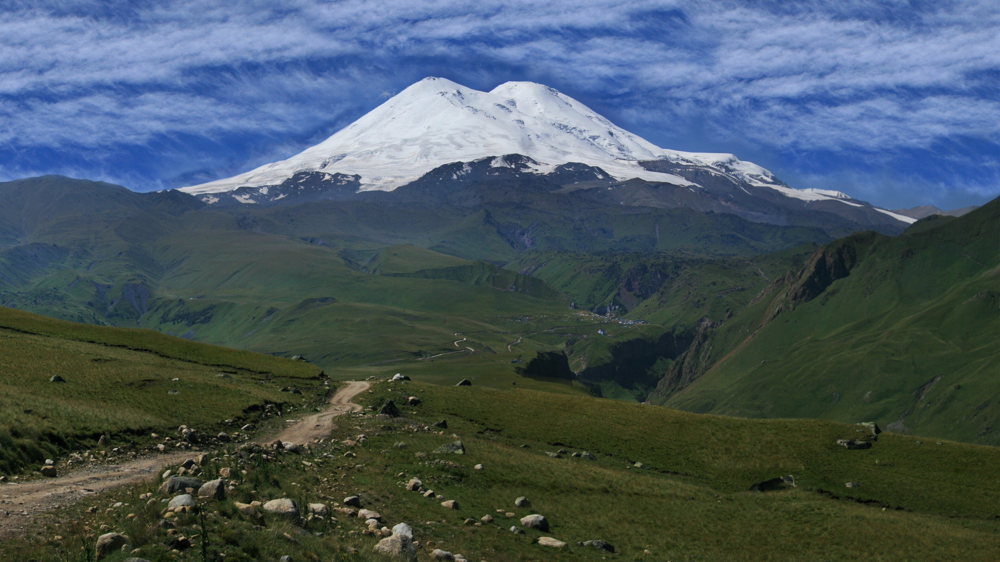
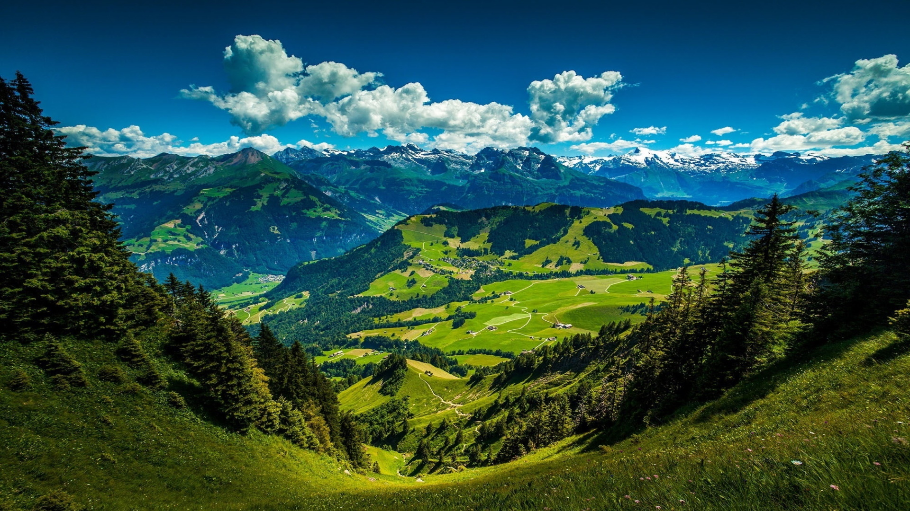
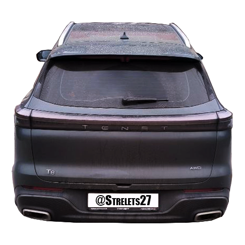

# css\base.css

```css
/* === ШРИФТЫ === */
@font-face {
  font-family: 'MyComicSans';
  src: url('../fonts/ComicSansMS.ttf') format('truetype');
  font-weight: normal; font-style: normal; font-display: swap;
}
@font-face {
  font-family: 'FlipClock';
  src: url('../fonts/digital-7.ttf') format('truetype');
  font-weight: normal; font-style: normal;
}

/* === ПЕРЕМЕННЫЕ === */
:root {
  --base-font-size: 18px;
  --widget-size: 13.5rem;
  --widget-gap: 0.375rem;
  --dashboard-bottom: 0.5rem;
  --dashboard-left-right: 1rem;
  --bg-widget: rgba(29, 27, 32, 0.7);
  --bg-slot: rgba(42, 39, 48, 0.7);
  --color-text: #D9D9D9;
  --widget-opacity: 1;
  --clock-digit-size: calc(var(--widget-size) * 0.2);
  --oem-panel: linear-gradient(180deg, rgba(20, 23, 30, 0.82), rgba(12, 14, 20, 0.66));
  --oem-panel-light: linear-gradient(180deg, rgba(251, 252, 255, 0.78), rgba(234, 238, 246, 0.56));
  --oem-border: rgba(255,255,255,0.075);
  --oem-border-soft: rgba(255,255,255,0.05);
  --oem-inner: rgba(255,255,255,0.05);
  --oem-shadow: 0 18px 38px rgba(0,0,0,0.22);
  --oem-shadow-soft: 0 10px 22px rgba(0,0,0,0.16);
}

@media (min-width: 1600px) { :root { --base-font-size: 20px; } }
@media (max-width: 1200px) { :root { --base-font-size: 15px; } }
@media (max-width: 900px)  { :root { --base-font-size: 13px; } }

/* [FIX] Адаптация под узкие вертикальные экраны */
@media (orientation: portrait) and (max-width: 1024px) {
  :root {
    --base-font-size: 12px;
    --widget-size: 11.5rem;
    --dashboard-bottom: 0.25rem;
    --dashboard-left-right: 0.5rem;
    --widget-gap: 0.25rem;
  }
}

html { font-size: var(--base-font-size); }

html, body {
  overflow-x: hidden;
  overscroll-behavior-x: none;
  width: 100%;
  max-width: 100vw;
}

*:not(.flip-digit):not(.flip-separator):not(.preloader-text) {
  font-family: -apple-system, BlinkMacSystemFont, 'SF Pro Display', 'Segoe UI', Roboto, Inter, Arial, sans-serif !important;
}

* {
  box-sizing: border-box;
  margin: 0;
  padding: 0;
}

body {
  background: #0F0D13;
  background-size: cover;
  background-position: center;
  color: var(--color-text);
  transition: background-color 0.8s ease;
  height: 100vh;
  position: relative;
  background-image:
    radial-gradient(circle at 50% 100%, rgba(122, 146, 190, 0.08), transparent 34%),
    radial-gradient(circle at 50% -10%, rgba(255,255,255,0.05), transparent 28%),
    linear-gradient(180deg, rgba(0,0,0,0.12), rgba(0,0,0,0.18));
}
body.light {
  background: #DFE0E9;
  color: #1C1119;
  background-image:
    radial-gradient(circle at 50% 100%, rgba(114, 140, 188, 0.08), transparent 34%),
    radial-gradient(circle at 50% -10%, rgba(255,255,255,0.55), transparent 32%),
    linear-gradient(180deg, rgba(255,255,255,0.18), rgba(219,225,236,0.18));
}

/* [NEW] Затемнение экрана (Оверлей) */
body.screen-dimmed::after {
  content: '';
  position: fixed;
  inset: 0;
  background: rgba(0, 0, 0, 0.6); /* Настройка интенсивности затемнения */
  pointer-events: none; /* Чтобы клики проходили сквозь оверлей */
  z-index: 9999; /* Поверх виджетов, но под настройками (у модалок z-index 10000+) */
  transition: opacity 0.8s ease;
}

body::before {
  content: '';
  position: fixed;
  top: 0;
  left: 0;
  width: 100%;
  height: 100%;
  background: black;
  opacity: 0;
  pointer-events: none;
  transition: opacity 3.12s ease;
  z-index: 5;
}

.global-loader {
  position: fixed;
  top: 0; left: 0; right: 0; bottom: 0;
  background: rgba(0,0,0,0.4);
  backdrop-filter: blur(4px);
  display: flex;
  align-items: center;
  justify-content: center;
  z-index: 9999;
}
.global-loader.hidden { display: none; }
.spinner {
  width: 3rem;
  height: 3rem;
  border: 0.3rem solid rgba(255,255,255,0.3);
  border-top-color: white;
  border-radius: 50%;
  animation: spin 0.8s linear infinite;
}
@keyframes spin { to { transform: rotate(360deg); } }

/* === ИНДИКАТОР СЕТИ === */
#btnNetwork {
  position: absolute;
  top: 0.55rem;
  right: 0.6rem;
  width: 1.35rem;
  height: 1.35rem;
  display: flex;
  align-items: center;
  justify-content: center;
  background: transparent;
  border: none;
  box-shadow: none;
  backdrop-filter: none;
  z-index: 6;
  cursor: pointer;
  padding: 0;
  margin: 0;
  transition: transform 0.2s ease;
  -webkit-tap-highlight-color: transparent;
  pointer-events: auto;
}
#btnNetwork:hover { transform: scale(1.06); }
#btnNetwork:active { transform: scale(0.94); }
#btnNetwork .network-svg {
  width: 100%;
  height: 100%;
  display: block;
  filter: drop-shadow(0 1px 2px rgba(0,0,0,0.25));
}
body.light #btnNetwork .network-svg {
  filter: drop-shadow(0 1px 1px rgba(0,0,0,0.1));
}
body.widgets-hidden #btnNetwork {
  opacity: 0;
  pointer-events: none;
}
#btnNetwork.network-hidden {
  display: none !important;
}

/* === ОСНОВНАЯ ПАНЕЛЬ === */
.dashboard {
  position: absolute;
  bottom: var(--dashboard-bottom);
  left: var(--dashboard-left-right);
  right: var(--dashboard-left-right);
  
  display: flex;
  align-items: stretch;
  gap: var(--widget-gap);
  
  z-index: 10;
  transition: all 0.5s;
  
  /* Разрешаем горизонтальный скролл, если виджеты не влезают */
  overflow-x: auto;
  overflow-y: hidden;
  scrollbar-width: none;
  -ms-overflow-style: none;
  -webkit-overflow-scrolling: touch;
  
  padding-bottom: 0.5rem;
  margin-bottom: -0.5rem;
  flex-wrap: nowrap;
}

.dashboard::-webkit-scrollbar {
  display: none;
}

/* [FIX] Плеер тянется, остальные виджеты фиксированы */
.dashboard > .widget_player {
  flex: 1 1 0%; /* Плеер занимает всё свободное место */
  min-width: 150px;
}

.dashboard > .widget,
.dashboard > .widget-wrapper,
.dashboard > .right-buttons {
  flex-shrink: 0; /* Остальные виджеты не сжимаются */
}

.dashboard > .right-buttons {
  margin-left: auto; /* Прижимаем кнопки вправо, если плеер скрыт */
}

.system-fab__halo {
  position: absolute;
  inset: 0.34rem;
  border-radius: inherit;
  background: radial-gradient(circle at 50% 26%, rgba(194, 214, 255, 0.18), rgba(255,255,255,0.03) 48%, transparent 76%);
  pointer-events: none;
}

.widget_player__btn,
.app_slot,
.climate_slot,
.climate-off-all,
.close-btn,
.drawer-close {
  position: relative;
  overflow: hidden;
  transform-origin: center center;
  will-change: transform, box-shadow, filter;
  -webkit-tap-highlight-color: transparent;
}

.diag-overlay {
  position: fixed;
  top: 0;
  left: 0;
  right: 0;
  bottom: 0;
  padding: 0.6rem;
  padding-top: 2.4rem;
  background: rgba(0, 0, 0, 0.9);
  color: #d8ff45;
  font-family: 'SF Mono', 'Monaco', monospace !important;
  font-size: 0.62rem;
  line-height: 1.35;
  white-space: pre-wrap;
  word-break: break-all;
  overflow-y: auto;
  z-index: 999999;
  display: none;
  cursor: default;
}
.diag-overlay.visible { display: block; }

.diag-close {
  position: fixed;
  top: 0.4rem;
  right: 0.6rem;
  width: 2rem;
  height: 2rem;
  border: none;
  border-radius: 0.5rem;
  background: rgba(255, 255, 255, 0.08);
  color: #d8ff45;
  font-size: 1rem;
  cursor: pointer;
  z-index: 1000000;
}

/* === ЗАПРЕТ ВЫДЕЛЕНИЯ ТЕКСТА И ВЫЗОВА КОНТЕКСТНОГО МЕНЮ === */
.dashboard,
.dashboard *,
.widget,
.widget *,
.widget_buttons,
.widget_buttons *,
.widget_player__btn,
.widget_player__btn *,
.app_slot,
.app_slot *,
.climate_slot,
.climate_slot *,
#btnNetwork,
#btnNetwork *,
#btnClose,
#btnClose *,
#btnSettings,
#btnSettings *,
#btnWallpaper,
#btnWallpaper *,
#openSidebar,
#openSidebar *,
.brand-footer,
.brand-footer *,
.close-btn,
.close-btn *,
.drawer-close,
.drawer-close *,
.picker-item,
.picker-item * {
  -webkit-touch-callout: none !important;
  -webkit-user-select: none !important;
  user-select: none !important;
  -webkit-tap-highlight-color: transparent !important;
}

body {
  -webkit-touch-callout: none;
}

body *:not(input):not(textarea):not(select):not(.settings-text-input) {
  -webkit-user-select: none;
  user-select: none;
  -webkit-touch-callout: none;
}
```

# css\climate-temp.css

```css
/* ============================================
   Регулировка температуры климата свайпом
   ============================================ */

.climate-temp-zone {
  position: fixed;
  top: 0;
  height: calc(100vh - var(--widget-size) - var(--dashboard-bottom) - var(--widget-gap) - 0.75rem);
  width: 5cm;
  z-index: 5;
  display: flex;
  align-items: center;
  justify-content: center;
  touch-action: pan-x;
  user-select: none;
  -webkit-user-select: none;
  -webkit-tap-highlight-color: transparent;
  transition: opacity 0.3s ease, background 0.2s ease;
  pointer-events: auto;
  padding: 0;
  box-sizing: border-box;
}

.climate-temp-zone--driver {
  left: 0;
  padding-left: 1.5rem;
  padding-right: 0;
}
.climate-temp-zone--passenger {
  right: 0;
  padding-right: 3.2rem;
  padding-left: 0;
}

.climate-temp-zone--hidden { opacity: 0; pointer-events: none; }

.climate-temp-zone--active {
  background: linear-gradient(180deg, rgba(100,150,255,0.04), rgba(100,150,255,0.08) 50%, rgba(100,150,255,0.04));
}

body.widgets-hidden .climate-temp-zone,
body.off-mode .climate-temp-zone { opacity: 0; pointer-events: none; }

.climate-temp-value {
  font-size: var(--climate-temp-font-size, clamp(4rem, 10vw, 8rem));
  font-weight: 400;
  font-variant-numeric: tabular-nums;
  line-height: 1;
  color: rgba(var(--climate-temp-rgb, 255,255,255), var(--climate-temp-opacity, 0.18));
  text-shadow:
    0 0 20px rgba(var(--climate-temp-rgb, 255,255,255), calc(var(--climate-temp-opacity, 0.18) * 0.8)),
    0 0 40px rgba(var(--climate-temp-rgb, 255,255,255), calc(var(--climate-temp-opacity, 0.18) * 0.4));
  transition: color 0.4s ease, opacity 0.4s ease, text-shadow 0.4s ease;
  pointer-events: none;
  letter-spacing: -0.04em;
  font-family: 'SF Pro Display', -apple-system, BlinkMacSystemFont, sans-serif;
  text-align: center;
  width: 100%;
  white-space: nowrap;
}

.climate-temp-zone--passenger .climate-temp-value {
  transform: translateX(-1.4rem);
}

.climate-temp-degree { font-size: 0.5em; vertical-align: super; margin-left: 0.05em; font-weight: 300; opacity: 0.8; }

.climate-temp-zone--active .climate-temp-value {
  color: rgba(var(--climate-temp-rgb, 255,255,255), calc(var(--climate-temp-opacity, 0.18) * 1.5));
  text-shadow:
    0 0 30px rgba(var(--climate-temp-rgb, 255,255,255), calc(var(--climate-temp-opacity, 0.18) * 1.2)),
    0 0 60px rgba(var(--climate-temp-rgb, 255,255,255), calc(var(--climate-temp-opacity, 0.18) * 0.6));
}

.climate-temp-zone--empty .climate-temp-value { color: rgba(var(--climate-temp-rgb, 255,255,255), 0.08); }

.climate-temp-value--pulse { animation: climateTempPulse 0.4s ease; }

@keyframes climateTempPulse {
  0% { transform: scale(1); }
  40% { transform: scale(1.06); }
  100% { transform: scale(1); }
}

.climate-temp-zone--passenger .climate-temp-value--pulse {
  animation: climateTempPulseRight 0.4s ease;
}

@keyframes climateTempPulseRight {
  0% { transform: translateX(-1.4rem) scale(1); }
  40% { transform: translateX(-1.4rem) scale(1.06); }
  100% { transform: translateX(-1.4rem) scale(1); }
}

body.light .climate-temp-value {
  color: rgba(var(--climate-temp-rgb, 30,40,60), calc(var(--climate-temp-opacity, 0.18) * 0.8));
  text-shadow:
    0 0 20px rgba(var(--climate-temp-rgb, 80,120,200), calc(var(--climate-temp-opacity, 0.18) * 0.6)),
    0 0 40px rgba(var(--climate-temp-rgb, 60,100,180), calc(var(--climate-temp-opacity, 0.18) * 0.3));
}

body.light .climate-temp-zone--active .climate-temp-value {
  color: rgba(var(--climate-temp-rgb, 30,40,60), calc(var(--climate-temp-opacity, 0.18) * 1.3));
  text-shadow:
    0 0 30px rgba(var(--climate-temp-rgb, 80,120,200), calc(var(--climate-temp-opacity, 0.18) * 1.2)),
    0 0 60px rgba(var(--climate-temp-rgb, 60,100,180), calc(var(--climate-temp-opacity, 0.18) * 0.6));
}

body.light .climate-temp-zone--active {
  background: linear-gradient(180deg, rgba(80,120,200,0.04), rgba(80,120,200,0.08) 50%, rgba(80,120,200,0.04));
}

/* ============================================
   КАРУСЕЛЬ ТЕМПЕРАТУРЫ (оверлей)
   ============================================ */

.climate-temp-carousel {
  position: fixed;
  inset: 0;
  z-index: 30000;
  display: flex;
  align-items: center;
  justify-content: center;
  opacity: 0;
  visibility: hidden;
  transition: opacity 0.3s ease, visibility 0.3s ease;
}

.climate-temp-carousel.visible { opacity: 1; visibility: visible; }

.climate-temp-carousel__backdrop {
  position: absolute;
  inset: 0;
  background: rgba(0,0,0,0.72);
  backdrop-filter: blur(16px);
  -webkit-backdrop-filter: blur(16px);
}

.climate-temp-carousel__panel {
  position: relative;
  width: min(88vw, 420px);
  max-height: 85vh;
  background: linear-gradient(180deg, rgba(28,33,44,0.96), rgba(16,19,26,0.94));
  border: 1px solid rgba(255,255,255,0.08);
  border-radius: 2rem;
  padding: 1.5rem 1.25rem 1.5rem;
  box-shadow: 0 30px 60px rgba(0,0,0,0.5), inset 0 1px 0 rgba(255,255,255,0.05);
  display: flex;
  flex-direction: column;
  align-items: center;
  transform: scale(0.94);
  transition: transform 0.3s cubic-bezier(0.34, 1.2, 0.64, 1);
  overflow: hidden;
}

.climate-temp-carousel.visible .climate-temp-carousel__panel { transform: scale(1); }

body.light .climate-temp-carousel__panel {
  background: linear-gradient(180deg, rgba(245,248,255,0.98), rgba(228,234,245,0.96));
  border-color: rgba(0,0,0,0.08);
  box-shadow: 0 30px 60px rgba(0,0,0,0.2), inset 0 1px 0 rgba(255,255,255,0.8);
}

.climate-temp-carousel__title {
  font-size: 0.9rem;
  font-weight: 700;
  letter-spacing: 0.06em;
  text-transform: uppercase;
  color: rgba(255,255,255,0.55);
  margin-bottom: 1rem;
  z-index: 2;
  position: relative;
}

body.light .climate-temp-carousel__title { color: rgba(40,50,70,0.6); }

.climate-temp-carousel__close {
  position: absolute;
  top: 1rem;
  right: 1rem;
  width: 2.2rem;
  height: 2.2rem;
  border-radius: 50%;
  border: 1px solid rgba(255,255,255,0.1);
  background: rgba(255,255,255,0.05);
  color: rgba(255,255,255,0.7);
  cursor: pointer;
  display: flex;
  align-items: center;
  justify-content: center;
  font-size: 0.9rem;
  transition: background 0.2s ease;
  z-index: 3;
}

.climate-temp-carousel__close:hover { background: rgba(255,255,255,0.12); }

body.light .climate-temp-carousel__close {
  border-color: rgba(0,0,0,0.08);
  background: rgba(0,0,0,0.04);
  color: rgba(40,50,70,0.7);
}

.climate-temp-carousel__highlight {
  position: absolute;
  top: 50%;
  left: 1rem;
  right: 1rem;
  height: 4.5rem;
  transform: translateY(-50%);
  border-radius: 1rem;
  background: linear-gradient(90deg, transparent, rgba(100,150,255,0.14) 20%, rgba(100,150,255,0.18) 50%, rgba(100,150,255,0.14) 80%, transparent);
  border-top: 1px solid rgba(150,190,255,0.25);
  border-bottom: 1px solid rgba(150,190,255,0.25);
  pointer-events: none;
  z-index: 1;
}

body.light .climate-temp-carousel__highlight {
  background: linear-gradient(90deg, transparent, rgba(80,120,200,0.1) 20%, rgba(80,120,200,0.15) 50%, rgba(80,120,200,0.1) 80%, transparent);
  border-top-color: rgba(80,120,200,0.2);
  border-bottom-color: rgba(80,120,200,0.2);
}

.climate-temp-carousel__wheel {
  position: relative;
  width: 100%;
  height: calc(4.5rem * 5);
  overflow: hidden;
  cursor: grab;
  touch-action: none;
  z-index: 2;
  mask-image: linear-gradient(180deg, transparent 0%, black 20%, black 80%, transparent 100%);
  -webkit-mask-image: linear-gradient(180deg, transparent 0%, black 20%, black 80%, transparent 100%);
}

.climate-temp-carousel__wheel:active { cursor: grabbing; }

.climate-temp-carousel__items {
  display: flex;
  flex-direction: column;
  align-items: center;
  will-change: transform;
}

.climate-temp-carousel__item {
  height: 4.5rem;
  display: flex;
  align-items: center;
  justify-content: center;
  font-size: 2.6rem;
  font-weight: 500;
  color: rgba(255,255,255,0.28);
  font-variant-numeric: tabular-nums;
  transition: color 0.25s ease, transform 0.25s ease, font-weight 0.25s ease;
  cursor: pointer;
  letter-spacing: -0.03em;
  font-family: 'SF Pro Display', -apple-system, BlinkMacSystemFont, sans-serif;
  flex-shrink: 0;
  width: 100%;
  text-align: center;
}

.climate-temp-carousel__item .climate-temp-degree { font-size: 0.55em; font-weight: 500; }

.climate-temp-carousel__item.active {
  color: rgba(255,255,255,0.95);
  font-size: 3.2rem;
  font-weight: 700;
  text-shadow: 0 0 24px rgba(150,190,255,0.4);
}

body.light .climate-temp-carousel__item { color: rgba(40,50,70,0.3); }

body.light .climate-temp-carousel__item.active {
  color: rgba(20,30,50,0.95);
  text-shadow: 0 0 24px rgba(80,120,200,0.35);
}

.climate-temp-carousel__sync-btn {
  display: flex;
  align-items: center;
  justify-content: center;
  gap: 0.5rem;
  width: 100%;
  max-width: 200px;
  padding: 0.7rem 1.2rem;
  margin-top: 1rem;
  border-radius: 1.2rem;
  border: 1px solid rgba(255,255,255,0.08);
  background: rgba(255,255,255,0.04);
  color: rgba(255,255,255,0.6);
  font-size: 0.85rem;
  font-weight: 500;
  cursor: pointer;
  transition: all 0.25s ease;
  z-index: 3;
  -webkit-tap-highlight-color: transparent;
}

.climate-temp-carousel__sync-btn svg { width: 1.2rem; height: 1.2rem; transition: transform 0.4s ease; }

.climate-temp-carousel__sync-btn:hover { background: rgba(255,255,255,0.08); color: rgba(255,255,255,0.8); }

.climate-temp-carousel__sync-btn.active {
  background: rgba(100,150,255,0.15);
  border-color: rgba(100,150,255,0.4);
  color: rgba(150,190,255,1);
  box-shadow: 0 0 15px rgba(100,150,255,0.15);
}

.climate-temp-carousel__sync-btn.active svg { transform: rotate(180deg); }

.climate-temp-carousel__sync-btn:active { transform: scale(0.96); }

body.light .climate-temp-carousel__sync-btn {
  background: rgba(0,0,0,0.04);
  border-color: rgba(0,0,0,0.08);
  color: rgba(40,50,70,0.6);
}

body.light .climate-temp-carousel__sync-btn.active {
  background: rgba(80,120,200,0.15);
  border-color: rgba(80,120,200,0.4);
  color: rgba(60,100,180,1);
  box-shadow: 0 0 15px rgba(80,120,200,0.15);
}

@media (max-width: 600px) {
  .climate-temp-zone { width: 4.5cm; }
  .climate-temp-zone--driver { padding-left: 1rem; }
  .climate-temp-zone--passenger { padding-right: 2.4rem; }
  .climate-temp-zone--passenger .climate-temp-value { transform: translateX(-1rem); }
  .climate-temp-zone--passenger .climate-temp-value--pulse { animation: climateTempPulseRightSm 0.4s ease; }
  @keyframes climateTempPulseRightSm {
    0% { transform: translateX(-1rem) scale(1); }
    40% { transform: translateX(-1rem) scale(1.06); }
    100% { transform: translateX(-1rem) scale(1); }
  }
  .climate-temp-carousel__panel { width: 92vw; border-radius: 1.6rem; }
}

@media (max-height: 500px) {
  .climate-temp-carousel__wheel { height: calc(3.6rem * 5); }
  .climate-temp-carousel__item { height: 3.6rem; font-size: 2.2rem; }
  .climate-temp-carousel__item.active { font-size: 2.6rem; }
  .climate-temp-carousel__highlight { height: 3.6rem; }
  .climate-temp-carousel__sync-btn { padding: 0.5rem 1rem; font-size: 0.75rem; }
}
```

# css\compass.css

```css
/* === ВИДЖЕТ КОМПАС === */
.widget_compass {
  width: var(--widget-size);
  min-width: var(--widget-size);
  max-width: var(--widget-size);
  height: var(--widget-size);
  flex-shrink: 0;
  padding: 0;
  position: relative;
  overflow: hidden;
  display: flex;
  flex-direction: column;
  align-items: center;
  justify-content: flex-start;
  opacity: var(--widget-opacity, 1);
  /* Убираем возможную мутность от родителя */
  filter: none;
  backdrop-filter: none;
}

.compass-direction {
  position: absolute;
  top: 0.25rem;
  left: 0;
  right: 0;
  font-size: 0.9rem;
  font-weight: 700;
  letter-spacing: 0.08em;
  color: rgba(200, 225, 255, 0.98);
  text-shadow: 0 0 8px rgba(120, 180, 255, 0.6);
  text-transform: uppercase;
  text-align: center;
  line-height: 1;
  z-index: 10;
  font-variant-numeric: tabular-nums;
  white-space: nowrap;
  overflow: hidden;
  text-overflow: ellipsis;
}

/* Сцена занимает ВСЁ пространство виджета */
.compass-scene {
  position: absolute;
  inset: 0;
  width: 100%;
  height: 100%;
  perspective: 360px;
  perspective-origin: 50% 55%;
  display: flex;
  align-items: center;
  justify-content: center;
  overflow: hidden;
  /* Убираем мутность, если она наследуется */
  backdrop-filter: none;
  filter: none;
}

/* Плоскость: scale уменьшен до 1.07 (было 1.13, -5%) */
.compass-plane {
  position: relative;
  width: 100%;
  height: 100%;
  transform-style: preserve-3d;
  transform: rotateX(40deg) scale(1.07);
  display: flex;
  align-items: center;
  justify-content: center;
  filter: none;
}

.compass-dial-svg {
  position: absolute;
  inset: 0;
  width: 100%;
  height: 100%;
  display: block;
  transform-origin: 50% 50%;
  transition: transform 0.08s linear;
  overflow: visible;
  /* Явно убираем блюр */
  filter: none;
}

.compass-ring-outer {
  fill: none;
  stroke: rgba(160, 190, 255, 0.7);
  stroke-width: 1.8;
  filter: drop-shadow(0 0 4px rgba(120, 160, 240, 0.5));
}
.compass-ring-inner {
  fill: none;
  stroke: rgba(120, 160, 240, 0.3);
  stroke-width: 1;
}

.compass-tick {
  stroke: rgba(180, 210, 255, 0.65);
  stroke-width: 1;
  stroke-linecap: round;
}
.compass-tick--major {
  stroke: rgba(180, 210, 255, 1);
  stroke-width: 1.8;
  filter: drop-shadow(0 0 3px rgba(120, 180, 255, 0.7));
}
.compass-tick--cardinal {
  stroke: rgba(255, 255, 255, 1);
  stroke-width: 2.2;
  filter: drop-shadow(0 0 4px rgba(120, 180, 255, 0.85));
}

.compass-label {
  fill: rgba(210, 232, 255, 1);
  font-size: 18px;
  font-weight: 700;
  text-anchor: middle;
  dominant-baseline: central;
  filter: drop-shadow(0 0 4px rgba(120, 180, 255, 0.7));
}
.compass-label--north {
  fill: #ff5a5a;
  filter: drop-shadow(0 0 6px rgba(255, 90, 90, 0.9));
  font-size: 20px;
}

.compass-arrow {
  fill: rgba(180, 210, 255, 0.9);
  filter: drop-shadow(0 0 3px rgba(120, 180, 255, 0.7));
}
.compass-arrow--north {
  fill: #ff5a5a;
  filter: drop-shadow(0 0 5px rgba(255, 90, 90, 0.9));
}

.compass-car-wrap {
  position: absolute;
  inset: 0;
  display: flex;
  align-items: center;
  justify-content: center;
  transform-style: preserve-3d;
  pointer-events: none;
  filter: none;
}

.compass-car-3d {
  width: 34%;
  height: 68%;
  transform: rotateX(-40deg) translateZ(6px) translateY(2%);
  transform-origin: 50% 100%;
  display: flex;
  align-items: flex-end;
  justify-content: center;
  filter: none;
}

.compass-car-3d img {
  width: 100%;
  height: 100%;
  object-fit: contain;
  display: block;
  pointer-events: none;
  user-select: none;
  -webkit-user-drag: none;
  mix-blend-mode: screen;
  /* Убран brightness(0.85) — он и давал мутность */
  filter: drop-shadow(0 6px 10px rgba(0, 0, 0, 0.75)) contrast(1.2) saturate(1.05);
}

body.light .compass-direction {
  color: rgba(28, 35, 48, 0.95);
  text-shadow: 0 0 6px rgba(80, 120, 200, 0.4);
}
body.light .compass-car-3d img {
  mix-blend-mode: multiply;
  filter: drop-shadow(0 6px 10px rgba(0, 0, 0, 0.4)) contrast(1.05);
}
body.light .compass-label {
  fill: rgba(40, 60, 100, 0.9);
}
body.light .compass-label--north {
  fill: #c42a2a;
}
body.light .compass-arrow {
  fill: rgba(80, 130, 220, 0.8);
}
body.light .compass-arrow--north {
  fill: #c42a2a;
}
body.light .compass-ring-outer {
  stroke: rgba(80, 130, 220, 0.55);
}
body.light .compass-tick {
  stroke: rgba(60, 100, 180, 0.5);
}
body.light .compass-tick--major {
  stroke: rgba(40, 80, 160, 0.95);
}
body.light .compass-tick--cardinal {
  stroke: rgba(20, 40, 80, 0.95);
}

body.widgets-hidden .widget_compass,
body.off-mode .widget_compass {
  opacity: 0;
  pointer-events: none;
}
```

# css\custom.css

```css
/* === КАСТОМНЫЕ ОБОИ В САЙДБАРЕ === */
.custom-wallpaper-section {
  margin-top: 0;
  margin-bottom: 15px;
  padding-bottom: 15px;
  border-bottom: 1px solid rgba(255,255,255,0.2);
  display: flex;
  flex-direction: column;
  gap: 10px;
}
.custom-wallpaper-btn {
  display: flex;
  align-items: center;
  gap: 10px;
  padding: 10px 15px;
  background: rgba(255,255,255,0.1);
  border-radius: 10px;
  cursor: pointer;
  transition: background 0.2s;
  color: white;
  font-size: 0.9rem;
}
.custom-wallpaper-btn:hover { background: rgba(255,255,255,0.2); }
.custom-wallpaper-btn svg { width: 20px; height: 20px; fill: white; }

#video-background {
  position: fixed;
  top: 0; left: 0;
  width: 100%; height: 100%;
  object-fit: cover;
  z-index: -1;
  pointer-events: none;
  display: none;
}
body.has-video-background #video-background { display: block; }
body.has-video-background { background: black; }

/* === ПОЛНОЕ СКРЫТИЕ НАТИВНЫХ КОНТРОЛОВ ВИДЕО НА ANDROID WEBVIEW === */
video::-webkit-media-controls,
video::-webkit-media-controls-enclosure,
video::-webkit-media-controls-panel,
video::-webkit-media-controls-play-button,
video::-webkit-media-controls-start-playback-button,
video::-internal-media-controls-download-button,
video::-webkit-media-controls-overlay-play-button {
  display: none !important;
  opacity: 0 !important;
  visibility: hidden !important;
}

video::before,
video::after {
  display: none !important;
}

#video-background {
  transition: opacity 0.6s ease;
}

body.widgets-hidden .dashboard {
  opacity: 0;
  pointer-events: none;
  transition: opacity 0.3s ease;
}

body.widgets-hidden #btnNetwork,
body.widgets-hidden #btnClose,
body.widgets-hidden .brand-footer {
  opacity: 0;
  pointer-events: none;
  transition: opacity 0.3s ease;
}

body:not(.widgets-hidden) .dashboard,
body:not(.widgets-hidden) #btnNetwork,
body:not(.widgets-hidden) #btnClose,
body:not(.widgets-hidden) .brand-footer {
  opacity: 1;
  pointer-events: auto;
  transition: opacity 0.3s ease;
}

/* ============================================
   МЕНЕДЖЕР ОБОЕВ (wallpaperManager)
   ============================================ */

.wm-overlay {
  position: fixed;
  inset: 0;
  background: rgba(0, 0, 0, 0.6);
  backdrop-filter: blur(8px);
  z-index: 15000;
  display: flex;
  align-items: center;
  justify-content: center;
  padding: 1rem;
  opacity: 0;
  transition: opacity 0.25s ease;
  animation: wmFadeIn 0.25s ease forwards;
}
@keyframes wmFadeIn {
  to { opacity: 1; }
}

.wm-content {
  width: min(92vw, 900px);
  max-height: 90vh;
  background: var(--bg-widget, rgba(29, 27, 32, 0.92));
  backdrop-filter: blur(20px);
  border: 1px solid var(--oem-border-soft, rgba(255, 255, 255, 0.08));
  border-radius: 1.5rem;
  box-shadow: 0 25px 50px rgba(0, 0, 0, 0.4);
  display: flex;
  flex-direction: column;
  overflow: hidden;
  transform: scale(0.96);
  animation: wmSlideIn 0.3s ease-out forwards;
}
@keyframes wmSlideIn {
  to { transform: scale(1); }
}
body.light .wm-content {
  background: rgba(235, 238, 245, 0.94);
  border-color: rgba(83, 94, 125, 0.12);
}

.wm-header {
  display: flex;
  align-items: center;
  justify-content: space-between;
  padding: 1rem 1.25rem;
  border-bottom: 1px solid rgba(255, 255, 255, 0.08);
  flex-shrink: 0;
}
body.light .wm-header { border-bottom-color: rgba(0, 0, 0, 0.06); }

.wm-header h3 {
  font-size: 1.05rem;
  font-weight: 600;
  color: rgba(255, 255, 255, 0.92);
  margin: 0;
}
body.light .wm-header h3 { color: rgba(28, 35, 48, 0.92); }

.wm-close {
  width: 2.2rem;
  height: 2.2rem;
  border-radius: 0.9rem;
  background: linear-gradient(180deg, rgba(40, 46, 58, 0.6), rgba(19, 22, 30, 0.36));
  border: 1px solid rgba(255, 255, 255, 0.08);
  color: rgba(238, 242, 247, 0.86);
  cursor: pointer;
  display: flex;
  align-items: center;
  justify-content: center;
  font-size: 1rem;
}
.wm-close:hover { background: linear-gradient(180deg, rgba(50, 58, 73, 0.76), rgba(24, 29, 38, 0.58)); }
body.light .wm-close {
  background: linear-gradient(180deg, rgba(255, 255, 255, 0.78), rgba(232, 237, 245, 0.58));
  border-color: rgba(86, 97, 124, 0.11);
  color: rgba(44, 53, 73, 0.82);
}

.wm-toolbar {
  display: flex;
  align-items: center;
  justify-content: space-between;
  gap: 1rem;
  padding: 0.75rem 1.25rem;
  border-bottom: 1px solid rgba(255, 255, 255, 0.06);
  flex-shrink: 0;
  flex-wrap: wrap;
}
body.light .wm-toolbar { border-bottom-color: rgba(0, 0, 0, 0.05); }

/* Контейнер для кнопок */
.wm-toolbar-buttons {
  display: flex;
  gap: 0.5rem;
  flex-wrap: wrap;
}

.wm-counter {
  font-size: 0.75rem;
  color: rgba(255, 255, 255, 0.6);
  font-family: monospace;
  margin-left: auto;
}
body.light .wm-counter { color: rgba(50, 60, 80, 0.7); }

.wm-btn {
  padding: 0.5rem 1rem;
  border-radius: 0.9rem;
  border: 1px solid rgba(255, 255, 255, 0.1);
  font-size: 0.8rem;
  font-weight: 500;
  cursor: pointer;
  transition: all 0.2s ease;
  color: rgba(238, 242, 247, 0.92);
  background: linear-gradient(180deg, rgba(46, 52, 66, 0.92), rgba(24, 28, 36, 0.78));
  white-space: nowrap;
}
.wm-btn:hover { background: linear-gradient(180deg, rgba(56, 62, 76, 0.92), rgba(30, 34, 42, 0.85)); }
.wm-btn:disabled { opacity: 0.5; cursor: not-allowed; }
.wm-btn-add { color: rgba(180, 220, 255, 0.95); border-color: rgba(100, 150, 255, 0.3); }
.wm-btn-cancel { color: rgba(238, 242, 247, 0.75); }
body.light .wm-btn {
  background: linear-gradient(180deg, rgba(255, 255, 255, 0.78), rgba(232, 237, 245, 0.58));
  border-color: rgba(88, 102, 134, 0.12);
  color: rgba(45, 56, 78, 0.85);
}
body.light .wm-btn-add { color: rgba(50, 90, 160, 0.95); border-color: rgba(80, 130, 220, 0.3); }

.wm-body {
  flex: 1;
  overflow-y: auto;
  padding: 0.75rem 1.25rem 1.25rem;
  scrollbar-width: thin;
}
.wm-body::-webkit-scrollbar { width: 4px; }
.wm-body::-webkit-scrollbar-thumb { background: rgba(255, 255, 255, 0.2); border-radius: 10px; }

.wm-section-title {
  font-size: 0.7rem;
  text-transform: uppercase;
  letter-spacing: 1px;
  color: rgba(255, 255, 255, 0.5);
  margin: 1rem 0 0.5rem;
  font-weight: 600;
}
body.light .wm-section-title { color: rgba(50, 60, 80, 0.6); }

.wm-empty {
  font-size: 0.78rem;
  color: rgba(255, 255, 255, 0.4);
  padding: 0.5rem 0;
  font-style: italic;
}
body.light .wm-empty { color: rgba(50, 60, 80, 0.5); }

.wm-grid {
  display: grid;
  grid-template-columns: repeat(auto-fill, minmax(140px, 1fr));
  gap: 0.7rem;
}

.wm-item {
  position: relative;
  background: linear-gradient(180deg, rgba(42, 47, 59, 0.44), rgba(23, 27, 35, 0.3));
  border: 1px solid rgba(255, 255, 255, 0.06);
  border-radius: 0.85rem;
  overflow: hidden;
  display: flex;
  flex-direction: column;
}
body.light .wm-item {
  background: linear-gradient(180deg, rgba(255, 255, 255, 0.72), rgba(234, 239, 246, 0.5));
  border-color: rgba(86, 97, 124, 0.09);
}

.wm-thumb {
  aspect-ratio: 16 / 10;
  background: rgba(0, 0, 0, 0.3);
  overflow: hidden;
}
.wm-thumb img {
  width: 100%;
  height: 100%;
  object-fit: cover;
  display: block;
}

.wm-name {
  font-size: 0.68rem;
  color: rgba(238, 242, 247, 0.8);
  padding: 0.35rem 0.5rem;
  white-space: nowrap;
  overflow: hidden;
  text-overflow: ellipsis;
}
body.light .wm-name { color: rgba(45, 56, 78, 0.85); }

.wm-del {
  margin: 0 0.35rem 0.4rem;
  padding: 0.3rem 0.5rem;
  font-size: 0.66rem;
  border-radius: 0.55rem;
  border: 1px solid rgba(255, 100, 100, 0.25);
  background: rgba(255, 80, 80, 0.08);
  color: rgba(255, 150, 150, 0.9);
  cursor: pointer;
  transition: background 0.2s ease;
}
.wm-del:hover { background: rgba(255, 80, 80, 0.18); }
.wm-restore { border-color: rgba(120, 200, 140, 0.3); background: rgba(80, 200, 100, 0.08); color: rgba(150, 240, 170, 0.9); }
.wm-restore:hover { background: rgba(80, 200, 100, 0.18); }
body.light .wm-del { border-color: rgba(200, 80, 80, 0.3); color: rgba(180, 60, 60, 0.9); background: rgba(255, 200, 200, 0.2); }
body.light .wm-restore { border-color: rgba(80, 160, 100, 0.3); color: rgba(60, 130, 70, 0.9); background: rgba(200, 240, 200, 0.25); }

.wm-item-hidden .wm-thumb { opacity: 0.45; filter: grayscale(0.7); }

/* === Picker из Downloads === */
.wm-picker-overlay {
  position: fixed;
  inset: 0;
  background: rgba(0, 0, 0, 0.65);
  backdrop-filter: blur(8px);
  z-index: 16000;
  display: flex;
  align-items: center;
  justify-content: center;
  padding: 1rem;
  animation: wmFadeIn 0.2s ease forwards;
}
.wm-picker-content {
  width: min(92vw, 700px);
  max-height: 85vh;
  background: var(--bg-widget, rgba(29, 27, 32, 0.95));
  border: 1px solid rgba(255, 255, 255, 0.1);
  border-radius: 1.25rem;
  box-shadow: 0 25px 50px rgba(0, 0, 0, 0.5);
  display: flex;
  flex-direction: column;
  overflow: hidden;
}
body.light .wm-picker-content { background: rgba(240, 243, 250, 0.96); border-color: rgba(0, 0, 0, 0.08); }

.wm-picker-header {
  display: flex;
  align-items: center;
  justify-content: space-between;
  padding: 0.85rem 1rem;
  border-bottom: 1px solid rgba(255, 255, 255, 0.08);
  font-size: 0.9rem;
  color: rgba(255, 255, 255, 0.9);
}
body.light .wm-picker-header { color: rgba(30, 40, 55, 0.9); border-bottom-color: rgba(0, 0, 0, 0.06); }

.wm-picker-close {
  width: 1.9rem;
  height: 1.9rem;
  border-radius: 0.7rem;
  border: 1px solid rgba(255, 255, 255, 0.1);
  background: rgba(255, 255, 255, 0.06);
  color: rgba(255, 255, 255, 0.8);
  cursor: pointer;
}
body.light .wm-picker-close { border-color: rgba(0, 0, 0, 0.1); background: rgba(0, 0, 0, 0.05); color: rgba(30, 40, 55, 0.8); }

.wm-picker-body {
  flex: 1;
  overflow-y: auto;
  padding: 0.5rem 0.75rem;
}
.wm-picker-grid {
  display: flex;
  flex-direction: column;
  gap: 0.4rem;
}
.wm-picker-item {
  display: grid;
  grid-template-columns: auto 1fr auto;
  align-items: center;
  gap: 0.75rem;
  padding: 0.55rem 0.7rem;
  border-radius: 0.65rem;
  background: rgba(255, 255, 255, 0.03);
  border: 1px solid rgba(255, 255, 255, 0.05);
}
body.light .wm-picker-item { background: rgba(0, 0, 0, 0.03); border-color: rgba(0, 0, 0, 0.05); }

.wm-picker-cb {
  width: 1.1rem;
  height: 1.1rem;
  accent-color: #4a80d0;
  cursor: pointer;
}
.wm-picker-name {
  font-size: 0.78rem;
  color: rgba(238, 242, 247, 0.85);
  white-space: nowrap;
  overflow: hidden;
  text-overflow: ellipsis;
}
body.light .wm-picker-name { color: rgba(45, 56, 78, 0.85); }
.wm-picker-size {
  font-size: 0.68rem;
  font-family: monospace;
  color: rgba(180, 200, 220, 0.7);
  white-space: nowrap;
}
.wm-picker-size.wm-over { color: rgba(255, 140, 140, 0.9); }

.wm-picker-footer {
  display: flex;
  gap: 0.6rem;
  justify-content: flex-end;
  padding: 0.75rem 1rem;
  border-top: 1px solid rgba(255, 255, 255, 0.08);
}
body.light .wm-picker-footer { border-top-color: rgba(0, 0, 0, 0.06); }

@media (max-width: 600px) {
  .wm-content { width: 96vw; max-height: 92vh; }
  .wm-grid { grid-template-columns: repeat(auto-fill, minmax(110px, 1fr)); gap: 0.5rem; }
  .wm-toolbar { flex-direction: column; align-items: stretch; }
  .wm-btn-add { width: 100%; }
}
```

# css\drag-drop.css

```css
.widget-wrapper {
  display: flex;
  flex-shrink: 0;
}
.widget-wrapper.widget-hidden {
  display: none !important;
}

.dashboard {
  gap: var(--widget-gap, 0.375rem) !important;
}

.dashboard > .widget,
.dashboard > .right-buttons,
.dashboard > .widget-wrapper {
  margin: 0 !important;
  flex-shrink: 0;
  transition: transform 0.18s ease, box-shadow 0.18s ease;
}

@keyframes widgetShake {
  0% { transform: rotate(0deg) translate(0, 0); }
  25% { transform: rotate(-0.4deg) translate(-0.3px, 0.3px); }
  50% { transform: rotate(0.4deg) translate(0.3px, -0.3px); }
  75% { transform: rotate(-0.3deg) translate(-0.2px, -0.2px); }
  100% { transform: rotate(0deg) translate(0, 0); }
}

.dashboard.reorder-mode > .widget,
.dashboard.reorder-mode > .right-buttons,
.dashboard.reorder-mode > .widget-wrapper {
  animation: widgetShake 0.25s infinite ease-in-out;
  cursor: grab;
  user-select: none;
  -webkit-user-select: none;
  -webkit-touch-callout: none;
}

.dashboard.reorder-mode > .widget-dragging {
  animation: none !important;
  cursor: grabbing;
  opacity: 0.9;
  box-shadow: 0 20px 40px rgba(0,0,0,0.5), 0 0 0 2px rgba(100,150,255,0.6) !important;
  z-index: 1000;
}

.dashboard .widget-drop-before {
  box-shadow: -4px 0 0 0 rgba(100,150,255,0.9), 0 20px 40px rgba(0,0,0,0.4) !important;
}
.dashboard .widget-drop-after {
  box-shadow: 4px 0 0 0 rgba(100,150,255,0.9), 0 20px 40px rgba(0,0,0,0.4) !important;
}

.dashboard .widget,
.dashboard .right-buttons,
.dashboard .widget-wrapper {
  user-select: none;
  -webkit-user-select: none;
  -webkit-touch-callout: none;
}
```

# css\drawers.css

```css
/* === ШТОРКИ И МОДАЛКИ === */
.picker-drawer {
  position: fixed; bottom: 0; left: 0; right: 0;
  background: var(--oem-panel);
  border: 1px solid var(--oem-border);
  box-shadow: inset 0 1px 0 rgba(255,255,255,0.05), var(--oem-shadow);
  backdrop-filter: blur(18px);
  border-radius: 1.6rem 1.6rem 0 0;
  padding: 1.2rem 1.25rem 1.35rem;
  transform: translateY(100%);
  transition: transform 0.3s;
  z-index: 2000;
  max-height: 80vh; overflow-y: auto;
}
body.light .picker-drawer {
  background: var(--oem-panel-light);
  border-color: rgba(83, 94, 125, 0.12);
  box-shadow: inset 0 1px 0 rgba(255,255,255,0.7), 0 16px 28px rgba(92, 109, 142, 0.12);
}

.modal-overlay {
  display: flex;
  align-items: flex-start;
  justify-content: center;
  background: rgba(7,9,13,0.56);
  backdrop-filter: blur(10px);
  border-radius: 0;
  transform: none;
  opacity: 0;
  pointer-events: none;
  padding: 1.4rem;
  overflow-y: auto;
  -webkit-overflow-scrolling: touch;
  position: fixed;
  top: 0; left: 0; right: 0; bottom: 0;
  z-index: 2500;
}
.modal-overlay.open {
  opacity: 1;
  pointer-events: auto;
}
.modal-content {
  background: var(--oem-panel);
  border: 1px solid var(--oem-border);
  box-shadow: inset 0 1px 0 rgba(255,255,255,0.05), var(--oem-shadow);
  backdrop-filter: blur(18px);
  border-radius: 1.5rem;
  padding: 1.2rem;
  width: min(100%, 31rem);
  max-width: 500px;
  max-height: 90vh;
  overflow-y: auto;
  margin-top: 3.2rem;
}
body.light .modal-content {
  background: var(--oem-panel-light);
  border-color: rgba(83, 94, 125, 0.12);
  box-shadow: inset 0 1px 0 rgba(255,255,255,0.7), 0 16px 28px rgba(92, 109, 142, 0.12);
}
.modal-content h3 {
  margin-bottom: 0.85rem;
  font-size: 1rem;
  font-weight: 620;
  color: rgba(243,246,251,0.92);
}
body.light .modal-content h3 { color: rgba(31, 41, 58, 0.92); }
.modal-content input {
  width: 100%; padding: 0.9rem 1rem;
  font-size: 1rem;
  background: linear-gradient(180deg, rgba(37, 43, 54, 0.7), rgba(20, 23, 30, 0.46));
  border: 1px solid rgba(255,255,255,0.08);
  border-radius: 1rem;
  color: rgba(244,247,252,0.92);
  margin-bottom: 1.5rem;
}
body.light .modal-content input {
  background: linear-gradient(180deg, rgba(255,255,255,0.82), rgba(236,240,247,0.62));
  border-color: rgba(88, 102, 134, 0.12);
  color: rgba(32, 41, 58, 0.92);
}
.modal-buttons { display: flex; gap: 1rem; justify-content: flex-end; }
.modal-btn {
  min-width: 6.7rem;
  padding: 0.72rem 1rem;
  border-radius: 0.95rem;
  border: 1px solid rgba(255,255,255,0.08);
  font-size: 0.92rem;
  font-weight: 600;
  cursor: pointer;
  box-shadow: inset 0 1px 0 rgba(255,255,255,0.05);
}
.modal-btn.save {
  background: linear-gradient(180deg, rgba(76, 104, 157, 0.96), rgba(41, 60, 95, 0.82));
  border-color: rgba(182, 203, 255, 0.16);
  color: white;
}
.modal-btn.cancel {
  background: linear-gradient(180deg, rgba(46, 52, 66, 0.92), rgba(24, 28, 36, 0.78));
  color: white;
}
body.light .modal-btn.save {
  background: linear-gradient(180deg, rgba(219, 230, 252, 0.94), rgba(193, 210, 242, 0.78));
  border-color: rgba(97, 125, 189, 0.18);
  color: rgba(36, 50, 83, 0.94);
}
body.light .modal-btn.cancel {
  background: linear-gradient(180deg, rgba(255,255,255,0.78), rgba(232, 237, 245, 0.58));
  border-color: rgba(86, 97, 124, 0.11);
  color: rgba(44, 53, 73, 0.82);
}

.picker-drawer.open { transform: translateY(0); }
.drawer-header {
  display: flex;
  align-items: center;
  justify-content: space-between;
  gap: 1rem;
  margin-bottom: 1rem;
}
.drawer-title {
  font-size: 1.04rem;
  font-weight: 620;
  letter-spacing: 0.01em;
  color: rgba(243, 246, 251, 0.9);
}
body.light .drawer-title { color: rgba(31, 41, 58, 0.92); }
.drawer-close {
  width: 2.3rem;
  height: 2.3rem;
  border: 1px solid rgba(255,255,255,0.08);
  border-radius: 0.9rem;
  background: linear-gradient(180deg, rgba(40, 46, 58, 0.6), rgba(19, 22, 30, 0.36));
  color: rgba(238,242,247,0.86);
  display: inline-flex;
  align-items: center;
  justify-content: center;
  cursor: pointer;
  box-shadow: inset 0 1px 0 rgba(255,255,255,0.05);
}
.drawer-close svg { width: 1rem; height: 1rem; }
body.light .drawer-close {
  background: linear-gradient(180deg, rgba(255,255,255,0.78), rgba(232, 237, 245, 0.58));
  border-color: rgba(86, 97, 124, 0.11);
  color: rgba(44, 53, 73, 0.82);
}

.picker-grid {
  display: grid;
  grid-template-columns: repeat(auto-fit, minmax(5.4rem, 1fr));
  gap: 0.78rem;
}
.picker-item {
  position: relative;
  min-height: 6.1rem;
  display: flex;
  flex-direction: column;
  align-items: center;
  justify-content: center;
  gap: 0.5rem;
  padding: 0.9rem 0.75rem;
  border-radius: 1rem;
  border: 1px solid rgba(255,255,255,0.06);
  background: linear-gradient(180deg, rgba(39, 45, 57, 0.44), rgba(20, 24, 31, 0.28));
  box-shadow: inset 0 1px 0 rgba(255,255,255,0.04), inset 0 -6px 14px rgba(0,0,0,0.1);
  transition: transform 0.18s ease, border-color 0.18s ease, background 0.18s ease, box-shadow 0.18s ease;
  cursor: pointer;
}
.picker-item:hover {
  background: linear-gradient(180deg, rgba(49, 56, 69, 0.52), rgba(24, 29, 38, 0.34));
  border-color: rgba(255,255,255,0.09);
  transform: translateY(-1px);
  box-shadow: inset 0 1px 0 rgba(255,255,255,0.05), 0 10px 18px rgba(0,0,0,0.14);
}
body.light .picker-item {
  background: linear-gradient(180deg, rgba(255,255,255,0.75), rgba(234,239,246,0.54));
  border-color: rgba(86, 97, 124, 0.1);
  box-shadow: inset 0 1px 0 rgba(255,255,255,0.76), 0 10px 18px rgba(100, 116, 149, 0.09);
}
.picker-item img { width: 2.7rem; height: 2.7rem; object-fit: contain; }
.picker-item span {
  font-size: 0.66rem;
  line-height: 1.2;
  color: rgba(231,236,244,0.74);
  text-align: center;
}
body.light .picker-item span { color: rgba(50, 60, 80, 0.62); }

/* === САЙДБАР ОБОЕВ === */
.sidebar-overlay {
  position: fixed;
  inset: 0;
  background: rgba(0, 0, 0, 0.4);
  backdrop-filter: blur(2px);
  z-index: 999;
  opacity: 0;
  pointer-events: none;
  transition: opacity 0.3s ease;
}
.sidebar-overlay.visible {
  opacity: 1;
  pointer-events: auto;
}

.sidebar {
  position: fixed; right: 0; top: 0; width: 20.5rem; height: 100%;
  background: linear-gradient(180deg, rgba(18, 21, 29, 0.9), rgba(11, 13, 19, 0.84));
  border: 1px solid var(--oem-border);
  box-shadow: inset 0 1px 0 rgba(255,255,255,0.05), var(--oem-shadow);
  backdrop-filter: blur(18px);
  color: white;
  transition: transform 0.3s;
  transform: translateX(100%);
  z-index: 1000;
  padding: 1.15rem;
  overflow-y: auto;
}
body.light .sidebar {
  background: var(--oem-panel-light);
  border-color: rgba(83, 94, 125, 0.12);
  box-shadow: inset 0 1px 0 rgba(255,255,255,0.7), 0 16px 28px rgba(92, 109, 142, 0.12);
  color: #1C1119;
}
.sidebar.open { transform: translateX(0); }
.sidebar__topbar {
  display: flex;
  align-items: center;
  justify-content: space-between;
  gap: 1rem;
  margin-bottom: 1rem;
}
.sidebar__eyebrow {
  margin-bottom: 0.22rem;
  font-size: 0.58rem;
  letter-spacing: 0.16em;
  text-transform: uppercase;
  color: rgba(230,235,243,0.46);
}
body.light .sidebar__eyebrow { color: rgba(50, 60, 80, 0.62); }
.sidebar h3 {
  font-size: 1.04rem;
  font-weight: 620;
  letter-spacing: 0.01em;
  color: rgba(243, 246, 251, 0.9);
}
body.light .sidebar h3 { color: rgba(31, 41, 58, 0.92); }
.close-btn {
  width: 2.3rem;
  height: 2.3rem;
  border: 1px solid rgba(255,255,255,0.08);
  border-radius: 0.9rem;
  background: linear-gradient(180deg, rgba(40, 46, 58, 0.6), rgba(19, 22, 30, 0.36));
  color: rgba(238,242,247,0.86);
  display: inline-flex;
  align-items: center;
  justify-content: center;
  cursor: pointer;
  box-shadow: inset 0 1px 0 rgba(255,255,255,0.05);
}
.close-btn svg { width: 1rem; height: 1rem; }
body.light .close-btn {
  background: linear-gradient(180deg, rgba(255,255,255,0.78), rgba(232, 237, 245, 0.58));
  border-color: rgba(86, 97, 124, 0.11);
  color: rgba(44, 53, 73, 0.82);
}

.wallpaper-grid {
  display: grid;
  grid-template-columns: repeat(3, 1fr);
  gap: 0.7rem;
}
.wallpaper-item {
  position: relative;
  border-radius: 0.95rem;
  overflow: hidden;
  border: 1px solid rgba(255,255,255,0.08);
  background: rgba(255,255,255,0.03);
  box-shadow: inset 0 1px 0 rgba(255,255,255,0.05), 0 8px 18px rgba(0,0,0,0.14);
  transition: transform 0.18s ease, border-color 0.18s ease, box-shadow 0.18s ease;
  cursor: pointer;
}
.wallpaper-item::after {
  content: '';
  position: absolute;
  inset: 0;
  background: linear-gradient(180deg, rgba(255,255,255,0.04), rgba(0,0,0,0.12));
  pointer-events: none;
}
.wallpaper-item:hover {
  transform: translateY(-1px);
  border-color: rgba(255,255,255,0.12);
  box-shadow: inset 0 1px 0 rgba(255,255,255,0.06), 0 12px 22px rgba(0,0,0,0.18);
}
.wallpaper-item img {
  display: block;
  aspect-ratio: 0.76;
  object-fit: cover;
  border-radius: 0.95rem;
  width: 100%;
}
body.light .wallpaper-item {
  background: linear-gradient(180deg, rgba(255,255,255,0.75), rgba(234,239,246,0.54));
  border-color: rgba(86, 97, 124, 0.1);
  box-shadow: inset 0 1px 0 rgba(255,255,255,0.76), 0 10px 18px rgba(100, 116, 149, 0.09);
}

.hidden { display: none; }

.toast-message {
  border: 1px solid rgba(255,255,255,0.08);
  border-radius: 999px !important;
  background: linear-gradient(180deg, rgba(24, 29, 38, 0.92), rgba(13, 16, 22, 0.86)) !important;
  box-shadow: inset 0 1px 0 rgba(255,255,255,0.05), 0 12px 28px rgba(0,0,0,0.22) !important;
}

/* === НАСТРОЙКИ АВТОСМЕНЫ В САЙДБАРЕ (Аккордеон) === */
.sidebar-settings-accordion {
  background: rgba(0, 0, 0, 0.2);
  border: 1px solid rgba(255, 255, 255, 0.05);
  border-radius: 0.95rem;
  margin-bottom: 1rem;
  overflow: hidden;
}
body.light .sidebar-settings-accordion {
  background: rgba(0, 0, 0, 0.03);
  border-color: rgba(0, 0, 0, 0.05);
}

.accordion-header {
  padding: 0.7rem 0.85rem;
  font-size: 0.8rem;
  font-weight: 600;
  color: rgba(238, 242, 247, 0.85);
  cursor: pointer;
  display: flex;
  align-items: center;
  justify-content: space-between;
  user-select: none;
}
.accordion-header:hover {
  background: rgba(255, 255, 255, 0.03);
}
body.light .accordion-header { color: rgba(45, 56, 78, 0.85); }
body.light .accordion-header:hover { background: rgba(0, 0, 0, 0.03); }

.accordion-icon {
  transition: transform 0.3s ease;
  font-size: 0.7rem;
  opacity: 0.6;
}
.sidebar-settings-accordion.open .accordion-icon {
  transform: rotate(180deg);
}

.accordion-content {
  display: none;
  padding: 0.5rem 0.85rem 0.85rem;
  border-top: 1px solid rgba(255, 255, 255, 0.04);
}
body.light .accordion-content { border-top-color: rgba(0, 0, 0, 0.04); }
.sidebar-settings-accordion.open .accordion-content {
  display: block;
}

.sidebar-setting-row {
  display: flex;
  align-items: center;
  justify-content: space-between;
  gap: 0.5rem;
  padding: 0.4rem 0;
  border-bottom: 1px solid rgba(255, 255, 255, 0.03);
}
.sidebar-setting-row:last-child { border-bottom: none; }
body.light .sidebar-setting-row { border-bottom-color: rgba(0, 0, 0, 0.03); }

.sidebar-setting-label {
  font-size: 0.75rem;
  color: rgba(231, 236, 244, 0.75);
  white-space: nowrap;
}
body.light .sidebar-setting-label { color: rgba(50, 60, 80, 0.75); }

/* Компактные элементы управления для сайдбара */
.sidebar .settings-select {
  padding: 0.25rem 0.5rem;
  min-width: auto;
  width: 110px;
  font-size: 0.7rem;
  border-radius: 0.6rem;
}

.sidebar .settings-range-container {
  min-width: auto;
  width: 120px;
  gap: 0.4rem;
}
.sidebar .settings-range { height: 2px; }
.sidebar .settings-range-value { font-size: 0.65rem; min-width: 30px; }

.sidebar .settings-toggle {
  min-width: 44px;
  padding: 0.2rem 0.4rem;
  font-size: 0.6rem;
  border-radius: 0.6rem;
}

/* УВЕЛИЧЕНА ШИРИНА КОЛОНКИ С НАЗВАНИЕМ (150px) И УМЕНЬШЕНЫ ОТСТУПЫ */
.sidebar .settings-server-row {
  grid-template-columns: 20px 150px minmax(0, 1fr) 40px;
  padding: 0.3rem 0;
  gap: 0.4rem;
  border-bottom: 1px solid rgba(255, 255, 255, 0.03);
}
.sidebar .settings-server-label { 
  font-size: 0.7rem; 
  white-space: nowrap;
  overflow: hidden;
  text-overflow: ellipsis;
}
.sidebar .settings-server-cb { width: 0.9rem; height: 0.9rem; }
.sidebar .settings-text-input {
  padding: 0.25rem 0.5rem;
  font-size: 0.65rem;
  border-radius: 0.5rem;
}
.sidebar .settings-server-status { font-size: 0.6rem; }

.sidebar .settings-check-all-btn {
  width: 100%;
  min-width: auto;
  padding: 0.4rem;
  font-size: 0.7rem;
  margin-top: 0.5rem;
}

/* Строка сервера кликабельна целиком */
.settings-server-row--clickable {
  cursor: pointer;
  user-select: none;
  -webkit-user-select: none;
  transition: background 0.15s ease;
}
.settings-server-row--clickable:hover {
  background: rgba(255, 255, 255, 0.03);
}
body.light .settings-server-row--clickable:hover {
  background: rgba(0, 0, 0, 0.03);
}
.settings-server-row--clickable:active {
  background: rgba(255, 255, 255, 0.05);
}
.settings-server-row--clickable .settings-server-cb {
  pointer-events: none; /* клик идёт через label */
}
.settings-server-row--clickable .settings-server-label {
  cursor: pointer;
}
```

# css\off-mode.css

```css
/* === OFF-РЕЖИМ === */
body.off-mode::before { opacity: 0.9; }

body.off-mode #btnClose {
  opacity: 0;
  pointer-events: none;
}

body.off-mode .brand-footer {
  opacity: 0;
  pointer-events: none;
}

body.off-mode .off-mode-hidden {
  display: none !important;
}

/* [UX] Подсказка выхода из OFF-mode */
.off-mode-hint {
  position: fixed;
  bottom: 12%;
  left: 50%;
  transform: translateX(-50%) translateY(8px);
  padding: 0.55rem 1.2rem;
  border-radius: 2rem;
  background: rgba(255, 255, 255, 0.06);
  border: 1px solid rgba(255, 255, 255, 0.1);
  color: rgba(220, 225, 235, 0.55);
  font-size: 0.75rem;
  letter-spacing: 0.05em;
  white-space: nowrap;
  pointer-events: none;
  opacity: 0;
  z-index: 101;
  animation: offModeHintFade 6s ease forwards;
  backdrop-filter: blur(8px);
}
body:not(.off-mode) .off-mode-hint {
  display: none;
}
@keyframes offModeHintFade {
  0% { opacity: 0; transform: translateX(-50%) translateY(8px); }
  15% { opacity: 1; transform: translateX(-50%) translateY(0); }
  75% { opacity: 1; transform: translateX(-50%) translateY(0); }
  100% { opacity: 0; transform: translateX(-50%) translateY(-8px); }
}

/* Часы в off-режиме – луна в центре, без подписи, видны всегда */
body.off-mode .widget_time {
  position: fixed;
  top: 35%;
  left: 50%;
  transform: translate(-50%, -50%);
  width: auto;
  height: auto;
  min-width: auto;
  max-width: none;
  background: transparent !important;
  backdrop-filter: none;
  box-shadow: none;
  border: none !important;
  padding: 0;
  margin: 0;
  z-index: 100;
  opacity: 1;
  pointer-events: auto;
  cursor: pointer;
  animation: moonRise 3.12s ease-out forwards;
  user-select: none;
  -webkit-user-select: none;
  -webkit-tap-highlight-color: transparent;
  overflow: visible;
  visibility: visible !important;
}

body.off-mode .widget_time::before,
body.off-mode .widget_time::after {
  display: none !important;
  background: transparent !important;
  border: none !important;
  opacity: 0 !important;
}

body.off-mode .widget_time__signature {
  display: none;
}

body.off-mode .flip-clock {
  display: flex;
  justify-content: center;
  align-items: center;
  gap: clamp(0.15rem, 0.8vw, 0.4rem);
  width: auto;
  min-width: auto;
  overflow: visible;
  white-space: nowrap;
  background: transparent !important;
  border: none !important;
  box-shadow: none !important;
  padding: 0;
  margin: 0;
}

body.off-mode .flip-digit {
  position: relative;
  background: rgba(20, 20, 30, 0.4);
  color: rgba(200, 200, 200, 0.5);
  font-size: clamp(3rem, 10vw, 8rem) !important;
  font-weight: bold;
  padding: 0.15rem 0.35rem;
  border-radius: 0.8rem;
  box-shadow: inset 0 -0.25rem 0 rgba(0,0,0,0.3), inset 0 0.25rem 0 rgba(255,255,255,0.05), 0 0.25rem 0.6rem rgba(0,0,0,0.2);
  text-shadow: 0 0 15px rgba(200,200,200,0.3);
  min-width: auto;
  width: auto;
  display: inline-block;
  text-align: center;
  backdrop-filter: blur(2px);
  transition: all 0.5s ease;
  line-height: 1;
  flex-shrink: 0;
  border: none !important;
}

body.off-mode .flip-digit::after {
  content: '';
  position: absolute;
  left: 0;
  right: 0;
  top: 50%;
  height: 2px;
  background: rgba(0,0,0,0.5);
  box-shadow: 0 0 6px rgba(0,0,0,0.5);
  transform: translateY(-50%);
  pointer-events: none;
}

body.off-mode .flip-separator {
  font-size: clamp(3rem, 10vw, 8rem) !important;
  color: rgba(200,200,200,0.4);
  display: inline-block;
  margin: 0 0.1rem;
  line-height: 1;
  flex-shrink: 0;
  background: transparent !important;
  border: none !important;
  box-shadow: none !important;
}

/* Строгое скрытие даты и дня недели */
body.off-mode .widget_time__date,
body.off-mode .widget_time__weekday,
body.off-mode #dateDisplay,
body.off-mode #weekdayDisplay {
  display: none !important;
}

body.off-mode .widget_time.glowing .flip-digit {
  animation: timeGlow 3s infinite alternate;
}

@keyframes timeGlow {
  from {
    text-shadow: 0 0 15px rgba(200,200,200,0.3);
    box-shadow: inset 0 -0.25rem 0 rgba(0,0,0,0.3), inset 0 0.25rem 0 rgba(255,255,255,0.05), 0 0.25rem 0.6rem rgba(0,0,0,0.2);
  }
  to {
    text-shadow: 0 0 30px rgba(255,255,200,0.5);
    box-shadow: inset 0 -0.25rem 0 rgba(0,0,0,0.3), inset 0 0.25rem 0 rgba(255,255,255,0.08), 0 0 8px rgba(255,255,200,0.2);
  }
}

@keyframes moonRise {
  0% {
    top: calc(100% - var(--dashboard-bottom) - var(--widget-size) / 2);
    left: calc(var(--dashboard-left-right) + var(--widget-size) / 2);
    transform: translate(-50%, -50%) scale(0.8);
    opacity: 0;
    filter: blur(8px);
  }
  40% { opacity: 0.8; filter: blur(3px); }
  100% {
    top: 35%;
    left: 50%;
    transform: translate(-50%, -50%) scale(1);
    opacity: 1;
    filter: blur(0);
  }
}

/* [FIX] Анимация возврата часов применяется ТОЛЬКО во время возврата из off-mode. */
body.returning-from-off .widget_time {
  position: fixed;
  top: 35%;
  left: 50%;
  transform: translate(-50%, -50%) scale(1);
  animation: moonSet 1.2s ease-in forwards;
  pointer-events: auto;
  cursor: pointer;
  z-index: 100;
  background: transparent;
  backdrop-filter: none;
  box-shadow: none;
  width: auto;
  height: auto;
  padding: 0;
}

@keyframes moonSet {
  0% {
    top: 35%;
    left: 50%;
    transform: translate(-50%, -50%) scale(1);
    opacity: 1;
    filter: blur(0);
  }
  100% {
    top: calc(100% - var(--dashboard-bottom) - var(--widget-size) / 2);
    left: calc(var(--dashboard-left-right) + var(--widget-size) / 2);
    transform: translate(-50%, -50%) scale(0.6);
    opacity: 0;
    filter: blur(8px);
  }
}

/* Финальное состояние часов после возврата из off-mode */
body:not(.off-mode) .widget_time.animation-done {
  position: relative !important;
  top: auto !important;
  left: auto !important;
  transform: none !important;
  width: var(--widget-size);
  height: var(--widget-size);
  background: var(--bg-widget);
  backdrop-filter: blur(10px);
  border-radius: 1.5rem;
  padding: 0.8rem;
  opacity: 1;
  animation: none;
  visibility: visible;
  border: 1px solid var(--oem-border-soft);
}

body:not(.off-mode) .widget_time.animation-done .widget_time__signature {
  display: block;
}

body:not(.off-mode) .widget_climate,
body:not(.off-mode) .widget_apps,
body:not(.off-mode) .right-buttons,
body:not(.off-mode) .widget_player {
  opacity: 1;
  pointer-events: auto;
  transition: opacity 1.04s ease, transform 1.04s ease;
  animation: none;
}

body:not(.off-mode) .brand-footer .char {
  animation: none;
  opacity: 1;
}

body:not(.off-mode)::before {
  opacity: 0;
  transition: opacity 3.12s ease;
}

body:not(.off-mode) .dashboard {
  opacity: 1;
  pointer-events: auto;
  visibility: visible;
}

/* OFF-mode: иконка сети по настройке — показываем/скрываем без !important. */
body.off-mode #btnNetwork {
  opacity: 1;
  visibility: visible;
  z-index: 999;
}

/* Скрытие виджета сети в OFF-mode через класс (управляется JS) */
body.off-mode #networkWidgetWrapper.off-mode-hidden,
body.off-mode #networkWidgetWrapper.off-mode-hidden #btnNetwork {
  display: none !important;
  opacity: 0 !important;
  visibility: hidden !important;
  pointer-events: none !important;
}
```

# css\onboarding.css

```css
/* ============================================
   ОНБОРДИНГ (Обучающие экраны)
   ============================================ */

.onboarding-overlay {
  position: fixed;
  inset: 0;
  background: transparent; 
  display: flex;
  align-items: center;
  justify-content: center;
  z-index: 50002;
  overflow-y: auto;
  -webkit-overflow-scrolling: touch;
  transition: opacity 0.3s ease;
  opacity: 1;
}

.onboarding-content {
  position: relative;
  width: min(92vw, 600px);
  background: #1c1f26; 
  border: 1px solid rgba(255, 255, 255, 0.1);
  border-radius: 1.5rem;
  padding: 1.5rem;
  box-shadow: 0 25px 50px rgba(0, 0, 0, 0.8);
  margin-bottom: 5vh;
}

.onboarding-title {
  font-size: 1.4rem;
  font-weight: 700;
  color: rgba(255, 255, 255, 0.95);
  margin-bottom: 1rem;
}

/* Новый блок для описания виджетов (карточки) */
.onboarding-feature-list {
  display: flex;
  flex-direction: column;
  gap: 0.8rem;
  margin-bottom: 1.5rem;
}

.onboarding-feature-item {
  display: flex;
  align-items: flex-start;
  gap: 0.8rem;
  background: rgba(255, 255, 255, 0.03);
  padding: 0.8rem 1rem;
  border-radius: 1rem;
  border: 1px solid rgba(255, 255, 255, 0.05);
}

.onboarding-feature-icon {
  font-size: 1.4rem;
  line-height: 1.2;
}

.onboarding-feature-text {
  flex: 1;
  font-size: 0.9rem;
  line-height: 1.4;
  color: rgba(238, 242, 247, 0.85);
}

.onboarding-feature-text strong {
  color: rgba(255, 255, 255, 0.95);
  display: block;
  margin-bottom: 0.2rem;
}

.onboarding-hint {
  background: rgba(100, 150, 255, 0.15);
  border-left: 3px solid rgba(100, 150, 255, 0.8);
  padding: 0.8rem 1rem;
  border-radius: 0 0.8rem 0.8rem 0;
  font-size: 0.9rem;
  color: rgba(220, 235, 255, 0.95);
  margin-bottom: 1.5rem;
}

.onboarding-buttons {
  display: flex;
  justify-content: flex-end;
  gap: 1rem;
  margin-top: 1.5rem;
}

.onboarding-buttons .modal-btn {
  min-width: 6.7rem;
  padding: 0.72rem 1rem;
  border-radius: 0.95rem;
  border: 1px solid rgba(255,255,255,0.08);
  font-size: 0.92rem;
  font-weight: 600;
  cursor: pointer;
  box-shadow: inset 0 1px 0 rgba(255,255,255,0.05);
}

/* Светлая тема */
body.light .onboarding-content {
  background: #f0f2f5;
  border-color: rgba(0, 0, 0, 0.1);
  box-shadow: 0 25px 50px rgba(0, 0, 0, 0.3);
}
body.light .onboarding-title { color: rgba(28, 35, 48, 0.95); }

body.light .onboarding-feature-item {
  background: rgba(0, 0, 0, 0.03);
  border-color: rgba(0, 0, 0, 0.05);
}
body.light .onboarding-feature-text { color: rgba(45, 56, 78, 0.9); }
body.light .onboarding-feature-text strong { color: rgba(20, 30, 50, 0.95); }

body.light .onboarding-hint {
  background: rgba(80, 120, 200, 0.1);
  border-left-color: rgba(80, 120, 200, 0.6);
  color: rgba(30, 50, 90, 0.95);
}

/* ============================================
   ЭФФЕКТ ПОДСВЕТКИ (SPOTLIGHT МАСКОЙ)
   ============================================ */

.spotlight-mask {
  position: fixed;
  top: 0;
  left: 0;
  width: 100vw;
  height: 100vh;
  background: rgba(0, 0, 0, 0.85);
  pointer-events: none;
  z-index: 50001;
  clip-path: polygon(0% 0%, 100% 0%, 100% 100%, 0% 100%);
  transition: clip-path 0.3s cubic-bezier(0.4, 0, 0.2, 1);
}

.spotlight-ring {
  position: fixed;
  border-radius: 1.5rem;
  pointer-events: none;
  z-index: 50001;
  border: 2px solid rgba(100, 150, 255, 0.9);
  box-shadow: inset 0 0 20px rgba(100, 150, 255, 0.4), 0 0 15px rgba(100, 150, 255, 0.3);
  animation: spotlightPulse 2s infinite alternate;
  transition: all 0.3s cubic-bezier(0.4, 0, 0.2, 1);
  display: none;
}

@keyframes spotlightPulse {
  0% { border-color: rgba(100, 150, 255, 0.5); box-shadow: inset 0 0 10px rgba(100, 150, 255, 0.2), 0 0 10px rgba(100, 150, 255, 0.1); }
  100% { border-color: rgba(100, 150, 255, 1); box-shadow: inset 0 0 25px rgba(100, 150, 255, 0.6), 0 0 20px rgba(100, 150, 255, 0.4); }
}
```

# css\orientation-picker.css

```css
/* ============================================
   ЭКРАН ПЕРВОГО ВЫБОРА ОРИЕНТАЦИИ
   ============================================ */

.orientation-picker-overlay {
  position: fixed;
  inset: 0;
  z-index: 60000;
  display: flex;
  align-items: center;
  justify-content: center;
  background: rgba(7, 9, 13, 0.92);
  backdrop-filter: blur(14px);
  -webkit-backdrop-filter: blur(14px);
  opacity: 0;
  visibility: hidden;
  transition: opacity 0.3s ease, visibility 0.3s ease;
  padding: 1rem;
}

.orientation-picker-overlay.visible {
  opacity: 1;
  visibility: visible;
}

.orientation-picker-content {
  width: min(92vw, 640px);
  background: linear-gradient(180deg, rgba(28, 33, 44, 0.98), rgba(16, 19, 26, 0.96));
  border: 1px solid rgba(255, 255, 255, 0.1);
  border-radius: 1.8rem;
  padding: 2rem 1.5rem 1.5rem;
  box-shadow: 0 30px 60px rgba(0, 0, 0, 0.55), inset 0 1px 0 rgba(255, 255, 255, 0.05);
  transform: scale(0.95);
  transition: transform 0.3s cubic-bezier(0.34, 1.2, 0.64, 1);
}

.orientation-picker-overlay.visible .orientation-picker-content {
  transform: scale(1);
}

body.light .orientation-picker-content {
  background: linear-gradient(180deg, rgba(245, 248, 255, 0.98), rgba(228, 234, 245, 0.96));
  border-color: rgba(0, 0, 0, 0.08);
}

.orientation-picker-title {
  font-size: 1.4rem;
  font-weight: 700;
  text-align: center;
  color: rgba(255, 255, 255, 0.95);
  margin-bottom: 0.5rem;
}

body.light .orientation-picker-title {
  color: rgba(28, 35, 48, 0.95);
}

.orientation-picker-subtitle {
  font-size: 0.9rem;
  text-align: center;
  color: rgba(220, 228, 240, 0.7);
  margin-bottom: 1.6rem;
  line-height: 1.5;
}

body.light .orientation-picker-subtitle {
  color: rgba(50, 60, 80, 0.7);
}

.orientation-picker-options {
  display: grid;
  grid-template-columns: 1fr 1fr;
  gap: 1rem;
  margin-bottom: 1.2rem;
}

@media (max-width: 560px) {
  .orientation-picker-options {
    grid-template-columns: 1fr;
  }
}

.orientation-option {
  position: relative;
  display: flex;
  flex-direction: column;
  align-items: center;
  justify-content: center;
  gap: 0.6rem;
  padding: 1.2rem 0.8rem;
  border-radius: 1.2rem;
  border: 2px solid rgba(255, 255, 255, 0.08);
  background: linear-gradient(180deg, rgba(42, 48, 60, 0.5), rgba(22, 26, 34, 0.4));
  cursor: pointer;
  transition: transform 0.2s ease, border-color 0.2s ease, background 0.2s ease, box-shadow 0.2s ease;
  text-align: center;
  -webkit-tap-highlight-color: transparent;
}

body.light .orientation-option {
  background: linear-gradient(180deg, rgba(255, 255, 255, 0.8), rgba(236, 240, 247, 0.6));
  border-color: rgba(86, 97, 124, 0.12);
}

.orientation-option:hover {
  transform: translateY(-2px);
  border-color: rgba(120, 160, 240, 0.4);
}

.orientation-option.selected {
  border-color: rgba(120, 160, 240, 0.9);
  background: linear-gradient(180deg, rgba(70, 100, 160, 0.45), rgba(40, 60, 100, 0.35));
  box-shadow: 0 0 0 3px rgba(120, 160, 240, 0.15), 0 12px 24px rgba(0, 0, 0, 0.2);
}

body.light .orientation-option.selected {
  background: linear-gradient(180deg, rgba(200, 220, 255, 0.7), rgba(180, 205, 250, 0.5));
  border-color: rgba(80, 130, 220, 0.8);
  box-shadow: 0 0 0 3px rgba(80, 130, 220, 0.12), 0 12px 24px rgba(0, 0, 0, 0.08);
}

.orientation-option__preview {
  width: 100%;
  height: 110px;
  display: flex;
  background: rgba(0, 0, 0, 0.18);
  border-radius: 0.8rem;
  position: relative;
  overflow: hidden;
  box-sizing: border-box;
}

body.light .orientation-option__preview {
  background: rgba(0, 0, 0, 0.05);
}

.orientation-option__preview--landscape {
  flex-direction: row;
  align-items: flex-end;
  justify-content: center;
  gap: 4px;
  padding: 0 8px 10px;
}

.orientation-option__preview--portrait {
  flex-direction: column;
  align-items: stretch;
  justify-content: flex-end;
  gap: 4px;
  padding: 10px 8px;
}

.orientation-option__preview--portrait .row {
  display: flex;
  gap: 4px;
  justify-content: center;
  align-items: center;
}

.orientation-option__preview .sq {
  width: 22px;
  height: 22px;
  flex: 0 0 auto;
  border-radius: 4px;
  background: linear-gradient(180deg, rgba(120, 160, 240, 0.95), rgba(70, 100, 160, 0.8));
  box-shadow: inset 0 1px 0 rgba(255, 255, 255, 0.25), 0 2px 4px rgba(0, 0, 0, 0.2);
}

.orientation-option__label {
  font-size: 0.95rem;
  font-weight: 600;
  color: rgba(244, 247, 252, 0.92);
}

body.light .orientation-option__label {
  color: rgba(28, 35, 48, 0.92);
}

.orientation-option__hint {
  font-size: 0.72rem;
  color: rgba(191, 199, 211, 0.6);
  line-height: 1.3;
}

body.light .orientation-option__hint {
  color: rgba(66, 76, 97, 0.65);
}

/* === Блок кнопок === */
.orientation-picker-buttons {
  display: grid;
  grid-template-columns: 1fr 1fr;
  gap: 0.8rem;
}

@media (max-width: 560px) {
  .orientation-picker-buttons {
    grid-template-columns: 1fr;
  }
}

.orientation-picker-tutorial,
.orientation-picker-apply {
  width: 100%;
  padding: 0.9rem 1rem;
  border-radius: 1rem;
  font-size: 0.95rem;
  font-weight: 600;
  cursor: pointer;
  transition: transform 0.15s ease, opacity 0.2s ease, box-shadow 0.2s ease;
  box-shadow: inset 0 1px 0 rgba(255, 255, 255, 0.06);
}

.orientation-picker-tutorial {
  border: 1px solid rgba(140, 180, 255, 0.35);
  background: linear-gradient(180deg, rgba(56, 78, 130, 0.85), rgba(32, 46, 78, 0.75));
  color: rgba(200, 225, 255, 0.95);
}

.orientation-picker-apply {
  border: 1px solid rgba(180, 203, 255, 0.2);
  background: linear-gradient(180deg, rgba(76, 104, 157, 0.96), rgba(41, 60, 95, 0.82));
  color: white;
}

.orientation-picker-tutorial:disabled,
.orientation-picker-apply:disabled {
  opacity: 0.45;
  cursor: not-allowed;
}

.orientation-picker-tutorial:not(:disabled):hover,
.orientation-picker-apply:not(:disabled):hover {
  transform: translateY(-1px);
  box-shadow: inset 0 1px 0 rgba(255, 255, 255, 0.1), 0 8px 16px rgba(0, 0, 0, 0.2);
}

.orientation-picker-tutorial:not(:disabled):active,
.orientation-picker-apply:not(:disabled):active {
  transform: scale(0.98);
}

body.light .orientation-picker-tutorial {
  background: linear-gradient(180deg, rgba(200, 220, 255, 0.8), rgba(180, 205, 250, 0.65));
  border-color: rgba(90, 130, 210, 0.35);
  color: rgba(30, 55, 105, 0.95);
}

body.light .orientation-picker-apply {
  background: linear-gradient(180deg, rgba(219, 230, 252, 0.94), rgba(193, 210, 242, 0.78));
  border-color: rgba(97, 125, 189, 0.18);
  color: rgba(36, 50, 83, 0.94);
}
```

# css\preloader.css

```css
/* === PRELOADER И СТАРТОВЫЙ ЭКРАН === */
html, body { overscroll-behavior: none; }

#app-content {
  opacity: 0;
  visibility: hidden;
  transition: opacity 0.3s ease, visibility 0.3s ease;
}
#app-content.ready {
  opacity: 1;
  visibility: visible;
}

#startup-preloader {
  position: fixed;
  top: 0;
  left: 0;
  right: 0;
  bottom: 0;
  background: #0F0D13;
  z-index: 100000;
  display: flex;
  align-items: center;
  justify-content: center;
  flex-direction: column;
  gap: 1rem;
  transition: opacity 0.5s ease, visibility 0.5s ease;
}
#startup-preloader.hide {
  opacity: 0;
  visibility: hidden;
}

.preloader-spinner {
  width: 3rem;
  height: 3rem;
  border: 0.3rem solid rgba(255,255,255,0.2);
  border-top-color: rgba(255,255,255,0.9);
  border-radius: 50%;
  animation: preloaderSpin 0.8s linear infinite;
}

@keyframes preloaderSpin {
  to { transform: rotate(360deg); }
}

.preloader-text {
  color: rgba(255,255,255,0.7);
  font-size: 0.85rem;
  letter-spacing: 0.1em;
  font-family: monospace;
}
```

# css\ripple.css

```css
/* === OEM TOUCH FEEDBACK ANIMATIONS === */
@keyframes oemTouchRebound {
  0% { transform: scale(0.958); }
  55% { transform: scale(1.018); }
  100% { transform: scale(1); }
}
@keyframes oemIconRebound {
  0% { transform: scale(0.92); }
  55% { transform: scale(1.04); }
  100% { transform: scale(1); }
}
@keyframes oemPulseFade {
  0% { opacity: 0.95; transform: scale(1); }
  100% { opacity: 0; transform: scale(1.18); }
}
@keyframes oemTouchRipple {
  0% { opacity: 0.1; transform: translate(-50%, -50%) scale(0.25); }
  32% { opacity: 0.34; }
  100% { opacity: 0; transform: translate(-50%, -50%) scale(2.6); }
}

/* Ripple элемент (будет создаваться JS) */
.touch-ripple {
  position: absolute;
  width: 1rem;
  height: 1rem;
  border-radius: 50%;
  background: radial-gradient(circle, rgba(212, 226, 255, 0.32) 0%, rgba(212, 226, 255, 0.11) 48%, transparent 74%);
  transform: translate(-50%, -50%) scale(0.35);
  opacity: 0;
  pointer-events: none;
  mix-blend-mode: screen;
}
.is-pressed .touch-ripple {
  animation: oemTouchRipple 420ms ease-out forwards;
}
body.light .touch-ripple {
  background: radial-gradient(circle, rgba(123, 149, 201, 0.26) 0%, rgba(123, 149, 201, 0.1) 48%, transparent 74%);
}

/* Псевдоэлемент для подсветки при нажатии (уже в виджетах) */
.widget_player__btn.is-pressed::after,
.app_slot.is-pressed::after,
.climate_slot.is-pressed::after,
.climate-off-all.is-pressed::after,
#btnNetwork.is-pressed::after,
#btnClose.is-pressed::after,
.close-btn.is-pressed::after,
.drawer-close.is-pressed::after {
  opacity: 1;
  transform: scale(1);
}
.widget_player__btn.is-releasing::after,
.app_slot.is-releasing::after,
.climate_slot.is-releasing::after,
.climate-off-all.is-releasing::after,
#btnNetwork.is-releasing::after,
#btnClose.is-releasing::after,
.close-btn.is-releasing::after,
.drawer-close.is-releasing::after {
  animation: oemPulseFade 240ms ease-out;
}
```

# css\settings.css

```css
/* settings.css - Модальное окно настроек в стиле виджетов */

.settings-modal-overlay {
  position: fixed;
  top: 0;
  left: 0;
  right: 0;
  bottom: 0;
  background: rgba(0, 0, 0, 0.6);
  backdrop-filter: blur(8px);
  display: flex;
  align-items: center;
  justify-content: center;
  z-index: 10000;
  opacity: 0;
  transition: opacity 0.3s ease;
}

.settings-modal-overlay.open {
  opacity: 1;
}

.settings-modal-content {
  position: relative;
  width: min(80vw, 800px);
  max-width: 800px;
  height: auto;
  max-height: 85vh;
  background: var(--bg-widget, rgba(29, 27, 32, 0.7));
  backdrop-filter: blur(20px);
  border-radius: 1.5rem;
  border: 1px solid var(--oem-border-soft, rgba(255, 255, 255, 0.08));
  box-shadow: 0 25px 50px rgba(0, 0, 0, 0.3), inset 0 1px 0 rgba(255, 255, 255, 0.05);
  display: flex;
  flex-direction: column;
  overflow: hidden;
  animation: settingsSlideIn 0.3s ease-out;
  opacity: var(--widget-opacity, 1);
}

body.light .settings-modal-content {
  background: rgba(235, 238, 245, 0.85);
  backdrop-filter: blur(20px);
  border-color: rgba(83, 94, 125, 0.12);
}

@keyframes settingsSlideIn {
  from { opacity: 0; transform: scale(0.96) translateY(8px); }
  to { opacity: 1; transform: scale(1) translateY(0); }
}

.settings-header {
  display: flex;
  align-items: center;
  gap: 0.9rem;
  padding: 1rem 1.25rem;
  border-bottom: 1px solid rgba(255, 255, 255, 0.08);
  flex-shrink: 0;
}

.settings-header h2,
.settings-header-title {
  font-size: 1.1rem;
  font-weight: 600;
  letter-spacing: 0.3px;
  color: rgba(255, 255, 255, 0.92);
  margin: 0;
  flex: 1 1 auto;
  min-width: 0;
  white-space: nowrap;
  overflow: hidden;
  text-overflow: ellipsis;
}

body.light .settings-header h2,
body.light .settings-header-title {
  color: rgba(28, 35, 48, 0.92);
}

.settings-header-link {
  appearance: none;
  -webkit-appearance: none;
  background: none;
  border: none;
  padding: 0;
  margin: 0;
  cursor: pointer;
  font-family: inherit;
  font-size: 1.1rem;
  font-weight: 600;
  letter-spacing: 0.3px;
  color: rgba(255, 255, 255, 0.92);
  flex: 0 0 auto;
  transition: opacity 0.15s ease, transform 0.1s ease;
  -webkit-tap-highlight-color: transparent;
  line-height: 1.2;
}

.settings-header-link:hover { opacity: 0.8; }
.settings-header-link:active { transform: scale(0.97); opacity: 0.7; }

body.light .settings-header-link {
  color: rgba(28, 35, 48, 0.92);
}

.settings-close-btn {
  width: 2.2rem;
  height: 2.2rem;
  border-radius: 0.9rem;
  background: linear-gradient(180deg, rgba(40, 46, 58, 0.6), rgba(19, 22, 30, 0.36));
  border: 1px solid rgba(255, 255, 255, 0.08);
  cursor: pointer;
  display: flex;
  align-items: center;
  justify-content: center;
  transition: all 0.2s ease;
  position: relative;
  overflow: hidden;
  flex-shrink: 0;
}

.settings-close-btn svg {
  width: 1rem;
  height: 1rem;
  color: rgba(238, 242, 247, 0.86);
}

.settings-close-btn:hover {
  background: linear-gradient(180deg, rgba(50, 58, 73, 0.76), rgba(24, 29, 38, 0.58));
  transform: scale(1.02);
  border-color: rgba(255, 255, 255, 0.12);
}

.settings-close-btn:active { transform: scale(0.98); }

body.light .settings-close-btn {
  background: linear-gradient(180deg, rgba(255, 255, 255, 0.78), rgba(232, 237, 245, 0.58));
  border-color: rgba(86, 97, 124, 0.11);
}

body.light .settings-close-btn svg {
  color: rgba(44, 53, 73, 0.82);
}

.settings-body {
  flex: 1;
  overflow-y: auto;
  padding: 1rem 1.25rem;
  scrollbar-width: thin;
}

.settings-body::-webkit-scrollbar { width: 4px; }
.settings-body::-webkit-scrollbar-track { background: rgba(255, 255, 255, 0.05); border-radius: 10px; }
.settings-body::-webkit-scrollbar-thumb { background: rgba(255, 255, 255, 0.2); border-radius: 10px; }
.settings-body::-webkit-scrollbar-thumb:hover { background: rgba(255, 255, 255, 0.3); }

.settings-section {
  margin-bottom: 1.5rem;
  background: rgba(0, 0, 0, 0.2);
  border-radius: 1rem;
  padding: 0.5rem 0;
  border: 1px solid rgba(255, 255, 255, 0.03);
}

body.light .settings-section {
  background: rgba(0, 0, 0, 0.03);
  border-color: rgba(0, 0, 0, 0.04);
}

.settings-section-title {
  font-size: 0.7rem;
  text-transform: uppercase;
  letter-spacing: 1px;
  color: rgba(255, 255, 255, 0.45);
  padding: 0.5rem 1rem 0.25rem;
  margin: 0;
}

body.light .settings-section-title {
  color: rgba(50, 60, 80, 0.55);
}

/* === ЕДИНАЯ СЕТКА ДЛЯ ВСЕХ СЕРВЕРОВ === */
.settings-server-row {
  display: grid;
  grid-template-columns: 24px 130px minmax(0, 1fr) 70px;
  align-items: center;
  gap: 0.8rem;
  padding: 0.5rem 1rem;
  border-bottom: 1px solid rgba(255, 255, 255, 0.04);
}

.settings-server-row:last-child { border-bottom: none; }

.settings-server-cb {
  width: 1.1rem;
  height: 1.1rem;
  cursor: pointer;
  accent-color: #4a80d0;
  margin: 0;
}

.settings-server-label {
  font-size: 0.8rem;
  color: rgba(238, 242, 247, 0.85);
  white-space: nowrap;
  overflow: hidden;
  text-overflow: ellipsis;
}

body.light .settings-server-label {
  color: rgba(45, 56, 78, 0.85);
}

.settings-server-middle {
  display: flex;
  align-items: center;
  min-width: 0;
  width: 100%;
  padding-left: 5mm;
}

.settings-server-status {
  font-size: 0.7rem;
  text-align: right;
  color: rgba(255, 255, 255, 0.6);
  font-family: monospace;
  white-space: nowrap;
}

.settings-text-input {
  flex: 1;
  width: 100%;
  padding: 0.45rem 0.75rem;
  font-size: 0.75rem;
  background: linear-gradient(180deg, rgba(43, 49, 62, 0.68), rgba(21, 25, 33, 0.52));
  border: 1px solid rgba(255, 255, 255, 0.08);
  border-radius: 0.75rem;
  color: rgba(238, 242, 247, 0.85);
  outline: none;
  min-width: 0;
  transition: border-color 0.2s;
}

.settings-text-input:focus { border-color: rgba(100, 150, 255, 0.5); }

body.light .settings-text-input {
  background: linear-gradient(180deg, rgba(255, 255, 255, 0.72), rgba(231, 236, 245, 0.52));
  border-color: rgba(88, 102, 134, 0.12);
  color: rgba(45, 56, 78, 0.85);
}

.settings-row {
  display: flex;
  align-items: center;
  justify-content: space-between;
  padding: 0.7rem 1rem;
  border-bottom: 1px solid rgba(255, 255, 255, 0.04);
}

.settings-row:last-child { border-bottom: none; }

.settings-label {
  font-size: 0.85rem;
  font-weight: 450;
  color: rgba(231, 236, 244, 0.8);
}

body.light .settings-label {
  color: rgba(50, 60, 80, 0.78);
}

.settings-range-container {
  display: flex;
  align-items: center;
  gap: 0.8rem;
  min-width: 180px;
}

.settings-range {
  flex: 1;
  height: 3px;
  -webkit-appearance: none;
  appearance: none;
  background: rgba(255, 255, 255, 0.15);
  border-radius: 10px;
  outline: none;
  cursor: pointer;
}

.settings-range::-webkit-slider-thumb {
  -webkit-appearance: none;
  appearance: none;
  width: 14px;
  height: 14px;
  border-radius: 50%;
  background: rgba(255, 255, 255, 0.9);
  cursor: pointer;
  box-shadow: 0 1px 4px rgba(0, 0, 0, 0.2);
  border: none;
  transition: transform 0.1s ease;
}

.settings-range::-webkit-slider-thumb:hover { transform: scale(1.2); }

.settings-range::-moz-range-thumb {
  width: 14px;
  height: 14px;
  border-radius: 50%;
  background: rgba(255, 255, 255, 0.9);
  cursor: pointer;
  border: none;
}

body.light .settings-range { background: rgba(0, 0, 0, 0.12); }
body.light .settings-range::-webkit-slider-thumb { background: rgba(50, 60, 80, 0.9); }

.settings-range-value {
  font-size: 0.75rem;
  color: rgba(255, 255, 255, 0.6);
  min-width: 50px;
  text-align: right;
  font-family: 'SF Mono', 'Monaco', monospace;
}

body.light .settings-range-value { color: rgba(50, 60, 80, 0.65); }

.settings-select {
  padding: 0.35rem 0.7rem;
  border-radius: 1rem;
  border: 1px solid rgba(255, 255, 255, 0.1);
  background: linear-gradient(180deg, rgba(43, 49, 62, 0.68), rgba(21, 25, 33, 0.52));
  color: rgba(238, 242, 247, 0.85);
  font-size: 0.75rem;
  font-weight: 500;
  cursor: pointer;
  outline: none;
  min-width: 130px;
  transition: all 0.2s ease;
}

.settings-select:hover {
  background: linear-gradient(180deg, rgba(50, 58, 73, 0.76), rgba(24, 29, 38, 0.58));
  border-color: rgba(255, 255, 255, 0.15);
}

.settings-select option { background: #1a1c24; color: #e0e0e0; }

body.light .settings-select {
  background: linear-gradient(180deg, rgba(255, 255, 255, 0.72), rgba(231, 236, 245, 0.52));
  border-color: rgba(88, 102, 134, 0.12);
  color: rgba(45, 56, 78, 0.85);
}

body.light .settings-select option { background: #f0f2f5; color: #2c3540; }

.settings-toggle {
  min-width: 64px;
  padding: 0.35rem 0.7rem;
  border-radius: 1rem;
  border: 1px solid rgba(255, 255, 255, 0.1);
  background: linear-gradient(180deg, rgba(43, 49, 62, 0.68), rgba(21, 25, 33, 0.52));
  color: rgba(238, 242, 247, 0.7);
  font-size: 0.7rem;
  font-weight: 600;
  letter-spacing: 0.5px;
  cursor: pointer;
  transition: all 0.2s ease;
  text-align: center;
  position: relative;
  overflow: hidden;
}

.settings-toggle.active {
  background: linear-gradient(180deg, rgba(62, 91, 144, 0.82), rgba(32, 48, 79, 0.76));
  border-color: rgba(176, 200, 255, 0.25);
  color: rgba(255, 255, 255, 0.95);
}

.settings-toggle:hover { transform: translateY(-1px); }
.settings-toggle:active { transform: scale(0.97); }

body.light .settings-toggle {
  background: linear-gradient(180deg, rgba(255, 255, 255, 0.72), rgba(231, 236, 245, 0.52));
  border-color: rgba(88, 102, 134, 0.12);
  color: rgba(45, 56, 78, 0.78);
}

body.light .settings-toggle.active {
  background: linear-gradient(180deg, rgba(218, 230, 255, 0.95), rgba(189, 209, 247, 0.85));
  border-color: rgba(96, 129, 203, 0.25);
  color: rgba(36, 50, 83, 0.94);
}

.settings-check-all-btn {
  min-width: 250px;
  padding: 0.7rem 1.5rem;
  font-size: 0.85rem;
  background: linear-gradient(180deg, rgba(46, 52, 66, 0.92), rgba(24, 28, 36, 0.78));
  border-color: rgba(255, 255, 255, 0.15);
  color: rgba(238, 242, 247, 0.9);
}

.settings-check-all-btn:hover {
  background: linear-gradient(180deg, rgba(56, 62, 76, 0.92), rgba(30, 34, 42, 0.85));
  border-color: rgba(255, 255, 255, 0.25);
}

.settings-check-all-btn.checking { pointer-events: none; opacity: 0.8; }

body.light .settings-check-all-btn {
  background: linear-gradient(180deg, rgba(255, 255, 255, 0.78), rgba(232, 237, 245, 0.58));
  border-color: rgba(88, 102, 134, 0.12);
  color: rgba(45, 56, 78, 0.85);
}

.settings-info {
  font-size: 0.85rem;
  font-family: 'SF Mono', 'Monaco', monospace;
  color: rgba(255, 255, 255, 0.55);
  background: rgba(255, 255, 255, 0.05);
  padding: 0.25rem 0.75rem;
  border-radius: 1rem;
}

body.light .settings-info {
  color: rgba(50, 60, 80, 0.65);
  background: rgba(0, 0, 0, 0.04);
}

.settings-reset-btn {
  width: 100%;
  margin-top: 1rem;
  margin-bottom: 0.5rem;
  padding: 0.7rem;
  border-radius: 1rem;
  background: linear-gradient(180deg, rgba(46, 52, 66, 0.92), rgba(24, 28, 36, 0.78));
  border: 1px solid rgba(255, 100, 100, 0.2);
  color: rgba(255, 150, 150, 0.85);
  font-size: 0.8rem;
  font-weight: 500;
  cursor: pointer;
  transition: all 0.2s ease;
  text-align: center;
  position: relative;
  overflow: hidden;
}

.settings-reset-btn:hover {
  background: linear-gradient(180deg, rgba(56, 62, 76, 0.92), rgba(30, 34, 42, 0.85));
  border-color: rgba(255, 100, 100, 0.35);
  transform: translateY(-1px);
}

.settings-reset-btn:active { transform: scale(0.98); }

body.light .settings-reset-btn {
  background: linear-gradient(180deg, rgba(255, 255, 255, 0.78), rgba(232, 237, 245, 0.65));
  border-color: rgba(255, 100, 100, 0.25);
  color: rgba(180, 80, 80, 0.85);
}

body.light .settings-reset-btn:hover {
  background: linear-gradient(180deg, rgba(255, 255, 255, 0.88), rgba(242, 247, 255, 0.75));
  border-color: rgba(255, 100, 100, 0.35);
}

/* ============================================
   Увеличенный шрифт в раскрытых секциях настроек
   (умеренно: +20..30% к базовым, чтобы влезало в строку)
   ============================================ */

.settings-section.settings-section--open .settings-section-title {
  font-size: 0.95rem;
}

.settings-section.settings-section--open .settings-label {
  font-size: 1rem;
}

.settings-section.settings-section--open .settings-range-value {
  font-size: 0.9rem;
  min-width: 56px;
}

.settings-section.settings-section--open .settings-select {
  font-size: 0.9rem;
  padding: 0.4rem 0.8rem;
  min-width: 120px;
}

.settings-section.settings-section--open .settings-toggle {
  font-size: 0.8rem;
  min-width: 70px;
  padding: 0.4rem 0.8rem;
}

.settings-section.settings-section--open .settings-info {
  font-size: 0.9rem;
}

.settings-section.settings-section--open .settings-text-input {
  font-size: 0.85rem;
  padding: 0.5rem 0.8rem;
}

.settings-section.settings-section--open .settings-server-label {
  font-size: 0.9rem;
}

.settings-section.settings-section--open .settings-server-status {
  font-size: 0.8rem;
}

.settings-section.settings-section--open .settings-section-content {
  padding: 0.4rem 0;
}

.settings-section.settings-section--open .settings-range {
  height: 4px;
}

.settings-section.settings-section--open .settings-range::-webkit-slider-thumb {
  width: 16px;
  height: 16px;
}

.settings-section.settings-section--open .settings-range::-moz-range-thumb {
  width: 16px;
  height: 16px;
}

.settings-section.settings-section--open .settings-server-cb {
  width: 1.2rem;
  height: 1.2rem;
}

.settings-section.settings-section--open .settings-server-row {
  grid-template-columns: 28px 140px minmax(0, 1fr) 80px;
  gap: 0.6rem;
  padding: 0.5rem 1rem;
}

.settings-section.settings-section--open .settings-reset-btn {
  font-size: 0.9rem;
  padding: 0.75rem;
}

/* На узких экранах — чуть меньше, чтобы влезало */
@media (max-width: 600px) {
  .settings-modal-content {
    width: 92vw;
    max-height: 88vh;
  }

  .settings-header {
    padding: 0.75rem 1rem;
    gap: 0.6rem;
  }

  .settings-header h2,
  .settings-header-title,
  .settings-header-link {
    font-size: 1rem;
  }

  .settings-row {
    flex-direction: column;
    align-items: flex-start;
    gap: 0.6rem;
  }

  .settings-range-container {
    width: 100%;
    min-width: auto;
  }

  .settings-select {
    width: 100%;
    min-width: auto;
  }

  .settings-toggle {
    min-width: 80px;
  }

  .settings-server-row {
    grid-template-columns: 24px 1fr;
    gap: 0.5rem;
    padding-bottom: 1rem;
  }

  .settings-server-middle {
    grid-column: 1 / -1;
    padding-left: 0;
  }

  .settings-server-status {
    grid-column: 2 / 3;
    text-align: left;
  }

  /* Увеличение для мобильного — но поменьше */
  .settings-section.settings-section--open .settings-section-title { font-size: 0.9rem; }
  .settings-section.settings-section--open .settings-label { font-size: 0.9rem; }
  .settings-section.settings-section--open .settings-select { font-size: 0.85rem; }
  .settings-section.settings-section--open .settings-toggle { font-size: 0.75rem; min-width: 70px; }
  .settings-section.settings-section--open .settings-range-value { font-size: 0.85rem; }
  .settings-section.settings-section--open .settings-text-input { font-size: 0.85rem; }
  .settings-section.settings-section--open .settings-server-label { font-size: 0.85rem; }
  .settings-section.settings-section--open .settings-server-status { font-size: 0.75rem; }
  .settings-section.settings-section--open .settings-server-row {
    grid-template-columns: 28px 1fr;
    padding-bottom: 1rem;
  }
  .settings-section.settings-section--open .settings-reset-btn { font-size: 0.85rem; }
}

@media (min-width: 601px) and (max-width: 1024px) {
  .settings-modal-content {
    width: 70vw;
  }
}
```

# css\vertical-layout.css

```css
/* ============================================
   ВЕРТИКАЛЬНЫЙ ПРОФИЛЬ (портрет, 15.6")
   Два независимых ряда-контейнера внизу экрана.
   В горизонтали .dashboard-row — display: contents,
   виджеты становятся прямыми flex-item'ами .dashboard.
   ============================================ */

/* Обёртки рядов — по умолчанию (landscape) не мешают горизонтальной раскладке */
.dashboard-row {
  display: contents;
}

/* === Горизонтальный режим (как было) === */
body:not(.layout-portrait) .dashboard > .widget_player,
body:not(.layout-portrait) .dashboard-row > .widget_player {
  flex: 1 1 0%;
  min-width: 150px;
}

body:not(.layout-portrait) .dashboard > .widget,
body:not(.layout-portrait) .dashboard > .widget-wrapper,
body:not(.layout-portrait) .dashboard > .right-buttons,
body:not(.layout-portrait) .dashboard-row > .widget,
body:not(.layout-portrait) .dashboard-row > .widget-wrapper,
body:not(.layout-portrait) .dashboard-row > .right-buttons {
  flex-shrink: 0;
}

body:not(.layout-portrait) .dashboard-row > .right-buttons {
  margin-left: auto;
}

/* === Портретный режим === */
body.layout-portrait .dashboard {
  display: flex;
  flex-direction: column;
  justify-content: flex-end;
  align-items: stretch;
  gap: var(--widget-gap);
  overflow-x: hidden;
  overflow-y: hidden;
  padding-bottom: 0.5rem;
  margin-bottom: -0.5rem;
  height: auto;
}

body.layout-portrait .dashboard-row {
  display: flex;
  flex-wrap: nowrap;
  align-items: center;
  justify-content: flex-start;
  gap: var(--widget-gap);
  min-height: var(--widget-size);
  overflow-x: auto;
  overflow-y: hidden;
  scrollbar-width: none;
  -ms-overflow-style: none;
  position: relative;
  transition: box-shadow 0.25s ease, background 0.25s ease;
}
body.layout-portrait .dashboard-row::-webkit-scrollbar { display: none; }

body.layout-portrait .dashboard-row > * {
  flex: 0 0 auto;
  min-width: 0;
  box-sizing: border-box;
}

body.layout-portrait .dashboard-row > .widget_player {
  flex: 1 1 150px;
  min-width: 150px;
  max-width: calc(100% - var(--widget-size) - 4.5rem - 2 * var(--widget-gap));
}

body.layout-portrait .dashboard-row > .widget-hidden,
body.layout-portrait .dashboard-row > .off-mode-hidden {
  display: none !important;
}

body.layout-portrait .dashboard-row .widget-drop-before {
  box-shadow: -4px 0 0 0 rgba(100, 150, 255, 0.9), 0 20px 40px rgba(0, 0, 0, 0.4) !important;
}
body.layout-portrait .dashboard-row .widget-drop-after {
  box-shadow: 4px 0 0 0 rgba(100, 150, 255, 0.9), 0 20px 40px rgba(0, 0, 0, 0.4) !important;
}

body.layout-portrait .dashboard.reorder-mode .dashboard-row > .widget,
body.layout-portrait .dashboard.reorder-mode .dashboard-row > .right-buttons,
body.layout-portrait .dashboard.reorder-mode .dashboard-row > .widget-wrapper {
  animation: widgetShake 0.25s infinite ease-in-out;
}

body.layout-portrait .dashboard-row > .widget-dragging {
  z-index: 1000;
  opacity: 0.9;
}

/* ==========================================
   ЛЁГКАЯ НЕОНОВАЯ СЕТКА ПРИ ПЕРЕТАСКИВАНИИ
   ========================================== */

/* В горизонтали — общий фон с сеткой на .dashboard */
body.reorder-active .dashboard {
  background-image:
    linear-gradient(rgba(120, 160, 240, 0.10) 1px, transparent 1px),
    linear-gradient(90deg, rgba(120, 160, 240, 0.10) 1px, transparent 1px);
  background-size: 1.5rem 1.5rem;
  background-position: 0 0;
  box-shadow: inset 0 0 0 1px rgba(120, 160, 240, 0.15), inset 0 0 40px rgba(120, 160, 240, 0.08);
  border-radius: 1.6rem;
  padding: 0.4rem;
  transition: box-shadow 0.25s ease, background 0.25s ease;
}

/* В портрете — сетка на каждом ряду отдельно */
body.layout-portrait.reorder-active .dashboard-row {
  background-image:
    linear-gradient(rgba(120, 160, 240, 0.10) 1px, transparent 1px),
    linear-gradient(90deg, rgba(120, 160, 240, 0.10) 1px, transparent 1px);
  background-size: 1.5rem 1.5rem;
  background-position: 0 0;
  box-shadow: inset 0 0 0 1px rgba(120, 160, 240, 0.18), inset 0 0 30px rgba(120, 160, 240, 0.10);
  border-radius: 1.4rem;
  padding: 0.35rem;
}

/* Подсветка активного ряда (куда сейчас летит виджет) */
body.reorder-active .dashboard-row--top.drag-hover-target,
body.reorder-active .dashboard-row--bottom.drag-hover-target {
  box-shadow: inset 0 0 0 2px rgba(120, 180, 255, 0.55), inset 0 0 40px rgba(120, 180, 255, 0.2);
}

/* Светящаяся «дорожка» вставки — переопределяем индикаторы */
body.layout-portrait .dashboard-row .widget-drop-before {
  box-shadow: -4px 0 0 0 rgba(120, 180, 255, 1),
              -8px 0 20px 0 rgba(120, 180, 255, 0.45),
              0 20px 40px rgba(0, 0, 0, 0.4) !important;
}
body.layout-portrait .dashboard-row .widget-drop-after {
  box-shadow: 4px 0 0 0 rgba(120, 180, 255, 1),
              8px 0 20px 0 rgba(120, 180, 255, 0.45),
              0 20px 40px rgba(0, 0, 0, 0.4) !important;
}

body:not(.layout-portrait).reorder-active .dashboard .widget-drop-before {
  box-shadow: -4px 0 0 0 rgba(120, 180, 255, 1),
              -8px 0 20px 0 rgba(120, 180, 255, 0.45),
              0 20px 40px rgba(0, 0, 0, 0.4) !important;
}
body:not(.layout-portrait).reorder-active .dashboard .widget-drop-after {
  box-shadow: 4px 0 0 0 rgba(120, 180, 255, 1),
              8px 0 20px 0 rgba(120, 180, 255, 0.45),
              0 20px 40px rgba(0, 0, 0, 0.4) !important;
}

/* Плавное появление */
.dashboard,
.dashboard-row {
  transition: background 0.25s ease, box-shadow 0.25s ease, padding 0.25s ease;
}

/* Адаптация размеров шрифта */
@media (orientation: portrait) {
  body.layout-portrait {
    --base-font-size: 16px;
  }
}
@media (orientation: portrait) and (min-width: 800px) {
  body.layout-portrait {
    --base-font-size: 18px;
  }
}
@media (orientation: portrait) and (min-width: 1200px) {
  body.layout-portrait {
    --base-font-size: 20px;
  }
}
```

# css\volume-swipe.css

```css
/* ============================================
   Управление громкостью через свайп
   ============================================ */

@keyframes swipeRippleLarge {
  0% {
    transform: translate(-50%, -50%) scale(0);
    opacity: 0.5;
  }
  100% {
    transform: translate(-50%, -50%) scale(8);
    opacity: 0;
  }
}

.swipe-ripple-large {
  position: fixed;
  width: 60px;
  height: 60px;
  border-radius: 50%;
  background: radial-gradient(circle, rgba(100, 150, 255, 0.4), rgba(100, 150, 255, 0.1));
  pointer-events: none;
  z-index: 10000;
  animation: swipeRippleLarge 0.5s ease-out forwards;
}

.volume-indicator {
  position: fixed;
  top: 2rem;
  left: 50%;
  transform: translateX(-50%) translateY(-12px);
  display: flex;
  align-items: center;
  gap: 0.75rem;
  padding: 0.6rem 1rem;
  border-radius: 1rem;
  background: linear-gradient(180deg, rgba(24, 27, 34, 0.94), rgba(16, 19, 25, 0.88));
  backdrop-filter: blur(12px);
  border: 1px solid rgba(255, 255, 255, 0.1);
  box-shadow: 0 12px 28px rgba(0, 0, 0, 0.3), inset 0 1px 0 rgba(255, 255, 255, 0.05);
  z-index: 10002;
  opacity: 0;
  visibility: hidden;
  pointer-events: none;
  transition: opacity 0.25s ease, transform 0.25s ease, visibility 0.25s ease;
  min-width: 180px;
}
.volume-indicator.visible {
  opacity: 1;
  visibility: visible;
  transform: translateX(-50%) translateY(0);
}
.volume-indicator__bar {
  position: relative;
  flex: 1;
  height: 0.35rem;
  background: linear-gradient(90deg, rgba(88, 96, 115, 0.5), rgba(65, 71, 90, 0.7));
  border-radius: 999px;
  overflow: hidden;
}
.volume-indicator__fill {
  position: absolute;
  left: 0;
  top: 0;
  height: 100%;
  background: linear-gradient(90deg, rgba(100, 150, 255, 0.95), rgba(70, 110, 200, 0.9));
  border-radius: inherit;
  box-shadow: 0 0 8px rgba(100, 150, 255, 0.5);
  transition: width 0.08s linear;
}
.volume-indicator__value {
  font-size: 0.75rem;
  font-weight: 600;
  color: rgba(212, 219, 229, 0.95);
  min-width: 3rem;
  text-align: right;
  font-family: monospace;
  font-variant-numeric: tabular-nums;
}

body.light .volume-indicator {
  background: linear-gradient(180deg, rgba(240, 243, 250, 0.96), rgba(225, 230, 240, 0.92));
  border-color: rgba(88, 102, 134, 0.15);
}
body.light .volume-indicator__bar {
  background: linear-gradient(90deg, rgba(116, 130, 162, 0.3), rgba(149, 160, 186, 0.4));
}
body.light .volume-indicator__fill {
  background: linear-gradient(90deg, rgba(70, 110, 200, 0.9), rgba(50, 80, 150, 0.85));
}
body.light .volume-indicator__value {
  color: rgba(66, 76, 97, 0.85);
}

.volume-hint {
  position: fixed;
  bottom: 30%;
  left: 50%;
  transform: translateX(-50%);
  background: rgba(0, 0, 0, 0.7);
  backdrop-filter: blur(10px);
  padding: 0.75rem 1.5rem;
  border-radius: 2rem;
  color: white;
  font-size: 0.8rem;
  white-space: nowrap;
  z-index: 10001;
  animation: hintFadeInOut 3s ease forwards;
  pointer-events: none;
  border: 1px solid rgba(255, 255, 255, 0.15);
}

@keyframes hintFadeInOut {
  0% {
    opacity: 0;
    transform: translateX(-50%) translateY(10px);
  }
  15% {
    opacity: 1;
    transform: translateX(-50%) translateY(0);
  }
  85% {
    opacity: 1;
    transform: translateX(-50%) translateY(0);
  }
  100% {
    opacity: 0;
    transform: translateX(-50%) translateY(-10px);
    visibility: hidden;
  }
}

body.off-mode .swipe-ripple-large,
body.off-mode .volume-hint,
body.off-mode .volume-indicator {
  display: none !important;
}

@media (max-width: 768px) {
  .volume-hint {
    font-size: 0.7rem;
    white-space: normal;
    text-align: center;
    max-width: 80vw;
    padding: 0.6rem 1.2rem;
  }
  .volume-indicator {
    min-width: 140px;
    padding: 0.5rem 0.8rem;
  }
}
```

# css\widgets-apps.css

```css
/* === ПРИЛОЖЕНИЯ === */
.widget_apps {
  background: var(--bg-widget);
  border: 1px solid var(--oem-border-soft);
  box-shadow: inset 0 1px 0 rgba(255,255,255,0.04), var(--oem-shadow-soft);
  flex-shrink: 0;
  opacity: var(--widget-opacity, 1);
  border-radius: 1.5rem;
  transition: width 0.3s ease, min-width 0.3s ease;
  padding: 0.58rem;
}
body.light .widget_apps {
  background: rgba(211, 212, 221, 0.7);
  border-color: rgba(83, 94, 125, 0.09);
  box-shadow: inset 0 1px 0 rgba(255,255,255,0.68), 0 12px 22px rgba(93, 110, 141, 0.1);
}

.widget_apps[data-count="2"] { display: flex; flex-direction: column; gap: 0.55rem; }
.widget_apps[data-count="4"] { display: grid; grid-template-columns: repeat(2, 1fr); grid-template-rows: repeat(2, 1fr); gap: 0.55rem; }
.widget_apps[data-count="6"] { display: grid; grid-template-columns: repeat(3, 1fr); grid-template-rows: repeat(2, 1fr); gap: 0.55rem; }

.app_slot {
  position: relative;
  background: linear-gradient(180deg, rgba(42, 47, 59, 0.44), rgba(23, 27, 35, 0.3));
  border: 1px solid rgba(255,255,255,0.05);
  backdrop-filter: blur(8px);
  border-radius: 1.05rem;
  display: flex;
  flex-direction: column;
  align-items: center;
  justify-content: center;
  cursor: pointer;
  transition: transform 0.18s ease, background 0.18s ease, border-color 0.18s ease, box-shadow 0.18s ease;
  box-shadow: inset 0 1px 0 rgba(255,255,255,0.04), inset 0 -6px 14px rgba(0,0,0,0.1);
  width: 100%;
  aspect-ratio: 1 / 1;
  opacity: var(--widget-opacity, 1);
}
body.light .app_slot {
  background: linear-gradient(180deg, rgba(255,255,255,0.72), rgba(234, 239, 246, 0.5));
  border-color: rgba(86, 97, 124, 0.09);
  box-shadow: inset 0 1px 0 rgba(255,255,255,0.72), inset 0 -6px 14px rgba(125, 141, 171, 0.06);
}
.app_slot::before {
  content: '';
  position: absolute;
  inset: 0.38rem;
  border-radius: 0.82rem;
  background: radial-gradient(circle at 50% 28%, rgba(178, 198, 236, 0.08), transparent 68%);
  pointer-events: none;
}
.app_slot:hover {
  background: linear-gradient(180deg, rgba(50, 57, 71, 0.52), rgba(25, 30, 39, 0.34));
  border-color: rgba(255,255,255,0.075);
  transform: translateY(-1px);
  box-shadow: inset 0 1px 0 rgba(255,255,255,0.05), 0 10px 18px rgba(0,0,0,0.12);
}
.app_slot img {
  width: 2.05rem;
  height: 2.05rem;
  opacity: 0.92;
  position: relative;
  z-index: 1;
  object-fit: contain;
}

.app-label {
  font-size: 0.55rem;
  margin-top: 0.25rem;
  color: rgba(231, 236, 244, 0.7);
  text-align: center;
  white-space: nowrap;
  overflow: hidden;
  text-overflow: ellipsis;
  max-width: 100%;
  padding: 0 0.2rem;
  display: none;
}
body.light .app-label { color: rgba(50, 60, 80, 0.65); }
.app_slot.has-label .app-label { display: block; }
```

# css\widgets-buttons.css

```css
/* === ПРАВЫЕ КНОПКИ === */
.right-buttons {
  position: relative;
  display: flex;
  flex-direction: column;
  justify-content: space-between;
  align-items: center;
  gap: 0.4rem;
  height: var(--widget-size);
  width: 4.5rem;
  flex-shrink: 0;
  padding: 0.45rem;
  border-radius: 1.6rem;
  /* Единственная внешняя подложка (как у остальных виджетов) */
  background: var(--bg-widget);
  border: 1px solid var(--oem-border-soft);
  box-shadow: inset 0 1px 0 rgba(255,255,255,0.04), var(--oem-shadow-soft);
  backdrop-filter: blur(10px);
  opacity: var(--widget-opacity, 1);
}
body.light .right-buttons {
  background: rgba(211, 212, 221, 0.7);
  border-color: rgba(83, 94, 125, 0.09);
  box-shadow: inset 0 1px 0 rgba(255,255,255,0.68), 0 12px 22px rgba(93, 110, 141, 0.1);
}

.right-buttons::before,
.right-buttons::after {
  display: none;
}

/* Сами кнопки: строго квадратные, с возвращенным контуром и фоном */
.widget_buttons {
  position: relative;
  z-index: 1;
  width: calc(100% - 0.2rem);
  aspect-ratio: 1 / 1;
  flex-shrink: 0;
  border-radius: 0.9rem;
  display: flex;
  align-items: center;
  justify-content: center;
  cursor: pointer;
  overflow: hidden;
  /* Контур и фон кнопки */
  border: 1px solid rgba(255, 255, 255, 0.08);
  background: linear-gradient(145deg, rgba(45, 52, 65, 0.6), rgba(28, 33, 42, 0.4));
  box-shadow: inset 0 1px 0 rgba(255, 255, 255, 0.05), 0 4px 8px rgba(0, 0, 0, 0.1);
  transition: background 0.2s ease, transform 0.2s ease, border-color 0.2s ease;
  transform-origin: center center;
  -webkit-tap-highlight-color: transparent;
  opacity: var(--widget-opacity, 1);
}
body.light .widget_buttons {
  background: linear-gradient(145deg, rgba(255, 255, 255, 0.8), rgba(240, 245, 255, 0.6));
  border-color: rgba(0, 0, 0, 0.06);
  box-shadow: inset 0 1px 0 rgba(255, 255, 255, 0.9), 0 4px 8px rgba(0, 0, 0, 0.05);
}

.widget_buttons::before {
  display: none;
}

.right-button__halo {
  display: none;
}

.right-button__icon {
  position: relative;
  z-index: 3;
  width: 1.6rem;
  height: 1.6rem;
  color: rgba(255, 255, 255, 0.9);
  opacity: 0.95;
  transition: transform 0.2s cubic-bezier(0.23, 1, 0.32, 1), opacity 0.2s ease, filter 0.2s ease;
  filter: drop-shadow(0 2px 4px rgba(0, 0, 0, 0.2));
}
body.light .right-button__icon {
  color: rgba(28, 35, 48, 0.8);
  filter: drop-shadow(0 1px 2px rgba(0, 0, 0, 0.1));
}

/* Наведение и нажатие */
.widget_buttons:hover {
  background: linear-gradient(145deg, rgba(55, 63, 78, 0.7), rgba(35, 41, 52, 0.5));
  border-color: rgba(255, 255, 255, 0.12);
}
body.light .widget_buttons:hover {
  background: linear-gradient(145deg, rgba(255, 255, 255, 1), rgba(250, 253, 255, 0.8));
  border-color: rgba(0, 0, 0, 0.1);
}

.widget_buttons:active,
.widget_buttons.is-pressed {
  background: rgba(255, 255, 255, 0.12);
  transform: scale(0.92);
  transition-duration: 0.05s;
}
body.light .widget_buttons:active,
body.light .widget_buttons.is-pressed {
  background: rgba(0, 0, 0, 0.08);
}

.widget_buttons.is-pressed .right-button__icon {
  transform: scale(0.9);
}
.widget_buttons.is-releasing {
  animation: oemTouchRebound 250ms cubic-bezier(0.23, 1, 0.32, 1);
}
.widget_buttons.is-releasing .right-button__icon {
  animation: oemIconRebound 250ms cubic-bezier(0.23, 1, 0.32, 1);
}

/* Активное состояние для верхней кнопки (автосмена обоев) */
#btnWallpaper.active {
  background: rgba(70, 100, 150, 0.4) !important;
  border-color: rgba(120, 160, 240, 0.3) !important;
}
body.light #btnWallpaper.active {
  background: rgba(200, 220, 255, 0.6) !important;
  border-color: rgba(100, 150, 255, 0.4) !important;
}
#btnWallpaper.active .right-button__icon {
  color: rgba(180, 210, 255, 1);
}
body.light #btnWallpaper.active .right-button__icon {
  color: rgba(40, 80, 160, 1);
}

@keyframes smartWallpaperBreath {
  0%, 100% { transform: scale(1); }
  50% { transform: scale(1.05); }
}
#btnWallpaper.active {
  animation: smartWallpaperBreath 4s ease-in-out infinite;
}
```

# css\widgets-climate.css

```css
/* === КЛИМАТ (2x3) === */
.widget_climate_2x3 {
  width: calc(var(--widget-size) * 2.2 + var(--widget-gap));
  position: relative;
  background: var(--bg-widget);
  border-color: rgba(255,255,255,0.05);
  box-shadow: inset 0 1px 0 rgba(255,255,255,0.045), 0 14px 28px rgba(0,0,0,0.16);
  flex-shrink: 0;
  transition: width 0.3s ease;
  padding: 0.58rem;
  opacity: var(--widget-opacity, 1);
}
body.light .widget_climate_2x3 {
  background: rgba(211, 212, 221, 0.7);
  border-color: rgba(86, 97, 124, 0.09);
}

.climate-grid_2x3 {
  display: grid;
  grid-template-rows: repeat(2, 1fr);
  grid-template-columns: repeat(3, 1fr);
  gap: 0.55rem;
  height: 100%;
  width: 100%;
}

.climate_slot {
  background: linear-gradient(180deg, rgba(42, 47, 59, 0.44), rgba(23, 27, 35, 0.3));
  border: 1px solid rgba(255,255,255,0.05);
  backdrop-filter: blur(8px);
  border-radius: 1.05rem;
  display: flex;
  flex-direction: column;
  align-items: center;
  justify-content: center;
  cursor: pointer;
  transition: transform 0.18s ease, background 0.18s ease, border-color 0.18s ease, box-shadow 0.18s ease;
  box-shadow: inset 0 1px 0 rgba(255,255,255,0.04), inset 0 -6px 14px rgba(0,0,0,0.1);
  width: 100%;
  aspect-ratio: 1 / 1;
  min-height: 0;
  position: relative;
  opacity: var(--widget-opacity, 1);
}
body.light .climate_slot {
  background: linear-gradient(180deg, rgba(255,255,255,0.72), rgba(234, 239, 246, 0.5));
  border-color: rgba(86, 97, 124, 0.09);
  box-shadow: inset 0 1px 0 rgba(255,255,255,0.72), inset 0 -6px 14px rgba(125, 141, 171, 0.06);
}
.climate_slot::before {
  content: '';
  position: absolute;
  inset: 0.38rem;
  border-radius: 0.82rem;
  background: radial-gradient(circle at 50% 28%, rgba(178, 198, 236, 0.08), transparent 68%);
  pointer-events: none;
}
.climate_slot:hover {
  background: linear-gradient(180deg, rgba(50, 57, 71, 0.52), rgba(25, 30, 39, 0.34));
  border-color: rgba(255,255,255,0.075);
  transform: translateY(-1px);
  box-shadow: inset 0 1px 0 rgba(255,255,255,0.05), 0 10px 18px rgba(0,0,0,0.12);
}

/* Иконка климата */
.climate-svg-icon {
  width: 1.95rem;
  height: 1.95rem;
  margin-bottom: 0.25rem;
  color: var(--climate-icon-color, #ffffff);
  display: flex;
  align-items: center;
  justify-content: center;
}
.climate-svg-icon svg {
  width: 100%;
  height: 100%;
  display: block;
}

.climate-label {
  font-size: 0.56rem;
  line-height: 1.2;
  letter-spacing: 0.02em;
  color: rgba(231, 236, 244, 0.7);
  text-align: center;
  width: 100%;
  white-space: normal;
  word-break: break-word;
  display: -webkit-box;
  -webkit-line-clamp: 2;
  -webkit-box-orient: vertical;
  overflow: hidden;
  padding: 0 0.2rem;
}
body.light .climate-label { color: rgba(50, 60, 80, 0.65); }

.climate_slot.active {
  background: linear-gradient(180deg, rgba(62, 91, 144, 0.82), rgba(32, 48, 79, 0.76));
  border-color: rgba(176, 200, 255, 0.18);
  box-shadow: inset 0 1px 0 rgba(255,255,255,0.07), 0 0 0 1px rgba(169,193,255,0.08), 0 14px 28px rgba(17, 29, 53, 0.2);
}
body.light .climate_slot.active {
  background: linear-gradient(180deg, rgba(218, 230, 255, 0.95), rgba(189, 209, 247, 0.78));
  border-color: rgba(96, 129, 203, 0.2);
  box-shadow: inset 0 1px 0 rgba(255,255,255,0.78), 0 12px 24px rgba(104,128,175,0.16);
}

.climate-dots {
  display: flex;
  gap: 0.15rem;
  margin-top: 0.2rem;
  justify-content: center;
}
.climate-dot {
  width: 0.25rem;
  height: 0.25rem;
  border-radius: 50%;
  background: rgba(255,255,255,0.35);
}
.climate-dot.on {
  background: rgba(244,248,255,0.96);
  box-shadow: 0 0 5px rgba(203,219,255,0.45);
}

.climate-off-all {
  position: absolute;
  top: 50%;
  left: 33.33%;
  transform: translate(-50%, -50%);
  width: 1.8rem;
  height: 1.8rem;
  border-radius: 0.9rem;
  border: 1px solid rgba(255,255,255,0.08);
  background: linear-gradient(180deg, rgba(28, 33, 42, 0.82), rgba(14, 18, 25, 0.7));
  box-shadow: inset 0 1px 0 rgba(255,255,255,0.05), 0 12px 24px rgba(0,0,0,0.18);
  display: flex;
  align-items: center;
  justify-content: center;
  cursor: pointer;
  z-index: 5;
  transition: background 0.2s, left 0.3s ease;
  opacity: var(--widget-opacity, 1);
}
.climate-off-all svg { width: 0.9rem; height: 0.9rem; }
.climate-off-all:hover { background: linear-gradient(180deg, rgba(36, 42, 53, 0.9), rgba(18, 22, 30, 0.76)); }
```

# css\widgets-nav.css

```css
/* === ВИДЖЕТ МИНИ-КАРТЫ === */
.widget_navigation {
  width: var(--widget-size);
  min-width: var(--widget-size);
  max-width: var(--widget-size);
  height: var(--widget-size);
  flex-shrink: 0;
  padding: 0 !important;
  margin: 0;
  position: relative;
  overflow: hidden;
  display: flex;
  align-items: stretch;
  justify-content: stretch;
  opacity: var(--widget-opacity, 1);
  background: transparent !important;
  border: none !important;
  box-shadow: none !important;
  cursor: pointer;
  -webkit-tap-highlight-color: transparent;
  border-radius: 1.5rem;
}

.widget_navigation.widget-hidden {
  display: none !important;
}

.nav-minimap-img {
  width: 100%;
  height: 100%;
  object-fit: cover;
  display: block;
  border: 0;
  border-radius: inherit;
  margin: 0;
  padding: 0;
  background: transparent;
  pointer-events: none;
  user-select: none;
  -webkit-user-drag: none;
}
```

# css\widgets-network.css

```css
/* === ИНДИКАТОР СЕТИ === */
#btnNetwork {
  position: absolute;
  top: 0.45rem;
  right: 0.45rem;
  width: 1.2rem;
  height: 1.2rem;
  display: flex;
  align-items: center;
  justify-content: center;
  background: transparent;
  border: none;
  box-shadow: none;
  backdrop-filter: none;
  z-index: 6;
  cursor: pointer;
  padding: 0;
  margin: 0;
  transition: transform 0.2s ease;
  -webkit-tap-highlight-color: transparent;
  pointer-events: auto;
}
#btnNetwork:hover { transform: scale(1.06); }
#btnNetwork:active { transform: scale(0.94); }
#btnNetwork .network-svg {
  width: 100%;
  height: 100%;
  display: block;
  filter: drop-shadow(0 1px 2px rgba(0,0,0,0.25));
}
body.light #btnNetwork .network-svg {
  filter: drop-shadow(0 1px 1px rgba(0,0,0,0.1));
}
body.widgets-hidden #btnNetwork {
  opacity: 0;
  pointer-events: none;
}
#btnNetwork.network-hidden {
  display: none !important;
}

/* === ВИДЖЕТ-ЗАГЛУШКА (данные авто) === */
.widget_placeholder {
  width: 4.5rem;
  min-width: 4.5rem;
  max-width: 4.5rem;
  height: var(--widget-size);
  flex-shrink: 0;
  display: flex;
  flex-direction: column;
  justify-content: space-between;
  align-items: center;
  padding: 0.58rem;
  opacity: var(--widget-opacity, 1);
}

.widget_placeholder.widget-hidden {
  display: none !important;
}

.widget_placeholder__top,
.widget_placeholder__center,
.widget_placeholder__bottom,
.widget_placeholder__storage {
  display: flex;
  align-items: center;
  justify-content: center;
  width: 100%;
  min-height: 0;
  flex-shrink: 0;
}

.widget_placeholder__center,
.widget_placeholder__bottom,
.widget_placeholder__storage {
  flex-direction: row;
  align-items: baseline;
  gap: 0.2rem;
}

.widget_placeholder__center.is-hidden,
.widget_placeholder__bottom.is-hidden,
.widget_placeholder__storage.is-hidden,
.widget_placeholder__top.is-hidden {
  display: none !important;
}

.widget_placeholder__value {
  font-size: 1.1rem;
  font-weight: 600;
  line-height: 1;
  color: rgba(244, 247, 252, 0.95);
  font-variant-numeric: tabular-nums;
  transition: color 0.25s ease, text-shadow 0.25s ease;
}
body.light .widget_placeholder__value { color: rgba(28, 35, 48, 0.92); }

.widget_placeholder__unit {
  font-size: 0.95rem;
  font-weight: 600;
  line-height: 1;
  color: rgba(191, 199, 211, 0.8);
  transition: color 0.25s ease;
}
body.light .widget_placeholder__unit { color: rgba(66, 76, 97, 0.65); }

/* === КРАСНЫЙ ЦВЕТ ПРИ НИЗКИХ ЗНАЧЕНИЯХ === */
.widget_placeholder__value.is-low {
  color: #ff453a;
  text-shadow: 0 0 8px rgba(255, 69, 58, 0.35);
}
body.light .widget_placeholder__value.is-low {
  color: #d92c22;
  text-shadow: 0 0 6px rgba(217, 44, 34, 0.25);
}
.widget_placeholder__unit.is-low {
  color: #ff453a;
  opacity: 0.85;
}
body.light .widget_placeholder__unit.is-low {
  color: #d92c22;
}

/* === ОРАНЖЕВЫЙ ЦВЕТ ПРИ ПРЕДУПРЕЖДЕНИИ === */
.widget_placeholder__value.is-warn {
  color: #ff9f43;
  text-shadow: 0 0 8px rgba(255, 159, 67, 0.35);
}
body.light .widget_placeholder__value.is-warn {
  color: #c96a10;
  text-shadow: 0 0 6px rgba(201, 106, 16, 0.25);
}
.widget_placeholder__unit.is-warn {
  color: #ff9f43;
  opacity: 0.85;
}
body.light .widget_placeholder__unit.is-warn {
  color: #c96a10;
}

/* === Строка диска === */
.widget_placeholder__storage {
  font-size: 0.85rem;
}
.widget_placeholder__storage .widget_placeholder__value {
  font-size: 0.95rem;
}
.widget_placeholder__storage .widget_placeholder__unit {
  font-size: 0.75rem;
}

.widget_placeholder #btnNetwork {
  position: static;
  width: 1.3rem;
  height: 1.3rem;
  display: flex;
  align-items: center;
  justify-content: center;
  background: transparent;
  border: none;
  box-shadow: none;
  backdrop-filter: none;
  cursor: pointer;
  padding: 0;
  margin: 0;
  opacity: 0.9;
  transition: opacity 0.2s ease, transform 0.2s ease;
  -webkit-tap-highlight-color: transparent;
  pointer-events: auto;
}
.widget_placeholder #btnNetwork:hover { opacity: 1; transform: scale(1.06); }
.widget_placeholder #btnNetwork:active { transform: scale(0.94); }
.widget_placeholder #btnNetwork .network-svg {
  width: 100%; height: 100%; display: block;
  filter: drop-shadow(0 1px 2px rgba(0,0,0,0.25));
}
body.light .widget_placeholder #btnNetwork .network-svg {
  filter: drop-shadow(0 1px 1px rgba(0,0,0,0.1));
}
body.off-mode .widget_placeholder #btnNetwork,
body.widgets-hidden .widget_placeholder #btnNetwork { opacity: 0; pointer-events: none; }
.widget_placeholder #btnNetwork.network-hidden { display: none !important; }
```

# css\widgets-player.css

```css
/* === ПЛЕЕР === */
.widget_player {
  display: flex;
  gap: 0.8rem;
  padding: 0.92rem 1rem;
  width: 100%;
  background: var(--bg-widget);
  border: 1px solid var(--oem-border-soft);
  box-shadow: inset 0 1px 0 rgba(255,255,255,0.04), var(--oem-shadow-soft);
  position: relative;
  opacity: var(--widget-opacity, 1);
  border-radius: 1.5rem;
  height: var(--widget-size);
  transition: all 0.5s;
}
body.light .widget_player {
  background: rgba(211, 212, 221, 0.7);
  border-color: rgba(90, 102, 132, 0.08);
  box-shadow: inset 0 1px 0 rgba(255,255,255,0.72), 0 14px 24px rgba(95, 110, 143, 0.12);
}

.widget_player__right {
  flex: 1;
  display: flex;
  flex-direction: column;
  justify-content: center;
  min-width: 0;
  gap: 0.3rem;
}
.widget_player__top {
  display: flex;
  flex-direction: column;
  gap: 0.32rem;
  padding-right: 0.2rem;
}
.widget_player__titles {
  min-width: 0;
}
.widget_player__title {
  font-size: 1.22rem;
  line-height: 1.14;
  font-weight: 610;
  color: rgba(244,247,252,0.95);
  white-space: nowrap;
  overflow: hidden;
  text-overflow: ellipsis;
}
body.light .widget_player__title { color: rgba(28, 35, 48, 0.92); }
.widget_player__artist {
  margin-top: 0.16rem;
  font-size: 0.9rem;
  color: rgba(191, 199, 211, 0.7);
  white-space: nowrap;
  overflow: hidden;
  text-overflow: ellipsis;
}
body.light .widget_player__artist { color: rgba(66, 76, 97, 0.58); }

.widget_player__track_row {
  display: flex;
  align-items: center;
  gap: 0.86rem;
  margin: 0.48rem 0 0.3rem;
}
.widget_player__track_line {
  position: relative;
  height: 0.3rem;
  background: linear-gradient(90deg, rgba(118, 128, 151, 0.22), rgba(65, 71, 90, 0.5));
  flex: 1;
  border-radius: 999px;
  overflow: hidden;
  cursor: pointer;
}
body.light .widget_player__track_line {
  background: linear-gradient(90deg, rgba(116, 130, 162, 0.16), rgba(149, 160, 186, 0.22));
}
.widget_player__track_progress {
  position: absolute;
  left: 0;
  top: 0;
  height: 100%;
  background: linear-gradient(90deg, rgba(241, 245, 251, 0.92), rgba(198, 206, 219, 0.82));
  border-radius: inherit;
  box-shadow: 0 0 10px rgba(255,255,255,0.14);
}
body.light .widget_player__track_progress {
  background: linear-gradient(90deg, rgba(72, 89, 125, 0.88), rgba(133, 151, 186, 0.72));
  box-shadow: none;
}
.widget_player__track_dot {
  position: absolute;
  right: -0.18rem;
  top: 50%;
  transform: translateY(-50%);
  width: 0.64rem;
  height: 0.64rem;
  border-radius: 50%;
  background: rgba(245, 247, 251, 0.92);
  box-shadow: 0 1px 4px rgba(0,0,0,0.3), 0 0 0 0.12rem rgba(255,255,255,0.08);
}
body.light .widget_player__track_dot {
  background: rgba(82, 97, 128, 0.9);
  box-shadow: 0 1px 4px rgba(74, 85, 111, 0.2), 0 0 0 0.12rem rgba(255,255,255,0.3);
}
.widget_player__track_time {
  font-size: 0.78rem;
  white-space: nowrap;
  letter-spacing: 0.015em;
  color: rgba(212, 219, 229, 0.58);
  font-variant-numeric: tabular-nums;
}
body.light .widget_player__track_time {
  color: rgba(66, 76, 97, 0.58);
}

.widget_player__buttons {
  display: flex;
  align-items: center;
  justify-content: center;
  gap: 0.72rem;
  margin-top: 0.5rem;
  margin-bottom: 0.5rem;
  position: relative;
}
.widget_player__btn {
  position: relative;
  width: 2.5rem;
  height: 2.5rem;
  border: 1px solid rgba(255,255,255,0.06);
  border-radius: 0.95rem;
  background: linear-gradient(180deg, rgba(43, 49, 62, 0.68), rgba(21, 25, 33, 0.52));
  box-shadow: inset 0 1px 0 rgba(255,255,255,0.05), inset 0 -8px 16px rgba(0,0,0,0.14), 0 8px 16px rgba(0,0,0,0.12);
  color: rgba(238, 242, 247, 0.78);
  display: inline-flex;
  align-items: center;
  justify-content: center;
  cursor: pointer;
  transition: transform 0.2s ease, background 0.2s ease, border-color 0.2s ease, box-shadow 0.2s ease, color 0.2s ease;
  -webkit-tap-highlight-color: transparent;
  opacity: var(--widget-opacity, 1);
}
.widget_player__btn:hover {
  transform: translateY(-1px);
  background: linear-gradient(180deg, rgba(50, 58, 73, 0.76), rgba(24, 29, 38, 0.58));
  border-color: rgba(255,255,255,0.085);
}
.widget_player__btn:active {
  transform: scale(0.985);
}
.widget_player__btn--primary {
  width: 3rem;
  height: 3rem;
  border-radius: 1.08rem;
  color: rgba(246, 248, 251, 0.95);
  background: linear-gradient(180deg, rgba(68, 79, 98, 0.78), rgba(31, 39, 53, 0.7));
  border-color: rgba(180, 194, 222, 0.14);
  box-shadow: inset 0 1px 0 rgba(255,255,255,0.06), 0 10px 18px rgba(12,18,27,0.22);
}
.widget_player__btn svg {
  width: 1.28rem;
  height: 1.28rem;
}
.widget_player__btn--primary svg {
  width: 1.4rem;
  height: 1.4rem;
}
body.light .widget_player__btn {
  background: linear-gradient(180deg, rgba(255,255,255,0.72), rgba(231, 236, 245, 0.52));
  border-color: rgba(88, 102, 134, 0.1);
  box-shadow: inset 0 1px 0 rgba(255,255,255,0.78), 0 8px 16px rgba(102, 117, 149, 0.09);
  color: rgba(45, 56, 78, 0.78);
}
body.light .widget_player__btn--primary {
  background: linear-gradient(180deg, rgba(219, 230, 252, 0.94), rgba(193, 210, 242, 0.78));
  border-color: rgba(97, 125, 189, 0.18);
  color: rgba(36, 50, 83, 0.94);
}

.widget_player__volume_slider {
  width: 100%;
  background: linear-gradient(180deg, rgba(24, 27, 34, 0.92), rgba(16, 19, 25, 0.86));
  backdrop-filter: blur(12px);
  border-radius: 1rem;
  padding: 0.6rem 0.8rem;
  display: flex;
  align-items: center;
  gap: 0.8rem;
  border: 1px solid rgba(255,255,255,0.08);
  box-shadow: 0 8px 20px rgba(0,0,0,0.2);
  opacity: 1;
  visibility: visible;
  cursor: pointer;
  touch-action: none;
  margin-top: 0.3rem;
}

.widget_player__volume_line {
  position: relative;
  flex: 1;
  height: 0.3rem;
  background: linear-gradient(90deg, rgba(88, 96, 115, 0.4), rgba(65, 71, 90, 0.6));
  border-radius: 999px;
  overflow: visible;
  cursor: pointer;
  touch-action: none;
}

.widget_player__volume_fill {
  position: absolute;
  left: 0;
  top: 0;
  height: 100%;
  background: linear-gradient(90deg, rgba(100, 150, 255, 0.9), rgba(70, 110, 200, 0.85));
  border-radius: inherit;
  box-shadow: 0 0 8px rgba(100, 150, 255, 0.4);
}

.widget_player__volume_dot {
  position: absolute;
  right: -0.35rem;
  top: 50%;
  transform: translateY(-50%);
  width: 0.9rem;
  height: 0.9rem;
  border-radius: 50%;
  background: rgba(255, 255, 255, 0.95);
  box-shadow: 0 1px 4px rgba(0,0,0,0.3), 0 0 0 2px rgba(100, 150, 255, 0.3);
  cursor: grab;
  touch-action: none;
  transition: transform 0.1s ease;
}

.widget_player__volume_dot:active {
  cursor: grabbing;
  transform: translateY(-50%) scale(1.2);
}

.widget_player__volume_value {
  font-size: 0.7rem;
  font-weight: 500;
  color: rgba(212, 219, 229, 0.8);
  min-width: 3rem;
  text-align: right;
  font-family: monospace;
  user-select: none;
}

body.light .widget_player__volume_slider {
  background: linear-gradient(180deg, rgba(240, 243, 250, 0.92), rgba(225, 230, 240, 0.86));
  border-color: rgba(88, 102, 134, 0.12);
}

body.light .widget_player__volume_line {
  background: linear-gradient(90deg, rgba(116, 130, 162, 0.2), rgba(149, 160, 186, 0.3));
}

body.light .widget_player__volume_fill {
  background: linear-gradient(90deg, rgba(70, 110, 200, 0.85), rgba(50, 80, 150, 0.8));
}

body.light .widget_player__volume_value {
  color: rgba(66, 76, 97, 0.7);
}
```

# css\widgets-speedtest.css

```css
/* === SPEEDTEST OVERLAY === */
.speedtest-overlay {
  position: fixed;
  top: 50%;
  left: 50%;
  transform: translate(-50%, -50%) scale(0.94);
  min-width: 320px;
  max-width: 90vw;
  background: rgba(20, 25, 35, 0.95);
  color: #fff;
  padding: 1.1rem 1.4rem;
  border-radius: 1.1rem;
  z-index: 100000;
  font-family: sans-serif;
  box-shadow: 0 10px 30px rgba(0, 0, 0, 0.5);
  border: 1px solid rgba(255, 255, 255, 0.1);
  backdrop-filter: blur(10px);
  font-size: 0.85rem;
  line-height: 1.5;
  text-align: left;
  pointer-events: none;
  opacity: 0;
  transition: opacity 0.3s ease, transform 0.3s ease;
}
.speedtest-overlay.visible {
  opacity: 1;
  transform: translate(-50%, -50%) scale(1);
}
.speedtest-title {
  font-size: 0.95rem;
  font-weight: 600;
  margin-bottom: 0.7rem;
  text-align: center;
  letter-spacing: 0.02em;
}
.speedtest-progress {
  height: 4px;
  border-radius: 4px;
  background: rgba(255, 255, 255, 0.12);
  overflow: hidden;
  margin-bottom: 0.9rem;
}
.speedtest-progress-bar {
  height: 100%;
  width: 0%;
  background: linear-gradient(90deg, rgba(100, 150, 255, 0.95), rgba(70, 110, 200, 0.9));
  border-radius: inherit;
  transition: width 0.35s ease;
}

.speedtest-row {
  display: flex;
  align-items: center;
  justify-content: space-between;
  padding: 0.35rem 0;
  border-bottom: 1px solid rgba(255, 255, 255, 0.05);
}
.speedtest-row:last-child {
  border-bottom: none;
  padding-bottom: 0.1rem;
}

.speedtest-label {
  font-weight: 500;
  color: rgba(255, 255, 255, 0.75);
  flex: 1;
}
.speedtest-label--ru { color: #ff6b6b; }
.speedtest-label--ru-up { color: #ff9f43; }
.speedtest-label--world { color: #4285F4; }
.speedtest-label--world-up { color: #34a853; }

.speedtest-value {
  font-family: 'SF Mono', 'Monaco', monospace;
  font-weight: 600;
  color: rgba(244, 247, 252, 0.95);
  text-align: right;
  width: 50px;
  flex-shrink: 0;
}

.speedtest-ping {
  font-size: 0.7rem;
  color: rgba(255, 255, 255, 0.55);
  font-family: 'SF Mono', 'Monaco', monospace;
  text-align: right;
  white-space: nowrap;
  width: 90px;
  flex-shrink: 0;
}

body.light .speedtest-overlay { background: rgba(240, 243, 250, 0.96); border-color: rgba(88, 102, 134, 0.15); color: #1c2330; }
body.light .speedtest-label { color: rgba(50, 60, 80, 0.75); }
body.light .speedtest-value { color: rgba(28, 35, 48, 0.95); }
body.light .speedtest-ping { color: rgba(50, 60, 80, 0.6); }
body.light .speedtest-progress { background: rgba(0, 0, 0, 0.08); }
body.light .speedtest-row { border-bottom-color: rgba(0, 0, 0, 0.05); }
```

# css\widgets-time.css

```css
/* === ВРЕМЯ (FLIP) === */
.widget_time {
  width: var(--widget-size);
  display: flex;
  flex-direction: column;
  justify-content: center;
  align-items: center;
  text-align: center;
  z-index: 20;
  cursor: pointer;
  flex-shrink: 0;
  position: relative;
  opacity: var(--widget-opacity, 1);
  padding: 0.58rem;
  gap: 0.15rem;
}

.widget_time__weather-top {
  display: flex;
  align-items: center;
  justify-content: center;
  gap: 0.3rem;
  font-size: 0.75rem;
  color: rgba(231, 236, 244, 0.85);
  height: 1.1rem;
  margin-bottom: 0.1rem;
}

.widget_time__weather-top .w-icon {
  width: 1.1rem;
  height: 1.1rem;
}
.widget_time__weather-top .w-icon svg {
  width: 100%;
  height: 100%;
  stroke-width: 2.5;
}

.widget_time__weather-bottom {
  font-size: 0.65rem;
  color: rgba(191, 199, 211, 0.6);
  text-align: center;
  height: 1rem;
  line-height: 1rem;
  white-space: nowrap;
  overflow: hidden;
  text-overflow: ellipsis;
  margin-top: 0.15rem;
}

.flip-clock {
  display: flex;
  justify-content: center;
  align-items: center;
  gap: 0.1rem;
  font-family: 'FlipClock', monospace;
  margin-top: 0.1rem;
}

.flip-digit {
  position: relative;
  background: #1a1c24;
  color: #e0e0e0;
  font-size: var(--clock-digit-size);
  font-weight: bold;
  padding: 0.15rem 0.25rem;
  border-radius: 0.4rem;
  box-shadow: inset 0 -0.15rem 0 rgba(0,0,0,0.5), inset 0 0.15rem 0 rgba(255,255,255,0.1), 0 0.15rem 0.3rem rgba(0,0,0,0.3);
  text-shadow: 0 0 5px rgba(255,255,255,0.3);
  min-width: 1.6rem;
  text-align: center;
  font-family: 'FlipClock', monospace;
  overflow: hidden;
}
.flip-digit::after {
  content: '';
  position: absolute;
  left: 0;
  right: 0;
  top: 50%;
  height: 2px;
  background: rgba(0,0,0,0.6);
  box-shadow: 0 0 3px rgba(0,0,0,0.5);
  transform: translateY(-50%);
  pointer-events: none;
}

.flip-separator {
  font-size: var(--clock-digit-size);
  color: #aaa;
  margin: 0 0.1rem;
  font-family: 'FlipClock', monospace;
}

.widget_time__date {
  margin-top: 0.3rem;
  font-size: 1rem;
  opacity: 0.9;
  line-height: 1.1;
}
.widget_time__weekday {
  margin-top: 0.1rem;
  font-size: 0.9rem;
  opacity: 0.8;
  line-height: 1.1;
}

.widget_time__signature {
  position: absolute;
  bottom: 6px;
  left: 0;
  right: 0;
  text-align: center;
  font-size: 0.55rem;
  opacity: 0.4;
  color: inherit;
  pointer-events: none;
  font-family: monospace;
  letter-spacing: 0.5px;
  user-select: none;
  white-space: nowrap;
}

body.light .flip-digit {
  background: #e0e0e0;
  color: #1a1c24;
}
body.light .flip-separator {
  color: #555;
}
body.light .widget_time__weather-top { color: rgba(28, 35, 48, 0.9); }
body.light .widget_time__weather-bottom { color: rgba(66, 76, 97, 0.7); }
```

# css\widgets-weather.css

```css
/* === ВИДЖЕТ ПОГОДЫ === */
.widget_weather {
  width: var(--widget-size);
  min-width: var(--widget-size);
  max-width: var(--widget-size);
  height: var(--widget-size);
  flex-shrink: 0;
  padding: 0.8rem;
  position: relative;
  overflow: hidden;
  display: flex;
  align-items: center;
  justify-content: center;
  opacity: var(--widget-opacity, 1);
}

.weather-content {
  display: flex;
  flex-direction: column;
  align-items: center;
  justify-content: center;
  width: 100%;
  height: 100%;
  gap: 0.5rem;
}

.weather-icon {
  width: 3rem;
  height: 3rem;
  display: flex;
  align-items: center;
  justify-content: center;
  opacity: 0.9;
}

.weather-icon svg {
  width: 100%;
  height: 100%;
  filter: drop-shadow(0 2px 4px rgba(0,0,0,0.3));
}

.weather-temp {
  font-size: 1.6rem;
  font-weight: 600;
  color: rgba(244, 247, 252, 0.95);
  font-variant-numeric: tabular-nums;
  line-height: 1;
}

body.light .weather-temp { color: rgba(28, 35, 48, 0.92); }

.weather-city {
  font-size: 0.7rem;
  color: rgba(244, 247, 252, 0.8);
  margin-top: 0.2rem;
  text-align: center;
  white-space: nowrap;
  overflow: hidden;
  text-overflow: ellipsis;
  max-width: 100%;
}

.weather-cond {
  font-size: 0.55rem;
  color: rgba(191, 199, 211, 0.6);
  text-align: center;
  white-space: nowrap;
  overflow: hidden;
  text-overflow: ellipsis;
  max-width: 100%;
}

.weather-details {
  font-size: 0.55rem;
  color: rgba(191, 199, 211, 0.7);
  margin-top: 0.2rem;
  text-align: center;
  white-space: nowrap;
  overflow: hidden;
  text-overflow: ellipsis;
  max-width: 100%;
}

body.light .weather-city { color: rgba(28, 35, 48, 0.9); }
body.light .weather-cond { color: rgba(66, 76, 97, 0.7); }
body.light .weather-details { color: rgba(66, 76, 97, 0.7); }
```

# css\widgets.css

```css
@import url('./widgets-time.css');
@import url('./widgets-climate.css');
@import url('./widgets-apps.css');
@import url('./widgets-player.css');
@import url('./widgets-network.css');
@import url('./widgets-weather.css');
@import url('./widgets-nav.css');
@import url('./widgets-buttons.css');
@import url('./widgets-speedtest.css');
@import url('./compass.css');

.widget {
  background: var(--bg-widget);
  backdrop-filter: blur(10px);
  border-radius: 1.5rem;
  padding: 0.8rem;
  height: var(--widget-size);
  flex-shrink: 0;
  transition: all 0.5s;
  border: 1px solid var(--oem-border-soft);
  box-shadow: inset 0 1px 0 rgba(255,255,255,0.04), var(--oem-shadow-soft);
  opacity: var(--widget-opacity, 1);
}
body.light .widget { background: rgba(211, 212, 221, 0.7); }

.widget-hidden {
  display: none !important;
}

body.widgets-hidden .dashboard {
  opacity: 0;
  pointer-events: none;
  transition: opacity 0.3s ease;
}

body.widgets-hidden #btnClose,
body.widgets-hidden .brand-footer {
  opacity: 0;
  pointer-events: none;
  transition: opacity 0.3s ease;
}

body:not(.widgets-hidden) .dashboard,
body:not(.widgets-hidden) #btnClose,
body:not(.widgets-hidden) .brand-footer {
  opacity: 1;
  pointer-events: auto;
  transition: opacity 0.3s ease;
}
```

# icons\Apps.svg

This is a file of the type: SVG Image

# icons\Camera.svg

This is a file of the type: SVG Image

# icons\Driver.svg

This is a file of the type: SVG Image

# icons\Last.svg

This is a file of the type: SVG Image

# icons\Music.svg

This is a file of the type: SVG Image

# icons\Navi.svg

This is a file of the type: SVG Image

# icons\Next.svg

This is a file of the type: SVG Image

# icons\Pause.svg

This is a file of the type: SVG Image

# icons\Phone.svg

This is a file of the type: SVG Image

# icons\Play.svg

This is a file of the type: SVG Image

# icons\Plus.svg

This is a file of the type: SVG Image

# icons\Rare windshield defroster.svg

This is a file of the type: SVG Image

# icons\Recirculation.svg

This is a file of the type: SVG Image

# icons\Seat heated_left.svg

This is a file of the type: SVG Image

# icons\Seat heated_right.svg

This is a file of the type: SVG Image

# icons\Seat vent_left.svg

This is a file of the type: SVG Image

# icons\Seat vent_right.svg

This is a file of the type: SVG Image

# icons\Setting.svg

This is a file of the type: SVG Image

# icons\Steering wheel heat.svg

This is a file of the type: SVG Image

# icons\Trunk_open.svg

This is a file of the type: SVG Image

# icons\Windshield defroster.svg

This is a file of the type: SVG Image

# images\Bg-1.jpg

This is a binary file of the type: Image

# images\Bg-3.jpg

This is a binary file of the type: Image

# images\Bg-4.jpg

This is a binary file of the type: Image

# images\Bg-5.jpg

This is a binary file of the type: Image

# images\Bg-6.jpg

This is a binary file of the type: Image

# images\Bg-7.jpg

This is a binary file of the type: Image

# images\Bg-8.jpg

This is a binary file of the type: Image

# images\Bg-9.jpg

This is a binary file of the type: Image

# images\Bg-10.jpg

This is a binary file of the type: Image

# images\Bg-11.jpg

This is a binary file of the type: Image

# images\Bg-12.jpg

This is a binary file of the type: Image

# images\Bg-13.jpg

This is a binary file of the type: Image

# images\Bg-14.jpg

This is a binary file of the type: Image

# images\Bg.jpg

This is a binary file of the type: Image

# images\kaminHD.mp4

This is a binary file of the type: Binary

# images\kompass.png

This is a binary file of the type: Image

# images\Qrkod.jpg

This is a binary file of the type: Image

# images\Qrkod.png

This is a binary file of the type: Image

# index.html

```html
<!DOCTYPE html>
<html lang="ru">
<head>
<meta name="viewport" content="width=device-width, initial-scale=1.0, maximum-scale=1.0, user-scalable=no, viewport-fit=cover">
<meta charset="utf-8">
<meta name="theme-color" content="#0F0D13">
<meta name="color-scheme" content="dark light">
<title>My Black Window</title>
<link rel="manifest" href="manifest.json">
<link rel="stylesheet" href="css/base.css">
<link rel="stylesheet" href="css/preloader.css">
<link rel="stylesheet" href="css/drag-drop.css">
<link rel="stylesheet" href="css/widgets.css">
<link rel="stylesheet" href="css/vertical-layout.css">
<link rel="stylesheet" href="css/off-mode.css">
<link rel="stylesheet" href="css/drawers.css">
<link rel="stylesheet" href="css/ripple.css">
<link rel="stylesheet" href="css/custom.css">
<link rel="stylesheet" href="css/settings.css">
<link rel="stylesheet" href="css/volume-swipe.css">
<link rel="stylesheet" href="css/climate-temp.css">
<link rel="stylesheet" href="css/onboarding.css">
<link rel="stylesheet" href="css/orientation-picker.css">
<noscript><style>#app-content{opacity:1;visibility:visible;}#startup-preloader{display:none;}</style></noscript>
</head>
<body>

<script src="manifest.js"></script>

<div id="startup-preloader">
  <div class="preloader-spinner"></div>
  <div class="preloader-text">ЗАГРУЗКА ПАНЕЛИ...</div>
</div>

<div id="sidebarOverlay" class="sidebar-overlay"></div>

<div id="app-content">
  <div class="modal-overlay" id="brandEditorModal">
    <div class="modal-content">
      <h3>Редактировать надпись</h3>
      <input type="text" id="brandTextInput" maxlength="50" value="">
      <div class="modal-buttons">
        <button class="modal-btn cancel" id="cancelBrandEdit">Отмена</button>
        <button class="modal-btn save" id="saveBrandEdit">Сохранить</button>
      </div>
    </div>
  </div>

  <div id="sidebar" class="sidebar">
    <div class="sidebar__topbar">
      <div>
        <div class="sidebar__eyebrow">Персонализация</div>
        <h3>Ручной выбор обоев</h3>
      </div>
      <button id="closeSidebar" class="close-btn" aria-label="Закрыть шторку">
        <svg class="right-button__icon" data-icon="close" viewBox="0 0 24 24" width="20" height="20"></svg>
      </button>
    </div>

    <div id="wallpaperAutoSettings"></div>

    <div class="custom-wallpaper-section">
      <div class="custom-wallpaper-btn" id="presetVideoKamin">
        <svg width="20" height="20" viewBox="0 0 24 24" fill="currentColor" data-icon="video"></svg>
        Камин HD
      </div>
      <div class="custom-wallpaper-btn" id="btnSaveCurrentWallpaper">
        <svg width="20" height="20" viewBox="0 0 24 24" fill="currentColor" data-icon="save"></svg>
        💾 Сохранить текущие обои
      </div>
    </div>

    <div class="wallpaper-grid">
      <div class="wallpaper-item" data-src="images/Bg.jpg"></div>
      <div class="wallpaper-item" data-src="images/Bg-1.jpg"></div>
      <div class="wallpaper-item" data-src="images/Bg-3.jpg"></div>
      <div class="wallpaper-item" data-src="images/Bg-4.jpg"></div>
      <div class="wallpaper-item" data-src="images/Bg-5.jpg"></div>
      <div class="wallpaper-item" data-src="images/Bg-6.jpg"></div>
      <div class="wallpaper-item" data-src="images/Bg-7.jpg"></div>
      <div class="wallpaper-item" data-src="images/Bg-8.jpg"></div>
      <div class="wallpaper-item" data-src="images/Bg-9.jpg"></div>
      <div class="wallpaper-item" data-src="images/Bg-10.jpg"></div>
      <div class="wallpaper-item" data-src="images/Bg-11.jpg"></div>
      <div class="wallpaper-item" data-src="images/Bg-12.jpg"></div>
      <div class="wallpaper-item" data-src="images/Bg-13.jpg"></div>
      <div class="wallpaper-item" data-src="images/Bg-14.jpg"></div>
    </div>
  </div>

  <div class="dashboard">
    <div class="dashboard-row dashboard-row--top">
      <div class="widget_climate widget widget_climate_2x3" data-widget-id="climate">
        <div class="climate-grid climate-grid_2x3">
          <div class="climate_slot" data-climate-slot="1"></div>
          <div class="climate_slot" data-climate-slot="2"></div>
          <div class="climate_slot" data-climate-slot="3"></div>
          <div class="climate_slot" data-climate-slot="4"></div>
          <div class="climate_slot" data-climate-slot="5"></div>
          <div class="climate_slot" data-climate-slot="6"></div>
        </div>
        <div class="climate-off-all" id="climateOffAll" title="Выключить всё">
          <svg viewBox="0 0 14 14"><path d="M14 1.41L12.59 0L7 5.59L1.41 0L0 1.41L5.59 7L0 12.59L1.41 14L7 8.41L12.59 14L14 12.59L8.41 7L14 1.41Z" fill="#D9D9D9"/></svg>
        </div>
      </div>

      <div class="widget_time widget" data-widget-id="time">
        <div class="widget_time__weather-top" id="timeWeatherTop"></div>
        <div class="flip-clock" id="flipClock"></div>
        <div class="widget_time__date" id="dateDisplay"></div>
        <div class="widget_time__weekday" id="weekdayDisplay"></div>
        <div class="widget_time__weather-bottom" id="timeWeatherBottom"></div>
        <div class="widget_time__signature">@Strelets27</div>
      </div>

      <div id="networkWidgetWrapper" class="widget-wrapper" data-widget-id="network">
        <div class="widget_placeholder widget" id="widgetPlaceholder">
          <div class="widget_placeholder__top">
            <div id="btnNetwork" title="Статус подключения" aria-label="Статус подключения">
              <span id="networkIconContainer"></span>
            </div>
          </div>
          <div class="widget_placeholder__center">
            <span class="widget_placeholder__value" id="fuelValue">—</span>
            <span class="widget_placeholder__unit" id="fuelUnit">Л</span>
          </div>
          <div class="widget_placeholder__bottom">
            <span class="widget_placeholder__value" id="batteryValue">—</span>
            <span class="widget_placeholder__unit">В</span>
          </div>
          <div class="widget_placeholder__storage">
            <span class="widget_placeholder__value" id="storageValue">—</span>
            <span class="widget_placeholder__unit">ГБ</span>
          </div>
        </div>
      </div>

      <div class="widget_weather widget" id="widgetWeather" data-widget-id="weather">
        <div class="weather-content" id="widgetWeatherContent">
          <div class="weather-temp" style="font-size:0.8rem;opacity:0.5;">Загрузка...</div>
        </div>
      </div>

      <div class="widget_navigation widget widget-hidden" id="widgetNavigation" data-widget-id="navigation">
        
      </div>

      <div class="widget_compass widget widget-hidden" id="widgetCompass" data-widget-id="compass">
        <div class="compass-direction" id="compassDirection">С 0°</div>
        <div class="compass-scene">
          <div class="compass-plane" id="compassPlane">
            <svg class="compass-dial-svg" id="compassDial" viewBox="-30 -30 260 260" xmlns="http://www.w3.org/2000/svg">
              <circle class="compass-ring-outer" cx="100" cy="100" r="96" />
              <circle class="compass-ring-inner" cx="100" cy="100" r="86" />
              <g id="compassTicks"></g>
              <g id="compassArrows"></g>
              <g id="compassLabels"></g>
            </svg>
            <div class="compass-car-wrap">
              <div class="compass-car-3d">
                
              </div>
            </div>
          </div>
        </div>
      </div>
    </div>

    <div class="dashboard-row dashboard-row--bottom">
      <div class="widget_player widget" data-widget-id="player">
        <div class="widget_player__right">
          <div class="widget_player__top">
            <div class="widget_player__titles">
              <div class="widget_player__title">Название песни</div>
              <div class="widget_player__artist">Имя артиста</div>
            </div>
          </div>
          <div class="widget_player__track_row">
            <div class="widget_player__track_line">
              <div class="widget_player__track_progress" style="width:0%"><div class="widget_player__track_dot"></div></div>
            </div>
            <div class="widget_player__track_time"><span>00:00</span> / <span>00:00</span></div>
          </div>
          <div class="widget_player__buttons" aria-label="Управление воспроизведением">
            <button id="player__prev" class="widget_player__prev widget_player__btn" type="button" aria-label="Назад">
              <svg data-icon="prev" viewBox="0 0 24 24" fill="none" stroke="currentColor" stroke-width="1.8"></svg>
            </button>

            <button id="player__playpause" class="widget_player__play widget_player__btn widget_player__btn--primary" type="button" aria-label="Play/Pause">
              <svg id="player__playpause_icon" viewBox="0 0 24 24" fill="none" stroke="currentColor" stroke-width="1.9" stroke-linecap="round" stroke-linejoin="round">
                <path id="player__playpause_play" d="M9 7.5v9l7-4.5-7-4.5z" fill="currentColor" stroke="none"></path>
                <path id="player__playpause_pause" d="M9.5 7.5v9M14.5 7.5v9" fill="none" stroke="currentColor" style="display:none;"></path>
              </svg>
            </button>

            <button id="player__next" class="widget_player__next widget_player__btn" type="button" aria-label="Вперёд">
              <svg data-icon="next" viewBox="0 0 24 24" fill="none" stroke="currentColor" stroke-width="1.8"></svg>
            </button>
          </div>
          <div class="widget_player__volume_slider" id="player__volume_slider">
            <div class="widget_player__volume_line">
              <div class="widget_player__volume_fill" id="player__volume_fill" style="width: 50%">
                <div class="widget_player__volume_dot"></div>
              </div>
            </div>
            <span class="widget_player__volume_value" id="player__volume_value">50%</span>
          </div>
        </div>
      </div>

      <div class="widget_apps widget" data-count="4" data-widget-id="apps">
        <div class="app_slot" data-slot="1"></div>
        <div class="app_slot" data-slot="2"></div>
        <div class="app_slot" data-slot="3"></div>
        <div class="app_slot" data-slot="4"></div>
      </div>

      <div class="right-buttons" aria-label="Быстрые действия" data-widget-id="buttons">
        <div id="btnWallpaper" class="widget_buttons" title="Автосмена обоев">
          <svg class="right-button__icon" data-icon="wallpaperAuto" viewBox="0 0 24 24" fill="none" stroke="currentColor" stroke-width="1.8"></svg>
        </div>
        <div id="openSidebar" class="widget_buttons" title="Выбор обоев">
          <svg class="right-button__icon" data-icon="wallpaperPick" viewBox="0 0 24 24" fill="none" stroke="currentColor" stroke-width="1.8"></svg>
        </div>
        <div id="btnSettings" class="widget_buttons" title="Настройки">
          <svg class="right-button__icon" data-icon="settings" viewBox="0 0 24 24" fill="none" stroke="currentColor" stroke-width="1.8"></svg>
        </div>
      </div>
    </div>
  </div>

  <div id="climate-picker" class="picker-drawer">
    <div class="drawer-header"><span class="drawer-title">Выберите функцию</span><button class="drawer-close" id="climate-picker-close">✕</button></div>
    <div id="climate-picker-grid" class="picker-grid"></div>
  </div>

  <div id="app_picker" class="picker-drawer">
    <div class="drawer-header"><span class="drawer-title">Выберите приложение</span><button class="drawer-close" id="app-picker-close">✕</button></div>
    <div id="app-picker-grid" class="picker-grid"></div>
  </div>

  <div id="global-loader" class="global-loader hidden">
    <div class="spinner"></div>
  </div>

  <video id="video-background" muted loop playsinline></video>

  <div id="volume-indicator" class="volume-indicator">
    <div class="volume-indicator__bar"><div class="volume-indicator__fill"></div></div>
    <div class="volume-indicator__value">50%</div>
  </div>

  <div id="diagOverlay" class="diag-overlay" aria-hidden="true"></div>
</div>

<script src="js/idb.js"></script>
<script src="js/core.js"></script>
<script src="js/layout-profile.js"></script>
<script src="js/climateLabels.js"></script>
<script src="js/icons.js"></script>
<script src="js/wallpaper-core.js"></script>
<script src="js/wallpaper-video.js"></script>
<script src="js/wallpaper-main.js"></script>
<script src="js/wallpaperManager.js"></script>
<script src="js/clock.js"></script>
<script src="js/network.js"></script>
<script src="js/brandEditor.js"></script>
<script src="js/volume.js"></script>
<script src="js/player.js"></script>

<script src="js/climate-icons.js"></script>
<script src="js/climate-state.js"></script>
<script src="js/climate-render.js"></script>
<script src="js/climate.js"></script>

<script src="js/climate-temp-state.js"></script>
<script src="js/climate-temp-zones.js"></script>
<script src="js/climate-temp-carousel.js"></script>
<script src="js/climate-temp.js"></script>

<script src="js/apps.js"></script>
<script src="js/carData.js"></script>
<script src="js/fuel.js"></script>
<script src="js/weather.js"></script>
<script src="js/navigation.js"></script>
<script src="js/compass.js"></script>
<script src="js/settings-config.js"></script>
<script src="js/settings-ui-controls.js"></script>
<script src="js/settings-ui.js"></script>
<script src="js/settings-core.js"></script>
<script src="js/settings-slots.js"></script>
<script src="js/settings.js"></script>
<script src="js/sidebar-settings.js"></script>
<script src="js/volume-swipe.js"></script>
<script src="js/widgets-reorder.js"></script>
<script src="js/onboarding-content.js"></script>
<script src="js/onboarding.js"></script>
<script src="js/orientation-picker.js"></script>
<script src="js/diag.js"></script>
<script src="js/main.js"></script>
</body>
</html>
```

# js\apps.js

```js
/**********************************************
 * Модуль: Приложения
 * [FIX] openPickerForSlot: защита от null/невалидного getApps().
 * [FIX] renderSlot: безопасная отрисовка при отсутствии saved.icon.
 * [FIX] initSlots: корректное снятие старых обработчиков long-press.
 **********************************************/

modules.apps = (function() {
  let currentPickerSlot = null;

  function openPickerForSlot(slotElement) {
    const slotId = slotElement.dataset.slot;
    if (!slotId) return;

    currentPickerSlot = slotId;
    const picker = document.getElementById("app_picker");
    const grid = document.getElementById("app-picker-grid");

    if (!picker || !grid) return;

    grid.textContent = '';
    const loadingDiv = document.createElement('div');
    loadingDiv.style.cssText = 'grid-column:1/-1;padding:20px;text-align:center;';
    loadingDiv.textContent = 'Загрузка приложений...';
    grid.appendChild(loadingDiv);
    picker.classList.add('open');

    setTimeout(() => {
      grid.textContent = '';
      let apps = [];
      try {
        const appsRaw = android.getUserApps();
        if (appsRaw) {
          // FIX: строки 'null', 'undefined' — не JSON
          if (typeof appsRaw === 'string') {
            const trimmed = appsRaw.trim();
            if (trimmed && trimmed !== 'null' && trimmed !== 'undefined') {
              try {
                const parsed = JSON.parse(trimmed);
                if (Array.isArray(parsed)) apps = parsed;
              } catch (e) {
                console.warn('[Apps] JSON parse error:', e);
                apps = [];
              }
            }
          } else if (Array.isArray(appsRaw)) {
            apps = appsRaw;
          }
        }
      } catch (e) {
        console.error('[Apps] Ошибка получения приложений:', e);
        apps = [];
      }

      if (!Array.isArray(apps) || !apps.length) {
        const emptyDiv = document.createElement('div');
        emptyDiv.style.cssText = 'grid-column:1/-1;padding:20px;text-align:center;';
        emptyDiv.textContent = 'Нет установленных приложений';
        grid.appendChild(emptyDiv);
        return;
      }

      apps.forEach(app => {
        if (!app || !app.icon) return;
        const d = document.createElement('div');
        d.className = 'picker-item';

        const img = document.createElement('img');
        img.src = `data:image/png;base64,${app.icon}`;

        const nameSpan = document.createElement('span');
        nameSpan.textContent = app.name || 'Приложение';

        d.appendChild(img);
        d.appendChild(nameSpan);

        d.onclick = () => {
          storage.save(`app_slot_${currentPickerSlot}`, {
            package: app.package,
            name: app.name || 'Приложение',
            icon: app.icon
          });

          const slotEl = document.querySelector(`.app_slot[data-slot="${currentPickerSlot}"]`);
          if (slotEl) {
            slotEl.setAttribute('data-app-name', app.name || 'Приложение');
            slotEl.textContent = '';

            const slotImg = document.createElement('img');
            slotImg.src = `data:image/png;base64,${app.icon}`;
            slotEl.appendChild(slotImg);

            const showLabels = storage.load('setting_showAppLabels');
            if (showLabels) {
              const labelSpan = document.createElement('span');
              labelSpan.className = 'app-label';
              labelSpan.textContent = app.name || 'Приложение';
              slotEl.appendChild(labelSpan);
              slotEl.classList.add('has-label');
            } else {
              slotEl.classList.remove('has-label');
            }
          }

          picker.classList.remove('open');
          currentPickerSlot = null;
        };

        grid.appendChild(d);
      });
    }, 10);
  }

  function renderSlot(slotElement) {
    const slotId = slotElement.dataset.slot;
    const saved = storage.load(`app_slot_${slotId}`);

    slotElement.textContent = '';

    if (!saved || !saved.icon) {
      const placeholder = document.createElement('span');
      placeholder.style.cssText = 'font-size:1.5rem;opacity:0.5;';
      placeholder.textContent = '+';
      slotElement.appendChild(placeholder);
      slotElement.classList.remove('has-label');
      return;
    }

    const img = document.createElement('img');
    img.src = `data:image/png;base64,${saved.icon}`;
    slotElement.appendChild(img);
    slotElement.setAttribute('data-app-name', saved.name || 'Приложение');

    const showLabels = storage.load('setting_showAppLabels');
    if (showLabels) {
      const labelSpan = document.createElement('span');
      labelSpan.className = 'app-label';
      labelSpan.textContent = saved.name || 'Приложение';
      slotElement.appendChild(labelSpan);
      slotElement.classList.add('has-label');
    } else {
      slotElement.classList.remove('has-label');
    }
  }

  function updateAllSlots() {
    document.querySelectorAll('.app_slot').forEach(renderSlot);
  }

  function initSlots() {
    const slots = document.querySelectorAll('.app_slot');

    slots.forEach(slot => {
      const slotId = slot.dataset.slot;

      if (slot._clickHandler) {
        slot.removeEventListener('click', slot._clickHandler);
        slot._clickHandler = null;
      }

      if (slot._lpHandlers && slot._lpHandlers.teardown) {
        slot._lpHandlers.teardown();
        slot._lpHandlers = null;
      }

      const clickHandler = (e) => {
        e.stopPropagation();
        e.preventDefault();

        if (slot.getAttribute('data-long-pressed') === 'true') {
          slot.removeAttribute('data-long-pressed');
          return;
        }

        const saved = storage.load(`app_slot_${slotId}`);
        if (!saved) {
          openPickerForSlot(slot);
        } else {
          if (saved.package) {
            try {
              android.runApp(saved.package);
            } catch(e) {
              console.error('[Apps] Ошибка запуска:', e);
              if (typeof showToast === 'function') {
                showToast('Не удалось запустить приложение', 2000);
              }
            }
          }
        }
      };

      const longPressHandler = () => {
        openPickerForSlot(slot);
      };

      slot._clickHandler = clickHandler;
      slot.addEventListener('click', clickHandler);
      makeLongPressable(slot, longPressHandler, { delay: 700, preventDefaultOnStart: false });
    });
  }

  function reinitSlots() {
    setTimeout(() => {
      initSlots();
      updateAllSlots();
      const showLabels = storage.load('setting_showAppLabels');
      updateAppLabels(showLabels);
    }, 50);
  }

  function updateAppLabels(show) {
    const slots = document.querySelectorAll('.app_slot');
    slots.forEach(slot => {
      const saved = storage.load(`app_slot_${slot.dataset.slot}`);
      if (saved && show) {
        if (!slot.querySelector('.app-label')) {
          const labelSpan = document.createElement('span');
          labelSpan.className = 'app-label';
          labelSpan.textContent = saved.name || 'Приложение';
          slot.appendChild(labelSpan);
          slot.classList.add('has-label');
        }
      } else if (!show) {
        const label = slot.querySelector('.app-label');
        if (label) label.remove();
        slot.classList.remove('has-label');
      }
    });
  }

  function initPicker() {
    const picker = document.getElementById("app_picker");
    const close = document.getElementById("app-picker-close");

    if (close) {
      const newClose = close.cloneNode(true);
      close.parentNode.replaceChild(newClose, close);
      newClose.addEventListener('click', (e) => {
        e.stopPropagation();
        picker.classList.remove('open');
        currentPickerSlot = null;
      });
    }

    if (picker) {
      picker.addEventListener('click', (e) => {
        if (e.target === picker) {
          picker.classList.remove('open');
          currentPickerSlot = null;
        }
      });
    }
  }

  function init() {
    initPicker();
    initSlots();
    updateAllSlots();

    const showLabels = storage.load('setting_showAppLabels');
    if (showLabels !== undefined && showLabels !== null) {
      updateAppLabels(showLabels);
    }
  }

  return {
    init,
    reinitSlots,
    updateAppLabels,
    renderSlot
  };
})();
```

# js\brandEditor.js

```js
/**********************************************
 * Модуль: Редактирование надписи (длинное нажатие)
 * [FIX] Защита от отсутствия #editableBrand (элемент не существует в текущем HTML).
 *       init() корректно пропускается, если элемента нет.
 **********************************************/

modules.brandEditor = (function() {
  function init() {
    const brandEl = document.getElementById('editableBrand');
    if (!brandEl) {
      // Элемент отсутствует в HTML — модуль не инициализируется.
      return;
    }
    const modal = document.getElementById('brandEditorModal');
    const input = document.getElementById('brandTextInput');
    const saveBtn = document.getElementById('saveBrandEdit');
    const cancelBtn = document.getElementById('cancelBrandEdit');

    if (!modal || !input || !saveBtn || !cancelBtn) return;

    function showModal() {
      input.value = brandEl.textContent || '';
      modal.classList.add('open');
      input.focus();
    }

    function hideModal() {
      modal.classList.remove('open');
      input.blur();
    }

    function saveBrand() {
      const newText = input.value.trim();
      if (newText) {
        brandEl.textContent = newText;
        storage.save('brandText', newText);
      }
      hideModal();
    }

    makeLongPressable(brandEl, showModal, { delay: 700 });
    saveBtn.addEventListener('click', saveBrand);
    cancelBtn.addEventListener('click', hideModal);
    modal.addEventListener('click', e => { if (e.target === modal) hideModal(); });

    const savedText = storage.load('brandText');
    if (savedText) brandEl.textContent = savedText;
  }

  return { init };
})();
```

# js\carData.js

```js
/**********************************************
 * Модуль: Данные автомобиля
 * [FIX] subscribe: защита от повторной подписки одного и того же callback.
 * [FIX] Используем requestCarDataAsync(key) вместо getCarData.
 * [FIX] Безопасный JSON.parse для updateFromEvent.
 **********************************************/

modules.carData = (function() {
  let updateInterval = null;
  let callbacks = [];
  let lastData = null;
  let isPolling = false;

  async function fetchData() {
    if (isPolling) return;
    isPolling = true;

    try {
      const data = await android.requestCarDataAsync('all', 3000);
      if (data) {
        lastData = data;
        notifyCallbacks(data);
      }
    } catch (e) {
      // noop
    } finally {
      isPolling = false;
    }
  }

  function notifyCallbacks(data) {
    callbacks.forEach(cb => { try { cb(data); } catch(e) {} });
  }

  function subscribe(callback) {
    if (typeof callback === 'function') {
      if (!callbacks.includes(callback)) {
        callbacks.push(callback);
      }
      if (lastData) callback(lastData);
    }
  }

  function startAutoUpdate(intervalMs = 5000) {
    stopAutoUpdate();
    fetchData();
    updateInterval = setInterval(fetchData, intervalMs);
  }

  function stopAutoUpdate() {
    if (updateInterval) { clearInterval(updateInterval); updateInterval = null; }
  }

  function updateFromEvent(data) {
    if (!data) return;
    let parsed = data;
    if (typeof data === 'string') {
      try { parsed = JSON.parse(data); } catch { return; }
    }
    lastData = parsed;
    notifyCallbacks(parsed);
  }

  return {
    init: () => startAutoUpdate(3000),
    subscribe,
    fetchData,
    startAutoUpdate,
    stopAutoUpdate,
    updateFromEvent,
    getData: () => lastData
  };
})();
```

# js\climate-icons.js

```js
/**********************************************
 * Модуль: Климат — иконки и палитра
 * Часть 1 из 4.
 * [NEW] fan_down — зеркальная иконка вентилятора (для кнопки «−»).
 * [NEW] Иконки "+"/"−" бейджа на кнопках вентилятора.
 **********************************************/

modules.climateIcons = (function() {
  const CLIMATE_COLOR_MAP = {
    'Белый':       { hex: '#ffffff', rgb: '255,255,255' },
    'Черный':      { hex: '#000000', rgb: '0,0,0' },
    'Чёрный':      { hex: '#000000', rgb: '0,0,0' },
    'Красный':     { hex: '#ff453a', rgb: '255,69,58' },
    'Оранжевый':   { hex: '#ff8a3c', rgb: '255,138,60' },
    'Жёлтый':      { hex: '#ffd60a', rgb: '255,214,10' },
    'Желтый':      { hex: '#ffd60a', rgb: '255,214,10' },
    'Зелёный':     { hex: '#30d158', rgb: '48,209,88' },
    'Зеленый':     { hex: '#30d158', rgb: '48,209,88' },
    'Голубой':     { hex: '#64d2ff', rgb: '100,210,255' },
    'Синий':       { hex: '#0a84ff', rgb: '10,132,255' },
    'Фиолетовый':  { hex: '#bf5af2', rgb: '191,90,242' }
  };

  const SVG_PATHS = {
    recirculation: `<svg viewBox="0 0 295.244 295.244" fill="currentColor" xmlns="http://www.w3.org/2000/svg"><g><path d="M149.583,154.01c5.47,0,9.895-4.43,9.895-9.895c0-5.465-4.426-9.896-9.895-9.896c-14.785,0-26.807-12.026-26.807-26.812 c0-14.78,12.021-26.808,26.807-26.808h26.382c14.787,0,26.808,12.027,26.808,26.808c0,5.465,4.426,9.896,9.895,9.896 c5.472,0,9.895-4.431,9.895-9.896c0-25.695-20.9-46.599-46.598-46.599h-26.382c-25.696,0-46.599,20.903-46.599,46.599 C102.985,133.103,123.887,154.01,149.583,154.01z"/><path d="M158.166,163.549c-1.665,1.218-2.649,2.908-3.297,4.706c-1.053,2.991-0.841,6.378,1.179,9.128 c1.933,2.638,4.939,4.034,7.983,4.034c2.029,0,4.088-0.624,5.846-1.924l37.303-27.407c2.541-1.859,4.038-4.821,4.038-7.972 c0-3.15-1.497-6.111-4.038-7.973l-19.86-14.592l-17.442-12.814c-4.396-3.248-10.61-2.292-13.829,2.112 c-2.02,2.749-2.231,6.136-1.179,9.126c0.648,1.798,1.632,3.488,3.297,4.706l14.466,10.634l11.983,8.8l-11.983,8.804 L158.166,163.549z"/><path d="M275.86,126.349h-19.105l-23.962-19.96c0.005,0.341,0.025,0.677,0.025,1.018c0,11.065-8.964,20.072-20.011,20.146 l0.429,0.314c5.157,3.775,8.236,9.85,8.236,16.247c0,6.398-3.079,12.473-8.222,16.235l-37.278,27.391 c-3.479,2.571-7.609,3.931-11.94,3.931c-6.403,0-12.48-3.076-16.246-8.218c-3.87-5.267-4.836-12.222-2.586-18.605l0.011-0.033 l0.013-0.034c0.083-0.232,0.18-0.452,0.269-0.679c-29.074-2.08-52.159-26.111-52.732-55.575l-29.048,21.818l-19.414-0.223 c-18.187,0-33.844,12.358-38.056,30.059l-5.77,24.185c-1.218,5.14-0.059,10.488,3.237,14.717c3.285,4.165,8.205,6.577,13.51,6.609 l36.355,0.209c4.232,16.39,19.144,28.536,36.838,28.536c17.568,0,32.402-11.987,36.731-28.218 c16.642,0.054,33.147,0.086,48.165,0.086l6.31-0.004c4.367,16.188,19.172,28.136,36.722,28.136 c19.133,0,35.012-14.205,37.64-32.624l24.179-5.489c8.882-2.016,15.085-9.789,15.085-18.898V145.73 C295.244,135.04,286.548,126.349,275.86,126.349z"/></g></svg>`,

    trunk: `<svg viewBox="0 0 512.003 512.003" fill="currentColor" xmlns="http://www.w3.org/2000/svg"><g><path d="M131.839,335.189c-12.944,0-23.474,10.531-23.474,23.475c0,12.943,10.531,23.474,23.474,23.474 c12.943,0,23.475-10.53,23.475-23.474C155.314,345.721,144.782,335.189,131.839,335.189z M131.839,367.141 c-4.675,0-8.477-3.803-8.477-8.477c0-4.675,3.803-8.478,8.477-8.478c4.674,0,8.478,3.804,8.478,8.478 C140.317,363.339,136.513,367.141,131.839,367.141z"/><path d="M383.646,335.189c-12.944,0-23.474,10.531-23.474,23.475c0,12.943,10.531,23.474,23.474,23.474 c12.944,0,23.475-10.53,23.475-23.474C407.122,345.721,396.59,335.189,383.646,335.189z M383.646,367.141 c-4.675,0-8.477-3.803-8.477-8.477c0-4.675,3.803-8.478,8.477-8.478c4.675,0,8.478,3.804,8.478,8.478 C392.125,363.339,388.321,367.141,383.646,367.141z"/><path d="M374.2,225.041c0,0,0-0.001-0.001-0.002c-0.014-0.024-0.029-0.049-0.044-0.072l-21.828-35.253 c-0.111-0.18-0.229-0.354-0.355-0.522c-9.686-13.047-23.14-14.965-28.474-15.185c-0.103-0.004-0.205-0.006-0.308-0.006h-87.802 v0.001c-28.409,0-41.585,15.984-44.013,19.302c-0.01,0.014-0.02,0.027-0.03,0.04l-24.995,34.016 c-1.466,2.043-5.97,9.247-2.409,16.185c2.544,4.958,7.937,7.472,16.028,7.472h177.682c9.013,0,15.107-2.726,18.112-8.102 C379.074,236.996,377.126,229.801,374.2,225.041z M262.568,236.021H179.97c-0.51,0-0.957-0.015-1.346-0.04l24.804-33.753 c0.018-0.023,0.034-0.047,0.051-0.069C204.46,200.813,213.688,189,235.388,189h27.179V236.021z M357.652,236.021h-80.088V189 h45.459c3.239,0.157,10.998,1.364,16.73,8.897l21.617,34.91c0.011,0.019,0.021,0.036,0.032,0.054l0.024,0.039 c0.447,0.734,0.868,1.809,1.025,2.542C361.759,235.685,360.318,236.021,357.652,236.021z"/><path d="M455.79,122.399c-12.579-9.003-27.429-13.761-42.944-13.761c-12.277,0-24.193,3.011-34.875,8.746l0.735-8.908 c0.34-4.127-2.729-7.748-6.857-8.089c-4.114-0.34-7.748,2.728-8.089,6.857l-2,24.245c-0.283,3.425,1.798,6.604,5.05,7.713 l20.496,6.999c0.803,0.274,1.62,0.404,2.424,0.404c3.119,0,6.032-1.962,7.095-5.077c1.338-3.919-0.754-8.181-4.673-9.519 l-5.917-2.021c8.202-4.167,17.274-6.352,26.611-6.352c12.366,0,24.198,3.789,34.216,10.959c1.322,0.947,2.847,1.402,4.357,1.402 c2.338,0,4.64-1.09,6.104-3.135C459.934,129.493,459.157,124.809,455.79,122.399z"/><path d="M489.259,226.431h-44.482l54.548-53.718c3.962-3.9,6.168-9.111,6.211-14.672c0.043-5.561-2.083-10.806-5.984-14.768 c-3.902-3.962-9.113-6.169-14.674-6.212c-5.536-0.027-10.805,2.083-14.766,5.985l-68.229,67.188l-27.604-44.58 c-0.111-0.18-0.229-0.354-0.355-0.522c-11.94-16.082-28.51-18.444-35.081-18.714c-0.103-0.004-0.205-0.006-0.307-0.006h-17.815 c-4.141,0-7.498,3.356-7.498,7.498s3.357,7.498,7.498,7.498h17.652c4.478,0.208,15.346,1.863,23.329,12.422l36.054,58.226 l3.601,5.818c1.367,2.208,3.779,3.551,6.376,3.551h18.741h62.782c4.27,0,7.745,3.474,7.745,7.743v5.992h-15.261 c-11.186,0-20.286,9.1-20.286,20.285v8.524c0,11.186,9.1,20.286,20.286,20.286h15.261v16.855 c0,16.695-13.582,30.279-30.278,30.279h-30.867c-0.005-0.035-0.012-0.069-0.017-0.104c-0.087-0.6-0.191-1.193-0.298-1.787 c-0.039-0.217-0.075-0.435-0.117-0.652c-0.117-0.604-0.248-1.201-0.386-1.798c-0.044-0.193-0.087-0.386-0.134-0.577 c-0.15-0.618-0.312-1.231-0.484-1.841c-0.044-0.155-0.087-0.31-0.132-0.464c-0.187-0.643-0.386-1.281-0.597-1.914 c-0.034-0.101-0.068-0.201-0.102-0.302c-0.232-0.683-0.477-1.36-0.736-2.03c-0.008-0.021-0.017-0.042-0.025-0.063 c-5.369-13.831-16.404-24.849-30.247-30.194c-0.057-0.022-0.114-0.046-0.171-0.068c-0.613-0.234-1.233-0.454-1.856-0.666 c-0.17-0.058-0.339-0.116-0.509-0.173c-0.555-0.182-1.115-0.354-1.678-0.518c-0.247-0.072-0.495-0.143-0.744-0.212 c-0.513-0.141-1.029-0.276-1.548-0.402c-0.311-0.076-0.624-0.146-0.937-0.217c-0.476-0.106-0.952-0.209-1.433-0.302 c-0.371-0.072-0.745-0.136-1.118-0.2c-0.439-0.075-0.877-0.151-1.319-0.216c-0.434-0.063-0.872-0.114-1.309-0.167 c-0.395-0.047-0.788-0.1-1.186-0.138c-0.528-0.051-1.06-0.086-1.592-0.121c-0.318-0.021-0.633-0.051-0.952-0.066 c-0.858-0.042-1.721-0.066-2.589-0.066c-0.867,0-1.729,0.024-2.586,0.066c-0.317,0.015-0.63,0.045-0.945,0.066 c-0.533,0.036-1.066,0.07-1.594,0.122c-0.396,0.038-0.787,0.09-1.18,0.137c-0.438,0.053-0.876,0.104-1.31,0.167 c-0.441,0.064-0.878,0.14-1.316,0.215c-0.372,0.064-0.745,0.128-1.114,0.199c-0.481,0.093-0.959,0.196-1.435,0.302 c-0.31,0.069-0.618,0.139-0.926,0.214c-0.522,0.126-1.041,0.261-1.557,0.403c-0.241,0.066-0.481,0.135-0.72,0.205 c-0.571,0.166-1.138,0.339-1.701,0.523c-0.154,0.051-0.307,0.104-0.461,0.156c-0.639,0.216-1.273,0.44-1.9,0.679 c-0.025,0.01-0.05,0.02-0.075,0.03c-13.85,5.309-24.903,16.293-30.309,30.096c-0.003,0.007-0.005,0.013-0.008,0.02 c-0.272,0.695-0.529,1.397-0.772,2.106c-0.023,0.066-0.045,0.132-0.067,0.198c-0.227,0.67-0.441,1.345-0.641,2.027 c-0.031,0.106-0.06,0.213-0.091,0.319c-0.189,0.658-0.368,1.32-0.531,1.988c-0.031,0.125-0.057,0.25-0.087,0.375 c-0.157,0.663-0.306,1.328-0.438,2c-0.021,0.106-0.037,0.213-0.057,0.319c-0.132,0.696-0.256,1.393-0.36,2.098h-87.728 c-4.141,0-7.498,3.356-7.498,7.498c0,4.142,3.357,7.498,7.498,7.498h87.67c3.555,25.657,25.62,45.478,52.238,45.478 c26.54,0,48.556-19.706,52.208-45.252h30.87c24.965,0,45.274-20.31,45.274-45.275v-24.354v-32.507v-15.082 C512,236.632,501.798,226.431,489.259,226.431z M423.404,226.431h-11.491l-1.932-3.12l70.655-69.578 c1.107-1.092,2.539-1.67,4.127-1.673c1.555,0.012,3.012,0.629,4.104,1.738c1.091,1.107,1.685,2.573,1.673,4.128 c-0.012,1.555-0.629,3.011-1.737,4.103L423.404,226.431z M383.647,396.645c-20.818,0-37.755-16.935-37.755-37.754 c0-0.052,0.004-0.103,0.004-0.154c0-0.012,0.002-0.023,0.002-0.035c0.099-20.066,15.995-36.508,35.818-37.516 c0.64-0.032,1.283-0.049,1.931-0.049s1.291,0.017,1.931,0.049c19.824,1.008,35.718,17.45,35.818,37.516 c0,0.071,0.002,0.141,0.005,0.211C421.388,379.721,404.457,396.645,383.647,396.645z M497.004,289.262h-15.261 c-2.916,0-5.289-2.372-5.289-5.289v-8.524c0-2.915,2.372-5.288,5.289-5.288h15.261V289.262z"/><path d="M285.73,146.415h-60.475c-35.623,0-52.029,19.909-55.034,24.019c-0.012,0.016-0.023,0.032-0.035,0.048l-41.39,56.324 l-84.96,8.632c-0.042,0.005-0.085,0.01-0.127,0.015c-1.145,0.136-11.48,1.491-21.726,7.054C7.601,250.314,0,262.565,0,277.934 c0,18.448,0,23.46,0,37.033v31.136c0,11.186,9.1,20.286,20.286,20.286H69.15c0.975,0,1.972-0.076,2.973-0.226h7.478 c3.555,25.657,25.619,45.478,52.238,45.478s48.683-19.823,52.238-45.478h24.67c4.141,0,7.498-3.356,7.498-7.498 c0-4.142-3.358-7.498-7.499-7.498h-24.728c-0.101-0.684-0.222-1.36-0.349-2.035c-0.025-0.131-0.045-0.264-0.071-0.395 c-0.128-0.656-0.275-1.304-0.427-1.951c-0.033-0.141-0.064-0.283-0.098-0.424c-0.16-0.655-0.336-1.304-0.521-1.949 c-0.034-0.12-0.067-0.24-0.102-0.36c-0.197-0.67-0.408-1.333-0.63-1.992c-0.026-0.078-0.053-0.157-0.08-0.235 c-0.24-0.699-0.493-1.391-0.761-2.076c-0.007-0.017-0.013-0.034-0.02-0.051c-5.408-13.794-16.457-24.771-30.3-30.078 c-0.026-0.01-0.052-0.021-0.078-0.031c-0.627-0.239-1.261-0.463-1.898-0.679c-0.154-0.052-0.308-0.106-0.463-0.157 c-0.563-0.184-1.13-0.357-1.7-0.523c-0.24-0.07-0.48-0.139-0.721-0.205c-0.516-0.142-1.035-0.276-1.557-0.402 c-0.308-0.075-0.617-0.145-0.927-0.214c-0.476-0.106-0.953-0.209-1.434-0.302c-0.37-0.072-0.742-0.135-1.115-0.2 c-0.438-0.075-0.875-0.151-1.316-0.215c-0.434-0.063-0.873-0.114-1.31-0.167c-0.393-0.047-0.785-0.099-1.18-0.137 c-0.529-0.051-1.062-0.086-1.594-0.122c-0.315-0.021-0.628-0.05-0.945-0.066c-0.857-0.042-1.719-0.066-2.586-0.066 c-0.868,0-1.729,0.024-2.586,0.066c-0.317,0.015-0.63,0.045-0.945,0.066c-0.533,0.036-1.066,0.07-1.594,0.122 c-0.396,0.038-0.787,0.09-1.18,0.137c-0.438,0.053-0.876,0.104-1.31,0.167c-0.441,0.064-0.878,0.14-1.316,0.215 c-0.372,0.064-0.745,0.128-1.115,0.2c-0.481,0.093-0.958,0.196-1.434,0.302c-0.31,0.069-0.619,0.139-0.927,0.214 c-0.522,0.126-1.041,0.261-1.557,0.402c-0.241,0.067-0.481,0.135-0.721,0.205c-0.571,0.166-1.138,0.339-1.7,0.523 c-0.155,0.051-0.309,0.105-0.463,0.157c-0.638,0.216-1.272,0.44-1.898,0.679c-0.026,0.01-0.052,0.021-0.078,0.031 c-13.843,5.307-24.892,16.284-30.3,30.078c-0.007,0.017-0.013,0.034-0.02,0.051c-0.268,0.685-0.521,1.377-0.761,2.076 c-0.027,0.078-0.053,0.156-0.08,0.235c-0.222,0.659-0.433,1.322-0.63,1.992c-0.035,0.12-0.068,0.24-0.102,0.36 c-0.185,0.646-0.361,1.294-0.521,1.949c-0.035,0.141-0.065,0.283-0.098,0.424c-0.153,0.647-0.299,1.296-0.427,1.951 c-0.026,0.131-0.046,0.264-0.071,0.395c-0.127,0.675-0.248,1.351-0.349,2.035h-8.156c-0.461,0-0.922,0.043-1.375,0.127 c-0.355,0.066-0.675,0.099-0.979,0.099H20.286c-2.916,0-5.289-2.372-5.289-5.289v-2.042h20.307c4.141,0,7.498-3.356,7.498-7.498 c0-4.142-3.357-7.498-7.498-7.498H14.997v-6.6h15.26c11.186,0,20.286-9.101,20.286-20.286v-8.524 c0-11.186-9.1-20.285-20.286-20.285H15.398c3.423-19.372,28.294-22.805,30.027-23.019l88.199-8.961 c2.109-0.215,4.029-1.312,5.284-3.02l43.361-59.007c0.02-0.026,0.039-0.053,0.058-0.078c1.333-1.83,13.859-17.874,42.928-17.874 h60.475c4.141,0,7.498-3.356,7.498-7.498C293.228,149.771,289.871,146.415,285.73,146.415z M94.089,358.737 c0-0.012,0.002-0.023,0.002-0.035c0.099-20.066,15.994-36.508,35.818-37.516c0.64-0.032,1.283-0.049,1.931-0.049 c0.648,0,1.291,0.017,1.931,0.049c19.824,1.008,35.719,17.45,35.818,37.516c0,0.012,0.002,0.023,0.002,0.035 c0,0.052,0.004,0.103,0.004,0.154c-0.002,20.819-16.938,37.754-37.756,37.754c-20.818,0-37.754-16.935-37.754-37.754 C94.085,358.839,94.089,358.788,94.089,358.737z M30.257,288.367c2.916,0,5.289,2.373,5.289,5.288v8.524 c0,2.916-2.372,5.289-5.289,5.289h-15.26v-19.101H30.257z"/></g></svg>`,

    driver: `<svg viewBox="0 0 24 24" fill="currentColor" xmlns="http://www.w3.org/2000/svg"><path d="M12 13C16.5901 13 18.6004 16.4401 19.4405 18.8086C19.8424 19.9423 18.9373 21 17.7344 21H6.26566C5.06281 21 4.15774 19.9422 4.55961 18.8086C5.3997 16.4401 7.41004 13.0001 12 13ZM12 3C14.2092 3 16 4.79086 16 7C16 9.20914 14.2092 11 12 11C9.79095 10.9999 8.00004 9.2091 8.00004 7C8.00004 4.7909 9.79095 3.00007 12 3Z"/></svg>`,

    rearwindow: `<svg viewBox="0 0 42 42" fill="currentColor" xmlns="http://www.w3.org/2000/svg"><path d="M9.1 9.41168H32.9C33.8389 9.41168 34.6 10.1754 34.6 11.1175V23.0584C34.6 24.0005 33.8389 24.7642 32.9 24.7642H29.9716L30.0643 25.0548L30.4434 26.2078L30.66 26.8967L30.8356 27.4995L30.839 27.512C30.9032 27.7454 30.9584 27.965 31.005 28.1759H32.9C35.7167 28.1759 38 25.8847 38 23.0584V11.1175C38 8.29119 35.7167 6 32.9 6H9.1C6.28335 6 4 8.29119 4 11.1175V23.0584C4 25.8847 6.28335 28.1759 9.1 28.1759H12.0282L11.9357 27.886L11.5566 26.733L11.34 26.0441L11.1644 25.4413L11.161 25.4288C11.0968 25.1951 11.0415 24.9753 10.9949 24.7642H9.1C8.16112 24.7642 7.4 24.0005 7.4 23.0584V11.1175C7.4 10.1754 8.16112 9.41168 9.1 9.41168Z"/><path d="M15.8103 18.1213C16.65 18.5427 16.9904 19.5673 16.5705 20.41L16.4598 20.6557C16.3945 20.8119 16.3166 21.0153 16.2378 21.2527C16.0252 21.8925 15.9 22.5207 15.9 23.0588C15.9 23.1536 15.9092 23.2618 15.9291 23.39L15.9838 23.6751L16.0702 24.0251L16.2653 24.6976L16.5476 25.5822L16.9222 26.7215L17.1334 27.3928L17.3002 27.9655C17.5189 28.7612 17.6 29.2947 17.6 29.8821C17.6 30.8367 17.4065 31.8077 17.0878 32.7671C16.9629 33.143 16.8367 33.4662 16.7251 33.723L16.5705 34.0567C16.1506 34.8993 15.1295 35.2409 14.2897 34.8195C13.45 34.3982 13.1096 33.3736 13.5295 32.5309L13.6402 32.2852C13.7055 32.1289 13.7834 31.9256 13.8622 31.6882C14.0748 31.0484 14.2 30.4202 14.2 29.8821C14.2 29.7873 14.1908 29.679 14.1709 29.5508L14.1162 29.2658L14.0298 28.9158L13.8347 28.2433L13.5524 27.3587L13.1778 26.2193L12.9666 25.5481L12.7998 24.9753C12.5811 24.1796 12.5 23.6461 12.5 23.0588C12.5 22.1042 12.6935 21.1332 13.0122 20.1738C13.1371 19.7979 13.2633 19.4747 13.3749 19.2179L13.5295 18.8842C13.9494 18.0416 14.9705 17.7 15.8103 18.1213Z"/><path d="M23.2502 27.9655C23.4689 28.7612 23.55 29.2947 23.55 29.8821C23.55 30.8367 23.3565 31.8077 23.0378 32.7671C22.9129 33.143 22.7867 33.4662 22.6751 33.723L22.5205 34.0567C22.1006 34.8993 21.0795 35.2409 20.2397 34.8195C19.4 34.3982 19.0596 33.3736 19.4795 32.5309L19.5902 32.2852C19.6555 32.1289 19.7334 31.9256 19.8122 31.6882C20.0248 31.0484 20.15 30.4202 20.15 29.8821C20.15 29.7873 20.1408 29.679 20.1209 29.5508L20.0662 29.2658L19.9798 28.9158L19.7847 28.2433L19.5024 27.3587L19.1278 26.2193L18.9166 25.5481L18.7498 24.9753C18.5312 24.1796 18.45 23.6461 18.45 23.0588C18.45 22.1042 18.6435 21.1332 18.9622 20.1738C19.0871 19.7979 19.2133 19.4747 19.3249 19.2179L19.4795 18.8842C19.8994 18.0416 20.9205 17.7 21.7603 18.1213C22.6 18.5427 22.9404 19.5673 22.5205 20.41L22.4098 20.6557C22.3445 20.8119 22.2666 21.0153 22.1878 21.2527C21.9752 21.8925 21.85 22.5207 21.85 23.0588C21.85 23.1536 21.8592 23.2618 21.8791 23.39L21.9338 23.6751L22.0202 24.0251L22.2153 24.6976L22.4976 25.5822L22.8722 26.7215L23.0834 27.3928L23.2502 27.9655Z"/><path d="M29.2002 27.9655C29.4189 28.7612 29.5 29.2947 29.5 29.8821C29.5 30.8367 29.3065 31.8077 28.9878 32.7671C28.8629 33.143 28.7367 33.4662 28.6251 33.723L28.4705 34.0567C28.0506 34.8993 27.0295 35.2409 26.1897 34.8195C25.35 34.3982 25.0096 33.3736 25.4295 32.5309L25.5402 32.2852C25.6055 32.1289 25.6834 31.9256 25.7622 31.6882C25.9748 31.0484 26.1 30.4202 26.1 29.8821C26.1 29.7873 26.0908 29.679 26.0709 29.5508L26.0162 29.2658L25.9298 28.9158L25.7347 28.2433L25.4524 27.3587L25.0778 26.2193L24.8666 25.5481L24.6998 24.9753C24.4812 24.1796 24.4 23.6461 24.4 23.0588C24.4 22.1042 24.5935 21.1332 24.9122 20.1738C25.0371 19.7979 25.1633 19.4747 25.2749 19.2179L25.4295 18.8842C25.8494 18.0416 26.8705 17.7 27.7103 18.1213C28.55 18.5427 28.8904 19.5673 28.4705 20.41L28.3598 20.6557C28.2945 20.8119 28.2166 21.0153 28.1378 21.2527C27.9252 21.8925 27.8 22.5207 27.8 23.0588C27.8 23.1536 27.8092 23.2618 27.8291 23.39L27.8838 23.6751L27.9702 24.0251L28.1653 24.6976L28.4476 25.5822L28.8222 26.7215L29.0334 27.3928L29.2002 27.9655Z"/></svg>`,

    seat_heat: `<svg viewBox="0 0 42 42" fill="currentColor" xmlns="http://www.w3.org/2000/svg"><path d="M28 29.75C29.75 29.75 35 23.3237 35 16.3238C35 9.32394 35 3.5 32.1364 3.5C29.7751 3.5 30.0099 5.31128 30.1649 6.50741C30.1979 6.76189 30.2273 6.98853 30.2273 7.16395C30.2273 7.26754 30.2293 7.39611 30.2317 7.5467C30.2525 8.8499 30.2995 11.8027 29.2727 14.4919C28.8078 15.7096 27.9339 16.6933 27.0597 17.6775C25.7802 19.1178 24.5 20.559 24.5 22.7358C24.5 26.3997 26.25 29.75 28 29.75Z"/><path d="M12.25 27.125C8.45833 27.125 7 28.9545 7 31.5C7 34.0454 8.45833 35 12.25 35H28.1729C28.9009 35 29.75 34.5227 29.75 33.25C29.75 31.9772 28 31.5 28 31.5C28 31.5 16.0417 27.125 12.25 27.125Z"/><path d="M9.44025 7.78301C9.87248 6.91855 9.52209 5.86737 8.65762 5.43514C7.79316 5.0029 6.74198 5.3533 6.30975 6.21776L6.15062 6.56009C6.03571 6.82353 5.90586 7.15507 5.7773 7.54073C5.44923 8.52496 5.25 9.52111 5.25 10.5004C5.25 11.103 5.33354 11.6503 5.55864 12.4666L5.73032 13.0542L5.94777 13.7428L6.33337 14.9116L6.624 15.8191L6.8248 16.509L6.91369 16.8681L6.97004 17.1605C6.99057 17.2921 7 17.4031 7 17.5004C7 18.0524 6.87111 18.6968 6.6523 19.3532C6.57113 19.5968 6.491 19.8054 6.42371 19.9657L6.30975 20.2178C5.87752 21.0822 6.22791 22.1334 7.09238 22.5656C7.95684 22.9979 9.00802 22.6475 9.44025 21.783L9.59938 21.4407C9.71429 21.1772 9.84414 20.8457 9.9727 20.46C10.3008 19.4758 10.5 18.4797 10.5 17.5004C10.5 16.8978 10.4165 16.3505 10.1914 15.5342L10.0197 14.9466L9.80223 14.258L9.41663 13.0891L9.126 12.1817L8.9252 11.4917L8.83631 11.1327L8.77996 10.8403C8.75943 10.7087 8.75 10.5977 8.75 10.5004C8.75 9.94841 8.87889 9.30394 9.0977 8.64753C9.17887 8.40401 9.259 8.19539 9.32629 8.03512L9.44025 7.78301Z" fill-opacity="0.9"/><path d="M14.7826 5.43514C15.6471 5.86737 15.9975 6.91855 15.5652 7.78301L15.4513 8.03512C15.384 8.19539 15.3039 8.40401 15.2227 8.64753C15.0039 9.30394 14.875 9.94841 14.875 10.5004C14.875 10.5977 14.8844 10.7087 14.905 10.8403L14.9613 11.1327L15.0502 11.4917L15.251 12.1817L15.5416 13.0891L15.9272 14.258L16.1447 14.9466L16.3164 15.5342C16.5415 16.3505 16.625 16.8978 16.625 17.5004C16.625 18.4797 16.4258 19.4758 16.0977 20.46C15.9691 20.8457 15.8393 21.1772 15.7244 21.4407L15.5652 21.783C15.133 22.6475 14.0818 22.9979 13.2174 22.5656C12.3529 22.1334 12.0025 21.0822 12.4348 20.2178L12.5487 19.9657C12.616 19.8054 12.6961 19.5968 12.7773 19.3532C12.9961 18.6968 13.125 18.0524 13.125 17.5004C13.125 17.4031 13.1156 17.2921 13.095 17.1605L13.0387 16.8681L12.9498 16.509L12.749 15.8191L12.4584 14.9116L12.0728 13.7428L11.8553 13.0542L11.6836 12.4666C11.4585 11.6503 11.375 11.103 11.375 10.5004C11.375 9.52111 11.5742 8.52496 11.9023 7.54073C12.0309 7.15507 12.1607 6.82353 12.2756 6.56009L12.4348 6.21776C12.867 5.3533 13.9182 5.0029 14.7826 5.43514Z" fill-opacity="0.9"/><path d="M20.9076 5.43514C21.7721 5.86737 22.1225 6.91855 21.6902 7.78301L21.5763 8.03512C21.509 8.19539 21.4289 8.40401 21.3477 8.64753C21.1289 9.30394 21 9.94841 21 10.5004C21 10.5977 21.0094 10.7087 21.03 10.8403L21.0863 11.1327L21.1752 11.4917L21.376 12.1817L21.6666 13.0891L22.0522 14.258L22.2697 14.9466L22.4414 15.5342C22.6665 16.3505 22.75 16.8978 22.75 17.5004C22.75 18.4797 22.5508 19.4758 22.2227 20.46C22.0941 20.8457 21.9643 21.1772 21.8494 21.4407L21.6902 21.783C21.258 22.6475 20.2068 22.9979 19.3424 22.5656C18.4779 22.1334 18.1275 21.0822 18.5598 20.2178L18.6737 19.9657C18.741 19.8054 18.8211 19.5968 18.9023 19.3532C19.1211 18.6968 19.25 18.0524 19.25 17.5004C19.25 17.4031 19.2406 17.2921 19.22 17.1605L19.1637 16.8681L19.0748 16.509L18.874 15.8191L18.5834 14.9116L18.1978 13.7428L17.9803 13.0542L17.8086 12.4666C17.5835 11.6503 17.5 11.103 17.5 10.5004C17.5 9.52111 17.6992 8.52496 18.0273 7.54073C18.1559 7.15507 18.2857 6.82353 18.4006 6.56009L18.5598 6.21776C18.992 5.3533 20.0432 5.0029 20.9076 5.43514Z" fill-opacity="0.9"/></svg>`,

    seat_vent: `<svg viewBox="0 0 42 42" fill="currentColor" xmlns="http://www.w3.org/2000/svg"><path d="M28 29.75C29.75 29.75 35 23.3237 35 16.3238C35 9.32394 35 3.5 32.1364 3.5C29.7751 3.5 30.0099 5.31128 30.1649 6.50741C30.1979 6.76189 30.2273 6.98853 30.2273 7.16395C30.2273 7.26754 30.2293 7.39611 30.2317 7.5467C30.2525 8.8499 30.2995 11.8027 29.2727 14.4919C28.8078 15.7096 27.9339 16.6933 27.0597 17.6775C25.7802 19.1178 24.5 20.559 24.5 22.7358C24.5 26.3997 26.25 29.75 28 29.75Z"/><path d="M12.25 27.125C8.45833 27.125 7 28.9545 7 31.5C7 34.0454 8.45833 35 12.25 35H28.1729C28.9009 35 29.75 34.5227 29.75 33.25C29.75 31.9772 28 31.5 28 31.5C28 31.5 16.0417 27.125 12.25 27.125Z"/><path d="M15.0285 14.5031C16.0274 14.6153 16.9634 15.044 17.6818 15.7267C18.5257 16.5287 19.0002 17.616 19.0002 18.7502C19.0002 19.8843 18.5257 20.9716 17.6818 21.7736C16.9634 22.4564 16.0274 22.8851 15.0285 22.9972C14.7382 23.0299 14.5002 22.8014 14.5002 22.5236V14.9767C14.5002 14.6989 14.7382 14.4705 15.0285 14.5031ZM13.0236 14.5002C13.3014 14.5002 13.5299 14.7382 13.4972 15.0285C13.4513 15.4379 13.3518 15.8395 13.2014 16.2219C12.9864 16.7678 12.6707 17.264 12.2736 17.6818C11.8766 18.0996 11.4056 18.4313 10.8869 18.6574C10.3681 18.8836 9.81177 19.0002 9.25018 19.0002C8.68859 19.0002 8.1323 18.8836 7.61346 18.6574C7.09474 18.4313 6.62377 18.0996 6.22674 17.6818C5.82964 17.264 5.51392 16.7678 5.29901 16.2219C5.14853 15.8395 5.0491 15.4379 5.00311 15.0285C4.9705 14.7382 5.19893 14.5002 5.47674 14.5002H13.0236ZM18.7502 9.00018C19.8843 9.00018 20.9716 9.47466 21.7736 10.3185C22.4564 11.037 22.8851 11.973 22.9972 12.9719C23.0299 13.2622 22.8014 13.5001 22.5236 13.5002H14.9767C14.6989 13.5001 14.4705 13.2622 14.5031 12.9719C14.6153 11.973 15.044 11.037 15.7267 10.3185C16.5287 9.47466 17.616 9.00018 18.7502 9.00018ZM12.9719 5.00311C13.2622 4.9705 13.5001 5.19893 13.5002 5.47674V13.0236C13.5001 13.3014 13.2622 13.5299 12.9719 13.4972C12.5625 13.4513 12.1609 13.3518 11.7785 13.2014C11.2325 12.9864 10.7364 12.6707 10.3185 12.2736C9.90077 11.8766 9.56909 11.4056 9.34295 10.8869C9.11681 10.3681 9.00018 9.81177 9.00018 9.25018C9.00018 8.68859 9.11681 8.1323 9.34295 7.61346C9.56909 7.09474 9.90077 6.62377 10.3185 6.22674C10.7364 5.82964 11.2325 5.51392 11.7785 5.29901C12.1609 5.14853 12.5625 5.0491 12.9719 5.00311Z" fill-opacity="0.9"/></svg>`,

    wheel: `<svg viewBox="0 0 24 24" fill="currentColor" xmlns="http://www.w3.org/2000/svg"><path d="M9.91564 3.1579C10.1132 2.76273 9.95305 2.28221 9.55789 2.08463C9.16272 1.88705 8.6822 2.04722 8.48462 2.44238L8.41188 2.59887C8.35935 2.7193 8.29999 2.87085 8.24123 3.04715C8.09126 3.49706 8.00018 3.95242 8.00018 4.40007C8.00018 4.67552 8.03837 4.92572 8.14127 5.29886L8.21975 5.56746L8.31915 5.88224L8.49541 6.41655L8.62827 6.83138L8.72006 7.14676L8.76069 7.3109L8.78645 7.44457C8.79584 7.5047 8.80015 7.55545 8.80015 7.59993C8.80015 7.85225 8.74123 8.14685 8.64121 8.44691C8.6041 8.55823 8.56747 8.65359 8.53671 8.72686L8.48462 8.84211C8.28704 9.23727 8.44721 9.71779 8.84238 9.91537C9.23754 10.113 9.71806 9.95278 9.91564 9.55761L9.98839 9.40113C10.0409 9.28071 10.1003 9.12915 10.159 8.95285C10.309 8.50294 10.4001 8.04758 10.4001 7.59993C10.4001 7.32448 10.3619 7.07428 10.259 6.70114L10.1805 6.43254L10.0811 6.11776L9.90485 5.58345L9.77199 5.16862L9.6802 4.85324L9.63957 4.6891L9.61381 4.55543C9.60443 4.4953 9.60011 4.44455 9.60011 4.40007C9.60011 4.14775 9.65903 3.85315 9.75905 3.55309C9.79616 3.44177 9.83279 3.34641 9.86355 3.27314L9.91564 3.1579Z"/><path d="M12.3578 2.08463C12.7529 2.28221 12.9131 2.76273 12.7155 3.1579L12.6634 3.27314C12.6327 3.34641 12.596 3.44177 12.5589 3.55309C12.4589 3.85315 12.4 4.14775 12.4 4.40007C12.4 4.44455 12.4043 4.4953 12.4137 4.55543L12.4394 4.6891L12.4801 4.85324L12.5719 5.16862L12.7047 5.58345L12.881 6.11776L12.9804 6.43254L13.0589 6.70114C13.1618 7.07428 13.2 7.32448 13.2 7.59993C13.2 8.04758 13.1089 8.50294 12.9589 8.95285C12.9001 9.12915 12.8408 9.28071 12.7883 9.40113L12.7155 9.55761C12.5179 9.95278 12.0374 10.113 11.6423 9.91537C11.2471 9.71779 11.0869 9.23727 11.2845 8.84211L11.3366 8.72686C11.3673 8.65359 11.404 8.55823 11.4411 8.44691C11.5411 8.14685 11.6 7.85225 11.6 7.59993C11.6 7.55545 11.5957 7.5047 11.5863 7.44457L11.5606 7.3109L11.5199 7.14676L11.4281 6.83138L11.2953 6.41655L11.119 5.88224L11.0196 5.56746L10.9411 5.29886C10.8382 4.92572 10.8001 4.67552 10.8001 4.40007C10.8001 3.95242 10.8911 3.49706 11.0411 3.04715C11.0999 2.87085 11.1592 2.7193 11.2118 2.59887L11.2845 2.44239C11.4821 2.04722 11.9626 1.88705 12.3578 2.08463Z"/><path d="M15.5154 3.1579C15.713 2.76273 15.5528 2.28221 15.1576 2.08463C14.7625 1.88705 14.282 2.04722 14.0844 2.44239L14.0116 2.59887C13.9591 2.7193 13.8997 2.87085 13.841 3.04715C13.691 3.49706 13.5999 3.95242 13.5999 4.40007C13.5999 4.67552 13.6381 4.92572 13.741 5.29886L13.8195 5.56746L13.9189 5.88224L14.0952 6.41655L14.228 6.83138L14.3198 7.14676L14.3604 7.3109L14.3862 7.44457C14.3956 7.5047 14.3999 7.55545 14.3999 7.59993C14.3999 7.85225 14.341 8.14685 14.241 8.44691C14.2039 8.55823 14.1672 8.65359 14.1365 8.72686L14.0844 8.84211C13.8868 9.23727 14.047 9.71779 14.4421 9.91537C14.8373 10.113 15.3178 9.95278 15.5154 9.55761L15.5881 9.40113C15.6407 9.28071 15.7 9.12915 15.7588 8.95285C15.9088 8.50294 15.9998 8.04758 15.9998 7.59993C15.9998 7.32448 15.9616 7.07428 15.8587 6.70114L15.7803 6.43254L15.6809 6.11776L15.5046 5.58345L15.3717 5.16862L15.28 4.85324L15.2393 4.6891L15.2136 4.55543C15.2042 4.4953 15.1999 4.44455 15.1999 4.40007C15.1999 4.14775 15.2588 3.85315 15.3588 3.55309C15.3959 3.44177 15.4325 3.34641 15.4633 3.27314L15.5154 3.1579Z"/><path fill-rule="evenodd" clip-rule="evenodd" d="M7.18957 5.60724C5.83962 6.62466 4.82222 8.05976 4.32945 9.72047C5.09185 9.5776 6.14685 9.4047 7.40097 9.26409C7.42427 9.90055 7.78537 10.5049 8.39516 10.8098C9.16565 11.195 10.0803 10.9758 10.6 10.3319C10.757 10.5262 10.9571 10.6908 11.195 10.8098C11.9655 11.195 12.8802 10.9758 13.3999 10.3319C13.5568 10.5262 13.7569 10.6908 13.9949 10.8098C14.8841 11.2543 15.9653 10.894 16.4098 10.0048L16.4162 9.99206L16.5 9.81185L16.5047 9.80093C16.5687 9.65438 16.6378 9.47735 16.7051 9.27612C17.9127 9.41448 18.9297 9.58165 19.6706 9.72047C19.1395 7.93069 17.9991 6.40295 16.4897 5.37767L16.4556 5.27424L16.3282 4.87632L16.2458 4.59324L16.2163 4.47418L16.2 4.38931C16.2017 4.27774 16.2311 4.09841 16.3075 3.8693C16.3345 3.78833 16.3603 3.72077 16.3807 3.67147L16.4201 3.58414C16.4954 3.42865 16.5463 3.26753 16.5743 3.10516C19.7965 4.76558 22 8.12545 22 12C22 17.5228 17.5228 22 12 22C6.47715 22 2 17.5228 2 12C2 8.24046 4.07462 4.96551 7.14148 3.25749C7.05348 3.62582 7.00018 4.00905 7.00018 4.40005C7.00018 4.79052 7.05825 5.13316 7.17725 5.56468L7.17927 5.572L7.18957 5.60724ZM7 13.5C8.22077 13.9069 10.1039 18.2879 10.7627 19.9049C7.37002 19.3781 4.68235 16.7196 4.112 13.3415C4.96833 13.2548 6.14617 13.2154 7 13.5ZM17 13.5C17.8538 13.2154 19.0317 13.2548 19.888 13.3415C19.3176 16.7196 16.63 19.3781 13.2373 19.9049C13.8961 18.2879 15.7792 13.9069 17 13.5Z"/></svg>`,

    windshield: `<svg viewBox="0 0 41 41" fill="currentColor" xmlns="http://www.w3.org/2000/svg"><path d="M21 6C16.3523 6 12.3461 6.67 8.9875 7.79337C7.24368 8.37664 5.96576 8.97293 5.1538 9.45034L4.75712 9.69816C4.14585 10.1071 3.86551 10.8638 4.06214 11.5741L8.31211 26.9265C8.55042 27.7874 9.41035 28.3179 10.2835 28.1427L10.9855 28.0217L11.3615 27.9641L11.9352 27.8848L11.5565 26.733L11.3399 26.0442L11.1644 25.4413L11.1609 25.4288C10.9265 24.5758 10.8111 23.9081 10.8007 23.1692L7.70099 11.9721L7.41661 12.1102C8.14256 11.7459 9.02452 11.3772 10.0627 11.03C13.0791 10.021 16.7228 9.41166 21 9.41166C25.2772 9.41166 28.9209 10.021 31.9373 11.03L32.4434 11.2053C33.1008 11.441 33.6888 11.6845 34.2074 11.9278L34.2973 11.9721L30.8174 24.5424L30.2498 24.4666L29.8615 24.42L30.0641 25.0548L30.4432 26.2078L30.6598 26.8967L30.8354 27.4996L30.8388 27.512C30.8872 27.6881 30.9305 27.8563 30.9689 28.0188L31.7165 28.1427C32.5896 28.3179 33.4496 27.7874 33.6879 26.9265L37.9379 11.5741C38.1345 10.8638 37.8542 10.1071 37.2429 9.69816L36.8462 9.45034C36.0342 8.97293 34.7563 8.37664 33.0125 7.79337C29.6539 6.67 25.6477 6 21 6Z"/><path d="M12.7998 24.9754L12.9665 25.5481L13.1778 26.2193L13.5523 27.3587L13.8347 28.2433L14.0297 28.9158L14.1161 29.2658L14.1708 29.5508C14.1908 29.6791 14.1999 29.7873 14.1999 29.8821C14.1999 30.4202 14.0747 31.0484 13.8622 31.6882C13.7833 31.9256 13.7055 32.1289 13.6401 32.2852L13.5294 32.5309C13.1095 33.3736 13.4499 34.3982 14.2897 34.8195C15.1294 35.2409 16.1506 34.8993 16.5704 34.0567L16.725 33.723C16.8367 33.4662 16.9628 33.143 17.0877 32.7671C17.4064 31.8077 17.5999 30.8367 17.5999 29.8821C17.5999 29.2948 17.5188 28.7612 17.3001 27.9656L17.1333 27.3928L16.9221 26.7216L16.5475 25.5822L16.2652 24.6976L16.0701 24.0251L15.9838 23.6751L15.929 23.3901C15.9091 23.2619 15.8999 23.1536 15.8999 23.0588C15.8999 22.5208 16.0251 21.8925 16.2377 21.2527C16.3165 21.0153 16.3944 20.812 16.4597 20.6558L16.5704 20.41C16.9903 19.5674 16.6499 18.5427 15.8102 18.1214C14.9704 17.7001 13.9493 18.0416 13.5294 18.8843L13.3748 19.218C13.2632 19.4747 13.1371 19.7979 13.0122 20.1738C12.6935 21.1332 12.4999 22.1042 12.4999 23.0588C12.4999 23.6462 12.5811 24.1797 12.7998 24.9754Z"/><path d="M24.8665 25.5481L24.6997 24.9754C24.481 24.1797 24.3999 23.6462 24.3999 23.0588C24.3999 22.1042 24.5934 21.1332 24.9121 20.1738C25.037 19.7979 25.1631 19.4747 25.2747 19.218L25.4293 18.8843C25.8492 18.0416 26.8703 17.7001 27.7101 18.1214C28.5499 18.5427 28.8902 19.5674 28.4704 20.41L28.3597 20.6558C28.2943 20.812 28.2164 21.0153 28.1376 21.2527C27.925 21.8925 27.7998 22.5208 27.7998 23.0588C27.7998 23.1536 27.809 23.2619 27.8289 23.3901L27.8837 23.6751L27.97 24.0251L28.1651 24.6976L28.4474 25.5822L28.822 26.7216L29.0332 27.3928L29.2 27.9656C29.2137 28.0153 29.2268 28.064 29.2394 28.1118C29.4285 28.8281 29.4998 29.3315 29.4998 29.8821C29.4998 30.8367 29.3063 31.8077 28.9876 32.7671C28.8627 33.143 28.7366 33.4662 28.6249 33.723L28.4704 34.0567C28.4179 34.162 28.356 34.2595 28.2862 34.3487C27.798 34.9728 26.9244 35.1882 26.1896 34.8195C25.3498 34.3982 25.0094 33.3736 25.4293 32.5309L25.54 32.2852C25.6054 32.1289 25.6832 31.9256 25.7621 31.6882C25.7754 31.6482 25.7883 31.6083 25.8009 31.5684C25.9898 30.9702 26.0998 30.3865 26.0998 29.8821C26.0998 29.7873 26.0907 29.6791 26.0707 29.5508L26.016 29.2658L25.9297 28.9158L25.7346 28.2433L25.4523 27.3587L25.0777 26.2194L24.8665 25.5481Z"/><path d="M22.5204 20.41C22.9403 19.5674 22.5999 18.5427 21.7601 18.1214C20.9204 17.7001 19.8992 18.0416 19.4794 18.8843L19.3248 19.218C19.2131 19.4747 19.087 19.7979 18.9621 20.1738C18.6434 21.1332 18.4499 22.1042 18.4499 23.0588C18.4499 23.6462 18.531 24.1797 18.7497 24.9754L18.9165 25.5481L19.1277 26.2194L19.5023 27.3587L19.7846 28.2433L19.9797 28.9158L20.066 29.2658L20.1208 29.5508C20.1407 29.6791 20.1499 29.7873 20.1499 29.8821C20.1499 30.4202 20.0247 31.0484 19.8121 31.6882C19.7333 31.9256 19.6554 32.1289 19.5901 32.2852L19.4794 32.5309C19.0595 33.3736 19.3999 34.3982 20.2396 34.8195C21.0794 35.2409 22.1005 34.8993 22.5204 34.0567L22.675 33.723C22.7866 33.4662 22.9127 33.143 23.0376 32.7671C23.3563 31.8077 23.5499 30.8367 23.5499 29.8821C23.5499 29.2948 23.4687 28.7612 23.25 27.9656L23.0833 27.3928L22.872 26.7216L22.4975 25.5822L22.2151 24.6976L22.0201 24.0251L21.9337 23.6751L21.879 23.3901C21.859 23.2619 21.8499 23.1536 21.8499 23.0588C21.8499 22.5208 21.9751 21.8925 22.1876 21.2527C22.2665 21.0153 22.3443 20.812 22.4097 20.6558L22.5204 20.41Z"/></svg>`,

    // Вентилятор (налево) — плюс
    fan: `<svg viewBox="0 0 24 24" fill="none" stroke="currentColor" stroke-width="2" stroke-linecap="round" stroke-linejoin="round"><path d="M9.59 4.59A2 2 0 1 1 11 8H2m10.59 11.41A2 2 0 1 0 14 16H2m15.73-8.27A2.5 2.5 0 1 1 19.5 12H2"/></svg>`,

    // Вентилятор (направо) — минус (зеркальная)
    fan_down: `<svg viewBox="0 0 24 24" fill="none" stroke="currentColor" stroke-width="2" stroke-linecap="round" stroke-linejoin="round" style="transform: scaleX(-1);"><path d="M9.59 4.59A2 2 0 1 1 11 8H2m10.59 11.41A2 2 0 1 0 14 16H2m15.73-8.27A2.5 2.5 0 1 1 19.5 12H2"/></svg>`
  };

  // Иконки "+"/"−" для бейджа на кнопке
  function getBadgeSvg(sign, color) {
    if (sign === '+') {
      return `<svg viewBox="0 0 24 24" fill="none" stroke="${color}" stroke-width="3" stroke-linecap="round"><line x1="12" y1="5" x2="12" y2="19"/><line x1="5" y1="12" x2="19" y2="12"/></svg>`;
    }
    return `<svg viewBox="0 0 24 24" fill="none" stroke="${color}" stroke-width="3" stroke-linecap="round"><line x1="5" y1="12" x2="19" y2="12"/></svg>`;
  }

  function getClimateColorInfo(name) {
    return CLIMATE_COLOR_MAP[name] || CLIMATE_COLOR_MAP['Белый'];
  }

  function getIconColorHex() {
    const c = storage.load('setting_climateIconColor') || 'Белый';
    return getClimateColorInfo(c).hex;
  }

  function getIconSvg(iconName, color) {
    const svg = SVG_PATHS[iconName] || SVG_PATHS.seat_heat;
    return svg.replace(/currentColor/g, color);
  }

  return {
    CLIMATE_COLOR_MAP,
    SVG_PATHS,
    getClimateColorInfo,
    getIconColorHex,
    getIconSvg,
    getBadgeSvg
  };
})();
```

# js\climate-render.js

```js
/**********************************************
 * Модуль: Климат — отрисовка
 * Часть 3 из 4.
 * [FIX] Убран бейдж "+"/"−" с иконки вентилятора.
 *       Знаки остаются только в подписи ("Вентилятор +" / "Вентилятор −").
 **********************************************/

modules.climateRender = (function() {
  const Icons = modules.climateIcons;
  const State = modules.climateState;
  const { getClimateColorInfo, getIconColorHex, getIconSvg } = Icons;
  const { climateState, OPTIMISTIC_MS } = State;

  let climateCommands = [];
  let currentPickerSlot = null;
  let trunkOpen = false;

  function init(trunk) { trunkOpen = !!trunk; }
  function setCommands(cmds) { climateCommands = cmds; }
  function setCurrentPickerSlot(slot) { currentPickerSlot = slot; }
  function getCurrentPickerSlot() { return currentPickerSlot; }
  function setTrunk(open) { trunkOpen = open; }
  function getTrunk() { return trunkOpen; }
  function getCommands() { return climateCommands; }

  function getFanLevel() {
    return climateState['fan_speed'] || 0;
  }

  function renderSlot(s) {
    const id = s.dataset.climateSlot;
    const saved = storage.load(`climate_slot_${id}`);
    s.innerHTML = "";
    if (!saved) {
      s.innerHTML = '<span style="font-size:1.5rem;opacity:0.5;">+</span>';
      s.classList.remove('active');
      return;
    }
    const c = climateCommands.find(x => x.cmd === saved);
    if (!c) return;

    let lvl = 0;
    if (saved === 'trunk') lvl = trunkOpen ? 1 : 0;
    else if (saved === 'fan_speed' || saved === 'fan_speed_down') lvl = getFanLevel();
    else lvl = climateState[saved] || 0;

    const iconColor = getIconColorHex();

    if (saved === 'fan_speed') {
      const displayVal = lvl === 0 ? '—' : lvl;
      const isActive = lvl > 0;
      s.innerHTML = `
        <div class="climate-svg-icon" style="width: 2.2rem; height: 2.2rem; margin-bottom: 0.3rem;">${getIconSvg('fan', iconColor)}</div>
        <div class="climate-label">${c.label}</div>
        <div class="climate-fan-value" style="font-size: 0.8rem; font-weight: 700; line-height: 1; color: ${iconColor}; opacity: ${lvl > 0 ? 0.95 : 0.45}; font-variant-numeric: tabular-nums; margin-top: 0.2rem; padding: 0; position: relative;">${displayVal}</div>
      `;
      s.classList.toggle('active', isActive);
      return;
    }

    if (saved === 'fan_speed_down') {
      const displayVal = lvl === 0 ? '—' : lvl;
      const isActive = lvl > 0;
      s.innerHTML = `
        <div class="climate-svg-icon" style="width: 2.2rem; height: 2.2rem; margin-bottom: 0.3rem;">${getIconSvg('fan_down', iconColor)}</div>
        <div class="climate-label">${c.label}</div>
        <div class="climate-fan-value" style="font-size: 0.8rem; font-weight: 700; line-height: 1; color: ${iconColor}; opacity: ${lvl > 0 ? 0.95 : 0.45}; font-variant-numeric: tabular-nums; margin-top: 0.2rem; padding: 0; position: relative;">${displayVal}</div>
      `;
      s.classList.toggle('active', isActive);
      return;
    }

    if (saved === 'trunk') {
      s.innerHTML = `<div class="climate-svg-icon" style="width:1.95rem; height:1.95rem; margin-bottom:0.25rem;">${getIconSvg('trunk', iconColor)}</div><div class="climate-label">${c.label}</div>`;
      s.classList.toggle('active', lvl > 0);
      return;
    }

    const dots = Array.from({ length: c.max }, (_, i) => `<span class="climate-dot${i < lvl ? ' on' : ''}"></span>`).join('');
    const iconHtml = `<div class="climate-svg-icon" style="width:1.95rem; height:1.95rem; margin-bottom:0.25rem;">${getIconSvg(c.icon, iconColor)}</div>`;

    s.innerHTML = `${iconHtml}<div class="climate-label">${c.label.replace(/\\n/g,'<br>')}</div><div class="climate-dots">${dots}</div>`;
    s.classList.toggle('active', lvl > 0);
  }

  function updateAll() {
    document.querySelectorAll('.climate_slot').forEach(renderSlot);
  }

  function updateIconColors() {
    const colorName = storage.load('setting_climateIconColor') || 'Белый';
    const info = getClimateColorInfo(colorName);

    document.documentElement.style.setProperty('--climate-icon-color', info.hex);
    document.documentElement.style.setProperty('--climate-temp-rgb', info.rgb);

    const isWhite = colorName === 'Белый';
    const isBlack = colorName === 'Черный' || colorName === 'Чёрный';
    document.body.classList.toggle('climate-icons-white', isWhite);
    document.body.classList.toggle('climate-icons-black', isBlack);

    document.querySelectorAll('.climate_slot').forEach(renderSlot);
  }

  function openPicker(slotElement, onSelect) {
    currentPickerSlot = slotElement.dataset.climateSlot;
    const picker = document.getElementById('climate-picker');
    const grid = document.getElementById('climate-picker-grid');
    if (!picker || !grid) return;
    grid.innerHTML = '';

    const iconColor = getIconColorHex();

    climateCommands.forEach(cmd => {
      const d = document.createElement('div');
      d.className = 'picker-item';

      const iconHtml = `<div class="climate-svg-icon" style="width: 2.2rem; height: 2.2rem; margin: 0 auto 0.5rem;">${getIconSvg(cmd.icon, iconColor)}</div>`;

      d.innerHTML = `${iconHtml}<span>${cmd.label.replace(/\\n/g,' ')}</span>`;
      d.onclick = () => {
        if (typeof onSelect === 'function') {
          onSelect(cmd.cmd);
        }
        picker.classList.remove('open');
      };
      grid.appendChild(d);
    });
    picker.classList.add('open');
  }

  function initSlots(onSlotClick, onLongPress) {
    document.querySelectorAll('.climate_slot').forEach(slot => {
      if (slot._clickHandler) slot.removeEventListener('click', slot._clickHandler);

      if (slot._lpHandlers && slot._lpHandlers.teardown) {
        slot._lpHandlers.teardown();
        slot._lpHandlers = null;
      }

      slot._clickHandler = (e) => { e.stopPropagation(); e.preventDefault(); onSlotClick(slot); };
      slot.addEventListener('click', slot._clickHandler);
      makeLongPressable(slot, () => onLongPress(slot), { delay: 700 });
    });
  }

  return {
    init,
    setCommands,
    getCommands,
    setCurrentPickerSlot,
    getCurrentPickerSlot,
    setTrunk,
    getTrunk,
    renderSlot,
    updateAll,
    updateIconColors,
    openPicker,
    initSlots
  };
})();
```

# js\climate-state.js

```js
/**********************************************
 * Модуль: Климат — состояние и данные
 * Часть 2 из 4. Логика state + нормализация + applyCarData.
 * Зависимости: climate-icons (для getIconColorHex не нужен).
 **********************************************/

modules.climateState = (function() {
  const OPTIMISTIC_MS = 3000;

  const ACTION_STATE_COMMANDS = {
    heat_wheel_on: { key: "rulHeat", value: true, apiCmd: "climate_set_steering_wheel_heat" },
    heat_wheel_off: { key: "rulHeat", value: false, apiCmd: "climate_set_steering_wheel_heat" },
    heat_windshield_on: { key: "lobHeat", value: true, apiCmd: "climate_set_front_glass_heat" },
    heat_windshield_off: { key: "lobHeat", value: false, apiCmd: "climate_set_front_glass_heat" },
    heat_rearwindow_on: { key: "zadHeat", value: true, apiCmd: "climate_set_rear_defrost" },
    heat_rearwindow_off: { key: "zadHeat", value: false, apiCmd: "climate_set_rear_defrost" },
    Recirculation_On: { key: "recirculation", value: true, apiCmd: "climate_set_recirculation" },
    Recirculation_Off: { key: "recirculation", value: false, apiCmd: "climate_set_recirculation" }
  };

  const climateState = {};
  const optimisticLevels = Object.create(null);
  const optimisticActions = Object.create(null);

  function normalizeLevel(v) {
    const n = Number(v); if (!Number.isFinite(n)) return null;
    const r = Math.round(n); if (r === 0) return 0; if (r >= 1 && r <= 4) return r - 1; return null;
  }

  function normalizeFanLevel(v) {
    const n = Number(v); if (!Number.isFinite(n)) return null;
    const r = Math.round(n); if (r < 0 || r > 10) return null; return r;
  }

  function normalizeBoolean(v) {
    if (typeof v === "boolean") return v;
    if (typeof v === "number") return v !== 0;
    if (typeof v === "string") {
      const s = v.trim().toLowerCase();
      if (["true","1","on","yes"].includes(s)) return true;
      if (["false","0","off","no"].includes(s)) return false;
    }
    return null;
  }

  function findKeyRecursive(obj, names, depth = 0) {
    if (!obj || typeof obj !== 'object' || depth > 5) return null;
    for (const k of Object.keys(obj)) {
      const lk = k.toLowerCase();
      if (names.some(n => lk.includes(n))) {
        const val = normalizeBoolean(obj[k]);
        if (val !== null) return val;
      }
    }
    for (const k of Object.keys(obj)) {
      if (obj[k] && typeof obj[k] === 'object') {
        const res = findKeyRecursive(obj[k], names, depth + 1);
        if (res !== null) return res;
      }
    }
    return null;
  }

  function sweepOptimistic() {
    const now = Date.now();
    Object.keys(optimisticLevels).forEach(k => { if (!optimisticLevels[k] || now >= optimisticLevels[k].until) delete optimisticLevels[k]; });
    Object.keys(optimisticActions).forEach(k => { if (!optimisticActions[k] || now >= optimisticActions[k].until) delete optimisticActions[k]; });
  }

  /**
   * Применяет сырые данные авто к climateState.
   * Возвращает true, если что-то изменилось (чтобы renderer знал, что надо перерисовать).
   */
  function applyCarData(raw, bootProtection) {
    if (!raw) return false;
    let payload;
    try { payload = typeof raw === 'string' ? JSON.parse(raw) : raw; } catch (e) { return false; }
    if (!payload || typeof payload !== 'object') return false;

    const seats = payload.seats || payload;
    const front = seats.front || seats.frontSeats || {};
    const rear = seats.rear || seats.rearSeats || {};
    const fl = front.frontLeft || {}, fr = front.frontRight || {};
    const rl = rear.rearLeft || {}, rr = rear.rearRight || {};

    const levels = {
      heat_seat_l: normalizeLevel(fl.heat), vent_seat_l: normalizeLevel(fl.vent),
      heat_seat_r: normalizeLevel(fr.heat), vent_seat_r: normalizeLevel(fr.vent),
      heat_zad_seat_l: normalizeLevel(rl.heat), vent_zad_seat_l: normalizeLevel(rl.vent),
      heat_zad_seat_r: normalizeLevel(rr.heat), vent_zad_seat_r: normalizeLevel(rr.vent)
    };

    let changed = false;
    const now = Date.now();
    Object.keys(levels).forEach(cmd => {
      const lvl = levels[cmd]; if (lvl == null) return;
      const o = optimisticLevels[cmd];
      if (o && now < o.until) { if (lvl !== o.level) return; delete optimisticLevels[cmd]; }
      if (climateState[cmd] !== lvl) { climateState[cmd] = lvl; changed = true; }
    });

    const fanRaw = payload.fanSpeed;
    if (fanRaw !== undefined && fanRaw !== null) {
      const fanLvl = normalizeFanLevel(fanRaw);
      if (fanLvl !== null) {
        const o = optimisticLevels['fan_speed'];
        let skip = false;
        if (o && now < o.until) { if (fanLvl !== o.level) skip = true; else delete optimisticLevels['fan_speed']; }
        if (bootProtection && fanLvl === 0) skip = true;
        const cur = climateState['fan_speed'] || 0;
        if (cur > 0 && fanLvl === 0) skip = true;
        if (!skip && climateState['fan_speed'] !== fanLvl) { climateState['fan_speed'] = fanLvl; changed = true; }
      }
    }

    const heat = (payload.heat && typeof payload.heat === 'object') ? payload.heat : payload;

    Object.keys(ACTION_STATE_COMMANDS).forEach(cmd => {
      if (cmd.startsWith('Recirculation')) return;
      const m = ACTION_STATE_COMMANDS[cmd];
      let v = null;
      if (payload.climate && typeof payload.climate === 'object' && payload.climate[m.apiCmd.replace('climate_set_', '')] !== undefined) {
        v = normalizeBoolean(payload.climate[m.apiCmd.replace('climate_set_', '')]);
      } else if (heat && heat[m.key] !== undefined) {
        v = normalizeBoolean(heat[m.key]);
      }
      if (v == null) return;
      const o = optimisticActions[m.key];
      if (o && now < o.until) { if (v !== o.value) return; delete optimisticActions[m.key]; }
      const target = v ? 1 : 0;
      if (climateState[cmd] !== target) { climateState[cmd] = target; changed = true; }
    });

    let recircVal = null;
    if (payload.climate && typeof payload.climate === 'object' && payload.climate.recirculation !== undefined) {
      recircVal = normalizeBoolean(payload.climate.recirculation);
    } else {
      recircVal = findKeyRecursive(payload, ['recirculation', 'recirc', 'air_circulation', 'circle']);
    }
    if (recircVal !== null) {
      const o = optimisticActions['recirculation'];
      let skip = false;
      if (o && now < o.until) { if (recircVal !== o.value) skip = true; else delete optimisticActions['recirculation']; }
      if (!skip) {
        const target = recircVal ? 1 : 0;
        if (climateState['Recirculation_On'] !== target) { climateState['Recirculation_On'] = target; changed = true; }
      }
    }

    return changed;
  }

  return {
    OPTIMISTIC_MS,
    ACTION_STATE_COMMANDS,
    climateState,
    optimisticLevels,
    optimisticActions,
    normalizeLevel,
    normalizeFanLevel,
    normalizeBoolean,
    sweepOptimistic,
    applyCarData
  };
})();
```

# js\climate-temp-carousel.js

```js
/**********************************************
 * Модуль: Регулировка температуры климата — карусель
 * Часть 3 из 4.
 * [NEW] Инверсия колеса при climateSwipeInvert = "Вверх — уменьшение".
 * [FIX] attachDragHandlers: сохранение и снятие window-обработчиков при closeCarousel.
 * [FIX] scrollToValue: защита от невалидного value.
 * [FIX] openCarousel: принудительно удаляем старый overlay, если остался в DOM.
 **********************************************/

modules.climateTempCarousel = (function() {
  const S = modules.climateTempState;
  const Z = modules.climateTempZones;
  const {
    STEP, MIN_TEMP, MAX_TEMP, CAROUSEL_OVERLAY_ID, state,
    formatTemp, clampTemp, getItemHeightPx, getTranslateY, buildCarouselValues
  } = S;

  let carouselOverlay = null;
  let carouselZone = null;
  let carouselAnimating = false;

  let activeWindowHandlers = null;

  function refreshSyncButton() {
    if (!carouselOverlay) return;
    const btn = carouselOverlay.querySelector('.climate-temp-carousel__sync-btn');
    if (btn) btn.classList.toggle('active', state.syncEnabled);
  }

  function scrollToValue(value) {
    if (!carouselOverlay) return;
    if (!Number.isFinite(value)) return;
    const wheel = carouselOverlay.querySelector('.climate-temp-carousel__wheel');
    const itemsContainer = carouselOverlay.querySelector('.climate-temp-carousel__items');
    if (!wheel || !itemsContainer) return;

    const overlayAtStart = carouselOverlay;

    const items = Array.from(itemsContainer.children);
    const targetItem = items.find(item => Number(item.dataset.value) === value);
    if (!targetItem) return;

    const idx = Number(targetItem.dataset.index);
    const itemHeightPx = getItemHeightPx();
    const wheelHeight = wheel.clientHeight;
    const centerOffset = wheelHeight / 2 - itemHeightPx / 2;
    const scrollY = idx * itemHeightPx - centerOffset;

    carouselAnimating = true;
    itemsContainer.style.transition = 'transform 0.35s cubic-bezier(0.22, 1, 0.36, 1)';
    itemsContainer.style.transform = `translateY(${-scrollY}px)`;

    setTimeout(() => {
      if (carouselOverlay !== overlayAtStart) return;
      carouselAnimating = false;
      itemsContainer.style.transition = '';
      updateActiveItem(items, idx);
      applyCarouselValue(value);
    }, 360);
  }

  function updateActiveItem(items, activeIdx) {
    items.forEach((item, i) => {
      item.classList.toggle('active', i === activeIdx);
    });
  }

  function applyCarouselValue(value) {
    if (!carouselZone) return;
    Z.requestTempChange(carouselZone, value);
  }

  function attachWheelHandlers(wheel, itemsContainer, values) {
    let wheelTimer = null;
    const overlayAtStart = carouselOverlay;

    const onWheel = (e) => {
      if (carouselOverlay !== overlayAtStart) return;
      e.preventDefault();
      if (carouselAnimating) return;

      // Инверсия: при "Вверх — уменьшение" скролл вниз (deltaY > 0) = увеличение
      const inverted = Z.isSwipeInverted();
      let dir = e.deltaY > 0 ? 1 : -1;
      if (inverted) dir = -dir;

      const itemHeightPx = getItemHeightPx();
      const wheelHeight = wheel.clientHeight;
      const centerOffset = wheelHeight / 2 - itemHeightPx / 2;
      const currentTranslate = getTranslateY(itemsContainer);
      const scrollY = -currentTranslate;
      const currentIdx = Math.round((scrollY + centerOffset) / itemHeightPx);
      const nextIdx = Math.max(0, Math.min(values.length - 1, currentIdx + dir));
      if (nextIdx === currentIdx) return;

      const nextScrollY = nextIdx * itemHeightPx - centerOffset;

      carouselAnimating = true;
      itemsContainer.style.transition = 'transform 0.25s cubic-bezier(0.22, 1, 0.36, 1)';
      itemsContainer.style.transform = `translateY(${-nextScrollY}px)`;

      clearTimeout(wheelTimer);
      wheelTimer = setTimeout(() => {
        if (carouselOverlay !== overlayAtStart) return;
        carouselAnimating = false;
        itemsContainer.style.transition = '';
        const items = Array.from(itemsContainer.children);
        updateActiveItem(items, nextIdx);
        applyCarouselValue(values[nextIdx]);
      }, 260);
    };
    wheel.addEventListener('wheel', onWheel, { passive: false });
  }

  function attachDragHandlers(wheel, itemsContainer, values) {
    let dragging = false;
    let startY = 0;
    let startTranslate = 0;
    let lastIdx = -1;
    const overlayAtStart = carouselOverlay;

    const snapToNearest = () => {
      if (carouselOverlay !== overlayAtStart) return;
      const itemHeightPx = getItemHeightPx();
      const wheelHeight = wheel.clientHeight;
      const centerOffset = wheelHeight / 2 - itemHeightPx / 2;
      const currentTranslate = getTranslateY(itemsContainer);
      const scrollY = -currentTranslate;
      const idx = Math.round((scrollY + centerOffset) / itemHeightPx);
      const clampedIdx = Math.max(0, Math.min(values.length - 1, idx));
      const snapScrollY = clampedIdx * itemHeightPx - centerOffset;
      itemsContainer.style.transition = 'transform 0.25s cubic-bezier(0.22, 1, 0.36, 1)';
      itemsContainer.style.transform = `translateY(${-snapScrollY}px)`;
      setTimeout(() => {
        if (carouselOverlay !== overlayAtStart) return;
        itemsContainer.style.transition = '';
        const items = Array.from(itemsContainer.children);
        updateActiveItem(items, clampedIdx);
        if (clampedIdx !== lastIdx) {
          lastIdx = clampedIdx;
          applyCarouselValue(values[clampedIdx]);
        }
      }, 260);
    };

    const onStart = (e) => {
      if (carouselOverlay !== overlayAtStart) return;
      if (carouselAnimating) return;
      const point = e.touches ? e.touches[0] : e;
      if (!point) return;
      dragging = true;
      startY = point.clientY;
      startTranslate = getTranslateY(itemsContainer);
      itemsContainer.style.transition = 'none';
    };

    const onMove = (e) => {
      if (carouselOverlay !== overlayAtStart) return;
      if (!dragging) return;
      const point = e.touches ? e.touches[0] : e;
      if (!point) return;
      if (e.cancelable) e.preventDefault();
      const dy = point.clientY - startY;
      // Инверсия: при "Вверх — уменьшение" перетаскиваем контент в обратную сторону
      const inverted = Z.isSwipeInverted();
      const effectiveDy = inverted ? -dy : dy;
      itemsContainer.style.transform = `translateY(${startTranslate + effectiveDy}px)`;
    };

    const onEnd = () => {
      if (carouselOverlay !== overlayAtStart) return;
      if (!dragging) return;
      dragging = false;
      snapToNearest();
    };

    wheel.addEventListener('touchstart', onStart, { passive: true });
    wheel.addEventListener('touchmove', onMove, { passive: false });
    wheel.addEventListener('touchend', onEnd);
    wheel.addEventListener('touchcancel', onEnd);
    wheel.addEventListener('mousedown', onStart);

    activeWindowHandlers = { onMove, onEnd };
    window.addEventListener('mousemove', onMove);
    window.addEventListener('mouseup', onEnd);
  }

  async function setSync(newState, syncBtn, syncTextSpan) {
    if (state.syncPending) return;
    state.syncPending = true;
    if (syncBtn) {
      syncBtn.classList.add('pending');
      syncBtn.disabled = true;
    }
    if (syncTextSpan) syncTextSpan.textContent = 'Отправка...';

    let success = false;
    try {
      const res = await android.requestCarCommandAsync(
        { cmd: 'climate_set_sync', value: newState },
        S.SYNC_REQUEST_TIMEOUT_MS
      );
      if (res && (res.success === true || res.status === 'ok')) {
        success = true;
      }
    } catch (err) {
      console.warn('[ClimateTemp] Sync error:', err);
    } finally {
      state.syncPending = false;
      if (syncBtn) {
        syncBtn.classList.remove('pending');
        syncBtn.disabled = false;
      }
      if (syncTextSpan) syncTextSpan.textContent = 'Синхронно';
    }

    if (success) {
      state.syncEnabled = newState;
      if (syncBtn) syncBtn.classList.toggle('active', state.syncEnabled);

      if (state.syncEnabled && carouselZone === 'driver') {
        const currentTemp = state.driverTemp;
        if (currentTemp !== null) {
          const values = buildCarouselValues();
          const safeCurrent = clampTemp(currentTemp);
          if (values.includes(safeCurrent)) scrollToValue(safeCurrent);
        }
      }
      if (typeof showToast === 'function') {
        showToast(state.syncEnabled ? 'Синхронизация включена' : 'Синхронизация выключена', 1500);
      }
    } else {
      if (typeof showToast === 'function') {
        showToast('Машина отклонила команду синхронизации', 2000);
      }
    }
  }

  function openCarousel(side) {
    if (carouselOverlay) {
      const old = carouselOverlay;
      carouselOverlay = null;
      if (old.parentNode) old.parentNode.removeChild(old);
    }
    const stray = document.getElementById(CAROUSEL_OVERLAY_ID);
    if (stray && stray.parentNode) stray.parentNode.removeChild(stray);

    if (activeWindowHandlers) {
      window.removeEventListener('mousemove', activeWindowHandlers.onMove);
      window.removeEventListener('mouseup', activeWindowHandlers.onEnd);
      activeWindowHandlers = null;
    }

    carouselZone = side;
    const currentTemp = side === 'driver' ? state.driverTemp : state.passengerTemp;
    const safeCurrent = currentTemp !== null ? clampTemp(currentTemp) : 22;

    const overlay = document.createElement('div');
    overlay.id = CAROUSEL_OVERLAY_ID;
    overlay.className = 'climate-temp-carousel';

    const backdrop = document.createElement('div');
    backdrop.className = 'climate-temp-carousel__backdrop';
    overlay.appendChild(backdrop);

    const panel = document.createElement('div');
    panel.className = 'climate-temp-carousel__panel';

    const title = document.createElement('div');
    title.className = 'climate-temp-carousel__title';
    title.textContent = side === 'driver' ? 'Температура водителя' : 'Температура пассажира';
    panel.appendChild(title);

    const highlight = document.createElement('div');
    highlight.className = 'climate-temp-carousel__highlight';
    panel.appendChild(highlight);

    const wheel = document.createElement('div');
    wheel.className = 'climate-temp-carousel__wheel';
    const itemsContainer = document.createElement('div');
    itemsContainer.className = 'climate-temp-carousel__items';
    wheel.appendChild(itemsContainer);
    panel.appendChild(wheel);

    const closeBtn = document.createElement('button');
    closeBtn.type = 'button';
    closeBtn.className = 'climate-temp-carousel__close';
    closeBtn.textContent = '✕';
    closeBtn.addEventListener('click', (e) => { e.stopPropagation(); closeCarousel(); });
    panel.appendChild(closeBtn);

    const syncBtn = document.createElement('button');
    syncBtn.type = 'button';
    syncBtn.className = `climate-temp-carousel__sync-btn ${state.syncEnabled ? 'active' : ''}`;
    syncBtn.innerHTML = `
      <svg viewBox="0 0 24 24" fill="none" stroke="currentColor" stroke-width="2" stroke-linecap="round" stroke-linejoin="round">
        <path d="M17 2.1l4 4-4 4"/>
        <path d="M3 12.2v-2a4 4 0 0 1 4-4h14"/>
        <path d="M7 21.9l-4-4 4-4"/>
        <path d="M21 11.8v2a4 4 0 0 1-4 4H3"/>
      </svg>
      <span>Синхронно</span>
    `;
    const syncTextSpan = syncBtn.querySelector('span');

    let syncClickBusy = false;
    const handleSyncClick = (e) => {
      if (e) {
        e.preventDefault();
        e.stopPropagation();
      }
      if (syncClickBusy || state.syncPending) return;
      syncClickBusy = true;
      setSync(!state.syncEnabled, syncBtn, syncTextSpan).finally(() => {
        setTimeout(() => { syncClickBusy = false; }, 200);
      });
    };
    syncBtn.addEventListener('click', handleSyncClick);

    panel.appendChild(syncBtn);
    overlay.appendChild(panel);
    document.body.appendChild(overlay);
    requestAnimationFrame(() => overlay.classList.add('visible'));

    carouselOverlay = overlay;

    const values = buildCarouselValues();
    const itemHeightPx = getItemHeightPx();

    values.forEach((v, idx) => {
      const item = document.createElement('div');
      item.className = 'climate-temp-carousel__item';
      item.dataset.value = String(v);
      item.dataset.index = String(idx);
      item.innerHTML = `${formatTemp(v)}<span class="climate-temp-degree">°</span>`;
      item.addEventListener('click', () => {
        if (carouselOverlay === overlay) scrollToValue(v);
      });
      itemsContainer.appendChild(item);
    });

    const safeIndex = values.indexOf(safeCurrent);
    const idx = safeIndex >= 0 ? safeIndex : Math.floor(values.length / 2);

    requestAnimationFrame(() => {
      if (carouselOverlay !== overlay) return;
      const wheelHeight = wheel.clientHeight;
      const centerOffset = wheelHeight / 2 - itemHeightPx / 2;
      const scrollY = idx * itemHeightPx - centerOffset;
      itemsContainer.style.transition = 'none';
      itemsContainer.style.transform = `translateY(${-scrollY}px)`;
      const items = Array.from(itemsContainer.children);
      updateActiveItem(items, idx);
    });

    attachWheelHandlers(wheel, itemsContainer, values);
    attachDragHandlers(wheel, itemsContainer, values);

    backdrop.addEventListener('click', () => closeCarousel());
  }

  function closeCarousel() {
    if (!carouselOverlay) return;
    const overlay = carouselOverlay;
    carouselOverlay = null;
    carouselZone = null;
    carouselAnimating = false;

    if (activeWindowHandlers) {
      window.removeEventListener('mousemove', activeWindowHandlers.onMove);
      window.removeEventListener('mouseup', activeWindowHandlers.onEnd);
      activeWindowHandlers = null;
    }

    overlay.classList.remove('visible');
    setTimeout(() => {
      if (overlay.parentNode) overlay.parentNode.removeChild(overlay);
    }, 300);
  }

  return {
    openCarousel,
    closeCarousel,
    scrollToValue,
    refreshSyncButton
  };
})();
```

# js\climate-temp-state.js

```js
/**********************************************
 * Модуль: Регулировка температуры климата — состояние
 * Часть 1 из 4.
 * [FIX] LO и HI — крайние значения, сверху и снизу пустых чисел нет.
 * [FIX] getTranslateY: поддержка matrix3d.
 * [FIX] buildCarouselValues: диапазон строго от LO до HI.
 **********************************************/

modules.climateTempState = (function() {
  const STEP = 1;
  const MIN_TEMP = 16;
  const MAX_TEMP = 30;

  const LO_VALUE = MIN_TEMP - 1; // 15 — отображается как "LO"
  const HI_VALUE = MAX_TEMP + 1; // 31 — отображается как "HI"

  const OPTIMISTIC_MS = 3000;
  const POLL_INTERVAL_MS = 5000;
  const SWIPE_THRESHOLD_PX = 25;
  const SWIPE_STEP_PX = 50;
  const CAROUSEL_ITEM_HEIGHT = 4.5;
  const CAROUSEL_EXTRA_STEPS = 3; // оставляем как есть для плавности, но ограничим генерацию
  const SYNC_REQUEST_TIMEOUT_MS = 2500;
  const COMMIT_DEBOUNCE_MS = 150;
  const FALLBACK_STEP_DELAY_MS = 300;
  const ABSOLUTE_TEMP_TIMEOUT_MS = 3000;

  const ZONE_LEFT_ID = 'climate-temp-zone-left';
  const ZONE_RIGHT_ID = 'climate-temp-zone-right';
  const CAROUSEL_OVERLAY_ID = 'climate-temp-carousel';

  const CMD = {
    driverUp: 'Driver_Temp_Up',
    driverDown: 'Driver_Temp_Down',
    passengerUp: 'Passenger_Temp_Up',
    passengerDown: 'Passenger_Temp_Down'
  };

  const state = {
    driverTemp: null,
    passengerTemp: null,
    syncEnabled: false,
    syncPending: false,
    optimistic: Object.create(null),
    pendingTarget: Object.create(null),
    enabled: true,
    initialized: false,
    disablingSync: false
  };

  function normalizeTemp(value) {
    if (typeof value === 'string') {
      const s = value.trim().toUpperCase();
      if (s === 'LO' || s === 'LOW') return LO_VALUE;
      if (s === 'HI' || s === 'HIGH') return HI_VALUE;
    }
    const n = Number(value);
    if (!Number.isFinite(n)) return null;
    if (n < -20 || n > 60) return null;
    return Math.round(n);
  }

  function formatTemp(temp) {
    if (temp === null || !Number.isFinite(temp)) return '—';
    if (temp <= LO_VALUE) return 'LO';
    if (temp >= HI_VALUE) return 'HI';
    return String(Math.round(temp));
  }

  function clampTemp(temp) {
    return Math.max(LO_VALUE, Math.min(HI_VALUE, temp));
  }

  function getRootFontSize() {
    return parseFloat(getComputedStyle(document.documentElement).fontSize) || 16;
  }

  function getItemHeightPx() {
    return CAROUSEL_ITEM_HEIGHT * getRootFontSize();
  }

  function getTranslateY(el) {
    if (!el) return 0;
    const transform = getComputedStyle(el).transform;
    if (!transform || transform === 'none') return 0;

    const m2d = transform.match(/matrix\(([^)]+)\)/);
    if (m2d) {
      const parts = m2d[1].split(',').map(s => parseFloat(s.trim()));
      return Number.isFinite(parts[5]) ? parts[5] : 0;
    }

    const m3d = transform.match(/matrix3d\(([^)]+)\)/);
    if (m3d) {
      const parts = m3d[1].split(',').map(s => parseFloat(s.trim()));
      return Number.isFinite(parts[13]) ? parts[13] : 0;
    }

    return 0;
  }

  // FIX: генерируем только значения от LO до HI (без выхода за пределы)
  function buildCarouselValues() {
    const values = [];
    for (let t = LO_VALUE; t <= HI_VALUE; t += STEP) {
      values.push(Math.round(t));
    }
    return values;
  }

  return {
    STEP,
    MIN_TEMP,
    MAX_TEMP,
    LO_VALUE,
    HI_VALUE,
    OPTIMISTIC_MS,
    POLL_INTERVAL_MS,
    SWIPE_THRESHOLD_PX,
    SWIPE_STEP_PX,
    CAROUSEL_ITEM_HEIGHT,
    CAROUSEL_EXTRA_STEPS,
    SYNC_REQUEST_TIMEOUT_MS,
    COMMIT_DEBOUNCE_MS,
    FALLBACK_STEP_DELAY_MS,
    ABSOLUTE_TEMP_TIMEOUT_MS,
    ZONE_LEFT_ID,
    ZONE_RIGHT_ID,
    CAROUSEL_OVERLAY_ID,
    CMD,
    state,
    normalizeTemp,
    formatTemp,
    clampTemp,
    getRootFontSize,
    getItemHeightPx,
    getTranslateY,
    buildCarouselValues
  };
})();
```

# js\climate-temp-zones.js

```js
/**********************************************
 * Модуль: Регулировка температуры климата — зоны и оптимистик
 * Часть 2 из 4.
 * [FIX] На машину отправляем числа: LO=15, HI=31 (без строк).
 * [NEW] climateSwipeInvert — направление свайпа.
 * [NEW] showClimateTempCarousel — карусель можно отключить в настройках.
 **********************************************/

modules.climateTempZones = (function() {
  const S = modules.climateTempState;
  const {
    STEP, MIN_TEMP, MAX_TEMP, LO_VALUE, HI_VALUE,
    OPTIMISTIC_MS, SWIPE_THRESHOLD_PX, SWIPE_STEP_PX,
    ZONE_LEFT_ID, ZONE_RIGHT_ID, CMD, state, normalizeTemp, formatTemp, clampTemp,
    COMMIT_DEBOUNCE_MS, FALLBACK_STEP_DELAY_MS, ABSOLUTE_TEMP_TIMEOUT_MS
  } = S;

  let zoneLeft = null;
  let zoneRight = null;

  const commitTimers = { driver: null, passenger: null };
  const committing = { driver: false, passenger: false };

  function isSwipeInverted() {
    return storage.load('setting_climateSwipeInvert') === 'Вверх — уменьшение';
  }

  function isCarouselEnabled() {
    return storage.load('setting_showClimateTempCarousel') !== false;
  }

  function isOffMode() {
    return document.body.classList.contains('off-mode');
  }

  function isWidgetsHidden() {
    return document.body.classList.contains('widgets-hidden');
  }

  function isPointInExcludedArea(x, y) {
    const el = document.elementFromPoint(x, y);
    if (!el) return false;
    const excludeSelectors = [
      '.dashboard', '.widget', '.widget_buttons',
      '.widget_player', '.widget_climate', '.widget_apps',
      '.widget_time', '.widget_weather', '.widget_navigation',
      '#sidebar', '.sidebar',
      '.picker-drawer', '.modal-overlay', '.modal-content',
      '.settings-modal-overlay', '.settings-modal-content',
      '.wm-overlay', '.wm-content', '.wm-picker-overlay', '.wm-picker-content',
      '#btnNetwork', '#btnClose', '#btnSettings', '#btnWallpaper',
      '#openSidebar', '#diagOverlay',
      '.climate-temp-carousel',
      '.off-mode-hint', '.toast-message',
      '.volume-indicator', '.volume-hint',
      '.speedtest-overlay'
    ];
    for (const sel of excludeSelectors) {
      if (el.closest && el.closest(sel)) return true;
    }
    return false;
  }

  async function ensureSyncDisabled() {
    if (!state.syncEnabled) return true;
    if (state.disablingSync) {
      return new Promise(resolve => {
        const check = setInterval(() => {
          if (!state.disablingSync) {
            clearInterval(check);
            resolve(!state.syncEnabled);
          }
        }, 100);
        setTimeout(() => { clearInterval(check); resolve(!state.syncEnabled); }, S.SYNC_REQUEST_TIMEOUT_MS + 500);
      });
    }
    state.disablingSync = true;
    let ok = false;
    try {
      const res = await android.requestCarCommandAsync(
        { cmd: 'climate_set_sync', value: false },
        S.SYNC_REQUEST_TIMEOUT_MS
      );
      if (res && (res.success === true || res.status === 'ok')) {
        state.syncEnabled = false;
        ok = true;
        if (typeof modules.climateTempCarousel !== 'undefined' && modules.climateTempCarousel.refreshSyncButton) {
          modules.climateTempCarousel.refreshSyncButton();
        }
      }
    } catch (e) {
      console.warn('[ClimateTemp] ensureSyncDisabled error:', e);
    } finally {
      state.disablingSync = false;
    }
    return ok || !state.syncEnabled;
  }

  function renderZone(side) {
    const zone = side === 'driver' ? zoneLeft : zoneRight;
    if (!zone) return;
    const valueEl = zone.querySelector('.climate-temp-value');
    if (!valueEl) return;

    const temp = side === 'driver' ? state.driverTemp : state.passengerTemp;

    let html;
    if (temp === null || !Number.isFinite(temp)) {
      html = '—';
    } else {
      html = `${formatTemp(temp)}<span class="climate-temp-degree">°</span>`;
    }

    if (valueEl.innerHTML !== html) {
      valueEl.innerHTML = html;
      valueEl.classList.remove('climate-temp-value--pulse');
      void valueEl.offsetWidth;
      valueEl.classList.add('climate-temp-value--pulse');
    }
    zone.classList.toggle('climate-temp-zone--empty', temp === null);
  }

  function applyTempOptimistic(side, targetTemp, skipSync) {
    if (targetTemp === null || !Number.isFinite(targetTemp)) return;
    const clamped = clampTemp(Math.round(targetTemp));
    const current = side === 'driver' ? state.driverTemp : state.passengerTemp;
    if (current === clamped) return;

    if (side === 'driver') state.driverTemp = clamped;
    else state.passengerTemp = clamped;

    if (!skipSync && state.syncEnabled) {
      const otherSide = side === 'driver' ? 'passenger' : 'driver';
      if (otherSide === 'driver') state.driverTemp = clamped;
      else state.passengerTemp = clamped;
      state.optimistic[otherSide] = { value: clamped, until: Date.now() + OPTIMISTIC_MS };
      renderZone(otherSide);
    }

    state.optimistic[side] = { value: clamped, until: Date.now() + OPTIMISTIC_MS };
    state.pendingTarget[side] = clamped;
    renderZone(side);
  }

  function toAbsoluteValue(temp) {
    return Math.round(temp);
  }

  async function commitTempChange(side) {
    const target = state.pendingTarget[side];
    if (target === null || target === undefined) return;
    if (committing[side]) return;
    if (state.syncPending) return;

    if (side === 'passenger' && state.syncEnabled) {
      const ok = await ensureSyncDisabled();
      if (!ok) return;
    }

    committing[side] = true;
    try {
      const zone = side === 'driver' ? 1 : 2;
      const res = await android.requestCarCommandAsync(
        { cmd: 'climate_set_temperature', zone: zone, value: toAbsoluteValue(target) },
        ABSOLUTE_TEMP_TIMEOUT_MS
      );

      if (res && res.success === true) {
        if (side === 'driver') state.driverTemp = target;
        else state.passengerTemp = target;
        delete state.pendingTarget[side];
        return;
      }

      await sendRelativeSteps(side, target);
    } catch (e) {
      console.warn('[ClimateTemp] commitTempChange error:', e);
      try { await sendRelativeSteps(side, target); } catch (e2) {}
    } finally {
      committing[side] = false;
      delete state.pendingTarget[side];
    }
  }

  async function sendRelativeSteps(side, target) {
    const current = side === 'driver' ? state.driverTemp : state.passengerTemp;
    if (current === null) return;
    const diff = target - current;
    if (diff === 0) return;

    const isUp = diff > 0;
    const steps = Math.abs(diff);
    const cmd = side === 'driver'
      ? (isUp ? CMD.driverUp : CMD.driverDown)
      : (isUp ? CMD.passengerUp : CMD.passengerDown);

    for (let i = 0; i < steps; i++) {
      if (state.syncPending) break;
      if (typeof android !== 'undefined' && typeof android.runEnum === 'function') {
        try { android.runEnum(cmd); } catch (e) { console.warn('[ClimateTemp] runEnum error:', e); break; }
      }
      if (i < steps - 1) {
        await new Promise(r => setTimeout(r, FALLBACK_STEP_DELAY_MS));
      }
    }
  }

  function scheduleCommit(side) {
    if (commitTimers[side]) clearTimeout(commitTimers[side]);
    commitTimers[side] = setTimeout(() => {
      commitTimers[side] = null;
      commitTempChange(side);
    }, COMMIT_DEBOUNCE_MS);
  }

  function requestTempChange(side, targetTemp) {
    if (targetTemp === null || !Number.isFinite(targetTemp)) return;
    if (state.syncPending) return;
    const clamped = clampTemp(Math.round(targetTemp));
    applyTempOptimistic(side, clamped, side !== 'driver');
    scheduleCommit(side);
  }

  function attachSwipeHandlers(zone, side) {
    let startY = 0;
    let startX = 0;
    let startTemp = null;
    let tracking = false;
    let moved = false;

    const onStart = (e) => {
      if (!state.enabled) return;
      if (isOffMode()) return;
      if (isWidgetsHidden()) return;

      const point = e.touches ? e.touches[0] : e;
      if (!point) return;

      if (isPointInExcludedArea(point.clientX, point.clientY)) return;

      tracking = true;
      moved = false;
      startX = point.clientX;
      startY = point.clientY;
      startTemp = side === 'driver' ? state.driverTemp : state.passengerTemp;
      if (startTemp === null) startTemp = 22;
      zone.dataset.swiped = '0';
      zone.classList.add('climate-temp-zone--active');
    };

    const onMove = (e) => {
      if (!tracking) return;
      const point = e.touches ? e.touches[0] : e;
      if (!point) return;

      const dy = point.clientY - startY;
      const dx = point.clientX - startX;

      if (!moved && Math.abs(dy) > SWIPE_THRESHOLD_PX && Math.abs(dy) > Math.abs(dx)) {
        moved = true;
        if (e.cancelable) e.preventDefault();
      }

      if (moved) {
        if (e.cancelable) e.preventDefault();
        const steps = Math.trunc(dy / SWIPE_STEP_PX);
        if (steps !== 0 && startTemp !== null) {
          const invert = isSwipeInverted();
          const direction = invert ? 1 : -1;
          const target = clampTemp(startTemp + (steps * STEP * direction));
          applyTempOptimistic(side, target, side !== 'driver');
          startTemp = target;
          startY = point.clientY;
        }
      }
    };

    const onEnd = () => {
      if (!tracking) return;
      tracking = false;
      zone.classList.remove('climate-temp-zone--active');
      if (moved) {
        zone.dataset.swiped = '1';
        setTimeout(() => { zone.dataset.swiped = '0'; }, 50);
        scheduleCommit(side);
      }
    };

    zone.addEventListener('touchstart', onStart, { passive: true });
    zone.addEventListener('touchmove', onMove, { passive: false });
    zone.addEventListener('touchend', onEnd);
    zone.addEventListener('touchcancel', onEnd);

    zone.addEventListener('mousedown', onStart);
    window.addEventListener('mousemove', onMove);
    window.addEventListener('mouseup', onEnd);
  }

  function createZone(side) {
    const zone = document.createElement('div');
    zone.id = side === 'driver' ? ZONE_LEFT_ID : ZONE_RIGHT_ID;
    zone.className = `climate-temp-zone climate-temp-zone--${side}`;
    zone.dataset.side = side;

    const valueEl = document.createElement('div');
    valueEl.className = 'climate-temp-value';
    valueEl.innerHTML = '—';
    zone.appendChild(valueEl);

    zone.addEventListener('click', (e) => {
      if (zone.dataset.swiped === '1') {
        zone.dataset.swiped = '0';
        return;
      }
      e.stopPropagation();
      // Проверяем настройку карусели
      if (!isCarouselEnabled()) return;
      if (typeof modules.climateTempCarousel !== 'undefined') {
        modules.climateTempCarousel.openCarousel(side);
      }
    });

    attachSwipeHandlers(zone, side);
    return zone;
  }

  function initZones() {
    zoneLeft = createZone('driver');
    zoneRight = createZone('passenger');
    document.body.appendChild(zoneLeft);
    document.body.appendChild(zoneRight);
    applyVisibility();
  }

  function applyVisibility() {
    const show = storage.load('setting_showClimateTemp');
    const enabled = show !== false;
    state.enabled = enabled;
    if (zoneLeft) zoneLeft.classList.toggle('climate-temp-zone--hidden', !enabled);
    if (zoneRight) zoneRight.classList.toggle('climate-temp-zone--hidden', !enabled);
  }

  function applyCarData(raw) {
    if (!raw) return;
    let payload;
    try {
      payload = typeof raw === 'string' ? JSON.parse(raw) : raw;
    } catch (e) { return; }
    if (!payload || typeof payload !== 'object') return;

    let driverTemp = null;
    let passengerTemp = null;
    let sync = null;

    const heat = (payload.heat && typeof payload.heat === 'object') ? payload.heat : null;
    if (heat && heat.driverTemp !== undefined) driverTemp = normalizeTemp(heat.driverTemp);
    if (heat && heat.passengerTemp !== undefined) passengerTemp = normalizeTemp(heat.passengerTemp);

    if (payload.cabinTemp && typeof payload.cabinTemp === 'object') {
      if (driverTemp === null) driverTemp = normalizeTemp(payload.cabinTemp.driverTemp);
      if (passengerTemp === null) passengerTemp = normalizeTemp(payload.cabinTemp.passengerTemp);
    }

    if (driverTemp === null) driverTemp = normalizeTemp(payload.driverTemp);
    if (passengerTemp === null) passengerTemp = normalizeTemp(payload.passengerTemp);

    if (payload.vehicle && typeof payload.vehicle === 'object') {
      if (driverTemp === null) driverTemp = normalizeTemp(payload.vehicle.driverTemp);
      if (passengerTemp === null) passengerTemp = normalizeTemp(payload.vehicle.passengerTemp);
    }

    if (payload.sync !== undefined) sync = Boolean(payload.sync);
    else if (payload.climate && typeof payload.climate === 'object' && payload.climate.sync !== undefined) sync = Boolean(payload.climate.sync);
    else if (heat && heat.sync !== undefined) sync = Boolean(heat.sync);

    const now = Date.now();
    let changed = false;

    if (sync !== null && state.syncEnabled !== sync) {
      state.syncEnabled = sync;
      if (typeof modules.climateTempCarousel !== 'undefined' && modules.climateTempCarousel.refreshSyncButton) {
        modules.climateTempCarousel.refreshSyncButton();
      }
    }

    const applyTemp = (side, value) => {
      if (value === null) return;
      const opt = state.optimistic[side];
      if (opt && now < opt.until) {
        if (Math.abs(value - opt.value) < 0.01) {
          delete state.optimistic[side];
        } else {
          return;
        }
      }
      const current = side === 'driver' ? state.driverTemp : state.passengerTemp;
      if (current !== value) {
        if (side === 'driver') state.driverTemp = value;
        else state.passengerTemp = value;
        changed = true;
      }
    };

    applyTemp('driver', driverTemp);
    applyTemp('passenger', passengerTemp);

    if (changed) {
      renderZone('driver');
      renderZone('passenger');
    }
  }

  function getZoneLeft() { return zoneLeft; }
  function getZoneRight() { return zoneRight; }
  function setZoneLeft(v) { zoneLeft = v; }
  function setZoneRight(v) { zoneRight = v; }

  return {
    initZones,
    applyVisibility,
    applyCarData,
    renderZone,
    requestTempChange,
    applyTempOptimistic,
    commitTempChange,
    ensureSyncDisabled,
    isSwipeInverted,
    isCarouselEnabled,
    getZoneLeft,
    getZoneRight,
    setZoneLeft,
    setZoneRight
  };
})();
```

# js\climate-temp.js

```js
/**********************************************
 * Модуль: Регулировка температуры климата свайпом
 * Часть 4 из 4 — точка входа, публичный API.
 * Подключение: climate-temp-state.js → climate-temp-zones.js → climate-temp-carousel.js → climate-temp.js
 * [FIX] pollClimateState: защита от отсутствия requestCarCommandAsync.
 * [FIX] сохранение и снятие обработчиков visibilitychange/storage в destroy().
 **********************************************/

modules.climateTemp = (function() {
  const S = modules.climateTempState;
  const Z = modules.climateTempZones;
  const C = modules.climateTempCarousel;
  const { state, POLL_INTERVAL_MS } = S;

  let pollTimer = null;
  let visibilityHandler = null;
  let storageHandler = null;

  async function pollClimateState() {
    if (typeof android === 'undefined' || typeof android.requestCarCommandAsync !== 'function') return;
    if (!state.enabled) return;
    if (document.hidden) return;
    try {
      const resp = await android.requestCarCommandAsync({ cmd: 'climate_get_state' }, 2500);
      if (resp && resp.success) {
        Z.applyCarData({
          heat: {
            driverTemp: resp.driverTemperature,
            passengerTemp: resp.passengerTemperature,
            sync: resp.sync
          }
        });
      }
    } catch (e) {}
  }

  function startPolling() {
    stopPolling();
    pollTimer = setInterval(pollClimateState, POLL_INTERVAL_MS);
  }

  function stopPolling() {
    if (pollTimer) { clearInterval(pollTimer); pollTimer = null; }
  }

  function init() {
    if (state.initialized) return;
    state.initialized = true;

    document.documentElement.style.setProperty('--climate-temp-opacity', storage.load('setting_climateTempOpacity') || 0.4);
    document.documentElement.style.setProperty('--climate-temp-font-size', (storage.load('setting_climateTempFontSize') || 8) + 'rem');

    Z.initZones();

    if (modules.carData && typeof modules.carData.subscribe === 'function') {
      modules.carData.subscribe(Z.applyCarData);
    }

    if (typeof EventBus !== 'undefined') {
      EventBus.on('climateState', (data) => { if (data) Z.applyCarData(data); });
      EventBus.on('carData', (data) => { if (data) Z.applyCarData(data); });
    }

    setTimeout(() => {
      if (modules.carData && typeof modules.carData.fetchData === 'function') {
        modules.carData.fetchData();
      }
      pollClimateState();
    }, 500);

    startPolling();

    // FIX: сохраняем ссылки для снятия в destroy()
    visibilityHandler = () => {
      if (!document.hidden) {
        pollClimateState();
        startPolling();
      } else {
        stopPolling();
      }
    };
    document.addEventListener('visibilitychange', visibilityHandler);

    storageHandler = (e) => {
      if (e.key === 'setting_showClimateTemp') {
        Z.applyVisibility();
      }
    };
    window.addEventListener('storage', storageHandler);

    console.log('[ClimateTemp] initialized');
  }

  function destroy() {
    stopPolling();
    C.closeCarousel();
    if (visibilityHandler) {
      document.removeEventListener('visibilitychange', visibilityHandler);
      visibilityHandler = null;
    }
    if (storageHandler) {
      window.removeEventListener('storage', storageHandler);
      storageHandler = null;
    }
    const left = Z.getZoneLeft();
    const right = Z.getZoneRight();
    if (left && left.parentNode) left.parentNode.removeChild(left);
    if (right && right.parentNode) right.parentNode.removeChild(right);
    Z.setZoneLeft(null);
    Z.setZoneRight(null);
    state.initialized = false;
  }

  return {
    init,
    destroy,
    applyCarData: Z.applyCarData,
    getDriverTemp: () => state.driverTemp,
    getPassengerTemp: () => state.passengerTemp
  };
})();
```

# js\climate.js

```js
/**********************************************
 * Модуль: Климат — точка входа
 * Часть 4 из 4.
 * [FIX] Вентилятор без зацикливания: «+» до 10, «−» до 1.
 * [FIX] fan_speed и fan_speed_down синхронизированы через общий climateState['fan_speed'].
 **********************************************/

modules.climate = (function() {
  const State = modules.climateState;
  const Render = modules.climateRender;
  const Icons = modules.climateIcons;

  const {
    OPTIMISTIC_MS,
    ACTION_STATE_COMMANDS,
    climateState,
    optimisticLevels,
    optimisticActions,
    sweepOptimistic,
    applyCarData
  } = State;

  let climatePollTimer = null;
  let optimisticSweepTimer = null;
  let bootProtection = true;

  const FAN_MIN = 1;
  const FAN_MAX = 10;

  function loadCommands() {
    const commands = [
      { cmd: "heat_seat_l", label: climateLabelFor("heat_seat_l"), max: 3, icon: "seat_heat", off: "heat_seat_l_0" },
      { cmd: "heat_seat_r", label: climateLabelFor("heat_seat_r"), max: 3, icon: "seat_heat", off: "heat_seat_r_0" },
      { cmd: "heat_zad_seat_l", label: climateLabelFor("heat_zad_seat_l"), max: 3, icon: "seat_heat", off: "heat_zad_seat_l_0" },
      { cmd: "heat_zad_seat_r", label: climateLabelFor("heat_zad_seat_r"), max: 3, icon: "seat_heat", off: "heat_zad_seat_r_off" },
      { cmd: "heat_wheel_on", label: climateLabelFor("heat_wheel_on"), max: 1, icon: "wheel", off: "heat_wheel_off" },
      { cmd: "heat_windshield_on", label: climateLabelFor("heat_windshield_on"), max: 1, icon: "windshield", off: "heat_windshield_off" },
      { cmd: "heat_rearwindow_on", label: climateLabelFor("heat_rearwindow_on"), max: 1, icon: "rearwindow", off: "heat_rearwindow_off" },
      { cmd: "vent_seat_l", label: climateLabelFor("vent_seat_l"), max: 3, icon: "seat_vent", off: "vent_seat_l_0" },
      { cmd: "vent_seat_r", label: climateLabelFor("vent_seat_r"), max: 3, icon: "seat_vent", off: "vent_seat_r_0" },
      { cmd: "vent_zad_seat_l", label: climateLabelFor("vent_zad_seat_l"), max: 3, icon: "seat_vent", off: "vent_zad_seat_l_0" },
      { cmd: "vent_zad_seat_r", label: climateLabelFor("vent_zad_seat_r"), max: 3, icon: "seat_vent", off: "vent_zad_seat_r_off" },
      { cmd: "Recirculation_On", label: climateLabelFor("Recirculation_On"), max: 1, icon: "recirculation", off: "Recirculation_Off" },
      { cmd: "fan_speed", label: "Вентилятор +", min: FAN_MIN, max: FAN_MAX, icon: "fan", off: null, badge: '+' },
      { cmd: "fan_speed_down", label: "Вентилятор −", min: FAN_MIN, max: FAN_MAX, icon: "fan_down", off: null, badge: '−' },
      { cmd: "trunk", label: "Багажник", max: 1, icon: "trunk", off: "trunk" },
      { cmd: "voditel_seat_1", label: climateLabelFor("voditel_seat_1"), max: 1, icon: "driver" },
      { cmd: "voditel_seat_2", label: climateLabelFor("voditel_seat_2"), max: 1, icon: "driver" },
      { cmd: "voditel_seat_3", label: climateLabelFor("voditel_seat_3"), max: 1, icon: "driver" }
    ];
    Render.setCommands(commands);
  }

  function getOff(cmd) { return cmd.off || `${cmd.cmd}_0`; }

  async function pollClimateState() {
    if (typeof android === 'undefined' || typeof android.requestCarCommandAsync !== 'function') return;
    if (document.hidden) return;
    try {
      const res = await android.requestCarCommandAsync(JSON.stringify({ cmd: 'climate_get_state' }), 2000);
      if (res && res.success) {
        applyAndRender({
          fanSpeed: res.fanSpeed,
          heat: {
            rulHeat: res.steeringWheelHeat,
            lobHeat: res.frontGlassHeat,
            zadHeat: res.rearDefrost,
            recirculation: res.recirculation
          },
          climate: { recirculation: res.recirculation }
        });
      }
    } catch (e) {}
  }

  function startPolling() { stopPolling(); climatePollTimer = setInterval(pollClimateState, 5000); }
  function stopPolling() { if (climatePollTimer) { clearInterval(climatePollTimer); climatePollTimer = null; } }

  function startOptimisticSweep() {
    if (!optimisticSweepTimer) optimisticSweepTimer = setInterval(sweepOptimistic, 1500);
  }
  function stopOptimisticSweep() {
    if (optimisticSweepTimer) { clearInterval(optimisticSweepTimer); optimisticSweepTimer = null; }
  }

  function applyAndRender(raw) {
    const changed = applyCarData(raw, bootProtection);
    if (changed) Render.updateAll();
  }

  function sendFanSpeed(value) {
    if (window.androidApi && typeof window.androidApi.requestCarCommandAsync === 'function') {
      window.androidApi.requestCarCommandAsync(getToken(), 'fan_' + Date.now(), JSON.stringify({ cmd: 'climate_set_fan_speed', value: value }));
    } else if (typeof android.runEnum === 'function') {
      android.runEnum(`fan_speed_${value}`);
    }
  }

  function renderAllFanSlots() {
    document.querySelectorAll('.climate_slot').forEach(slot => {
      const id = slot.dataset.climateSlot;
      const saved = storage.load(`climate_slot_${id}`);
      if (saved === 'fan_speed' || saved === 'fan_speed_down') {
        Render.renderSlot(slot);
      }
    });
  }

  function onSlotClick(slotElement) {
    const slotId = slotElement.dataset.climateSlot;
    const saved = storage.load(`climate_slot_${slotId}`);
    const commands = Render.getCommands();

    if (!saved) {
      openPicker(slotElement);
      return;
    }
    const c = commands.find(x => x.cmd === saved);
    if (!c) return;

    if (saved === 'trunk') {
      const trunkOpen = Render.getTrunk();
      const cmd = trunkOpen ? 'close_trunk' : 'open_trunk';
      if (window.androidApi && typeof window.androidApi.requestCarCommandAsync === 'function') {
        window.androidApi.requestCarCommandAsync(getToken(), 'trunk_' + Date.now(), JSON.stringify({ cmd }));
      } else if (typeof android.runEnum === 'function') {
        android.runEnum(cmd);
      }
      const newTrunk = !trunkOpen;
      Render.setTrunk(newTrunk);
      storage.save('climateTrunkOpen', newTrunk);
      Render.renderSlot(slotElement);
      if (typeof showToast === 'function') showToast(newTrunk ? 'Багажник открыт' : 'Багажник закрыт');
      return;
    }

    if (saved.startsWith('voditel_seat_')) {
      android.runEnum(saved);
      if (typeof showToast === 'function') showToast(c.label.replace(/\\n/g, ' '));
      return;
    }

    // === ВЕНТИЛЯТОР + (только увеличение, до FAN_MAX) ===
    if (saved === 'fan_speed') {
      const cur = climateState['fan_speed'] || 0;
      // Если текущее 0 — считаем «пока не включено», поднимаем до 1
      const base = cur < FAN_MIN ? FAN_MIN - 1 : cur;
      if (base >= FAN_MAX) {
        // Уже на максимуме — не отправляем команду, показываем подсказку
        if (typeof showToast === 'function') showToast('Вентилятор уже на максимуме', 1500);
        return;
      }
      const next = Math.min(FAN_MAX, base + 1);
      climateState['fan_speed'] = next;
      optimisticLevels['fan_speed'] = { level: next, until: Date.now() + OPTIMISTIC_MS };
      renderAllFanSlots();
      sendFanSpeed(next);
      return;
    }

    // === ВЕНТИЛЯТОР − (только уменьшение, до FAN_MIN) ===
    if (saved === 'fan_speed_down') {
      const cur = climateState['fan_speed'] || 0;
      // Если 0/пусто — считаем, что уже минимум
      const base = cur < FAN_MIN ? FAN_MIN : cur;
      if (base <= FAN_MIN) {
        if (typeof showToast === 'function') showToast('Вентилятор уже на минимуме', 1500);
        return;
      }
      const next = Math.max(FAN_MIN, base - 1);
      climateState['fan_speed'] = next;
      optimisticLevels['fan_speed'] = { level: next, until: Date.now() + OPTIMISTIC_MS };
      renderAllFanSlots();
      sendFanSpeed(next);
      return;
    }

    const curLvl = climateState[saved] || 0;
    const maxLvl = c.max || 1;
    let next;
    if (curLvl === 0) next = maxLvl;
    else if (curLvl === 1) next = 0;
    else next = curLvl - 1;

    climateState[saved] = next;

    if (saved === 'Recirculation_On') {
      optimisticActions['recirculation'] = { value: next > 0, until: Date.now() + OPTIMISTIC_MS };
    } else if (ACTION_STATE_COMMANDS[saved]) {
      optimisticActions[ACTION_STATE_COMMANDS[saved].key] = { value: next > 0, until: Date.now() + OPTIMISTIC_MS };
    } else {
      optimisticLevels[saved] = { level: next, until: Date.now() + OPTIMISTIC_MS };
    }
    Render.renderSlot(slotElement);

    if (ACTION_STATE_COMMANDS[saved] && window.androidApi && typeof window.androidApi.requestCarCommandAsync === 'function') {
      const m = ACTION_STATE_COMMANDS[saved];
      window.androidApi.requestCarCommandAsync(getToken(), 'climate_' + Date.now(), JSON.stringify({ cmd: m.apiCmd, value: next > 0 }));
    } else if (saved === 'Recirculation_On' && window.androidApi && typeof window.androidApi.requestCarCommandAsync === 'function') {
      window.androidApi.requestCarCommandAsync(getToken(), 'climate_' + Date.now(), JSON.stringify({ cmd: 'climate_set_recirculation', value: next > 0 }));
    } else {
      let cmd;
      if (next === 0) cmd = getOff(c);
      else if (c.max === 1) cmd = saved;
      else cmd = `${saved}_${next}`;
      android.runEnum(cmd);
    }
  }

  function openPicker(slotElement) {
    Render.openPicker(slotElement, (chosenCmd) => {
      const slot = Render.getCurrentPickerSlot();
      storage.save(`climate_slot_${slot}`, chosenCmd);
      climateState[chosenCmd] = 0;
      Render.updateAll();
    });
  }

  function reinitSlots() {
    setTimeout(() => {
      Render.initSlots(onSlotClick, openPicker);
      Render.updateAll();
    }, 50);
  }

  function updateIconColors() {
    Render.updateIconColors();
  }

  function init() {
    loadCommands();
    Render.init(!!storage.load('climateTrunkOpen'));

    Render.initSlots(onSlotClick, openPicker);
    Render.updateIconColors();
    startOptimisticSweep();
    startPolling();

    if (modules.carData) modules.carData.subscribe(applyAndRender);
    setTimeout(() => { bootProtection = false; }, 10000);

    document.getElementById('climate-picker-close')?.addEventListener('click', () => {
      document.getElementById('climate-picker')?.classList.remove('open');
    });

    document.getElementById('climateOffAll')?.addEventListener('click', () => {
      let anyOff = false;
      const commands = Render.getCommands();
      document.querySelectorAll('.climate_slot').forEach(slot => {
        const id = slot.dataset.climateSlot;
        const saved = storage.load(`climate_slot_${id}`);
        if (!saved || saved === 'trunk' || saved === 'fan_speed' || saved === 'fan_speed_down') return;
        const c = commands.find(x => x.cmd === saved);
        if (c && (climateState[saved] || 0) > 0) {
          android.runEnum(getOff(c));
          climateState[saved] = 0;
          Render.renderSlot(slot);
          anyOff = true;
        }
      });
      if (anyOff && typeof showToast === 'function') showToast('Все функции выключены');
    });
  }

  function destroy() {
    stopOptimisticSweep();
    stopPolling();
  }

  return {
    init,
    updateState: applyAndRender,
    destroy,
    reinitSlots,
    updateIconColors,
    getClimateColorInfo: modules.climateIcons.getClimateColorInfo
  };
})();
```

# js\climateLabels.js

```js
/**********************************************
 * Словарь русских подписей для команд климата.
 * Используется в climate.js для formatLabel и в fallback.
 * [NOTE] Изменения не требуются.
 **********************************************/

const CLIMATE_LABELS = {
  heat_seat_l:          "Подогрев\nводителя",
  heat_seat_r:          "Подогрев\nпассажира",
  heat_zad_seat_l:      "Подогрев\nзад. лево",
  heat_zad_seat_r:      "Подогрев\nзад. право",
  heat_wheel_on:        "Подогрев\nруля",
  heat_windshield_on:   "Подогрев\nлобового",
  heat_rearwindow_on:   "Подогрев\nзаднего",
  vent_seat_l:          "Вентиляция\nводителя",
  vent_seat_r:          "Вентиляция\nпассажира",
  vent_zad_seat_l:      "Вентиляция\nзад. лево",
  vent_zad_seat_r:      "Вентиляция\nзад. право",
  voditel_seat_1:       "Память\nводитель 1",
  voditel_seat_2:       "Память\nводитель 2",
  voditel_seat_3:       "Память\nводитель 3",
  Recirculation_On:     "Рециркуляция"
};

function climateLabelFor(cmd) {
  if (CLIMATE_LABELS[cmd]) return CLIMATE_LABELS[cmd];
  return cmd
    .replace(/_on$/, '')
    .replace(/_/g, ' ')
    .replace(/^./, c => c.toUpperCase());
}
```

# js\clock.js

```js
/**********************************************
 * Модуль: Часы (flip-часы, дата, день недели)
 * Погода в часах, подписка weather один раз.
 * [FIX] renderWeatherInClock: используем ?? вместо || (0° — валидное значение).
 * [FIX] renderWeatherInClock: защита от невалидного condition.
 **********************************************/

modules.clock = (function() {
  const flipClock = document.getElementById('flipClock');
  const dateDisplay = document.getElementById('dateDisplay');
  const weekdayDisplay = document.getElementById('weekdayDisplay');
  const signatureEl = document.querySelector('.widget_time__signature');
  const weatherTopEl = document.getElementById('timeWeatherTop');
  const weatherBottomEl = document.getElementById('timeWeatherBottom');

  let intervalId = null;
  let lastMinute = -1;
  let lastHour = -1;
  let lastDate = -1;
  let weatherSubscribed = false;

  const months = ['января','февраля','марта','апреля','мая','июня','июля','августа','сентября','октября','ноября','декабря'];
  const weekdays = ['Воскресенье','Понедельник','Вторник','Среда','Четверг','Пятница','Суббота'];

  function updateDateTime() {
    const now = new Date();
    const hours = String(now.getHours()).padStart(2,'0');
    const minutes = String(now.getMinutes()).padStart(2,'0');
    const currentDate = now.getDate();

    if (minutes !== lastMinute || hours !== lastHour) {
      lastMinute = minutes;
      lastHour = hours;
      if (flipClock) {
        flipClock.innerHTML = `<span class="flip-digit">${hours[0]}</span><span class="flip-digit">${hours[1]}</span><span class="flip-separator">:</span><span class="flip-digit">${minutes[0]}</span><span class="flip-digit">${minutes[1]}</span>`;
      }
    }

    if (currentDate !== lastDate) {
      lastDate = currentDate;
      if (dateDisplay) dateDisplay.textContent = `${now.getDate()} ${months[now.getMonth()]}`;
      if (weekdayDisplay) weekdayDisplay.textContent = weekdays[now.getDay()];
    }
  }

  function update() {
    updateDateTime();
  }

  function applyVersion() {
    if (!signatureEl) return;
    try {
      const v = (window.MANIFEST && window.MANIFEST.version) ? String(window.MANIFEST.version) : '';
      if (v) signatureEl.textContent = `@Strelets27 v.${v}`;
    } catch (e) {}
  }

  function renderWeatherInClock(weather) {
    if (!weatherTopEl || !weatherBottomEl) return;

    const showWeather = storage.load('setting_showClockWeather');
    if (showWeather === false) {
      weatherTopEl.style.display = 'none';
      weatherBottomEl.style.display = 'none';
      return;
    } else {
      weatherTopEl.style.display = 'flex';
      weatherBottomEl.style.display = 'block';
    }

    if (!weather || weather.error) return;

    // FIX: 0° — валидное значение, используем ?? вместо ||
    const rawTemp = weather.temp ?? weather.temperature ?? '--';
    const city = weather.city || '';
    const condition = weather.condition || '';
    let tempStr;
    if (typeof rawTemp === 'number' && Number.isFinite(rawTemp)) {
      tempStr = `${Math.round(rawTemp)}°`;
    } else {
      const s = String(rawTemp);
      tempStr = s.includes('°') ? s : `${s}°`;
    }

    let iconSvg = '';
    const t = String(condition).toLowerCase();
    if (t.includes('дождь') || t.includes('ливень')) iconSvg = '<svg viewBox="0 0 24 24" fill="none" stroke="currentColor"><path d="M20 16.2A4.5 4.5 0 0 0 17.5 8h-1.8A7 7 0 1 0 4 14.9"/><path d="M16 14v6M8 14v6M12 16v6"/></svg>';
    else if (t.includes('снег')) iconSvg = '<svg viewBox="0 0 24 24" fill="none" stroke="currentColor"><path d="M20 17.58A5 5 0 0 0 18 8h-1.26A8 8 0 1 0 4 16.25"/><path d="M8 16h.01M8 20h.01M12 18h.01M12 22h.01M16 16h.01M16 20h.01"/></svg>';
    else if (t.includes('облач') || t.includes('пасмур')) iconSvg = '<svg viewBox="0 0 24 24" fill="none" stroke="currentColor"><path d="M18 10h-1.26A8 8 0 1 0 9 20h9a5 5 0 0 0 0-10z"/></svg>';
    else iconSvg = '<svg viewBox="0 0 24 24" fill="none" stroke="currentColor"><circle cx="12" cy="12" r="5"/><path d="M12 1v2M12 21v2M4.22 4.22l1.42 1.42M18.36 18.36l1.42 1.42M1 12h2M21 12h2M4.22 19.78l1.42-1.42M18.36 5.64l1.42-1.42"/></svg>';

    weatherTopEl.innerHTML = `
      <div class="w-icon">${iconSvg}</div>
      <span>${tempStr}</span>
      <span>${condition}</span>
    `;

    weatherBottomEl.textContent = city || '';
  }

  function start() {
    stop();
    updateDateTime();
    applyVersion();

    if (!weatherSubscribed && modules.weather && typeof modules.weather.subscribe === 'function') {
      modules.weather.subscribe(renderWeatherInClock);
      weatherSubscribed = true;
    }

    intervalId = setInterval(update, 1000);
  }

  function stop() {
    if (intervalId) { clearInterval(intervalId); intervalId = null; }
  }

  document.addEventListener('visibilitychange', () => {
    if (document.hidden) stop(); else start();
  });

  return { start, stop };
})();
```

# js\compass.js

```js
/**********************************************
 * Модуль: Виджет «Компас».
 * Все элементы увеличены (кольцо, тики, буквы, шипы).
 * Внутреннее кольцо приближено к тикам.
 **********************************************/

modules.compass = (function() {
  const DIRECTIONS = ['С', 'СВ', 'В', 'ЮВ', 'Ю', 'ЮЗ', 'З', 'СЗ'];
  const SVG_NS = 'http://www.w3.org/2000/svg';

  let svgEl = null;
  let ticksEl = null;
  let labelsEl = null;
  let arrowsEl = null;
  let directionEl = null;
  let heading = 0;
  let targetHeading = 0;
  let rafId = null;
  let demoTimer = null;
  let hasRealData = false;
  let eventsBound = false;
  let eventBusHandlers = [];

  const CX = 100;
  const CY = 100;
  // Кольца
  const RING_OUTER_R = 96;      // внешнее (основа тиков)
  const RING_INNER_R = 86;      // внутреннее (ближе к тикам)
  // Тики
  const TICK_OUTER_R = RING_OUTER_R;
  const TICK_LEN_MINOR = 4;
  const TICK_LEN_MAJOR = 7;
  const TICK_LEN_CARDINAL = 10;
  // Буквы
  const LABEL_R = 72;
  // Шипы
  const SPIKE_HALF_ANGLE_DEG = 7;
  const SPIKE_HEIGHT = 11;

  const SMOOTH_FACTOR = 0.15;

  function polarToXY(radius, angleDeg) {
    const rad = (angleDeg - 90) * Math.PI / 180;
    return {
      x: CX + radius * Math.cos(rad),
      y: CY + radius * Math.sin(rad)
    };
  }

  function buildTicks() {
    if (!ticksEl) return;
    ticksEl.textContent = '';
    for (let angle = 0; angle < 360; angle += 5) {
      const isCardinal = (angle % 90 === 0);
      const isMajor = (angle % 15 === 0);
      const len = isCardinal ? TICK_LEN_CARDINAL : (isMajor ? TICK_LEN_MAJOR : TICK_LEN_MINOR);

      const rad = (angle - 90) * Math.PI / 180;
      const cosA = Math.cos(rad);
      const sinA = Math.sin(rad);

      const x1 = CX + TICK_OUTER_R * cosA;
      const y1 = CY + TICK_OUTER_R * sinA;
      const x2 = CX + (TICK_OUTER_R - len) * cosA;
      const y2 = CY + (TICK_OUTER_R - len) * sinA;

      const line = document.createElementNS(SVG_NS, 'line');
      line.setAttribute('x1', x1.toFixed(2));
      line.setAttribute('y1', y1.toFixed(2));
      line.setAttribute('x2', x2.toFixed(2));
      line.setAttribute('y2', y2.toFixed(2));
      line.setAttribute('class', 'compass-tick'
        + (isCardinal ? ' compass-tick--cardinal' : '')
        + (!isCardinal && isMajor ? ' compass-tick--major' : ''));
      ticksEl.appendChild(line);
    }
  }

  function buildArrows() {
    if (!arrowsEl) return;
    arrowsEl.textContent = '';
    const dirs = [
      { angle: 0, cls: 'compass-arrow compass-arrow--north' },
      { angle: 90, cls: 'compass-arrow' },
      { angle: 180, cls: 'compass-arrow' },
      { angle: 270, cls: 'compass-arrow' }
    ];

    dirs.forEach(dir => {
      const a1 = dir.angle - SPIKE_HALF_ANGLE_DEG;
      const a2 = dir.angle + SPIKE_HALF_ANGLE_DEG;
      const p1 = polarToXY(RING_OUTER_R, a1);
      const p2 = polarToXY(RING_OUTER_R, a2);
      const tip = polarToXY(RING_OUTER_R + SPIKE_HEIGHT, dir.angle);

      const d = [
        `M ${p1.x.toFixed(2)} ${p1.y.toFixed(2)}`,
        `L ${p2.x.toFixed(2)} ${p2.y.toFixed(2)}`,
        `L ${tip.x.toFixed(2)} ${tip.y.toFixed(2)}`,
        `Z`
      ].join(' ');

      const path = document.createElementNS(SVG_NS, 'path');
      path.setAttribute('d', d);
      path.setAttribute('class', dir.cls);
      arrowsEl.appendChild(path);
    });
  }

  function buildLabels() {
    if (!labelsEl) return;
    labelsEl.textContent = '';
    const cardinal = [
      { label: 'С', angle: 0, isNorth: true },
      { label: 'В', angle: 90 },
      { label: 'Ю', angle: 180 },
      { label: 'З', angle: 270 }
    ];
    cardinal.forEach(item => {
      const p = polarToXY(LABEL_R, item.angle);
      const text = document.createElementNS(SVG_NS, 'text');
      text.setAttribute('x', p.x.toFixed(2));
      text.setAttribute('y', p.y.toFixed(2));
      text.setAttribute('class', 'compass-label' + (item.isNorth ? ' compass-label--north' : ''));
      text.textContent = item.label;
      labelsEl.appendChild(text);
    });
  }

  function getDirectionLabel(deg) {
    const normalized = ((deg % 360) + 360) % 360;
    const idx = Math.round(normalized / 45) % 8;
    return DIRECTIONS[idx];
  }

  function render() {
    if (!svgEl || !directionEl) return;
    svgEl.style.transform = `rotate(${-heading}deg)`;
    const label = getDirectionLabel(heading);
    directionEl.textContent = label + ' ' + Math.round(heading) + '°';
  }

  function tick() {
    let diff = ((targetHeading - heading + 540) % 360) - 180;
    if (Math.abs(diff) < 0.05) {
      heading = targetHeading;
      render();
      rafId = null;
      return;
    }
    heading = (heading + diff * SMOOTH_FACTOR + 360) % 360;
    render();
    rafId = requestAnimationFrame(tick);
  }

  function setHeading(deg, immediate) {
    if (!Number.isFinite(deg)) return;
    targetHeading = ((deg % 360) + 360) % 360;
    hasRealData = true;
    stopDemo();
    if (immediate) {
      heading = targetHeading;
      render();
      if (rafId) { cancelAnimationFrame(rafId); rafId = null; }
      return;
    }
    if (rafId === null) {
      rafId = requestAnimationFrame(tick);
    }
  }

  function toNum(v) {
    if (typeof v === 'number' && Number.isFinite(v)) return v;
    if (typeof v === 'string') {
      const n = parseFloat(v.replace(',', '.'));
      if (Number.isFinite(n)) return n;
    }
    return null;
  }

  function extractHeading(data) {
    if (data === null || data === undefined) return null;
    if (typeof data === 'number') return toNum(data);
    if (typeof data !== 'object') return null;
    const candidates = ['heading', 'bearing', 'azimuth', 'course'];
    for (const k of candidates) {
      if (data[k] !== undefined) {
        const n = toNum(data[k]);
        if (n !== null) return n;
      }
    }
    return null;
  }

  function startDemo() {
    stopDemo();
    let angle = heading;
    demoTimer = setInterval(() => {
      if (hasRealData) { stopDemo(); return; }
      angle = (angle + 1) % 360;
      targetHeading = angle;
      if (rafId === null) rafId = requestAnimationFrame(tick);
    }, 50);
  }

  function stopDemo() {
    if (demoTimer) { clearInterval(demoTimer); demoTimer = null; }
  }

  function bindEvents() {
    if (eventsBound) return;
    eventsBound = true;
    if (typeof EventBus === 'undefined') return;

    const handler = (data) => {
      const deg = extractHeading(data);
      if (deg !== null) setHeading(deg);
    };

    EventBus.on('heading', handler);
    EventBus.on('compass', handler);
    EventBus.on('gps', handler);

    eventBusHandlers.push({ type: 'heading', handler });
    eventBusHandlers.push({ type: 'compass', handler });
    eventBusHandlers.push({ type: 'gps', handler });
  }

  function init() {
    svgEl = document.getElementById('compassDial');
    ticksEl = document.getElementById('compassTicks');
    labelsEl = document.getElementById('compassLabels');
    arrowsEl = document.getElementById('compassArrows');
    directionEl = document.getElementById('compassDirection');

    if (!svgEl) return;

    buildTicks();
    buildArrows();
    buildLabels();
    render();
    bindEvents();

    setTimeout(() => {
      if (!hasRealData) startDemo();
    }, 2000);
  }

  function destroy() {
    if (rafId) { cancelAnimationFrame(rafId); rafId = null; }
    stopDemo();
    if (typeof EventBus !== 'undefined') {
      eventBusHandlers.forEach(({ type, handler }) => EventBus.off(type, handler));
      eventBusHandlers = [];
    }
    eventsBound = false;
  }

  return { init, destroy, setHeading };
})();
```

# js\core.js

```js
/**********************************************
 * Ядро: токен, хранилище, API, утилиты
 * [FIX] IS_ANDROID вычисляется лениво (функция isAndroid + getter).
 * [FIX] Единая нормализация requestCarCommandAsync (2 и 3 аргумента).
 * [NEW] EventBus + onAndroidEvent dispatcher (идемпотентный).
 * [FIX] showToast защищён от отсутствия body и невалидного duration.
 * [FIX] showToast поднят над каруселью температуры (z-index 40000).
 **********************************************/

if (typeof window.MANIFEST === 'undefined' || !window.MANIFEST) {
  window.MANIFEST = { version: '—' };
}

function getToken() {
  return window.ANDROID_TOKEN || "SECURE_TOKEN_2025";
}

function isAndroid() {
  return !!(window.androidApi && typeof window.androidApi === "object");
}

Object.defineProperty(window, 'IS_ANDROID', {
  configurable: true,
  get() { return isAndroid(); }
});

const storage = {
  save(key, value) {
    try { localStorage.setItem(key, JSON.stringify(value)); return true; } catch (e) { return false; }
  },
  load(key) {
    try { const v = localStorage.getItem(key); if (v === null) return null; return JSON.parse(v); } catch (e) { return null; }
  },
  remove(key) {
    try { localStorage.removeItem(key); } catch (e) {}
  }
};

// ---------- EventBus ----------

const EventBus = (function() {
  const listeners = Object.create(null);

  function on(type, fn) {
    if (typeof fn !== 'function') return () => {};
    if (!listeners[type]) listeners[type] = [];
    if (!listeners[type].includes(fn)) listeners[type].push(fn);
    return function off() {
      const arr = listeners[type];
      if (!arr) return;
      const i = arr.indexOf(fn);
      if (i !== -1) arr.splice(i, 1);
    };
  }

  function once(type, fn) {
    const off = on(type, function handler(data) {
      off();
      try { fn(data); } catch (e) { console.warn('[EventBus] once listener error:', e); }
    });
    return off;
  }

  function off(type, fn) {
    const arr = listeners[type];
    if (!arr) return;
    if (!fn) { delete listeners[type]; return; }
    const i = arr.indexOf(fn);
    if (i !== -1) arr.splice(i, 1);
  }

  function emit(type, data) {
    const arr = listeners[type];
    if (!arr || !arr.length) return;
    const snapshot = arr.slice();
    for (let i = 0; i < snapshot.length; i++) {
      try { snapshot[i](data, type); } catch (e) { console.warn('[EventBus] listener error:', type, e); }
    }
  }

  return { on, once, off, emit };
})();
window.EventBus = EventBus;

// ---------- Async request helpers ----------

const responseWaiters = Object.create(null);
let requestSeq = 0;

function nextReqId(prefix) {
  requestSeq = (requestSeq + 1) % 1_000_000;
  return `${prefix}_${Date.now()}_${requestSeq}`;
}

function waitForResponse(requestId, timeoutMs = 3000) {
  return new Promise(resolve => {
    responseWaiters[requestId] = resolve;
    setTimeout(() => {
      if (responseWaiters[requestId]) {
        delete responseWaiters[requestId];
        resolve(null);
      }
    }, timeoutMs);
  });
}

function resolveResponseWaiter(requestId, response) {
  const resolve = responseWaiters[requestId];
  if (!resolve) return false;
  delete responseWaiters[requestId];
  resolve(response);
  return true;
}

function callAndroid(method, ...args) {
  if (!isAndroid() || typeof window.androidApi[method] !== "function") return null;
  try {
    return window.androidApi[method].call(window.androidApi, getToken(), ...args);
  } catch (e) {
    return null;
  }
}

// ---------- Enum command queue ----------

const commandQueue = [];
let commandInFlight = null;

function enqueueEnumCommand(command) {
  commandQueue.push({ command, requestId: null, watchdog: null });
  dispatchNextEnumCommand();
}

function dispatchNextEnumCommand() {
  if (commandInFlight || !commandQueue.length) return;
  const item = commandQueue.shift();
  item.requestId = nextReqId('enum');
  commandInFlight = item;

  const ok = callAndroid('requestRunEnumAsync', item.requestId, item.command);
  if (ok !== true) {
    finishEnumCommand(item.requestId);
    return;
  }
  item.watchdog = setTimeout(() => finishEnumCommand(item.requestId), 2500);
}

function finishEnumCommand(requestId) {
  const item = commandInFlight;
  if (!item || item.requestId !== requestId) return;
  clearTimeout(item.watchdog);
  commandInFlight = null;
  setTimeout(dispatchNextEnumCommand, 70);
}

function handleCarResponse(raw) {
  let evt = raw;
  if (typeof raw === 'string') {
    try { evt = JSON.parse(raw); } catch { return; }
  }
  if (!evt || !evt.requestId) return;

  if (commandInFlight && evt.requestId === commandInFlight.requestId) {
    finishEnumCommand(evt.requestId);
  }

  resolveResponseWaiter(evt.requestId, evt.response);

  EventBus.emit('carResponse', evt);
  EventBus.emit('carResponse:' + (evt.requestType || 'unknown'), evt);
}

function normalizeCommandPayload(json) {
  if (typeof json === 'string') {
    try { return { payload: json, object: JSON.parse(json) }; }
    catch { return { payload: json, object: null }; }
  }
  try { return { payload: JSON.stringify(json), object: json }; }
  catch { return { payload: '{}', object: null }; }
}

const android = {
  call: callAndroid,

  runEnum(cmd) {
    enqueueEnumCommand(cmd);
  },

  async requestCarDataAsync(key, timeoutMs = 3000) {
    const id = nextReqId('data_' + key);
    const ok = callAndroid('requestCarDataAsync', id, key);
    if (ok !== true) return null;
    const resp = await waitForResponse(id, timeoutMs);
    if (!resp) return null;
    if (typeof resp === 'string') {
      try { return JSON.parse(resp); } catch { return resp; }
    }
    return resp;
  },

  async requestCarCommandAsync(json, a2, a3) {
    if (typeof a3 !== 'undefined' && typeof a2 === 'string') {
      if (!isAndroid() || typeof window.androidApi.requestCarCommandAsync !== 'function') return null;
      const requestId = a2;
      const payload = (typeof a3 === 'string') ? a3 : JSON.stringify(a3);
      const accepted = window.androidApi.requestCarCommandAsync(getToken(), requestId, payload);
      if (accepted !== true) return null;
      const resp = await waitForResponse(requestId, 3000);
      if (!resp) return null;
      if (typeof resp === 'string') { try { return JSON.parse(resp); } catch { return resp; } }
      return resp;
    }

    const timeoutMs = typeof a2 === 'number' ? a2 : 3000;
    const { payload } = normalizeCommandPayload(json);
    const id = nextReqId('cmd');
    const ok = callAndroid('requestCarCommandAsync', id, payload);
    if (ok !== true) return null;
    const resp = await waitForResponse(id, timeoutMs);
    if (!resp) return null;
    if (typeof resp === 'string') { try { return JSON.parse(resp); } catch { return resp; } }
    return resp;
  },

  getUserApps() {
    return callAndroid('getUserApps');
  },

  runApp(packageName) {
    return callAndroid('runApp', packageName);
  },

  getWeather() {
    const raw = callAndroid('getWeather');
    if (!raw) return null;
    try { return typeof raw === 'string' ? JSON.parse(raw) : raw; } catch { return null; }
  },

  refreshWeather(lat, lon) {
    return callAndroid('refreshWeather', lat, lon);
  },

  getFileList() {
    const raw = callAndroid('getFileList');
    if (!raw) return [];
    try {
      const parsed = typeof raw === 'string' ? JSON.parse(raw) : raw;
      return Array.isArray(parsed) ? parsed : [];
    } catch (e) {
      return [];
    }
  },

  getFile(name) {
    return callAndroid('getFile', name);
  },

  getVolume() {
    const raw = callAndroid('getvol');
    const n = parseInt(raw, 10);
    return Number.isFinite(n) ? n : 50;
  },
  setVolume(volume) {
    callAndroid('setvol', Math.min(100, Math.max(0, volume)));
  },

  requestMusicState() {
    callAndroid('requestMusicState');
  },

  onJsReady() { callAndroid('onJsReady'); },
  onClose() { callAndroid('onClose'); },
  onSettings() { callAndroid('onSettings'); }
};

// ---------- Central dispatcher (идемпотентный) ----------

(function installAndroidEventDispatcher() {
  if (window.__androidEventDispatcherInstalled) return;
  window.__androidEventDispatcherInstalled = true;

  const preexisting = typeof window.onAndroidEvent === 'function' ? window.onAndroidEvent : null;

  window.onAndroidEvent = function(type, data) {
    if (type === 'carResponse') handleCarResponse(data);

    try { EventBus.emit(type, data); } catch (e) { console.warn('[EventBus] emit error:', e); }
    try { EventBus.emit('*', { type, data }); } catch (e) { console.warn('[EventBus] emit * error:', e); }

    if (preexisting) {
      try { preexisting(type, data); } catch (e) { /* noop */ }
    }
  };
})();

// ---------- Toast ----------

(function injectToastKeyframes() {
  if (document.getElementById('toast-keyframes-style')) return;
  const style = document.createElement('style');
  style.id = 'toast-keyframes-style';
  style.textContent = `
    @keyframes fadeInOutTop {
      0% { opacity: 0; transform: translateX(-50%) translateY(-10px); }
      15% { opacity: 1; transform: translateX(-50%) translateY(0); }
      85% { opacity: 1; transform: translateX(-50%) translateY(0); }
      100% { opacity: 0; transform: translateX(-50%) translateY(-10px); }
    }
  `;
  (document.head || document.documentElement).appendChild(style);
})();

function showToast(message, duration = 3000) {
  if (!document.body) return;
  // FIX: некорректный duration
  if (!Number.isFinite(duration) || duration <= 0) duration = 3000;
  const existing = document.querySelector('.toast-message');
  if (existing) existing.remove();
  const toast = document.createElement('div');
  toast.className = 'toast-message';
  toast.textContent = message;
  toast.style.cssText = `position:fixed; top:5rem; left:50%; transform:translateX(-50%); background:rgba(0,0,0,0.85); color:white; padding:0.8rem 1.5rem; border-radius:2rem; font-size:1rem; backdrop-filter:blur(5px); z-index:40000; white-space:nowrap; box-shadow:0 4px 12px rgba(0,0,0,0.3); animation:fadeInOutTop ${duration}ms ease-in-out; pointer-events:none;`;
  document.body.appendChild(toast);
  setTimeout(() => {
    if (toast.parentNode) toast.parentNode.removeChild(toast);
  }, duration);
}

// ---------- Long press / OEM feedback ----------

document.addEventListener('contextmenu', (e) => {
  if (e.target.closest('input, textarea')) return;
  e.preventDefault();
});

document.addEventListener('selectstart', (e) => {
  if (e.target.closest('input, textarea')) return;
  if (e.target.closest('.dashboard, .widget, .widget_buttons, .app_slot, .climate_slot, .widget_player__btn, #btnNetwork, #btnClose, #btnSettings, #btnWallpaper, #openSidebar')) {
    e.preventDefault();
  }
});

function makeLongPressable(element, callback, options = {}) {
  const { delay = 700, preventDefaultOnStart = false } = options;
  if (!element) return;
  if (element._lpHandlers && element._lpHandlers.teardown) element._lpHandlers.teardown();
  let pressTimer = null;
  let longPressTriggered = false;
  let startX = 0, startY = 0;
  const MOVE_CANCEL_PX = 10;

  const start = (e) => {
    longPressTriggered = false;
    clearTimeout(pressTimer);
    if (preventDefaultOnStart && e.cancelable) e.preventDefault();

    const point = e.touches ? e.touches[0] : e;
    if (point) { startX = point.clientX; startY = point.clientY; }

    if (window.getSelection) {
      const sel = window.getSelection();
      if (sel) sel.removeAllRanges();
    }

    pressTimer = setTimeout(() => {
      longPressTriggered = true;
      callback(element, e);
      element.setAttribute('data-long-pressed', 'true');
      setTimeout(() => element.removeAttribute('data-long-pressed'), 300);
    }, delay);
  };
  const cancel = () => { clearTimeout(pressTimer); pressTimer = null; };
  const end = (e) => {
    cancel();
    if (longPressTriggered && e && e.cancelable) e.preventDefault();
  };
  const move = (e) => {
    if (!pressTimer) return;
    const point = e.touches ? e.touches[0] : e;
    if (!point) return;
    const dx = point.clientX - startX;
    const dy = point.clientY - startY;
    if (Math.sqrt(dx * dx + dy * dy) > MOVE_CANCEL_PX) cancel();
  };

  element.addEventListener('touchstart', start, { passive: !preventDefaultOnStart });
  element.addEventListener('touchend', end);
  element.addEventListener('touchcancel', cancel);
  element.addEventListener('touchmove', move, { passive: true });
  element.addEventListener('mousedown', start);
  element.addEventListener('mouseup', end);
  element.addEventListener('mouseleave', cancel);
  element.addEventListener('mousemove', move);

  element._lpHandlers = {
    teardown() {
      element.removeEventListener('touchstart', start);
      element.removeEventListener('touchend', end);
      element.removeEventListener('touchcancel', cancel);
      element.removeEventListener('touchmove', move);
      element.removeEventListener('mousedown', start);
      element.removeEventListener('mouseup', end);
      element.removeEventListener('mouseleave', cancel);
      element.removeEventListener('mousemove', move);
      clearTimeout(pressTimer);
    }
  };
}

function attachOemTouchFeedback(selector) {
  const elements = typeof selector === 'string' ? document.querySelectorAll(selector) : selector;
  if (!elements) return;
  const list = (elements instanceof Element) ? [elements] : Array.from(elements);
  list.forEach((element) => {
    if (!element || element.dataset.oemTouchBound === '1') return;
    element.dataset.oemTouchBound = '1';
    let releaseTimer = null;
    let pointerActive = false;
    const clearRelease = () => { if (releaseTimer) { clearTimeout(releaseTimer); releaseTimer = null; } };
    const ensureRipple = (event) => {
      let ripple = element.querySelector('.touch-ripple');
      if (!ripple) {
        ripple = document.createElement('span');
        ripple.className = 'touch-ripple';
        element.appendChild(ripple);
      }
      const rect = element.getBoundingClientRect();
      const point = event?.touches?.[0] || event;
      ripple.style.left = `${(point?.clientX ?? (rect.left + rect.width / 2)) - rect.left}px`;
      ripple.style.top = `${(point?.clientY ?? (rect.top + rect.height / 2)) - rect.top}px`;
      ripple.style.animation = '';
      void ripple.offsetWidth;
    };
    const press = (event) => {
      pointerActive = true;
      clearRelease();
      element.classList.remove('is-releasing');
      ensureRipple(event);
      element.classList.add('is-pressed');

      if (window.getSelection) {
        const sel = window.getSelection();
        if (sel) sel.removeAllRanges();
      }
    };
    const release = () => {
      if (!pointerActive && !element.classList.contains('is-pressed')) return;
      pointerActive = false;
      element.classList.remove('is-pressed');
      element.classList.add('is-releasing');
      clearRelease();
      releaseTimer = setTimeout(() => element.classList.remove('is-releasing'), 240);
    };
    element.addEventListener('pointerdown', press, { passive: true });
    element.addEventListener('pointerup', release, { passive: true });
    element.addEventListener('pointercancel', release, { passive: true });
    element.addEventListener('pointerleave', release, { passive: true });
    element.addEventListener('blur', release, true);
  });
}

const loader = {
  show() { document.getElementById('global-loader')?.classList.remove('hidden'); },
  hide() { document.getElementById('global-loader')?.classList.add('hidden'); }
};

const modules = {};
const log = (...args) => {};
const warn = (...args) => {};
const error = (...args) => {};
```

# js\diag.js

```js
/**********************************************
 * [DIAG] Визуальная диагностика для машины (без консоли).
 * [FIX] runDiagnostics: используем getToken() из core.js вместо локальной копии.
 * [FIX] Добавлен перехват launcherCatalog.
 **********************************************/

const diag = (function() {
  let el = null;
  let lines = [];
  let started = false;

  let clickCount = 0;
  let clickFirstAt = 0;
  let clickResetTimer = null;
  const CLICKS_NEEDED = 10;
  const CLICK_WINDOW_MS = 3000;

  const IMPORTANT_EVENTS = new Set([
    'carResponse', 'climateState', 'carData', 'musicInfo', 'volumeChanged',
    'launcherCatalog'
  ]);

  function ensureEl() {
    if (el && document.body.contains(el)) return el;
    el = document.getElementById('diagOverlay');
    return el;
  }

  function render() {
    const node = ensureEl();
    if (!node) return;
    const closeBtn = node.querySelector('.diag-close');
    const content = node.querySelector('.diag-content');
    if (!closeBtn || !content) {
      node.innerHTML = '<button class="diag-close" aria-label="Закрыть">✕</button><div class="diag-content"></div>';
    }
    const c = node.querySelector('.diag-content');
    if (c) c.textContent = lines.join('\n');
    node.scrollTop = node.scrollHeight;
  }

  function log(...args) {
    const text = args.map(a => {
      if (typeof a === 'string') return a;
      try { return JSON.stringify(a); } catch { return String(a); }
    }).join(' ');
    const ts = new Date().toLocaleTimeString('ru-RU');
    lines.push(`[${ts}] ${text}`);
    if (lines.length > 200) lines = lines.slice(-200);
    render();
  }

  function show() {
    const node = ensureEl();
    if (!node) return;
    render();
    node.classList.add('visible');
  }

  function hide() {
    const node = ensureEl();
    if (!node) return;
    node.classList.remove('visible');
  }

  function safeCall(name, fn) {
    try {
      const r = fn();
      let preview;
      try { preview = typeof r === 'string' ? r.slice(0, 300) : JSON.stringify(r).slice(0, 300); }
      catch { preview = String(r).slice(0, 300); }
      log(`${name} → ${preview}`);
      return r;
    } catch (e) {
      log(`${name} → ОШИБКА: ${e && e.message ? e.message : e}`);
      return null;
    }
  }

  function callApi(method, ...args) {
    if (!window.androidApi || typeof window.androidApi[method] !== 'function') {
      return `(метод ${method} отсутствует)`;
    }
    try {
      return window.androidApi[method].apply(window.androidApi, args);
    } catch (e) {
      return `ОШИБКА: ${e && e.message ? e.message : e}`;
    }
  }

  function runDiagnostics() {
    // FIX: используем централизованный getToken() из core.js
    const TOKEN = (typeof getToken === 'function') ? getToken() : (window.ANDROID_TOKEN || "SECURE_TOKEN_2025");
    log('=== ДИАГНОСТИКА ===');
    log('TOKEN:', TOKEN);

    log('--- Каталог приложений ---');
    safeCall('requestLauncherCatalogAsync', () => {
      const id = 'diag_apps_' + Date.now();
      return callApi('requestLauncherCatalogAsync', TOKEN, id);
    });
    safeCall('getUserApps', () => callApi('getUserApps', TOKEN));

    log('=== ЖДУ carResponse ===');
  }

  function handleNetworkClick() {
    const now = Date.now();
    if (now - clickFirstAt > CLICK_WINDOW_MS) {
      clickFirstAt = now;
      clickCount = 0;
    }
    clickCount++;

    if (clickResetTimer) clearTimeout(clickResetTimer);
    clickResetTimer = setTimeout(() => {
      clickCount = 0;
      clickFirstAt = 0;
    }, CLICK_WINDOW_MS);

    if (clickCount >= CLICKS_NEEDED) {
      clickCount = 0;
      clickFirstAt = 0;
      if (clickResetTimer) { clearTimeout(clickResetTimer); clickResetTimer = null; }
      log('=== СЕРИЯ ИЗ 10 КЛИКОВ — ОТКРЫВАЮ ПЛАШКУ ===');
      show();
      runDiagnostics();
      return true;
    }
    return false;
  }

  function init() {
    if (started) return;
    started = true;

    const node = ensureEl();
    if (node) {
      node.addEventListener('click', (e) => {
        if (e.target.closest('.diag-close')) {
          e.stopPropagation();
          hide();
        }
      });
      node.addEventListener('pointerdown', (e) => {
        if (e.target.closest('.diag-close')) {
          e.stopPropagation();
        }
      });
    }

    log('Диагностика готова. 10 кликов по значку сети — открыть.');
  }

  function onEvent(type, data) {
    if (!IMPORTANT_EVENTS.has(type)) return;

    let preview;
    try {
      if (type === 'carResponse') {
        const evt = typeof data === 'string' ? JSON.parse(data) : data;
        const reqId = evt && evt.requestId ? evt.requestId : '?';
        const resp = evt && evt.response !== undefined ? evt.response : null;
        let respStr;
        try { respStr = (typeof resp === 'string') ? resp : JSON.stringify(resp); }
        catch { respStr = String(resp); }
        preview = `reqId=${reqId} response=${(respStr || '').slice(0, 500)}`;
      } else if (type === 'launcherCatalog') {
        preview = (typeof data === 'string') ? data.slice(0, 500) : JSON.stringify(data).slice(0, 500);
      } else {
        preview = (typeof data === 'string') ? data.slice(0, 500) : JSON.stringify(data).slice(0, 500);
      }
    } catch {
      preview = String(data).slice(0, 500);
    }
    log(`СОБЫТИЕ "${type}" → ${preview}`);
  }

  return { init, log, onEvent, show, hide, handleNetworkClick, runDiagnostics };
})();
```

# js\fuel.js

```js
/**********************************************
 * Модуль: Топливо, АКБ и свободное место на диске
 * [FIX] storageFree приходит в БАЙТАХ → пересчитываем в GiB (/ 1024^3).
 * [FIX] Вместо 'л' отображается 'Л', вместо 'V' — 'В', вместо 'GiB' — 'ГБ'.
 **********************************************/

modules.fuel = (function() {
  let fuelPercent = null;
  let batteryVoltage = null;
  let storageFreeGiB = null;
  let pollInterval = null;
  let subscribed = false;

  const elFuelValue = document.getElementById('fuelValue');
  const elFuelUnit = document.getElementById('fuelUnit');
  const elBatteryValue = document.getElementById('batteryValue');
  const elStorageValue = document.getElementById('storageValue');
  const elStorageUnit = document.querySelector('.widget_placeholder__storage .widget_placeholder__unit');

  const FUEL_LOW_LITERS = 10;
  const BATTERY_LOW_VOLTS = 12;
  const STORAGE_WARN_GIB = 3;
  const STORAGE_LOW_GIB = 1.5;
  const BYTES_IN_GIB = 1024 * 1024 * 1024;

  function getTankSize() {
    const n = parseFloat(storage.load('setting_fuelTankSize'));
    return (Number.isFinite(n) && n > 0) ? n : 57;
  }

  function getDisplayMode() {
    return storage.load('setting_fuelDisplayMode') === 'percent' ? 'percent' : 'liters';
  }

  function isFuelLow(percentValue, tankSize) {
    if (percentValue === null || !Number.isFinite(percentValue)) return false;
    const liters = percentValue * tankSize / 100;
    return liters < FUEL_LOW_LITERS;
  }

  function isBatteryLow(volts) {
    if (volts === null || !Number.isFinite(volts)) return false;
    return volts < BATTERY_LOW_VOLTS;
  }

  function setColorState(el, state) {
    if (!el) return;
    el.classList.remove('is-low', 'is-warn');
    if (state === 'low') el.classList.add('is-low');
    else if (state === 'warn') el.classList.add('is-warn');
  }

  function setColorStateForPair(valueEl, unitEl, state) {
    setColorState(valueEl, state);
    setColorState(unitEl, state);
  }

  function bytesToGiB(bytes) {
    if (bytes === null || bytes === undefined) return null;
    const n = Number(bytes);
    if (!Number.isFinite(n) || n < 0) return null;
    return n / BYTES_IN_GIB;
  }

  function render() {
    const tankSize = getTankSize();
    const displayMode = getDisplayMode();
    const fuelLow = isFuelLow(fuelPercent, tankSize);

    if (elFuelValue && elFuelUnit) {
      if (fuelPercent === null) {
        elFuelValue.textContent = '—';
        elFuelUnit.textContent = displayMode === 'liters' ? 'Л' : '%'; // Заменили 'л' на 'Л'
        setColorStateForPair(elFuelValue, elFuelUnit, null);
      } else {
        if (displayMode === 'liters') {
          const liters = fuelPercent * tankSize / 100;
          elFuelValue.textContent = liters.toFixed(1);
          elFuelUnit.textContent = 'Л'; // Заменили 'л' на 'Л'
        } else {
          elFuelValue.textContent = String(Math.round(fuelPercent));
          elFuelUnit.textContent = '%';
        }
        setColorStateForPair(elFuelValue, elFuelUnit, fuelLow ? 'low' : null);
      }
    }

    if (elBatteryValue) {
      elBatteryValue.textContent = batteryVoltage !== null ? batteryVoltage.toFixed(1) : '—';
      const batteryUnit = elBatteryValue.nextElementSibling;
      const unitEl = (batteryUnit && batteryUnit.classList.contains('widget_placeholder__unit')) ? batteryUnit : null;
      // В HTML уже заменено V на В, но на всякий случай обновляем
      if (unitEl) unitEl.textContent = 'В'; 
      setColorStateForPair(elBatteryValue, unitEl, isBatteryLow(batteryVoltage) ? 'low' : null);
    }

    if (elStorageValue) {
      if (storageFreeGiB === null || !Number.isFinite(storageFreeGiB)) {
        elStorageValue.textContent = '—';
        setColorStateForPair(elStorageValue, elStorageUnit, null);
      } else {
        elStorageValue.textContent = storageFreeGiB.toFixed(1);
        let state = null;
        if (storageFreeGiB < STORAGE_LOW_GIB) state = 'low';
        else if (storageFreeGiB <= STORAGE_WARN_GIB) state = 'warn';
        setColorStateForPair(elStorageValue, elStorageUnit, state);
      }
    }
  }

  function applyCarData(data) {
    if (!data) return;
    let changed = false;

    let f = null;
    if (data.vehicle && data.vehicle.fuelPercent !== undefined) {
      f = Number(data.vehicle.fuelPercent);
    } else if (data.fuel && data.fuel.value !== undefined) {
      f = Number(data.fuel.value);
    } else if (data.fuelPercent !== undefined) {
      f = Number(data.fuelPercent);
    } else if (data.fuel && data.fuel.raw !== undefined) {
      f = Number(data.fuel.raw) / 10;
    }

    if (f !== null && Number.isFinite(f)) {
      const clamped = Math.max(0, Math.min(100, f));
      if (fuelPercent !== clamped) {
        fuelPercent = clamped;
        changed = true;
      }
    }

    let b = null;
    if (data.vehicle && data.vehicle.batteryVoltage !== undefined) {
      b = Number(data.vehicle.batteryVoltage);
    } else if (data.battery && data.battery.value !== undefined) {
      b = Number(data.battery.value);
    } else if (data.batteryVoltage !== undefined) {
      b = Number(data.batteryVoltage);
    }

    if (b !== null && Number.isFinite(b) && b > 0 && b < 100) {
      if (batteryVoltage !== b) {
        batteryVoltage = b;
        changed = true;
      }
    }

    let sRaw = null;
    if (data.storageFree !== undefined) {
      sRaw = data.storageFree;
    } else if (data.storage && data.storage.free !== undefined) {
      sRaw = data.storage.free;
    } else if (data.vehicle && data.vehicle.storageFree !== undefined) {
      sRaw = data.vehicle.storageFree;
    }

    const s = bytesToGiB(sRaw);
    if (s !== null && Number.isFinite(s)) {
      if (storageFreeGiB !== s) {
        storageFreeGiB = s;
        changed = true;
      }
    }

    if (changed) render();
  }

  function fetchStorageFreeSync() {
    if (typeof android === 'undefined' || typeof window.androidApi === 'undefined') return;
    if (typeof window.androidApi.getCarData !== 'function') return;
    try {
      const raw = window.androidApi.getCarData(getToken(), 'storageFree');
      if (!raw) return;
      let parsed = raw;
      if (typeof raw === 'string') {
        try { parsed = JSON.parse(raw); } catch (e) { parsed = null; }
      }
      if (!parsed || typeof parsed !== 'object') return;

      let bytes = null;
      if (typeof parsed === 'number') bytes = parsed;
      else if (parsed.value !== undefined) bytes = Number(parsed.value);
      else if (parsed.storageFree !== undefined) bytes = Number(parsed.storageFree);

      const gib = bytesToGiB(bytes);
      if (gib !== null && Number.isFinite(gib)) {
        if (storageFreeGiB !== gib) {
          storageFreeGiB = gib;
          render();
        }
      }
    } catch (e) {
      console.warn('[Fuel] storageFree sync error:', e);
    }
  }

  function init() {
    render();

    if (!subscribed && modules.carData && typeof modules.carData.subscribe === 'function') {
      modules.carData.subscribe(applyCarData);
      subscribed = true;
    }

    if (pollInterval) clearInterval(pollInterval);
    pollInterval = setInterval(async () => {
      if (!isAndroid() || typeof android.requestCarDataAsync !== 'function') return;

      const fRes = await android.requestCarDataAsync('fuel', 2000);
      if (fRes) applyCarData({ fuel: fRes });

      const bRes = await android.requestCarDataAsync('battery', 2000);
      if (bRes) applyCarData({ battery: bRes });

      fetchStorageFreeSync();
      if (storageFreeGiB === null) {
        const sRes = await android.requestCarDataAsync('storageFree', 2000);
        if (sRes) applyCarData({ storageFree: sRes });
      }
    }, 10000);

    setTimeout(fetchStorageFreeSync, 200);

    window.addEventListener('storage', (e) => {
      if (e.key === 'setting_fuelTankSize' || e.key === 'setting_fuelDisplayMode') render();
    });
  }

  function destroy() {
    if (pollInterval) {
      clearInterval(pollInterval);
      pollInterval = null;
    }
  }

  return { init, refreshDisplay: render, destroy, updateFromEvent: applyCarData };
})();
```

# js\icons.js

```js
/**********************************************
 * Модуль: Иконки (SVG)
 * [FIX] init(): идемпотентный (не перезаписывает уже обработанные иконки).
 **********************************************/

modules.icons = (function() {
  const ICONS = {
    wallpaperAuto: `<rect x="3" y="3" width="18" height="18" rx="2" ry="2"/><circle cx="8.5" cy="8.5" r="1.5"/><polyline points="21 15 16 10 5 21"/>`,
    wallpaperPick: `<rect x="3" y="3" width="18" height="18" rx="2"/><circle cx="8.5" cy="8.5" r="2"/><path d="M3 15l4-4 3 3 6-6"/>`,
    settings: `<circle cx="12" cy="12" r="3"/><path d="M19.4 15a1.65 1.65 0 0 0 .33 1.82l.06.06a2 2 0 0 1 0 2.83 2 2 0 0 1-2.83 0l-.06-.06a1.65 1.65 0 0 0-1.82-.33 1.65 1.65 0 0 0-1 1.51V21a2 2 0 0 1-2 2 2 2 0 0 1-2-2v-.09A1.65 1.65 0 0 0 9 19.4a1.65 1.65 0 0 0-1.82.33l-.06.06a2 2 0 0 1-2.83 0 2 2 0 0 1 0-2.83l.06-.06a1.65 1.65 0 0 0 .33-1.82 1.65 1.65 0 0 0-1.51-1H3a2 2 0 0 1-2-2 2 2 0 0 1 2-2h.09A1.65 1.65 0 0 0 4.6 9a1.65 1.65 0 0 0-.33-1.82l-.06-.06a2 2 0 0 1 0-2.83 2 2 0 0 1 2.83 0l.06.06a1.65 1.65 0 0 0 1.82.33H9a1.65 1.65 0 0 0 1-1.51V3a2 2 0 0 1 2-2 2 2 0 0 1 2 2v.09a1.65 1.65 0 0 0 1 1.51 1.65 1.65 0 0 0 1.82-.33l.06-.06a2 2 0 0 1 2.83 0 2 2 0 0 1 0 2.83l-.06.06a1.65 1.65 0 0 0-.33 1.82V9a1.65 1.65 0 0 0 1.51 1H21a2 2 0 0 1 2 2 2 2 0 0 1-2 2h-.09a1.65 1.65 0 0 0-1.51 1z"/>`,

    prev: `<path d="M6 6v12M18 7l-8 5 8 5V7z"/>`,
    play: `<path d="M9 7.5v9l7-4.5-7-4.5z"/>`,
    next: `<path d="M18 6v12M6 7l8 5-8 5V7z"/>`,

    close: `<path d="M8 8l8 8M16 8l-8 8"/>`,

    video: `<path d="M4 6h16v12H4zM10 9l5 3-5 3V9z"/>`,
    save: `<path d="M17 3H5a2 2 0 0 0-2 2v14a2 2 0 0 0 2 2h14a2 2 0 0 0 2-2V7l-4-4zm-5 16a3 3 0 1 1 0-6 3 3 0 0 1 0 6zm3-10H6V5h9v4z"/>`
  };

  function init() {
    document.querySelectorAll('[data-icon]').forEach(el => {
      if (el.dataset.iconRendered === '1') return;
      const iconName = el.getAttribute('data-icon');
      if (!ICONS[iconName]) return;

      const viewBox = el.getAttribute('viewBox') || '0 0 24 24';
      const fill = el.getAttribute('fill') || 'none';
      const stroke = el.getAttribute('stroke') || 'currentColor';
      const strokeWidth = el.getAttribute('stroke-width') || '1.8';

      el.innerHTML = ICONS[iconName];
      el.setAttribute('viewBox', viewBox);
      el.setAttribute('fill', fill);
      el.setAttribute('stroke', stroke);
      el.setAttribute('stroke-width', strokeWidth);
      el.setAttribute('stroke-linecap', 'round');
      el.setAttribute('stroke-linejoin', 'round');
      el.dataset.iconRendered = '1';
    });
  }

  return { init };
})();
```

# js\idb.js

```js
/**********************************************
 * Модуль: IndexedDB для крупных blob (картинки)
 * Заменяет localStorage для base64-изображений
 * [NOTE] Изменения не требуются.
 **********************************************/

const idbStore = (function() {
  const DB_NAME = 'mbw_images';
  const DB_VERSION = 1;
  const STORE = 'blobs';
  let dbPromise = null;

  function openDB() {
    if (dbPromise) return dbPromise;
    dbPromise = new Promise((resolve, reject) => {
      if (!('indexedDB' in window)) {
        reject(new Error('IndexedDB not supported'));
        return;
      }
      const req = indexedDB.open(DB_NAME, DB_VERSION);
      req.onupgradeneeded = () => {
        const db = req.result;
        if (!db.objectStoreNames.contains(STORE)) {
          db.createObjectStore(STORE);
        }
      };
      req.onsuccess = () => resolve(req.result);
      req.onerror = () => reject(req.error);
    });
    return dbPromise;
  }

  async function set(key, value) {
    try {
      const db = await openDB();
      return await new Promise((resolve, reject) => {
        const tx = db.transaction(STORE, 'readwrite');
        tx.objectStore(STORE).put(value, key);
        tx.oncomplete = () => resolve(true);
        tx.onerror = () => reject(tx.error);
      });
    } catch (e) {
      console.warn('[IDB] set error:', e);
      return false;
    }
  }

  async function get(key) {
    try {
      const db = await openDB();
      return await new Promise((resolve, reject) => {
        const tx = db.transaction(STORE, 'readonly');
        const req = tx.objectStore(STORE).get(key);
        req.onsuccess = () => resolve(req.result ?? null);
        req.onerror = () => reject(req.error);
      });
    } catch (e) {
      console.warn('[IDB] get error:', e);
      return null;
    }
  }

  async function remove(key) {
    try {
      const db = await openDB();
      return await new Promise((resolve, reject) => {
        const tx = db.transaction(STORE, 'readwrite');
        tx.objectStore(STORE).delete(key);
        tx.oncomplete = () => resolve(true);
        tx.onerror = () => reject(tx.error);
      });
    } catch (e) {
      console.warn('[IDB] remove error:', e);
      return false;
    }
  }

  async function clear() {
    try {
      const db = await openDB();
      return await new Promise((resolve, reject) => {
        const tx = db.transaction(STORE, 'readwrite');
        tx.objectStore(STORE).clear();
        tx.oncomplete = () => resolve(true);
        tx.onerror = () => reject(tx.error);
      });
    } catch (e) {
      console.warn('[IDB] clear error:', e);
      return false;
    }
  }

  return { set, get, remove, clear };
})();
```

# js\layout-profile.js

```js
/**********************************************
 * Модуль: Профиль раскладки (горизонталь/вертикаль)
 * - Применяет класс body.layout-portrait / body.layout-landscape
 * - Хранит выбор в localStorage (setting_layoutProfile)
 * - Первичный выбор ориентации (если не задано) — через onboarding-orientation
 **********************************************/

modules.layoutProfile = (function() {
  const STORAGE_KEY = 'setting_layoutProfile';
  const PORTRAIT_CLASS = 'layout-portrait';
  const LANDSCAPE_CLASS = 'layout-landscape';

  let current = null;

  function normalize(value) {
    if (value === 'portrait') return 'portrait';
    if (value === 'landscape') return 'landscape';
    return null;
  }

  function getSaved() {
    return normalize(storage.load(STORAGE_KEY));
  }

  function apply(profile) {
    const p = normalize(profile) || 'landscape';
    current = p;

    document.body.classList.remove(PORTRAIT_CLASS, LANDSCAPE_CLASS);
    document.body.classList.add(p === 'portrait' ? PORTRAIT_CLASS : LANDSCAPE_CLASS);

    // Уведомляем widgets-reorder, что раскладка поменялась
    if (modules.widgetsReorder && typeof modules.widgetsReorder.refresh === 'function') {
      try { modules.widgetsReorder.refresh(); } catch (e) {}
    }
  }

  function set(profile, opts) {
    const p = normalize(profile);
    if (!p) return false;
    storage.save(STORAGE_KEY, p);
    apply(p);
    if (opts && opts.toast && typeof showToast === 'function') {
      showToast(p === 'portrait' ? 'Вертикальный профиль' : 'Горизонтальный профиль', 1500);
    }
    return true;
  }

  function init() {
    const saved = getSaved();
    if (saved) {
      apply(saved);
    } else {
      apply('landscape');
    }
  }

  function hasChoice() {
    return getSaved() !== null;
  }

  return {
    init,
    apply,
    set,
    get: () => current,
    hasChoice
  };
})();
```

# js\main.js

```js
/**********************************************
 * Main entry.
 * [NEW] Инициализация layoutProfile (портрет/ландшафт).
 * [NEW] При первом запуске — orientationPicker перед onboarding.
 * [NEW] init compass + destroy в cleanupIntervals.
 **********************************************/

(function installModuleEventBindings() {
  if (typeof EventBus === 'undefined') return;

  EventBus.on('musicInfo', (data) => {
    if (modules.player) modules.player.updateMusicInfo(data);
  });
  EventBus.on('climateState', (data) => {
    if (modules.climate) modules.climate.updateState(data);
  });
  EventBus.on('carData', (data) => {
    if (modules.carData) modules.carData.updateFromEvent(data);
    if (modules.fuel) modules.fuel.updateFromEvent(data);
  });
  EventBus.on('volumeChanged', (data) => {
    if (modules.volume) modules.volume.handleVolumeFromSystem(data);
    if (modules.player) modules.player.handleVolumeFromSystem(data);
  });
})();

function toggleWidgetsVisibility() {
  document.body.classList.toggle('widgets-hidden');
  storage.save('widgetsHiddenByUser', document.body.classList.contains('widgets-hidden'));
}

function changeWallpaper() {
  const mode = storage.load("wallpaperMode") || "custom";
  if (mode === "auto") {
    if (modules.wallpaper && modules.wallpaper.setAuto) modules.wallpaper.setAuto(false);
  } else if (mode === "custom") {
    if (modules.wallpaper && modules.wallpaper.nextCustom) modules.wallpaper.nextCustom();
  }
}

function isBackgroundElement(target) {
  if (!target) return false;
  if (target === document.body) return true;
  const excludeSelectors = [
    '.settings-modal-overlay', '.settings-modal-content', '.settings-toggle',
    '.settings-range', '.settings-reset-btn', '.settings-close-btn',
    '.modal-overlay', '.modal-content', '.picker-drawer', '.picker-item',
    '.drawer-close', '#sidebar', '.wallpaper-item', '.close-btn',
    '.custom-wallpaper-btn', '.climate_slot', '.climate-off-all',
    '.app_slot', '.widget_player__btn', '.widget_player__track_line',
    '.widget_player__volume_slider',
    '#btnNetwork', '#btnWallpaper', '#openSidebar', '#btnSettings',
    '#diagOverlay', '#widgetWeather', '#widgetNavigation', '#widgetCompass',
    '.widget_time', '.widget_climate', '.widget_apps', '.widget_player',
    '#widgetPlaceholder', '.dashboard',
    '.wm-overlay', '.wm-content', '.wm-picker-overlay', '.wm-picker-content',
    '#openWallpaperManager', '.sidebar-settings-accordion', '.settings-select', '.settings-text-input',
    '.settings-server-row', '.settings-server-cb',
    '.settings-header-link',
    '.climate-temp-zone', '.climate-temp-carousel',
    '#climate-temp-zone-left', '#climate-temp-zone-right', '#climate-temp-carousel',
    '#speedtest-overlay', '.volume-indicator', '.volume-hint',
    '.onboarding-overlay', '.onboarding-content',
    '.orientation-picker-overlay', '.orientation-picker-content'
  ];
  for (const selector of excludeSelectors) {
    if (target.closest && target.closest(selector)) return false;
  }
  const dashboard = document.querySelector('.dashboard');
  if (dashboard && dashboard.contains(target)) return false;
  return true;
}

let bgLongPressTriggered = false;
let bgLongPressTimer = null;
let bgLongPressStartX = 0;
let bgLongPressStartY = 0;
let bgLongPressMoved = false;

function handleBackgroundLongPressStart(e) {
  if (!isBackgroundElement(e.target)) return;
  if (document.body.classList.contains('off-mode')) return;
  if (document.body.classList.contains('widgets-hidden')) return;
  if (e.touches && e.touches.length !== 1) return;

  const point = e.touches ? e.touches[0] : e;
  if (!point) return;

  bgLongPressStartX = point.clientX;
  bgLongPressStartY = point.clientY;
  bgLongPressTriggered = false;
  bgLongPressMoved = false;

  bgLongPressTimer = setTimeout(() => {
    if (bgLongPressMoved) return;
    bgLongPressTriggered = true;
    if (navigator.vibrate) {
      try { navigator.vibrate(20); } catch (err) {}
    }
    const shouldSave = confirm('Сохранить текущие обои в «Ваши обои»?');
    if (shouldSave) {
      if (modules.wallpaper && typeof modules.wallpaper.saveCurrentAsUserWallpaper === 'function') {
        modules.wallpaper.saveCurrentAsUserWallpaper();
      }
    }
    setTimeout(() => { bgLongPressTriggered = false; }, 100);
  }, 1400);
}

function handleBackgroundLongPressMove(e) {
  if (!bgLongPressTimer) return;
  const point = e.touches ? e.touches[0] : e;
  if (!point) return;
  const dx = Math.abs(point.clientX - bgLongPressStartX);
  const dy = Math.abs(point.clientY - bgLongPressStartY);
  if (dx > 10 || dy > 10) {
    bgLongPressMoved = true;
    clearTimeout(bgLongPressTimer);
    bgLongPressTimer = null;
  }
}

function handleBackgroundLongPressEnd(e) {
  if (bgLongPressTimer) {
    clearTimeout(bgLongPressTimer);
    bgLongPressTimer = null;
  }
  if (bgLongPressTriggered && e && e.cancelable) {
    e.preventDefault();
    e.stopPropagation();
  }
}

let isReady = false;
function onAllModulesReady() {
  if (isReady) return;
  isReady = true;
  const preloader = document.getElementById('startup-preloader');
  const appContent = document.getElementById('app-content');
  if (appContent) appContent.classList.add('ready');
  if (preloader) {
    preloader.classList.add('hide');
    setTimeout(() => {
      if (preloader.parentNode) preloader.parentNode.removeChild(preloader);
    }, 500);
  }
}

function cleanupIntervals() {
  if (modules.clock && modules.clock.stop) modules.clock.stop();
  if (modules.volume && modules.volume.stopAutoCheck) modules.volume.stopAutoCheck();
  if (modules.carData && modules.carData.stopAutoUpdate) modules.carData.stopAutoUpdate();
  if (modules.network && modules.network.stopAutoCheck) modules.network.stopAutoCheck();
  if (modules.climate && modules.climate.destroy) modules.climate.destroy();
  if (modules.climateTemp && modules.climateTemp.destroy) modules.climateTemp.destroy();
  if (modules.fuel && modules.fuel.destroy) modules.fuel.destroy();
  if (modules.player && modules.player.destroy) modules.player.destroy();
  if (modules.navigation && modules.navigation.destroy) modules.navigation.destroy();
  if (modules.compass && modules.compass.destroy) modules.compass.destroy();
  if (modules.widgetsReorder && modules.widgetsReorder.destroy) modules.widgetsReorder.destroy();
  if (modules.weather && modules.weather.destroy) modules.weather.destroy();
  if (modules.settings && modules.settings.destroy) modules.settings.destroy();
}
window.addEventListener('beforeunload', cleanupIntervals);

window.rebuildSidebarGrid = async function() {
  const grid = document.querySelector('.wallpaper-grid');
  if (!grid) return;

  if (modules.wallpaper && typeof modules.wallpaper.rebuildStaticWallpapers === 'function') {
    await modules.wallpaper.rebuildStaticWallpapers();
  }

  let list = [];
  if (modules.wallpaper && typeof modules.wallpaper.getStaticList === 'function') {
    list = modules.wallpaper.getStaticList();
  }

  grid.innerHTML = '';

  for (let i = 0; i < list.length; i++) {
    const item = list[i];
    const div = document.createElement('div');
    div.className = 'wallpaper-item';

    let src = item.src;
    if (!item.isBuiltin && modules.wallpaper && typeof modules.wallpaper.resolveStaticSrc === 'function') {
      try { src = await modules.wallpaper.resolveStaticSrc(item); } catch (e) { src = null; }
    }

    if (src) {
      const img = document.createElement('img');
      img.src = src;
      img.alt = item.name;
      div.appendChild(img);
      div.setAttribute('data-id', item.id);

      div.addEventListener('click', (e) => {
        e.stopPropagation();
        if (modules.wallpaper && modules.wallpaper.setCustomByIndex) {
           modules.wallpaper.setCustomByIndex(i);
        }
        closeSidebar();
      });
    }
    grid.appendChild(div);
  }
};

function refreshOemFeedbackOnSlots() {
  attachOemTouchFeedback('.widget_buttons, .widget_player__btn, .close-btn, .drawer-close, .climate-off-all, .app_slot, .climate_slot, .settings-toggle, .settings-close-btn, .settings-reset-btn, .custom-wallpaper-btn, .accordion-header');
}

function forceResetSwipe() {
  if (modules.volumeSwipe && typeof modules.volumeSwipe.resetSwipeState === 'function') {
    modules.volumeSwipe.resetSwipeState();
  }
}

function closeSidebar() {
  const sidebar = document.getElementById("sidebar");
  const sidebarOverlay = document.getElementById("sidebarOverlay");
  sidebar?.classList.remove("open");
  if (sidebarOverlay) sidebarOverlay.classList.remove("visible");
  if (modules.sidebarSettings && typeof modules.sidebarSettings.collapse === 'function') {
    modules.sidebarSettings.collapse();
  }
}

let bgClickTimer = null;
let lastClickTime = 0;
let lastClickX = 0;
let lastClickY = 0;
const DOUBLE_CLICK_MS = 300;
const DOUBLE_CLICK_DIST = 40;

function checkDashboardFit() {
  const dashboard = document.querySelector('.dashboard');
  if (!dashboard) return;

  if (document.body.classList.contains('layout-portrait')) return;

  requestAnimationFrame(() => {
    const isOverflowing = dashboard.scrollWidth > dashboard.clientWidth + 10;

    if (isOverflowing) {
      dashboard.scrollTo({ left: dashboard.scrollWidth, behavior: 'smooth' });
      if (typeof showToast === 'function') {
        showToast('Виджеты не помещаются. Отключите лишние в настройках.', 4000);
      }
    }
  });
}

async function initUI() {
  if (typeof diag !== 'undefined') diag.init();

  if (modules.icons && typeof modules.icons.init === 'function') {
    modules.icons.init();
  }

  if (modules.wallpaper) {
    try { await modules.wallpaper.restore(); }
    catch (e) { console.warn('[Main] wallpaper.restore error:', e); }
    try { modules.wallpaper.initAutoMode(); }
    catch (e) { console.warn('[Main] wallpaper.initAutoMode error:', e); }
    document.body.classList.remove('widgets-hidden');
    storage.save('widgetsHiddenByUser', false);
  }

  await window.rebuildSidebarGrid();

  if (modules.settings) modules.settings.init();
  if (modules.sidebarSettings) modules.sidebarSettings.init();

  if (modules.clock) modules.clock.start();
  if (modules.player) modules.player.init();
  if (modules.apps) modules.apps.init();
  if (modules.network) modules.network.init();
  if (modules.fuel) modules.fuel.init();
  if (modules.weather) modules.weather.init();
  if (modules.compass) modules.compass.init();
  if (modules.carData) modules.carData.init();
  if (modules.volume) modules.volume.init();
  if (modules.volumeSwipe) modules.volumeSwipe.init();
  if (modules.navigation) modules.navigation.init();
  if (modules.wallpaperManager) modules.wallpaperManager.init();
  if (modules.climateTemp) modules.climateTemp.init();
  if (modules.widgetsReorder) modules.widgetsReorder.init();

  if (modules.onboarding) {
    setTimeout(() => {
      if (modules.orientationPicker && !modules.orientationPicker.isResolved()) {
        return;
      }
      modules.onboarding.init();
    }, 1000);
  }

  const btnWallpaper = document.getElementById("btnWallpaper");
  if (btnWallpaper) {
    if (btnWallpaper._wallpaperClickHandler) {
      btnWallpaper.removeEventListener("click", btnWallpaper._wallpaperClickHandler);
    }
    const wallpaperClickHandler = async (e) => {
      e.stopPropagation();
      e.preventDefault();
      if (!modules.wallpaper || !modules.wallpaper.toggleAutoMode) {
        if (typeof showToast === 'function') showToast('Модуль обоев не загружен', 2000);
        return;
      }
      try {
        await modules.wallpaper.toggleAutoMode();
      } catch (err) {
        console.error('[Main] toggleAutoMode error:', err);
        if (typeof showToast === 'function') showToast('Ошибка переключения обоев', 2000);
      }
    };
    btnWallpaper._wallpaperClickHandler = wallpaperClickHandler;
    btnWallpaper.addEventListener("click", wallpaperClickHandler);
  }
  if (storage.load("wallpaperMode") === "auto") btnWallpaper?.classList.add("active");

  document.body.addEventListener("click", (e) => {
    if (modules.weather) modules.weather.fetchWeather();
    if (bgLongPressTriggered) return;

    if (document.body.classList.contains('off-mode')) {
      const exclude = [
        '.settings-modal-overlay', '.settings-modal-content',
        '.modal-overlay', '.modal-content', '.picker-drawer',
        '#sidebar', '#btnNetwork', '#diagOverlay', '#widgetWeather', '#widgetNavigation', '#widgetCompass',
        '.wm-overlay', '.wm-content', '.wm-picker-overlay', '.wm-picker-content',
        '.climate-temp-zone', '.climate-temp-carousel',
        '.onboarding-overlay', '.onboarding-content',
        '.orientation-picker-overlay', '.orientation-picker-content'
      ];
      for (const selector of exclude) {
        if (e.target.closest(selector)) return;
      }
      if (modules.wallpaper && modules.wallpaper.exitOffMode) {
        e.stopPropagation();
        modules.wallpaper.exitOffMode();
      }
      return;
    }

    if (!isBackgroundElement(e.target)) return;

    const doubleTapEnabled = storage.load('setting_doubleTapToHideWidgets') === true;
    const tapToChangeEnabled = storage.load('setting_tapToChangeWallpaper') !== false;

    if (document.body.classList.contains('widgets-hidden')) {
      if (doubleTapEnabled) {
        const now = Date.now();
        const dx = e.clientX - lastClickX;
        const dy = e.clientY - lastClickY;
        const dist = Math.sqrt(dx * dx + dy * dy);

        if (now - lastClickTime < DOUBLE_CLICK_MS && dist < DOUBLE_CLICK_DIST) {
          clearTimeout(bgClickTimer);
          bgClickTimer = null;
          lastClickTime = 0;
          toggleWidgetsVisibility();
          return;
        }
        lastClickTime = now;
        lastClickX = e.clientX;
        lastClickY = e.clientY;
      } else {
        toggleWidgetsVisibility();
      }
      return;
    }

    if (doubleTapEnabled) {
      const now = Date.now();
      const dx = e.clientX - lastClickX;
      const dy = e.clientY - lastClickY;
      const dist = Math.sqrt(dx * dx + dy * dy);

      if (now - lastClickTime < DOUBLE_CLICK_MS && dist < DOUBLE_CLICK_DIST) {
        clearTimeout(bgClickTimer);
        bgClickTimer = null;
        lastClickTime = 0;
        toggleWidgetsVisibility();
        return;
      }

      lastClickTime = now;
      lastClickX = e.clientX;
      lastClickY = e.clientY;

      bgClickTimer = setTimeout(() => {
        lastClickTime = 0;
        if (tapToChangeEnabled) {
          changeWallpaper();
        }
      }, DOUBLE_CLICK_MS);

    } else {
      if (tapToChangeEnabled) {
        changeWallpaper();
      }
    }
  });

  document.body.addEventListener("touchstart", handleBackgroundLongPressStart, { passive: true });
  document.body.addEventListener("touchend", handleBackgroundLongPressEnd);
  document.body.addEventListener("touchcancel", handleBackgroundLongPressEnd);
  document.body.addEventListener("touchmove", handleBackgroundLongPressMove, { passive: true });
  document.body.addEventListener("mousedown", handleBackgroundLongPressStart);
  document.body.addEventListener("mouseup", handleBackgroundLongPressEnd);
  document.body.addEventListener("mousemove", handleBackgroundLongPressMove);
  document.body.addEventListener("mouseleave", handleBackgroundLongPressEnd);

  window.addEventListener('blur', forceResetSwipe);
  window.addEventListener('focus', forceResetSwipe);

  const sidebar = document.getElementById("sidebar");
  const sidebarOverlay = document.getElementById("sidebarOverlay");

  document.getElementById("openSidebar")?.addEventListener("click", (e) => {
    e.stopPropagation();
    sidebar?.classList.add("open");
    if (sidebarOverlay) sidebarOverlay.classList.add("visible");

    if (modules.sidebarSettings && typeof modules.sidebarSettings.render === 'function') {
      modules.sidebarSettings.render();
    }
  });

  document.getElementById("closeSidebar")?.addEventListener("click", (e) => {
    e.stopPropagation();
    closeSidebar();
  });

  if (sidebarOverlay) {
    sidebarOverlay.addEventListener("click", () => {
      closeSidebar();
    });
  }

  document.getElementById('presetVideoKamin')?.addEventListener('click', (e) => {
    e.stopPropagation();
    if (modules.wallpaper && modules.wallpaper.setVideoBackground) {
      modules.wallpaper.setVideoBackground('images/kaminHD.mp4');
    }
    closeSidebar();
  });

  const btnSaveCurrentWallpaper = document.getElementById('btnSaveCurrentWallpaper');
  if (btnSaveCurrentWallpaper) {
    if (btnSaveCurrentWallpaper._saveHandler) {
      btnSaveCurrentWallpaper.removeEventListener('click', btnSaveCurrentWallpaper._saveHandler);
    }
    const saveHandler = async (e) => {
      e.stopPropagation();
      e.preventDefault();
      if (!modules.wallpaper || typeof modules.wallpaper.saveCurrentAsUserWallpaper !== 'function') {
        if (typeof showToast === 'function') showToast('Модуль обоев не загружен', 2000);
        return;
      }
      try {
        await modules.wallpaper.saveCurrentAsUserWallpaper();
      } catch (err) {
        console.warn('[Main] saveCurrentAsUserWallpaper error:', err);
        if (typeof showToast === 'function') showToast('Ошибка сохранения обоев', 2500);
      }
    };
    btnSaveCurrentWallpaper._saveHandler = saveHandler;
    btnSaveCurrentWallpaper.addEventListener('click', saveHandler);
    if (typeof attachOemTouchFeedback === 'function') {
      attachOemTouchFeedback(btnSaveCurrentWallpaper);
    }
  }

  document.addEventListener("visibilitychange", () => {
    if (!document.hidden) {
      if (modules.player && typeof android.requestMusicState === 'function') {
        android.requestMusicState();
      }
      if (modules.weather) modules.weather.fetchWeather();
      if (modules.navigation && typeof modules.navigation.refresh === 'function') {
        modules.navigation.refresh();
      }
    }
  });

  refreshOemFeedbackOnSlots();

  window.addEventListener('storage', (e) => {
    if (e.key === 'appsSlotsCount' || e.key === 'climateSlotsCount' ||
        e.key === 'setting_appsSlotsCount' || e.key === 'setting_climateSlotsCount') {
      setTimeout(refreshOemFeedbackOnSlots, 100);
    }
    if (e.key === 'setting_layoutProfile') {
      const stored = storage.load('setting_layoutProfile');
      if (modules.layoutProfile && typeof modules.layoutProfile.apply === 'function') {
        modules.layoutProfile.apply(stored);
      }
    }
  });

  document.addEventListener("contextmenu", e => e.preventDefault());
  if (typeof android.onJsReady === 'function') android.onJsReady();

  setTimeout(() => {
    if (modules.navigation && typeof modules.navigation.applyThemeNow === 'function') {
      modules.navigation.applyThemeNow();
    }
  }, 150);

  setTimeout(checkDashboardFit, 1000);
  window.addEventListener('resize', () => {
    clearTimeout(window._fitTimer);
    window._fitTimer = setTimeout(checkDashboardFit, 500);
  });
}

async function start() {
  try {
    if (modules.layoutProfile && typeof modules.layoutProfile.init === 'function') {
      modules.layoutProfile.init();
    }

    if (modules.climate) await modules.climate.init();
    await initUI();

    if (modules.orientationPicker && !modules.orientationPicker.isResolved()) {
      setTimeout(() => {
        modules.orientationPicker.show();
        const checkInterval = setInterval(() => {
          if (modules.orientationPicker.isResolved()) {
            clearInterval(checkInterval);
            if (modules.onboarding) {
              setTimeout(() => modules.onboarding.init(), 400);
            }
          }
        }, 250);
      }, 600);
    }
  } catch (e) {
    console.error('[Main] Ошибка инициализации:', e);
  } finally {
    setTimeout(onAllModulesReady, 500);
  }
}

document.addEventListener("DOMContentLoaded", start);
```

# js\navigation.js

```js
/**********************************************
 * Модуль: Мини-карта (navigation)
 * [FIX] subscribe: subscribed=true только при успешной подписке.
 * [FIX] init: защита от повторного навешивания EventBus и poll-интервала.
 * [FIX] destroy: снимаем EventBus-листенер.
 * [FIX] launchNavigator: не запускает навигатор, если виджет только что перетащили
 *       (dataset.dragJustEnded) или был long-press (data-long-pressed).
 **********************************************/

modules.navigation = (function() {
  const imgEl = document.getElementById('navMinimapImg');
  const widgetEl = document.getElementById('widgetNavigation');
  let subscribed = false;
  let lastFrameTs = 0;
  let themeApplied = null;
  let noDataTimeout = null;
  let autoThemeInterval = null;
  let lastFrameAt = 0;
  let themeReassertTimer = null;
  let clickHandlerAttached = false;
  let framePollInterval = null;
  let eventsBound = false;
  let onMiniMapFrameHandler = null;

  const DEFAULT_NAV_PACKAGE = 'ru.yandex.yandexnavi';

  function isEnabledInSettings() {
    return storage.load('setting_showMiniMap') === true;
  }

  function applyVisibility() {
    if (!widgetEl) return;
    const enabled = isEnabledInSettings();
    if (!enabled) {
      widgetEl.classList.add('widget-hidden');
      unsubscribe();
      if (imgEl) imgEl.removeAttribute('src');
      clearTimeout(noDataTimeout);
      return;
    }

    if (!imgEl || !imgEl.src || imgEl.src === '' || imgEl.src === window.location.href) {
      widgetEl.classList.add('widget-hidden');
      subscribe();
      startNoDataTimeout();
    } else {
      widgetEl.classList.remove('widget-hidden');
      subscribe();
      clearTimeout(noDataTimeout);
    }
  }

  function startNoDataTimeout() {
    clearTimeout(noDataTimeout);
    noDataTimeout = setTimeout(() => {
      if (widgetEl) widgetEl.classList.add('widget-hidden');
    }, 5000);
  }

  function getAutoTheme() {
    const hour = new Date().getHours();
    return (hour >= 7 && hour < 19) ? 'day' : 'night';
  }

  function getTargetTheme() {
    const setting = storage.load('setting_miniMapTheme');
    if (setting === 'day') return 'day';
    if (setting === 'night') return 'night';
    if (setting === 'auto') return getAutoTheme();
    return 'night';
  }

  function applyTheme(force) {
    if (typeof IS_ANDROID !== 'undefined' && !IS_ANDROID) return;
    if (!window.androidApi || typeof window.androidApi.setMiniMapTheme !== 'function') return;

    const targetMode = getTargetTheme();
    if (!force && themeApplied === targetMode) return;

    try {
      const res = callAndroid('setMiniMapTheme', targetMode);
      if (res === null) return;
      themeApplied = targetMode;
    } catch (e) {
      themeApplied = null;
    }
  }

  function applyThemeNow() {
    applyTheme(true);
  }

  function scheduleThemeReassert() {
    if (themeReassertTimer) clearTimeout(themeReassertTimer);
    themeReassertTimer = setTimeout(function() {
      applyTheme(true);
      themeReassertTimer = null;
    }, 200);
  }

  function subscribe() {
    if (!isEnabledInSettings()) return;
    if (subscribed) return;
    if (typeof callAndroid !== 'function') return;
    try {
      const res = callAndroid('subscribeMiniMap');
      if (res === null || res === undefined) {
        subscribed = false;
        return;
      }
      subscribed = true;
      themeApplied = null;
      applyTheme(true);
    } catch (e) {
      subscribed = false;
    }
  }

  function unsubscribe() {
    if (!subscribed) return;
    if (typeof callAndroid !== 'function') { subscribed = false; return; }
    try {
      callAndroid('unsubscribeMiniMap');
    } catch (e) { /* noop */ }
    subscribed = false;
    themeApplied = null;
  }

  function onMiniMapFrame(data) {
    if (!isEnabledInSettings()) return;
    if (!imgEl) return;
    let payload = data;
    if (typeof payload === 'string') {
      try { payload = JSON.parse(payload); } catch (e) { return; }
    }
    if (!payload || !payload.image) return;
    const ts = payload.timestamp || 0;
    if (ts && ts < lastFrameTs) return;
    lastFrameTs = ts;
    imgEl.src = payload.image;
    lastFrameAt = Date.now();

    if (widgetEl) {
      widgetEl.classList.remove('widget-hidden');
    }
    clearTimeout(noDataTimeout);

    if (themeApplied !== getTargetTheme()) {
      applyTheme(true);
    } else {
      scheduleThemeReassert();
    }
  }

  function pollFrame() {
    if (!isEnabledInSettings()) return;
    if (document.hidden) return;
    try {
      if (window.androidApi && typeof window.androidApi.requestMiniMapFrame === 'function') {
        window.androidApi.requestMiniMapFrame(getToken());
      }
    } catch (e) {}
  }

  function startPolling() {
    stopPolling();
    framePollInterval = setInterval(pollFrame, 250);
  }

  function stopPolling() {
    if (framePollInterval) { clearInterval(framePollInterval); framePollInterval = null; }
  }

  function launchNavigator(e) {
    // FIX: не запускаем навигатор после перетаскивания или long-press
    if (widgetEl) {
      if (widgetEl.dataset.dragJustEnded) {
        if (e) {
          e.stopPropagation();
          e.preventDefault();
        }
        return;
      }
      if (widgetEl.getAttribute('data-long-pressed') === 'true') {
        widgetEl.removeAttribute('data-long-pressed');
        if (e) {
          e.stopPropagation();
          e.preventDefault();
        }
        return;
      }
    }

    if (e) {
      e.stopPropagation();
      e.preventDefault();
    }

    const pkg = storage.load('setting_navigatorPackage') || DEFAULT_NAV_PACKAGE;
    try {
      if (window.androidApi && typeof window.androidApi.runApp === 'function') {
        const res = window.androidApi.runApp(getToken(), pkg);
        let parsed = res;
        if (typeof res === 'string') {
          try { parsed = JSON.parse(res); } catch (err) { /* noop */ }
        }
        if (parsed && parsed.error) {
          console.warn('[Navigation] runApp error:', parsed.error);
          if (typeof showToast === 'function') showToast('Не удалось запустить навигатор', 2000);
        }
      } else if (typeof android !== 'undefined' && typeof android.runApp === 'function') {
        android.runApp(pkg);
      }
    } catch (err) {
      console.warn('[Navigation] launchNavigator error:', err);
      if (typeof showToast === 'function') showToast('Ошибка запуска навигатора', 2000);
    }
  }

  function attachClickHandler() {
    if (!widgetEl || clickHandlerAttached) return;
    widgetEl.style.cursor = 'pointer';
    widgetEl.addEventListener('click', launchNavigator);
    clickHandlerAttached = true;
    if (typeof attachOemTouchFeedback === 'function') {
      attachOemTouchFeedback(widgetEl);
    }
  }

  function refresh() {
    applyVisibility();
    applyTheme(true);
    attachClickHandler();
  }

  function init() {
    applyVisibility();
    applyTheme(true);
    attachClickHandler();
    startPolling();

    if (!eventsBound && typeof EventBus !== 'undefined') {
      eventsBound = true;
      onMiniMapFrameHandler = onMiniMapFrame;
      EventBus.on('miniMapFrame', onMiniMapFrameHandler);
    }

    if (autoThemeInterval) clearInterval(autoThemeInterval);
    autoThemeInterval = setInterval(function() {
      const currentSetting = storage.load('setting_miniMapTheme');
      if (currentSetting === 'auto') {
        applyTheme(true);
      } else {
        if (themeApplied !== getTargetTheme()) {
          applyTheme(true);
        }
      }
    }, 15000);

    window.addEventListener('storage', function(e) {
      if (e.key === 'setting_showMiniMap') {
        applyVisibility();
      } else if (e.key === 'setting_miniMapTheme') {
        themeApplied = null;
        applyTheme(true);
      }
    });

    document.addEventListener('visibilitychange', () => {
      if (document.hidden) {
        stopPolling();
      } else {
        startPolling();
      }
    });
  }

  function destroy() {
    unsubscribe();
    stopPolling();
    clearTimeout(noDataTimeout);
    if (autoThemeInterval) { clearInterval(autoThemeInterval); autoThemeInterval = null; }
    if (themeReassertTimer) { clearTimeout(themeReassertTimer); themeReassertTimer = null; }
    if (eventsBound && typeof EventBus !== 'undefined' && onMiniMapFrameHandler) {
      EventBus.off('miniMapFrame', onMiniMapFrameHandler);
      onMiniMapFrameHandler = null;
      eventsBound = false;
    }
  }

  return {
    init: init,
    refresh: refresh,
    destroy: destroy,
    applyThemeNow: applyThemeNow
  };
})();
```

# js\network.js

```js
/**********************************************
 * Модуль: Индикатор сети внутри виджета данных
 * [FIX] applyVisibilityFromSettings: скрывает только строку `.widget_placeholder__top`,
 *       а не весь виджет данных.
 * [FIX] fetchCheck: с no-cors ответ opaque НЕ считается успехом.
 * [FIX] checkGroup: сначала imageCheck (надёжен в WebView), затем cors-fetch.
 * [FIX] setStatus: начальный рендер из кэша статуса.
 * [FIX] check(): защита от параллельных вызовов, кэш статуса в storage.
 * [FIX] init(): принудительная отрисовка иконки ДО проверки — значок виден сразу.
 * [FIX] Диагностика в консоль для отладки на ПК.
 **********************************************/

modules.network = (function() {
  let online = false;
  let status = 0;
  let checking = false;
  let checkInterval = null;

  const btn = document.getElementById('btnNetwork');
  const icon = document.getElementById('networkIconContainer');
  const widget = document.getElementById('widgetPlaceholder');

  // [FIX] Если ключевых элементов нет — не тихо умираем, а логируем.
  if (!btn || !icon) {
    console.warn('[Network] #btnNetwork или #networkIconContainer не найдены в DOM');
    return { init() {}, stopAutoCheck() {}, setVisible() {}, check() {}, forceStatus() {} };
  }

  const IS_ANDROID_WEBVIEW = /Android/i.test(navigator.userAgent) || (typeof window.androidApi !== 'undefined');

  const WHITE_URLS = [
    'https://music.yandex.ru/favicon.ico',
    'https://app.jcartools.ru/'
  ];
  const OPEN_URLS = [
    'https://clients3.google.com/generate_204',
    'https://cp.cloudflare.com/generate_204',
    'https://www.gstatic.com/generate_204'
  ];
  const WHITE_IMG_URLS = [
    'https://music.yandex.ru/favicon.ico',
    'https://app.jcartools.ru/favicon.ico'
  ];
  const OPEN_IMG_URLS = [
    'https://www.google.com/favicon.ico',
    'https://www.gstatic.com/favicon.ico',
    'https://cp.cloudflare.com/favicon.ico'
  ];

  const FETCH_TIMEOUT_MS = 4000;
  const IMG_TIMEOUT_MS = 4000;
  const TOAST_DURATION_MS = 2500;

  const SPEEDTEST_TIMEOUT_MS = 15000;
  const SPEEDTEST_OVERLAY_DURATION_MS = 5000;
  const SPEEDTEST_OVERLAY_ID = 'speedtest-overlay';

  const SPEEDTEST_DOWNLOAD_URL = 'https://speed.cloudflare.com/__down?bytes=2000000';
  const RU_SPEEDTEST_URL = 'https://speed.cloudflare.com/__down?bytes=2000000&colo=DME';
  const CUSTOM_SPEEDTEST_URL = 'https://dwn.jcartools.ru/arad/Base.zip';
  const PING_CUSTOM_URL = 'https://dwn.jcartools.ru/arad/Base.zip';

  const PING_RU_URLS = [
    'https://img.imgsmail.ru/imgpreview?url=https%3A%2F%2Fpicsum.photos%2F100%2F100',
    'https://music.yandex.ru/favicon.ico?t='
  ];
  const PING_WORLD_URLS = [
    'https://speed.cloudflare.com/__down?bytes=1',
    'https://www.gstatic.com/generate_204'
  ];
  const PING_ATTEMPTS = 3;
  const PING_TIMEOUT_MS = 4000;

  const STORAGE_KEY_STATUS = 'network_last_status';

  const STATUS_HINTS = {
    0: '❌ Нет интернета',
    1: '⚠️ Ограниченный доступ (белые списки)',
    2: '✅ Есть интернет'
  };

  function showStatusHint(text) {
    if (typeof showToast === 'function') showToast(text, TOAST_DURATION_MS);
  }

  function applyVisibilityFromSettings() {
    const show = storage.load('setting_showNetworkStatus') !== false;
    const topRow = document.querySelector('.widget_placeholder__top');
    if (topRow) topRow.classList.toggle('is-hidden', !show);
  }

  function ensureOverlay() {
    let overlay = document.getElementById(SPEEDTEST_OVERLAY_ID);
    if (overlay) return overlay;
    overlay = document.createElement('div');
    overlay.id = SPEEDTEST_OVERLAY_ID;
    overlay.className = 'speedtest-overlay';
    overlay.innerHTML = `
      <div class="speedtest-title">Замер скорости...</div>
      <div class="speedtest-progress"><div class="speedtest-progress-bar"></div></div>
      <div class="speedtest-row speedtest-row--ru">
        <span class="speedtest-label speedtest-label--ru">🇷🇺 РФ Download:</span>
        <span class="speedtest-value" data-test="ru-download">…</span>
        <span class="speedtest-ping" data-ping="ru">Пинг: …</span>
      </div>
      <div class="speedtest-row speedtest-row--ru-up">
        <span class="speedtest-label speedtest-label--ru-up">🇷🇺 РФ Upload:</span>
        <span class="speedtest-value" data-test="ru-upload">…</span>
        <span class="speedtest-ping"></span>
      </div>
      <div class="speedtest-row speedtest-row--world">
        <span class="speedtest-label speedtest-label--world">🌍 Мир Download:</span>
        <span class="speedtest-value" data-test="world-download">…</span>
        <span class="speedtest-ping" data-ping="world">Пинг: …</span>
      </div>
      <div class="speedtest-row speedtest-row--world-up">
        <span class="speedtest-label speedtest-label--world-up">🌍 Мир Upload:</span>
        <span class="speedtest-value" data-test="world-upload">…</span>
        <span class="speedtest-ping"></span>
      </div>
      <div class="speedtest-row speedtest-row--custom" style="margin-top: 10px; border-top: 1px solid rgba(255,255,255,0.1); padding-top: 8px;">
        <span class="speedtest-label" style="color: #ffeb3b;">📦 jcartools.ru:</span>
        <span class="speedtest-value" data-test="custom-download">…</span>
        <span class="speedtest-ping" data-ping="custom">Пинг: …</span>
      </div>
    `;
    document.body.appendChild(overlay);
    requestAnimationFrame(() => overlay.classList.add('visible'));
    return overlay;
  }

  function setOverlayValue(key, value) {
    const el = document.querySelector(`#${SPEEDTEST_OVERLAY_ID} [data-test="${key}"]`);
    if (el) el.textContent = value;
  }

  function setOverlayPing(key, value) {
    const el = document.querySelector(`#${SPEEDTEST_OVERLAY_ID} [data-ping="${key}"]`);
    if (el) el.textContent = `Пинг: ${value}`;
  }

  function setOverlayTitle(text) {
    const el = document.querySelector(`#${SPEEDTEST_OVERLAY_ID} .speedtest-title`);
    if (el) el.textContent = text;
  }

  function setOverlayProgress(percent) {
    const bar = document.querySelector(`#${SPEEDTEST_OVERLAY_ID} .speedtest-progress-bar`);
    if (bar) bar.style.width = Math.max(0, Math.min(100, percent)) + '%';
  }

  function scheduleOverlayRemoval() {
    setTimeout(() => {
      const overlay = document.getElementById(SPEEDTEST_OVERLAY_ID);
      if (!overlay) return;
      overlay.classList.remove('visible');
      setTimeout(() => {
        if (overlay.parentNode) overlay.parentNode.removeChild(overlay);
      }, 300);
    }, SPEEDTEST_OVERLAY_DURATION_MS);
  }

  function removeOverlayImmediate() {
    const overlay = document.getElementById(SPEEDTEST_OVERLAY_ID);
    if (overlay && overlay.parentNode) overlay.parentNode.removeChild(overlay);
  }

  async function measurePing(url, timeoutMs) {
    const start = performance.now();
    const controller = new AbortController();
    const timer = setTimeout(() => controller.abort(), timeoutMs);
    try {
      await fetch(url + (url.includes('?') ? '&' : '?') + 't=' + Date.now(), {
        method: 'GET',
        cache: 'no-store',
        mode: 'no-cors',
        credentials: 'omit',
        signal: controller.signal
      });
      const end = performance.now();
      clearTimeout(timer);
      return end - start;
    } catch (e) {
      clearTimeout(timer);
      return null;
    }
  }

  async function measureAveragePing(urls, attempts, timeoutMs) {
    const samples = [];
    for (let i = 0; i < attempts; i++) {
      const url = urls[i % urls.length];
      const ms = await measurePing(url, timeoutMs);
      if (ms !== null && Number.isFinite(ms) && ms > 0) {
        samples.push(ms);
      }
    }
    if (!samples.length) return null;
    if (samples.length >= 3) {
      samples.sort((a, b) => a - b);
      const trimmed = samples.slice(1, -1);
      return trimmed.reduce((s, v) => s + v, 0) / trimmed.length;
    }
    return samples.reduce((s, v) => s + v, 0) / samples.length;
  }

  function formatPing(ms) {
    if (ms === null || !Number.isFinite(ms)) return '—';
    if (ms < 10) return ms.toFixed(1) + ' мс';
    return Math.round(ms) + ' мс';
  }

  function measureDownloadXHR(url) {
    return new Promise((resolve, reject) => {
      const xhr = new XMLHttpRequest();
      xhr.open('GET', url + (url.includes('?') ? '&' : '?') + 't=' + Date.now(), true);
      xhr.responseType = 'blob';

      const start = performance.now();
      let timeoutTimer = setTimeout(() => {
        xhr.abort();
        reject(new Error('Timeout'));
      }, SPEEDTEST_TIMEOUT_MS);

      xhr.onload = () => {
        clearTimeout(timeoutTimer);
        const end = performance.now();
        const duration = Math.max(0.001, (end - start) / 1000);

        if ((xhr.status === 200 || xhr.status === 0) && xhr.response) {
          const size = xhr.response.size || 0;
          if (size > 0) {
            const bits = size * 8;
            resolve((bits / duration) / (1024 * 1024));
            return;
          }
        }

        if (url.includes('bytes=2000000')) {
           const bits = 2000000 * 8;
           resolve((bits / duration) / (1024 * 1024));
           return;
        }

        reject(new Error('Empty response'));
      };

      xhr.onerror = () => {
        clearTimeout(timeoutTimer);
        reject(new Error('Network Error'));
      };

      xhr.ontimeout = () => {
        clearTimeout(timeoutTimer);
        reject(new Error('Timeout'));
      };

      xhr.send();
    });
  }

  function formatSpeed(mbps) {
    if (mbps === null || !Number.isFinite(mbps)) return '—';
    if (mbps >= 100) return mbps.toFixed(0);
    if (mbps >= 10) return mbps.toFixed(1);
    return mbps.toFixed(2);
  }

  let speedtestInProgress = false;

  async function runSpeedTest() {
    if (speedtestInProgress) return;
    speedtestInProgress = true;
    removeOverlayImmediate();
    ensureOverlay();
    setOverlayProgress(5);

    try {
      if (!IS_ANDROID_WEBVIEW) {
        setOverlayTitle('Тест на ПК (симуляция)');
        await new Promise(r => setTimeout(r, 300));

        setOverlayPing('ru', '25 мс');
        setOverlayValue('ru-download', '85.4');
        setOverlayValue('ru-upload', '12.1');

        await new Promise(r => setTimeout(r, 400));
        setOverlayPing('world', '45 мс');
        setOverlayValue('world-download', '120.5');
        setOverlayValue('world-upload', '18.3');

        await new Promise(r => setTimeout(r, 400));
        setOverlayPing('custom', '34 мс');
        setOverlayValue('custom-download', '415');

        setOverlayProgress(100);
        setOverlayTitle('Скорость (Мбит/с)');
        speedtestInProgress = false;
        scheduleOverlayRemoval();
        return;
      }

      setOverlayTitle('Пинг РФ...');
      setOverlayProgress(10);
      try {
        const ruPing = await measureAveragePing(PING_RU_URLS, PING_ATTEMPTS, PING_TIMEOUT_MS);
        setOverlayPing('ru', formatPing(ruPing));
      } catch (e) { setOverlayPing('ru', 'ошибка'); }

      setOverlayTitle('Замер РФ (Download)...');
      setOverlayProgress(20);
      try {
        const ruSpeed = await measureDownloadXHR(RU_SPEEDTEST_URL);
        setOverlayValue('ru-download', formatSpeed(ruSpeed));
      } catch (e) {
        setOverlayValue('ru-download', 'ошибка');
      }

      setOverlayTitle('Замер РФ (Upload)...');
      setOverlayProgress(35);
      try {
        const ruUpload = 10;
        setOverlayValue('ru-upload', formatSpeed(ruUpload));
      } catch (e) {
        setOverlayValue('ru-upload', 'ошибка');
      }

      setOverlayTitle('Пинг Мир...');
      setOverlayProgress(50);
      try {
        const worldPing = await measureAveragePing(PING_WORLD_URLS, PING_ATTEMPTS, PING_TIMEOUT_MS);
        setOverlayPing('world', formatPing(worldPing));
      } catch (e) { setOverlayPing('world', 'ошибка'); }

      setOverlayTitle('Замер Мир (Download)...');
      setOverlayProgress(65);
      try {
        const worldDownload = await measureDownloadXHR(SPEEDTEST_DOWNLOAD_URL);
        setOverlayValue('world-download', formatSpeed(worldDownload));
      } catch (e) {
        setOverlayValue('world-download', 'ошибка');
      }

      setOverlayTitle('Замер Мир (Upload)...');
      setOverlayProgress(80);
      try {
        const worldUpload = 15;
        setOverlayValue('world-upload', formatSpeed(worldUpload));
      } catch (e) {
        setOverlayValue('world-upload', 'ошибка');
      }

      setOverlayTitle('Замер jcartools.ru...');
      setOverlayProgress(90);
      try {
        const customPing = await measurePing(PING_CUSTOM_URL, PING_TIMEOUT_MS);
        setOverlayPing('custom', formatPing(customPing));

        const customSpeed = await measureDownloadXHR(CUSTOM_SPEEDTEST_URL);
        setOverlayValue('custom-download', formatSpeed(customSpeed));
      } catch (e) {
        console.warn('jcartools test failed:', e);
        setOverlayValue('custom-download', 'ошибка');
      }

      setOverlayProgress(100);
      setOverlayTitle('Скорость (Мбит/с)');
    } catch (e) {
      setOverlayTitle('Ошибка замера');
      setOverlayProgress(100);
    } finally {
      speedtestInProgress = false;
      scheduleOverlayRemoval();
    }
  }

  // === SVG-иконки статуса ===

  function svgNoNetwork() {
    return '<svg class="network-svg" viewBox="0 0 24 24">' +
      '<circle cx="12" cy="12" r="10" stroke="#F44336" stroke-width="1.5" fill="none"/>' +
      '<path d="M8 8l8 8M16 8l-8 8" stroke="#F44336" stroke-width="1.5"/>' +
      '</svg>';
  }

  function svgWifi(fill) {
    return '<svg class="network-svg" viewBox="0 0 24 24">' +
      '<path d="M12 18c-1.1 0-2 .9-2 2s.9 2 2 2 2-.9 2-2-.9-2-2-2zm4.95-5.95c-1.6-1.6-3.1-2.3-4.95-2.3s-3.35.7-4.95 2.3l1.4 1.4c1.3-1.3 2.5-1.7 3.55-1.7s2.25.4 3.55 1.7l1.4-1.4zm3.15-3.95C17.8 5.8 15.1 4.75 12 4.75S6.2 5.8 3.9 8.1l1.4 1.4c2-2 4.3-2.75 6.7-2.75s4.7.75 6.7 2.75l1.4-1.4zm3.1-3.9C19.9.9 16.1-.5 12-.5S4.1.9.8 4.2l1.4 1.4c3-3 6.3-4.1 9.8-4.1s6.8 1.1 9.8 4.1l1.4-1.4z" fill="' + fill + '"/>' +
      '</svg>';
  }

  function svgWifiLimited() {
    return '<svg class="network-svg network-svg--limited" viewBox="0 0 24 24">' +
      '<circle cx="12" cy="12" r="11" stroke="#FFFFFF" stroke-width="1.8" fill="none" opacity="0.95"/>' +
      '<circle cx="12" cy="12" r="9.2" fill="#F44336" opacity="0.95"/>' +
      '<path d="M12 16.4c-.75 0-1.35.6-1.35 1.35S11.25 19.1 12 19.1s1.35-.6 1.35-1.35S12.75 16.4 12 16.4zm3.34-4.02c-1.08-1.08-2.09-1.55-3.34-1.55s-2.26.47-3.34 1.55l.94.94c.88-.88 1.69-1.15 2.4-1.15s1.52.27 2.4 1.15l.94-.94zm2.13-2.67C16.03 8.27 14.2 7.56 12 7.56s-4.03.71-5.47 2.15l.94.94c1.35-1.35 2.9-1.86 4.53-1.86s3.18.51 4.53 1.86l.94-.94zm2.09-2.64C17.45 4.96 14.89 4.06 12 4.06s-5.45.9-7.56 3.01l.94.94c2.02-2.02 4.25-2.78 6.62-2.78s4.6.76 6.62 2.78l.94-.94z" fill="#FFFFFF"/>' +
      '</svg>';
  }

  // === Отрисовка статуса ===

  function setStatus(newStatus) {
    if (![0, 1, 2].includes(newStatus)) newStatus = 0;
    status = newStatus;
    online = newStatus > 0;

    storage.save(STORAGE_KEY_STATUS, newStatus);

    if (newStatus === 0) {
      icon.innerHTML = svgNoNetwork();
      btn.title = 'Нет интернета';
    } else if (newStatus === 1) {
      icon.innerHTML = svgWifiLimited();
      btn.title = 'Ограниченный доступ (белые списки)';
    } else {
      icon.innerHTML = svgWifi('#7BA7FF');
      btn.title = 'Есть интернет';
    }

    // [FIX] На ПК принудительно делаем значок видимым, если родитель не скрыт настройкой.
    if (!IS_ANDROID_WEBVIEW) {
      const show = storage.load('setting_showNetworkStatus') !== false;
      if (show) {
        btn.style.display = 'flex';
        btn.style.opacity = '1';
        btn.style.visibility = 'visible';
      }
    }
  }

  function restoreStatusFromCache() {
    const saved = storage.load(STORAGE_KEY_STATUS);
    if (saved === 0 || saved === 1 || saved === 2) {
      setStatus(saved);
    } else {
      icon.innerHTML = svgWifi('rgba(255,255,255,0.4)');
      btn.title = 'Проверка сети...';
    }
  }

  // === Проверки ===

  function fetchCheck(url) {
    const controller = typeof AbortController !== 'undefined' ? new AbortController() : null;
    const opts = { mode: 'cors', cache: 'no-store', credentials: 'omit' };
    if (controller) opts.signal = controller.signal;

    const fetchPromise = (async () => {
      try {
        const res = await fetch(url, opts);
        if (!res) return false;
        return res.ok === true;
      } catch (e) {
        return false;
      }
    })();

    const timeoutPromise = new Promise(resolve => {
      setTimeout(() => {
        if (controller) { try { controller.abort(); } catch (e) { /* noop */ } }
        resolve(false);
      }, FETCH_TIMEOUT_MS);
    });

    return Promise.race([fetchPromise, timeoutPromise]);
  }

  function imageCheck(url) {
    return new Promise(resolve => {
      let settled = false;
      const img = new Image();
      const timer = setTimeout(() => {
        if (settled) return;
        settled = true;
        img.src = '';
        resolve(false);
      }, IMG_TIMEOUT_MS);
      img.onload = () => {
        if (settled) return;
        settled = true;
        clearTimeout(timer);
        resolve(true);
      };
      img.onerror = () => {
        if (settled) return;
        settled = true;
        clearTimeout(timer);
        resolve(false);
      };
      img.src = url;
    });
  }

  async function checkGroup(fetchUrls, imgUrls) {
    for (const url of imgUrls) {
      const ok = await imageCheck(url);
      if (ok) return true;
    }
    for (const url of fetchUrls) {
      const ok = await fetchCheck(url);
      if (ok) return true;
    }
    return false;
  }

  async function check(showHintAfter = false) {
    if (checking) {
      if (showHintAfter) showStatusHint('🔄 Проверка уже идёт...');
      return;
    }
    checking = true;

    if (showHintAfter) showStatusHint('🔄 Проверка сети...');

    let resultStatus = 0;

    try {
      if (typeof navigator !== 'undefined' && navigator.onLine === false) {
        resultStatus = 0;
      } else {
        const openOk = await checkGroup(OPEN_URLS, OPEN_IMG_URLS);
        if (openOk) {
          resultStatus = 2;
        } else {
          const whiteOk = await checkGroup(WHITE_URLS, WHITE_IMG_URLS);
          resultStatus = whiteOk ? 1 : 0;
        }
      }
      setStatus(resultStatus);
    } catch (e) {
      console.warn('[Network] check error:', e);
      resultStatus = 0;
      setStatus(0);
    } finally {
      checking = false;
      if (showHintAfter) {
        showStatusHint(STATUS_HINTS[resultStatus] || STATUS_HINTS[0]);
      }
    }
  }

  function stopAutoCheck() {
    if (checkInterval) { clearInterval(checkInterval); checkInterval = null; }
  }

  function forceStatus(newStatus) {
    if ([0, 1, 2].includes(newStatus)) {
      setStatus(newStatus);
      showStatusHint('Принудительно установлен статус: ' + newStatus);
    }
  }

  function init() {
    applyVisibilityFromSettings();

    // [FIX] Принудительно показываем строку со значком, если настройка включена.
    const show = storage.load('setting_showNetworkStatus') !== false;
    const topRow = document.querySelector('.widget_placeholder__top');
    if (topRow && show) topRow.classList.remove('is-hidden');

    // [FIX] Сразу рисуем значок (нейтральный), чтобы он был виден до окончания проверки.
    restoreStatusFromCache();

    // [FIX] Гарантируем видимость кнопки на ПК.
    if (!IS_ANDROID_WEBVIEW) {
      btn.style.display = 'flex';
      btn.style.opacity = '1';
      btn.style.visibility = 'visible';
    }

    check();

    btn.addEventListener('click', (e) => {
      e.stopPropagation();

      if (typeof diag !== 'undefined' && typeof diag.handleNetworkClick === 'function') {
        const consumed = diag.handleNetworkClick();
        if (consumed) return;
      }

      if (checking) {
        showStatusHint(STATUS_HINTS[status] || STATUS_HINTS[0]);
        return;
      }

      runSpeedTest();
    });

    window.addEventListener('online', () => { check(); });
    window.addEventListener('offline', () => setStatus(0));
    checkInterval = setInterval(check, 60000);

    document.addEventListener('visibilitychange', () => {
      if (!document.hidden && !checking) check();
    });

    window.addEventListener('storage', (e) => {
      if (e.key === 'setting_showNetworkStatus') {
        applyVisibilityFromSettings();
      }
    });

    // [DIAG] В консоль — что увидели.
    console.log('[Network] init: btn=', btn, 'icon=', icon, 'IS_ANDROID_WEBVIEW=', IS_ANDROID_WEBVIEW);
  }

  return { init, stopAutoCheck, check, setVisible: applyVisibilityFromSettings, forceStatus };
})();
```

# js\onboarding-content.js

```js
/**********************************************
 * Модуль: Онбординг — контент шагов
 * Часть 1 из 2. Логика и spotlight — в onboarding.js.
 * [NEW] Подробное обучение по всем виджетам и настройкам.
 * [FIX] Шаг 8 — подсветка часов (.widget_time) вместо шестерёнки.
 **********************************************/

modules.onboardingContent = (function() {
  function getStepContent(step) {
    switch (step) {
      case 1:
        return `
          <div class="onboarding-title">
            <span style="font-size: 1.6rem; margin-right: 0.5rem;">🚗</span> Добро пожаловать!
          </div>
          <div style="margin-bottom: 1rem; color: rgba(238,242,247,0.85); line-height: 1.6;">
            Это <strong>Strelets27</strong> — ваша персональная приборная панель. 
            Она объединяет управление климатом, музыкой, приложениями, навигацией и обоями в одном стильном интерфейсе.
          </div>
          <div class="onboarding-hint">
            <span style="margin-right: 0.4rem;">💡</span> Сейчас я подробно расскажу, как ей пользоваться. Следите за подсветкой!
          </div>
        `;
      case 2:
        return `
          <div class="onboarding-title">
            <span style="font-size: 1.6rem; margin-right: 0.5rem;">🌡️</span> Блок климата
          </div>
          <div class="onboarding-feature-list">
            <div class="onboarding-feature-item">
              <div class="onboarding-feature-icon">🔘</div>
              <div class="onboarding-feature-text">
                <strong>Кнопки</strong>
                Управление подогревом, вентиляцией сидений, обогревом руля и стёкол.
              </div>
            </div>
            <div class="onboarding-feature-item">
              <div class="onboarding-feature-icon">➕</div>
              <div class="onboarding-feature-text">
                <strong>Пустые слоты</strong>
                Нажмите, чтобы добавить нужную функцию в свободную ячейку.
              </div>
            </div>
            <div class="onboarding-feature-item">
              <div class="onboarding-feature-icon">📌</div>
              <div class="onboarding-feature-text">
                <strong>Долгое нажатие</strong>
                Зажмите любую кнопку климата, чтобы <strong>заменить её</strong> на другую функцию.
              </div>
            </div>
            <div class="onboarding-feature-item">
              <div class="onboarding-feature-icon">✖️</div>
              <div class="onboarding-feature-text">
                <strong>Центральная кнопка</strong>
                Выключает все активные функции климата разом.
              </div>
            </div>
            <div class="onboarding-feature-item">
              <div class="onboarding-feature-icon">⚙️</div>
              <div class="onboarding-feature-text">
                <strong>Настройка</strong>
                В <strong>Настройках → Климат</strong> можно изменить количество кнопок (4, 6 или 8), цвет иконок и размер шрифта.
              </div>
            </div>
          </div>
        `;
      case 3:
        return `
          <div class="onboarding-title">
            <span style="font-size: 1.6rem; margin-right: 0.5rem;">👆</span> Температура свайпом
          </div>
          <div style="margin-bottom: 1rem; color: rgba(238,242,247,0.85); line-height: 1.6;">
            По краям экрана (на фоне) находятся невидимые зоны для быстрой регулировки температуры.
          </div>
          <div class="onboarding-feature-list">
            <div class="onboarding-feature-item">
              <div class="onboarding-feature-icon">↕️</div>
              <div class="onboarding-feature-text">
                <strong>Свайп вверх/вниз</strong>
                Проведите пальцем по левому или правому краю экрана, чтобы изменить температуру.
              </div>
            </div>
            <div class="onboarding-feature-item">
              <div class="onboarding-feature-icon">👆</div>
              <div class="onboarding-feature-text">
                <strong>Клик по цифрам</strong>
                Открывает карусель (колесо) для точной настройки температуры.
              </div>
            </div>
          </div>
        `;
      case 4:
        return `
          <div class="onboarding-title">
            <span style="font-size: 1.6rem; margin-right: 0.5rem;">🎵</span> Музыкальный плеер
          </div>
          <div class="onboarding-feature-list">
            <div class="onboarding-feature-item">
              <div class="onboarding-feature-icon">⏯️</div>
              <div class="onboarding-feature-text">
                <strong>Управление</strong>
                Кнопки переключения треков и паузы.
              </div>
            </div>
            <div class="onboarding-feature-item">
              <div class="onboarding-feature-icon">📊</div>
              <div class="onboarding-feature-text">
                <strong>Полоса трека</strong>
                Показывает текущую позицию композиции.
              </div>
            </div>
            <div class="onboarding-feature-item">
              <div class="onboarding-feature-icon">🔊</div>
              <div class="onboarding-feature-text">
                <strong>Громкость</strong>
                Встроенный ползунок. А ещё — <strong>свайп влево/вправо по свободному месту экрана</strong> быстро меняет громкость.
              </div>
            </div>
          </div>
        `;
      case 5:
        return `
          <div class="onboarding-title">
            <span style="font-size: 1.6rem; margin-right: 0.5rem;">🖼️</span> Управление фоном
          </div>
          <div style="margin-bottom: 1rem; color: rgba(238,242,247,0.85); line-height: 1.6;">
            Фон панели — это интерактивная зона. Обои можно ставить из интернета (автосмена) или выбирать из своих.
          </div>
          <div class="onboarding-feature-list">
            <div class="onboarding-feature-item">
              <div class="onboarding-feature-icon">👆</div>
              <div class="onboarding-feature-text">
                <strong>Обычный клик</strong>
                Меняет обои на следующие из вашего плейлиста или подгружает новые из интернета (если включён режим автосмены).
              </div>
            </div>
            <div class="onboarding-feature-item">
              <div class="onboarding-feature-icon">📌</div>
              <div class="onboarding-feature-text">
                <strong>Долгое нажатие</strong>
                Зажмите фон на секунду, чтобы <strong>сохранить текущую картинку</strong> в список «Ваших обоев».
              </div>
            </div>
            <div class="onboarding-feature-item">
              <div class="onboarding-feature-icon">↔️</div>
              <div class="onboarding-feature-text">
                <strong>Свайп по фону</strong>
                Быстрое управление громкостью. Проведите пальцем влево или вправо в любом свободном месте экрана.
                <div style="margin-top: 0.5rem; display: flex; justify-content: center;">
                  <div style="display: flex; align-items: center; gap: 0.6rem; padding: 0.4rem 0.8rem; background: rgba(100,150,255,0.12); border-radius: 0.8rem; border: 1px solid rgba(100,150,255,0.25);">
                    <span style="font-size: 1.2rem;">👆</span>
                    <span style="font-size: 1.4rem; color: #7BA7FF; letter-spacing: 0.1em;">⟶⟶⟶</span>
                    <span style="font-size: 0.7rem; color: rgba(200,220,255,0.85);">громкость +</span>
                  </div>
                </div>
                <div style="margin-top: 0.3rem; display: flex; justify-content: center;">
                  <div style="display: flex; align-items: center; gap: 0.6rem; padding: 0.4rem 0.8rem; background: rgba(100,150,255,0.12); border-radius: 0.8rem; border: 1px solid rgba(100,150,255,0.25);">
                    <span style="font-size: 1.4rem; color: #7BA7FF; letter-spacing: 0.1em;">⟵⟵⟵</span>
                    <span style="font-size: 1.2rem;">👆</span>
                    <span style="font-size: 0.7rem; color: rgba(200,220,255,0.85);">громкость −</span>
                  </div>
                </div>
              </div>
            </div>
          </div>
        `;
      case 6:
        return `
          <div class="onboarding-title">
            <span style="font-size: 1.6rem; margin-right: 0.5rem;">📱</span> Ваши приложения
          </div>
          <div class="onboarding-feature-list">
            <div class="onboarding-feature-item">
              <div class="onboarding-feature-icon">⚙️</div>
              <div class="onboarding-feature-text">
                <strong>Включение виджета</strong>
                По умолчанию виджет приложений скрыт. Включите его в <strong>Настройках → Виджеты → «Показывать виджет приложений»</strong>.
              </div>
            </div>
            <div class="onboarding-feature-item">
              <div class="onboarding-feature-icon">➕</div>
              <div class="onboarding-feature-text">
                <strong>Добавление</strong>
                Нажмите на пустой слот, чтобы выбрать приложение из списка.
              </div>
            </div>
            <div class="onboarding-feature-item">
              <div class="onboarding-feature-icon">📌</div>
              <div class="onboarding-feature-text">
                <strong>Замена</strong>
                Долгое нажатие на слот с приложением — заменить его на другое.
              </div>
            </div>
            <div class="onboarding-feature-item">
              <div class="onboarding-feature-icon">⚙️</div>
              <div class="onboarding-feature-text">
                <strong>Количество слотов</strong>
                В <strong>Настройках → Приложения</strong> можно выбрать 2, 4 или 6 слотов.
              </div>
            </div>
          </div>
        `;
      case 7:
        return `
          <div class="onboarding-title">
            <span style="font-size: 1.6rem; margin-right: 0.5rem;">↔️</span> Ориентация и перестановка виджетов
          </div>
          <div style="margin-bottom: 1rem; color: rgba(238,242,247,0.85); line-height: 1.6;">
            Панель поддерживает два профиля раскладки:
          </div>
          <div class="onboarding-feature-list">
            <div class="onboarding-feature-item">
              <div class="onboarding-feature-icon">↔️</div>
              <div class="onboarding-feature-text">
                <strong>Горизонтальный</strong>
                Виджеты в один ряд, как лента. Удобно для горизонтальных экранов 15.6".
              </div>
            </div>
            <div class="onboarding-feature-item">
              <div class="onboarding-feature-icon">↕️</div>
              <div class="onboarding-feature-text">
                <strong>Вертикальный</strong>
                Виджеты в два независимых ряда внизу экрана. Удобно для портретной ориентации.
              </div>
            </div>
            <div class="onboarding-feature-item">
              <div class="onboarding-feature-icon">🤏</div>
              <div class="onboarding-feature-text">
                <strong>Перестановка</strong>
                Зажмите виджет на ~1 секунду и перетащите влево/вправо. В портретном профиле можно переносить между рядами.
              </div>
            </div>
            <div class="onboarding-feature-item">
              <div class="onboarding-feature-icon">⚙️</div>
              <div class="onboarding-feature-text">
                <strong>Смена профиля</strong>
                В <strong>Настройках → Поведение → «Ориентация экрана»</strong> можно переключить профиль в любой момент.
              </div>
            </div>
          </div>
        `;
      case 8:
        return `
          <div class="onboarding-title">
            <span style="font-size: 1.6rem; margin-right: 0.5rem;">🕰️</span> Часы и Ночной режим
          </div>
          <div class="onboarding-feature-list">
            <div class="onboarding-feature-item">
              <div class="onboarding-feature-icon">⏱️</div>
              <div class="onboarding-feature-text">
                <strong>Время и дата</strong>
                Показывают время, день недели и число. Сверху отображается погода.
              </div>
            </div>
            <div class="onboarding-feature-item">
              <div class="onboarding-feature-icon">🌙</div>
              <div class="onboarding-feature-text">
                <strong>Ночной режим (OFF-mode)</strong>
                Клик по часам активирует «Черную заставку».
                В этом режиме можно скрывать лишние виджеты (климат, плеер, приложения и др.) через
                <strong>Настройки → Черная заставка OFF-mode</strong>.
              </div>
            </div>
          </div>
        `;
      case 9:
        return `
          <div class="onboarding-title">
            <span style="font-size: 1.6rem; margin-right: 0.5rem;">⛽</span> Данные автомобиля
          </div>
          <div class="onboarding-feature-list">
            <div class="onboarding-feature-item">
              <div class="onboarding-feature-icon">⛽</div>
              <div class="onboarding-feature-text">
                <strong>Топливо</strong>
                Показывает остаток топлива в литрах или процентах. Размер бака настраивается.
              </div>
            </div>
            <div class="onboarding-feature-item">
              <div class="onboarding-feature-icon">🔋</div>
              <div class="onboarding-feature-text">
                <strong>АКБ</strong>
                Показывает напряжение аккумулятора. Красным — если ниже нормы.
              </div>
            </div>
            <div class="onboarding-feature-item">
              <div class="onboarding-feature-icon">💾</div>
              <div class="onboarding-feature-text">
                <strong>Свободное место</strong>
                Показывает остаток свободного места на диске в ГБ.
              </div>
            </div>
            <div class="onboarding-feature-item">
              <div class="onboarding-feature-icon">🛜</div>
              <div class="onboarding-feature-text">
                <strong>Статус сети</strong>
                Клик по иконке запускает Speedtest.
                <div style="margin-top: 0.5rem; display: flex; flex-direction: column; gap: 0.4rem; font-size: 0.85rem; color: rgba(200, 220, 255, 0.8);">
                  <div>🔵 <strong>Синяя</strong> — Есть интернет</div>
                  <div>🔴 <strong>Красная с ободком</strong> — Ограниченный доступ</div>
                  <div>❌ <strong>Перечёркнутая</strong> — Нет сети</div>
                </div>
              </div>
            </div>
          </div>
        `;
      case 10:
        return `
          <div class="onboarding-title">
            <span style="font-size: 1.6rem; margin-right: 0.5rem;">🌤️</span> Погода и мини-карта
          </div>
          <div class="onboarding-feature-list">
            <div class="onboarding-feature-item">
              <div class="onboarding-feature-icon">🌡️</div>
              <div class="onboarding-feature-text">
                <strong>Погода</strong>
                Показывает текущую температуру, условия и влажность. По умолчанию виджет скрыт — включите в
                <strong>Настройках → Виджеты → «Показывать виджет погоды»</strong>.
              </div>
            </div>
            <div class="onboarding-feature-item">
              <div class="onboarding-feature-icon">🗺️</div>
              <div class="onboarding-feature-text">
                <strong>Мини-карта</strong>
                Отображает фрагмент навигации. Клик по карте запускает навигатор.
                <div style="margin-top: 0.5rem; padding: 0.6rem 0.8rem; background: rgba(255, 200, 100, 0.1); border-radius: 0.6rem; border: 1px solid rgba(255, 200, 100, 0.25); font-size: 0.8rem; color: rgba(255, 220, 160, 0.9);">
                  ⚠️ Для работы мини-карты должен быть установлен <strong>Яндекс Навигатор (мод из JCTstore)</strong>.
                </div>
              </div>
            </div>
          </div>
        `;
      case 11:
        return `
          <div class="onboarding-title">
            <span style="font-size: 1.6rem; margin-right: 0.5rem;">🎛️</span> Главные кнопки
          </div>
          <div class="onboarding-feature-list">
            <div class="onboarding-feature-item">
              <div class="onboarding-feature-icon">🖼️</div>
              <div class="onboarding-feature-text">
                <strong>Верхняя кнопка</strong>
                Включение/выключение автосмены обоев. Если включена — обои подгружаются из интернета.
              </div>
            </div>
            <div class="onboarding-feature-item">
              <div class="onboarding-feature-icon">🎨</div>
              <div class="onboarding-feature-text">
                <strong>Средняя кнопка</strong>
                Открывает сайдбар с ручным выбором обоев из встроенных, ваших или «Камин HD».
              </div>
            </div>
            <div class="onboarding-feature-item">
              <div class="onboarding-feature-icon">⚙️</div>
              <div class="onboarding-feature-text">
                <strong>Нижняя кнопка</strong>
                Открывает модальное окно настроек со всеми параметрами.
              </div>
            </div>
          </div>
        `;
      case 12:
        return `
          <div class="onboarding-title">
            <span style="font-size: 1.6rem; margin-right: 0.5rem;">🖼️</span> Сайдбар обоев
          </div>
          <div class="onboarding-feature-list">
            <div class="onboarding-feature-item">
              <div class="onboarding-feature-icon">⚙️</div>
              <div class="onboarding-feature-text">
                <strong>Настройки автосмены</strong>
                Раскройте «гармошку», чтобы выбрать интервал смены обоев и серверы.
              </div>
            </div>
            <div class="onboarding-feature-item">
              <div class="onboarding-feature-icon">☑️</div>
              <div class="onboarding-feature-text">
                <strong>Серверы</strong>
                Поставьте галочки на нужных источниках (Пейзажи, Автомобили, Бинг, Животные и др.).
                Затем нажмите <strong>«Проверить все серверы»</strong> — панель покажет ✅ или ❌ для каждого.
                <div style="margin-top: 0.5rem; display: flex; flex-wrap: wrap; gap: 0.4rem; font-size: 0.75rem;">
                  <span style="padding: 0.2rem 0.5rem; background: rgba(100,200,120,0.15); border: 1px solid rgba(100,200,120,0.3); border-radius: 0.4rem; color: rgba(160,240,180,0.9);">✅ доступен</span>
                  <span style="padding: 0.2rem 0.5rem; background: rgba(255,100,100,0.15); border: 1px solid rgba(255,100,100,0.3); border-radius: 0.4rem; color: rgba(255,150,150,0.9);">❌ недоступен</span>
                </div>
              </div>
            </div>
            <div class="onboarding-feature-item">
              <div class="onboarding-feature-icon">🎞️</div>
              <div class="onboarding-feature-text">
                <strong>Видео-обои</strong>
                Нажмите «Камин HD», чтобы включить анимированный фон.
              </div>
            </div>
            <div class="onboarding-feature-item">
              <div class="onboarding-feature-icon">📥</div>
              <div class="onboarding-feature-text">
                <strong>Свои обои</strong>
                Нажмите «Управление обоями», чтобы загрузить картинки из папки Downloads.
              </div>
            </div>
          </div>
        `;
      case 13:
        return `
          <div class="onboarding-title">
            <span style="font-size: 1.6rem; margin-right: 0.5rem;">⚙️</span> Настройки панели
          </div>
          <div style="margin-bottom: 1rem; color: rgba(238,242,247,0.85); line-height: 1.6;">
            Модальное окно (нижняя шестерёнка) позволяет тонко настроить панель:
          </div>
          <div class="onboarding-feature-list">
            <div class="onboarding-feature-item">
              <div class="onboarding-feature-icon">📐</div>
              <div class="onboarding-feature-text">
                <strong>Виджеты</strong>
                <strong>Любой виджет можно включить или выключить</strong> (часы, климат, плеер, приложения, погода, компас, мини-карта, данные). Также здесь — размер, прозрачность и размытие.
              </div>
            </div>
            <div class="onboarding-feature-item">
              <div class="onboarding-feature-icon">🌡️</div>
              <div class="onboarding-feature-text">
                <strong>Климат</strong>
                Количество кнопок, цвет иконок, шрифт температуры.
              </div>
            </div>
            <div class="onboarding-feature-item">
              <div class="onboarding-feature-icon">🕰️</div>
              <div class="onboarding-feature-text">
                <strong>Часы и поведение</strong>
                Отображение даты, погоды, ночной режим, реакция на тапы.
              </div>
            </div>
          </div>
        `;
      case 14:
        return `
          <div class="onboarding-title">
            <span style="font-size: 1.6rem; margin-right: 0.5rem;">🎉</span> Всё готово!
          </div>
          <div style="margin-bottom: 1rem; color: rgba(238,242,247,0.85); line-height: 1.6;">
            Теперь вы знаете все возможности панели <strong>Strelets27</strong>. 
          </div>
          <div class="onboarding-hint" style="margin-bottom: 1rem;">
            <span style="margin-right: 0.4rem;">🎓</span>
            <strong>Обучение можно пройти повторно в любой момент:</strong> откройте
            <strong>Настройки → Поведение → «🎓 Пройти обучение повторно» → «Запустить»</strong>.
            Онбординг запустится заново, и вы сможете освежить все инструкции.
          </div>
          <div style="display: flex; flex-direction: column; align-items: center; gap: 0.8rem; margin-top: 1rem; border-top: 1px solid rgba(255,255,255,0.1); padding-top: 1.5rem;">
            <div style="font-size: 0.95rem; color: rgba(255, 255, 255, 0.9); text-align: center; margin-bottom: 0.5rem;">
              ❤️ Панель разработана с душой для вашего комфорта.<br>Если вам нравится <strong>Strelets27</strong>, вы можете отблагодарить автора.
            </div>
            
            <div style="font-size: 0.85rem; color: rgba(200, 220, 255, 0.9); text-align: center;">
              Отсканируйте QR-код, чтобы поддержать создателя
            </div>
          </div>
        `;
      default:
        return `<div class="onboarding-title">Шаг ${step}</div>`;
    }
  }

  function getStepHighlightSelector(step) {
    switch (step) {
      case 2: return '.widget_climate';
      case 3: return '#climate-temp-zone-left';
      case 4: return '.widget_player';
      case 5: return 'body';
      case 6: return '#btnSettings';
      case 7: return '.dashboard';
      case 8: return '.widget_time';        // часы на столе (включены по умолчанию)
      case 9: return '#networkWidgetWrapper';
      case 10: return '#btnSettings';
      case 11: return '.right-buttons';
      case 12: return '#sidebar';
      case 13: return '#btnSettings';
      default: return null;
    }
  }

  return { getStepContent, getStepHighlightSelector };
})();
```

# js\onboarding.js

```js
/**********************************************
 * Модуль: Онбординг — логика, spotlight, навигация
 * Контент шагов — в onboarding-content.js.
 * [FIX] resizeHandler хранится в модуле, снимается в close() — корректная работа после повторного запуска.
 * [FIX] prepareUIForStep: при открытии sidebar вызываем sidebarSettings.render().
 * [FIX] reset(): close() не сохраняет onboarding_completed, если вызван из reset().
 **********************************************/

modules.onboarding = (function() {
  const Content = modules.onboardingContent;
  const { getStepContent, getStepHighlightSelector } = Content;

  let currentStep = 1;
  const TOTAL_STEPS = 14;
  const STORAGE_KEY = 'onboarding_completed';

  let resizeHandler = null;
  let skipStorageSaveOnClose = false;

  function prepareUIForStep(step) {
    const sidebar = document.getElementById('sidebar');
    const sidebarOverlay = document.getElementById('sidebarOverlay');

    if (step === 12) {
      if (sidebar) sidebar.classList.add('open');
      if (sidebarOverlay) sidebarOverlay.classList.add('visible');

      if (modules.sidebarSettings && typeof modules.sidebarSettings.render === 'function') {
        try { modules.sidebarSettings.render(); } catch (e) { /* noop */ }
      }

      if (modules.sidebarSettings) {
        const accordion = document.querySelector('.sidebar-settings-accordion');
        if (accordion && !accordion.classList.contains('open')) {
          const toggle = document.getElementById('wmAccordionToggle');
          if (toggle) toggle.click();
        }
      }
    } else {
      if (sidebar) sidebar.classList.remove('open');
      if (sidebarOverlay) sidebarOverlay.classList.remove('visible');
    }
  }

  function updateSpotlight(selector) {
    let mask = document.getElementById('onboardingMask');
    let ring = document.getElementById('onboardingRing');

    if (!mask) {
      mask = document.createElement('div');
      mask.id = 'onboardingMask';
      mask.className = 'spotlight-mask';
      document.body.appendChild(mask);
    }
    if (!ring) {
      ring = document.createElement('div');
      ring.id = 'onboardingRing';
      ring.className = 'spotlight-ring';
      document.body.appendChild(ring);
    }

    if (!selector || selector === 'body') {
      mask.style.clipPath = 'polygon(0% 0%, 100% 0%, 100% 100%, 0% 100%)';
      ring.style.display = 'none';
      return;
    }

    const targetEl = document.querySelector(selector);
    if (!targetEl) {
      mask.style.clipPath = 'polygon(0% 0%, 100% 0%, 100% 100%, 0% 100%)';
      ring.style.display = 'none';
      return;
    }

    const rect = targetEl.getBoundingClientRect();

    if (rect.width === 0 || rect.height === 0) {
      mask.style.clipPath = 'polygon(0% 0%, 100% 0%, 100% 100%, 0% 100%)';
      ring.style.display = 'none';
      return;
    }

    const padding = 10;
    const x1 = rect.left - padding;
    const y1 = rect.top - padding;
    const x2 = rect.right + padding;
    const y2 = rect.bottom + padding;

    const clipPath = `polygon(
      0px 0px, 
      100% 0px, 
      100% 100%, 
      0px 100%, 
      0px 0px, 
      ${x1}px ${y1}px, 
      ${x1}px ${y2}px, 
      ${x2}px ${y2}px, 
      ${x2}px ${y1}px, 
      ${x1}px ${y1}px
    )`;

    mask.style.clipPath = clipPath;

    ring.style.display = 'block';
    ring.style.top = y1 + 'px';
    ring.style.left = x1 + 'px';
    ring.style.width = (x2 - x1) + 'px';
    ring.style.height = (y2 - y1) + 'px';
  }

  function renderStep(step) {
    prepareUIForStep(step);

    const contentHtml = getStepContent(step);
    const isLast = (step === TOTAL_STEPS);
    const nextBtnText = isLast ? 'Завершить' : 'Далее';

    let overlay = document.getElementById('onboardingOverlay');
    if (!overlay) {
      overlay = document.createElement('div');
      overlay.id = 'onboardingOverlay';
      overlay.className = 'onboarding-overlay';
      document.body.appendChild(overlay);
    }

    overlay.innerHTML = `
      <div class="onboarding-content">
        <div style="display: flex; justify-content: space-between; color: #7BA7FF; font-weight: bold; margin-bottom: 1rem;">
          <span>ШАГ ${step}</span>
          <span>ИЗ ${TOTAL_STEPS}</span>
        </div>
        
        ${contentHtml}
        
        <div class="onboarding-buttons">
          ${isLast ? '' : '<button type="button" class="modal-btn cancel" onclick="modules.onboarding.skip()">Пропустить</button>'}
          <button type="button" class="modal-btn save" onclick="modules.onboarding.next()">${nextBtnText}</button>
        </div>
      </div>
    `;

    const highlightSelector = getStepHighlightSelector(step);
    setTimeout(() => {
      if (!document.getElementById('onboardingOverlay')) return;
      updateSpotlight(highlightSelector);
    }, 400);
  }

  function next() {
    if (currentStep < TOTAL_STEPS) {
      currentStep++;
      renderStep(currentStep);
    } else {
      close();
    }
  }

  function skip() {
    close();
  }

  function close() {
    const overlay = document.getElementById('onboardingOverlay');
    if (overlay) {
      overlay.style.opacity = '0';
      setTimeout(() => {
        if (overlay.parentNode) overlay.parentNode.removeChild(overlay);
      }, 300);
    }

    const mask = document.getElementById('onboardingMask');
    if (mask) mask.remove();

    const ring = document.getElementById('onboardingRing');
    if (ring) ring.remove();

    const sidebar = document.getElementById('sidebar');
    const sidebarOverlay = document.getElementById('sidebarOverlay');
    if (sidebar) sidebar.classList.remove('open');
    if (sidebarOverlay) sidebarOverlay.classList.remove('visible');

    if (resizeHandler) {
      window.removeEventListener('resize', resizeHandler);
      resizeHandler = null;
    }

    currentStep = 1;

    // FIX: сохраняем только при реальном завершении/пропуске (не из reset())
    if (!skipStorageSaveOnClose) {
      storage.save(STORAGE_KEY, true);
    }
    skipStorageSaveOnClose = false;
  }

  function init() {
    currentStep = 1;

    const oldOverlay = document.getElementById('onboardingOverlay');
    if (oldOverlay) oldOverlay.remove();
    const oldMask = document.getElementById('onboardingMask');
    if (oldMask) oldMask.remove();
    const oldRing = document.getElementById('onboardingRing');
    if (oldRing) oldRing.remove();

    if (resizeHandler) {
      window.removeEventListener('resize', resizeHandler);
      resizeHandler = null;
    }

    if (!storage.load(STORAGE_KEY)) {
      renderStep(currentStep);

      resizeHandler = () => {
        if (document.getElementById('onboardingOverlay')) {
          updateSpotlight(getStepHighlightSelector(currentStep));
        }
      };
      window.addEventListener('resize', resizeHandler);
    }
  }

  function reset() {
    skipStorageSaveOnClose = true;
    storage.remove(STORAGE_KEY);
    currentStep = 1;
    close();
    // После reset пользователь должен увидеть онбординг — открываем снова
    setTimeout(() => {
      if (!storage.load(STORAGE_KEY)) {
        init();
      }
    }, 100);
  }

  return { init, next, skip, close, reset };
})();
```

# js\orientation-picker.js

```js
/**********************************************
 * Модуль: Экран первого выбора ориентации
 * Показывается один раз, если пользователь
 * ещё не выбрал профиль (setting_layoutProfile отсутствует).
 * [NEW] Кнопка «Пройти обучение» — активна после выбора ориентации,
 *       запускает онбординг сразу после применения профиля.
 **********************************************/

modules.orientationPicker = (function() {
  const STORAGE_KEY = 'setting_layoutProfile';
  const PICKER_ID = 'orientationPickerOverlay';

  let overlay = null;
  let selected = null;
  let resolved = null;

  function markResolved(profile) {
    resolved = profile;
    if (typeof modules.layoutProfile === 'object') {
      modules.layoutProfile.set(profile, { toast: false });
    }
  }

  function buildOverlay() {
    const el = document.createElement('div');
    el.id = PICKER_ID;
    el.className = 'orientation-picker-overlay';

    el.innerHTML = `
      <div class="orientation-picker-content">
        <div class="orientation-picker-title">
          🖥️ Выберите ориентацию экрана
        </div>
        <div class="orientation-picker-subtitle">
          Панель выглядит по-разному на горизонтальных и вертикальных<br>
          экранах (15.6"). Выберите подходящий профиль.<br>
          Его можно изменить в любой момент в <strong>Настройках → Поведение</strong>.<br>
          <span style="display:block; margin-top:0.4rem; color: rgba(255, 200, 150, 0.85); font-size: 0.82rem;">
            ⚠️ На других размерах экрана — используйте на свой страх и риск.
          </span>
        </div>

        <div class="orientation-picker-options">
          <div class="orientation-option" data-profile="landscape" role="button" tabindex="0">
            <div class="orientation-option__preview orientation-option__preview--landscape">
              <div class="sq"></div>
              <div class="sq"></div>
              <div class="sq"></div>
              <div class="sq"></div>
              <div class="sq"></div>
            </div>
            <div class="orientation-option__label">Горизонтальный</div>
            <div class="orientation-option__hint">Виджеты в один ряд, как лента</div>
          </div>

          <div class="orientation-option" data-profile="portrait" role="button" tabindex="0">
            <div class="orientation-option__preview orientation-option__preview--portrait">
              <div class="row">
                <div class="sq"></div>
                <div class="sq"></div>
                <div class="sq"></div>
              </div>
              <div class="row">
                <div class="sq"></div>
                <div class="sq"></div>
                <div class="sq"></div>
              </div>
            </div>
            <div class="orientation-option__label">Вертикальный</div>
            <div class="orientation-option__hint">Виджеты в два ряда внизу</div>
          </div>
        </div>

        <div class="orientation-picker-buttons">
          <button type="button" class="orientation-picker-tutorial" disabled>
            🎓 Пройти обучение
          </button>
          <button type="button" class="orientation-picker-apply" disabled>
            Продолжить
          </button>
        </div>
      </div>
    `;

    const options = el.querySelectorAll('.orientation-option');
    const applyBtn = el.querySelector('.orientation-picker-apply');
    const tutorialBtn = el.querySelector('.orientation-picker-tutorial');

    options.forEach(opt => {
      opt.addEventListener('click', () => {
        options.forEach(o => o.classList.remove('selected'));
        opt.classList.add('selected');
        selected = opt.getAttribute('data-profile');
        applyBtn.disabled = !selected;
        tutorialBtn.disabled = !selected;
      });
      opt.addEventListener('keydown', (e) => {
        if (e.key === 'Enter' || e.key === ' ') {
          e.preventDefault();
          opt.click();
        }
      });
    });

    applyBtn.addEventListener('click', () => {
      if (!selected) return;
      storage.save(STORAGE_KEY, selected);
      markResolved(selected);
      hide();
    });

    tutorialBtn.addEventListener('click', () => {
      if (!selected) return;
      storage.save(STORAGE_KEY, selected);
      markResolved(selected);
      hide();

      // Сброс флага онбординга, чтобы он гарантированно открылся
      storage.remove('onboarding_completed');
      setTimeout(() => {
        if (modules.onboarding && typeof modules.onboarding.init === 'function') {
          modules.onboarding.init();
        }
      }, 400);
    });

    return el;
  }

  function show() {
    if (overlay) return;
    overlay = buildOverlay();
    document.body.appendChild(overlay);
    requestAnimationFrame(() => {
      if (overlay) overlay.classList.add('visible');
    });
  }

  function hide() {
    if (!overlay) return;
    const el = overlay;
    overlay = null;
    el.classList.remove('visible');
    setTimeout(() => {
      if (el.parentNode) el.parentNode.removeChild(el);
    }, 320);
  }

  function isResolved() {
    return resolved !== null || !!storage.load(STORAGE_KEY);
  }

  function getResolved() {
    return resolved || storage.load(STORAGE_KEY);
  }

  return {
    show,
    hide,
    isResolved,
    getResolved
  };
})();
```

# js\player.js

```js
/**********************************************
 * Модуль: Плеер
 * [FIX] Переключение Play/Pause:
 *       - в HTML теперь ДВА path (play/pause) вместо одного;
 *       - renderPlayState() переключает их через display;
 *       - не кэшируем path наверху модуля — ищем в момент рендера;
 *       - icons.init() больше не перезаписывает SVG (убрали data-icon="play").
 * [FIX] onPlayPauseClick: мгновенное переключение иконки (оптимистично).
 * [FIX] Защита от перебивания статуса, пока команда в пути.
 **********************************************/

modules.player = (function() {
  const PLACEHOLDER_COVER = "images/img.jpg";
  const playerWidget = document.querySelector(".widget_player");
  const titleEl = document.querySelector(".widget_player__title");
  const artistEl = document.querySelector(".widget_player__artist");
  const imgEl = document.querySelector(".widget_player__image img");
  const progressFill = document.querySelector(".widget_player__track_progress");
  const timeSpans = document.querySelectorAll(".widget_player__track_time span");
  const timeCurrentSpan = timeSpans[0];
  const timeDurationSpan = timeSpans[1];

  const playPauseBtn = document.getElementById("player__playpause");

  const trackRow = document.querySelector(".widget_player__track_row");
  const trackLine = document.querySelector(".widget_player__track_line");
  const volumeSlider = document.getElementById("player__volume_slider");
  const volumeValue = document.getElementById("player__volume_value");

  let isPlaying = false;
  let trackDuration = 0;
  let trackPosition = 0;
  let positionTimestamp = 0;
  let progressTimer = null;
  let currentVolume = 50;
  let isDraggingProgress = false;

  let musicPollInterval = null;
  let volumePollInterval = null;
  const VOLUME_POLL_MS = 400;
  let visibilityHandler = null;
  let focusHandler = null;
  let pageshowHandler = null;
  let touchRefreshHandler = null;

  let lastTitle = null;
  let lastArtist = null;
  let lastImgBase64 = null;

  let lastExplicitPositionTs = 0;

  // Новое: защита от перебивания статуса, пока команда в пути
  let pendingPlayCommand = null;
  let pendingPlayUntil = 0;

  function formatTime(ms) {
    if (!Number.isFinite(ms) || ms < 0) return "0:00";
    if (ms === Infinity || ms > 86400000) return "∞";
    const m = Math.floor(ms / 60000);
    const s = Math.floor((ms % 60000) / 1000);
    return m + ":" + String(s).padStart(2, '0');
  }

  function updateProgressUI(pos, dur) {
    const safePos = Number.isFinite(pos) ? pos : 0;
    const safeDur = Number.isFinite(dur) ? dur : 0;
    const percent = safeDur > 0 ? Math.min(safePos / safeDur * 100, 100) : 0;
    if (progressFill) progressFill.style.width = percent + "%";
    if (timeCurrentSpan) timeCurrentSpan.textContent = formatTime(safePos);
    if (timeDurationSpan) timeDurationSpan.textContent = formatTime(safeDur);
  }

  function currentPosition() {
    if (!isPlaying) return trackPosition;
    if (!Number.isFinite(trackDuration) || trackDuration <= 0) return trackPosition;
    const elapsed = Date.now() - positionTimestamp;
    let pos = trackPosition + elapsed;
    if (pos > trackDuration) pos = trackDuration;
    if (pos < 0) pos = 0;
    return pos;
  }

  function startProgressTick() {
    if (progressTimer) clearInterval(progressTimer);
    if (!isPlaying) return;
    if (!Number.isFinite(trackDuration) || trackDuration <= 0) return;

    const now = Date.now();
    if (now - lastExplicitPositionTs > 800) {
      trackPosition = currentPosition();
      positionTimestamp = now;
    } else {
      positionTimestamp = now;
    }

    progressTimer = setInterval(() => {
      if (!isPlaying || isDraggingProgress) return;
      if (!Number.isFinite(trackDuration) || trackDuration <= 0) return;
      const pos = currentPosition();
      updateProgressUI(pos, trackDuration);
    }, 1000);
  }

  function stopProgressTick() {
    if (progressTimer) { clearInterval(progressTimer); progressTimer = null; }
    if (isPlaying) {
      trackPosition = currentPosition();
      if (trackPosition > trackDuration) trackPosition = trackDuration;
      if (trackPosition < 0) trackPosition = 0;
      positionTimestamp = Date.now();
    }
    updateProgressUI(trackPosition, trackDuration);
  }

  /**
   * Переключает иконку Play/Pause.
   * [FIX] Ищем path-узлы в момент рендера (они могут быть заменены icons.init()).
   * [FIX] Переключаем через display — надёжнее, чем замена d.
   */
  function renderPlayState() {
    const playPath = document.getElementById('player__playpause_play');
    const pausePath = document.getElementById('player__playpause_pause');
    if (!playPath || !pausePath) return;

    if (isPlaying) {
      // Играет → показываем "паузу" (две полоски)
      playPath.style.display = 'none';
      pausePath.style.display = '';
    } else {
      // Пауза → показываем "play" (треугольник)
      playPath.style.display = '';
      pausePath.style.display = 'none';
    }
  }

  function applyPlayState(playing) {
    if (playing === isPlaying) {
      renderPlayState();
      if (isPlaying && !progressTimer) startProgressTick();
      return;
    }
    isPlaying = playing;
    renderPlayState();
    if (isPlaying) {
      startProgressTick();
    } else {
      stopProgressTick();
    }
  }

  function onPlayPauseClick(e) {
    e?.stopPropagation?.();
    const nextState = !isPlaying;

    // 1. Мгновенно обновляем UI (оптимистично)
    applyPlayState(nextState);

    // 2. Ставим защиту на 1.5 сек, чтобы опрос не перебил наше состояние
    pendingPlayCommand = nextState;
    pendingPlayUntil = Date.now() + 1500;

    // 3. Отправляем команду в машину
    if (typeof android.runEnum === 'function') {
      android.runEnum("MEDIA_PLAY_PAUSE");
    }
    requestMusicRefresh();
  }

  function seekToClientX(clientX) {
    if (!Number.isFinite(trackDuration) || trackDuration <= 0) return undefined;
    if (!trackLine) return undefined;
    const rect = trackLine.getBoundingClientRect();
    if (rect.width <= 0) return undefined;
    let percent = (clientX - rect.left) / rect.width;
    percent = Math.min(1, Math.max(0, percent));
    const newPos = Math.floor(percent * trackDuration);
    if (!Number.isFinite(newPos)) return undefined;

    trackPosition = newPos;
    positionTimestamp = Date.now();
    lastExplicitPositionTs = positionTimestamp;
    updateProgressUI(newPos, trackDuration);
    return newPos;
  }

  function commitSeek(clientX) {
    const newPos = seekToClientX(clientX);
    if (newPos !== undefined && typeof android.runEnum === 'function') {
      android.runEnum("MEDIA_SEEK_" + newPos);
    }
    return newPos;
  }

  function initProgressDrag() {
    if (!trackRow) return;
    let active = false;

    const isInsideSeekZone = (clientX) => {
      if (!trackLine) return false;
      const lineRect = trackLine.getBoundingClientRect();
      return clientX >= lineRect.left - 20 && clientX <= lineRect.right + 20;
    };

    const start = (e) => {
      if (!Number.isFinite(trackDuration) || trackDuration <= 0) return;
      if (e.target.closest('.widget_player__track_time')) return;

      const clientX = e.touches ? e.touches[0]?.clientX : e.clientX;
      if (clientX === undefined) return;
      if (!isInsideSeekZone(clientX)) return;

      active = true;
      isDraggingProgress = true;
      if (progressTimer) { clearInterval(progressTimer); progressTimer = null; }

      seekToClientX(clientX);
      if (e.cancelable) e.preventDefault();
    };

    const move = (e) => {
      if (!active) return;
      if (e.cancelable) e.preventDefault();
      const clientX = e.touches ? e.touches[0]?.clientX : e.clientX;
      if (clientX === undefined) return;
      seekToClientX(clientX);
    };

    const end = (e) => {
      if (!active) return;
      active = false;
      isDraggingProgress = false;

      const clientX = e.changedTouches ? e.changedTouches[0]?.clientX : e.clientX;
      if (clientX !== undefined) {
        commitSeek(clientX);
      }
      if (isPlaying) startProgressTick();
    };

    trackRow.addEventListener('mousedown', start);
    trackRow.addEventListener('touchstart', start, { passive: false });
    window.addEventListener('mousemove', move);
    window.addEventListener('mouseup', end);
    window.addEventListener('touchmove', move, { passive: false });
    window.addEventListener('touchend', end);
    window.addEventListener('touchcancel', end);
  }

  function updateVolumeUI(percent) {
    const safe = Math.min(100, Math.max(0, parseInt(percent, 10)));
    if (isNaN(safe)) return;
    const volumeFill = document.getElementById("player__volume_fill");
    if (volumeFill) volumeFill.style.width = safe + "%";
    if (volumeValue) volumeValue.textContent = safe + "%";
    currentVolume = safe;
  }

  function setVolume(volume, showToastMsg = false) {
    const vol = Math.min(100, Math.max(0, parseInt(volume, 10)));
    if (isNaN(vol)) return;
    updateVolumeUI(vol);
    if (modules.volume && typeof modules.volume.setVolume === 'function') {
      modules.volume.setVolume(vol, showToastMsg);
    } else if (typeof android.setVolume === 'function') {
      android.setVolume(vol);
    }
  }

  function onVolumeLineClick(e) {
    e.stopPropagation();
    e.preventDefault();
    const clientX = e.touches ? e.touches[0]?.clientX : e.clientX;
    if (clientX === undefined) return;
    const volumeLine = volumeSlider?.querySelector('.widget_player__volume_line');
    if (!volumeLine) return;
    const rect = volumeLine.getBoundingClientRect();
    if (rect.width <= 0) return;
    let percent = (clientX - rect.left) / rect.width;
    percent = Math.min(1, Math.max(0, percent));
    setVolume(Math.round(percent * 100), false);
  }

  function initVolumeSliderDrag(volumeLine) {
    const volumeDot = volumeSlider?.querySelector('.widget_player__volume_dot');
    if (!volumeDot || !volumeLine) return;
    let isDragging = false;

    const applyFromEvent = (e) => {
      const clientX = e.touches ? e.touches[0]?.clientX : e.clientX;
      if (clientX === undefined) return;
      const rect = volumeLine.getBoundingClientRect();
      if (rect.width <= 0) return;
      let percent = (clientX - rect.left) / rect.width;
      percent = Math.min(1, Math.max(0, percent));
      setVolume(Math.round(percent * 100), false);
    };

    const startDrag = (e) => {
      e.stopPropagation();
      e.preventDefault();
      isDragging = true;
      applyFromEvent(e);
    };
    const onDrag = (e) => {
      if (!isDragging) return;
      e.preventDefault();
      applyFromEvent(e);
    };
    const stopDrag = () => { isDragging = false; };

    volumeDot.addEventListener('mousedown', startDrag);
    volumeDot.addEventListener('touchstart', startDrag, { passive: false });
    window.addEventListener('mousemove', onDrag);
    window.addEventListener('mouseup', stopDrag);
    window.addEventListener('touchmove', onDrag, { passive: false });
    window.addEventListener('touchend', stopDrag);
    window.addEventListener('touchcancel', stopDrag);
  }

  function initVolumeSlider() {
    if (!volumeSlider) return;
    const volumeLine = volumeSlider.querySelector('.widget_player__volume_line');
    if (!volumeLine) return;
    volumeLine.addEventListener('click', onVolumeLineClick);
    volumeLine.addEventListener('touchstart', onVolumeLineClick, { passive: false });
    initVolumeSliderDrag(volumeLine);

    let sysVolume = 50;
    try {
      if (modules.volume && typeof modules.volume.getVolume === 'function') {
        sysVolume = modules.volume.getVolume();
      }
    } catch (e) { /* noop */ }
    updateVolumeUI(sysVolume);
  }

  function handleVolumeFromSystem(volume) {
    if (volume === undefined || volume === null) return;
    const raw = (typeof volume === 'object') ? (volume.volume ?? volume.value) : volume;
    const vol = parseInt(raw, 10);
    if (!isNaN(vol) && vol >= 0 && vol <= 100) {
      updateVolumeUI(vol);
    }
  }

  function pollVolume() {
    if (document.hidden) return;
    try {
      if (modules.volume && typeof modules.volume.fetchVolume === 'function') {
        modules.volume.fetchVolume(true);
      } else if (typeof android !== 'undefined' && typeof android.getVolume === 'function') {
        const v = android.getVolume();
        const vol = parseInt(v, 10);
        if (!isNaN(vol) && vol >= 0 && vol <= 100) {
          handleVolumeFromSystem(vol);
        }
      }
    } catch (e) {
      /* noop */
    }
  }

  function startVolumePoll() {
    stopVolumePoll();
    volumePollInterval = setInterval(pollVolume, VOLUME_POLL_MS);
  }

  function stopVolumePoll() {
    if (volumePollInterval) { clearInterval(volumePollInterval); volumePollInterval = null; }
  }

  function parsePlayFlag(raw) {
    if (raw === undefined || raw === null) return undefined;
    if (raw === true) return true;
    if (raw === false) return false;
    const s = String(raw).trim().toLowerCase();
    if (s === 'true' || s === '1' || s === 'on' || s === 'playing' || s === 'play') return true;
    if (s === 'false' || s === '0' || s === 'off' || s === 'paused' || s === 'pause') return false;
    return undefined;
  }

  function isNonEmptyString(v) {
    return typeof v === 'string' && v.trim().length > 0;
  }

  function unwrapPayload(raw) {
    let data = raw;
    if (typeof data === "string") {
      try { data = JSON.parse(data); } catch (e) { return null; }
    }
    if (!data || typeof data !== 'object') return null;
    if (data.response && typeof data.response === 'object') return data.response;
    if (data.data && typeof data.data === 'object') return data.data;
    return data;
  }

  function requestMusicRefresh() {
    try { if (typeof android.requestMusicState === 'function') android.requestMusicState(); } catch (e) {}
    try {
      if (typeof android.requestCarDataAsync === 'function') {
        android.requestCarDataAsync('music', 1500).catch(() => {});
      }
    } catch (e) {}
    try {
      if (typeof android.requestCarDataAsync === 'function') {
        android.requestCarDataAsync('all', 2000).catch(() => {});
      }
    } catch (e) {}
  }

  function updateMusicInfo(rawData) {
    const data = unwrapPayload(rawData);
    if (!data) return;

    const rawTitle = data.SongName ?? data.title ?? data.name ?? data.track;
    if (titleEl) {
      if (isNonEmptyString(rawTitle)) {
        if (lastTitle !== rawTitle) {
          titleEl.textContent = rawTitle;
          lastTitle = rawTitle;
        }
      } else if (lastTitle === null) {
        lastTitle = titleEl.textContent;
      }
    }

    const rawArtist = data.SongArtist ?? data.artist ?? data.author ?? data.singer;
    if (artistEl) {
      if (isNonEmptyString(rawArtist)) {
        if (lastArtist !== rawArtist) {
          artistEl.textContent = rawArtist;
          lastArtist = rawArtist;
        }
      } else if (lastArtist === null) {
        lastArtist = artistEl.textContent;
      }
    }

    if (imgEl) {
      const pic = data.SongAlbumPicture || data.picture;
      if (pic) {
        if (lastImgBase64 !== pic) {
          imgEl.src = "data:image/png;base64," + pic;
          lastImgBase64 = pic;
        }
      } else if (lastImgBase64 === null) {
        imgEl.src = PLACEHOLDER_COVER;
        lastImgBase64 = "placeholder";
      }
    }

    const rawVol = data.Volume ?? data.volume ?? data.Vol ?? data.vol;
    if (rawVol !== undefined && rawVol !== null) {
      const v = parseInt(rawVol, 10);
      if (!isNaN(v) && v >= 0 && v <= 100) {
        updateVolumeUI(v);
      }
    }

    let dur = parseFloat(data.Trdur ?? data.duration ?? 0);
    let pos = parseFloat(data.Trpos ?? data.position ?? 0);
    if (!Number.isFinite(dur)) dur = 0;
    if (!Number.isFinite(pos)) pos = 0;

    if (trackDuration !== dur) {
      trackDuration = dur;
    }

    const computed = currentPosition();
    if (!isPlaying || Math.abs(computed - pos) > 2000) {
      trackPosition = pos;
      positionTimestamp = Date.now();
      lastExplicitPositionTs = positionTimestamp;
      if (trackPosition > trackDuration) trackPosition = trackDuration;
      if (trackPosition < 0) trackPosition = 0;
      if (!isPlaying) {
        updateProgressUI(trackPosition, trackDuration);
      }
    }

    const playRaw = (data.IsPlaying !== undefined) ? data.IsPlaying
                  : (data.PlayStat   !== undefined) ? data.PlayStat
                  : (data.playState  !== undefined) ? data.playState
                  : (data.playStat   !== undefined) ? data.playStat
                  : undefined;
    const newPlaying = parsePlayFlag(playRaw);

    if (newPlaying !== undefined) {
      // Защита: если мы только что нажали кнопку — игнорируем статус от машины,
      // пока не истечёт окно ожидания, ЕСЛИ машина ещё не догнала команду.
      if (pendingPlayCommand !== null && Date.now() < pendingPlayUntil) {
        if (newPlaying !== pendingPlayCommand) {
          return;
        }
      }
      pendingPlayCommand = null;
      applyPlayState(newPlaying);
    }
  }

  let isInitialized = false;

  function init() {
    if (isInitialized) return;
    isInitialized = true;

    document.getElementById("player__prev")?.addEventListener("click", () => {
      if (typeof android.runEnum === 'function') android.runEnum("MEDIA_BLACK");
      requestMusicRefresh();
    });
    document.getElementById("player__next")?.addEventListener("click", () => {
      if (typeof android.runEnum === 'function') android.runEnum("MEDIA_NEXT");
      requestMusicRefresh();
    });
    if (playPauseBtn) playPauseBtn.addEventListener("click", onPlayPauseClick);

    if (playerWidget) {
      playerWidget.addEventListener('click', (e) => {
        if (e.target.closest('button')) return;
        if (e.target.closest('.widget_player__track_row') ||
            e.target.closest('.widget_player__volume_slider')) return;
        requestMusicRefresh();
      });
    }

    initProgressDrag();
    initVolumeSlider();

    if (modules.volume && modules.volume.subscribe) {
      modules.volume.subscribe(handleVolumeFromSystem);
    }
    if (typeof EventBus !== 'undefined') {
      EventBus.on('volumeChanged', (data) => handleVolumeFromSystem(data));
    }

    // Первичная отрисовка иконки
    renderPlayState();

    requestMusicRefresh();
    startVolumePoll();

    if (musicPollInterval) clearInterval(musicPollInterval);
    musicPollInterval = setInterval(() => {
      if (!document.hidden) {
        requestMusicRefresh();
      }
    }, 1500);

    visibilityHandler = () => {
      if (document.hidden) {
        stopProgressTick();
        stopVolumePoll();
      } else {
        setTimeout(requestMusicRefresh, 100);
        setTimeout(requestMusicRefresh, 500);
        if (isPlaying && !progressTimer) startProgressTick();
        startVolumePoll();
      }
    };
    document.addEventListener('visibilitychange', visibilityHandler);

    pageshowHandler = (event) => {
      if (event.persisted) {
        requestMusicRefresh();
      } else {
        setTimeout(requestMusicRefresh, 100);
      }
    };
    window.addEventListener('pageshow', pageshowHandler);

    focusHandler = () => {
      setTimeout(requestMusicRefresh, 100);
      setTimeout(requestMusicRefresh, 500);
    };
    window.addEventListener('focus', focusHandler);

    let lastTouchRefresh = 0;
    touchRefreshHandler = () => {
      const now = Date.now();
      if (now - lastTouchRefresh > 2000) {
        lastTouchRefresh = now;
        setTimeout(requestMusicRefresh, 50);
      }
    };
    document.addEventListener('touchstart', touchRefreshHandler, { passive: true });
  }

  function destroy() {
    if (musicPollInterval) { clearInterval(musicPollInterval); musicPollInterval = null; }
    stopVolumePoll();
    stopProgressTick();
    if (visibilityHandler) {
      document.removeEventListener('visibilitychange', visibilityHandler);
      visibilityHandler = null;
    }
    if (pageshowHandler) {
      window.removeEventListener('pageshow', pageshowHandler);
      pageshowHandler = null;
    }
    if (focusHandler) {
      window.removeEventListener('focus', focusHandler);
      focusHandler = null;
    }
    if (touchRefreshHandler) {
      document.removeEventListener('touchstart', touchRefreshHandler);
      touchRefreshHandler = null;
    }
    isInitialized = false;
  }

  return { updateMusicInfo, init, handleVolumeFromSystem, destroy };
})();
```

# js\settings-config.js

```js
/**********************************************
 * Модуль: Конфигурация настроек (Схема)
 * [NEW] showClimateTempCarousel — включение/выключение карусели температуры.
 **********************************************/

modules.settingsConfig = (function() {
  const schema = {
    widgets: {
      title: 'Виджеты',
      settings: [
        { id: 'showClock', type: 'toggle', label: 'Показывать виджет часов', default: true },
        { id: 'showClimate', type: 'toggle', label: 'Показывать виджет климата', default: true },
        { id: 'showApps', type: 'toggle', label: 'Показывать виджет приложений', default: false },
        { id: 'showWeather', type: 'toggle', label: 'Показывать виджет погоды', default: false },
        { id: 'showCompass', type: 'toggle', label: 'Показывать виджет компаса', default: true },
        { id: 'showMiniMap', type: 'toggle', label: 'Показывать виджет мини-карты', default: true },
        { id: 'showPlayer', type: 'toggle', label: 'Показывать виджет плеера', default: true },
        { id: 'showDataWidget', type: 'toggle', label: 'Показывать виджет данных (топливо/АКБ/диск/сеть)', default: true },
        { id: 'miniMapTheme', type: 'select', label: 'Тема мини-карты', options: ['День', 'Ночь', 'Авто'], default: 'Ночь' },
        { id: 'widgetSize', type: 'range', label: 'Размер виджетов', min: 9, max: 20, step: 0.5, default: 12.5, unit: 'rem' },
        { id: 'widgetOpacity', type: 'range', label: 'Прозрачность виджетов и кнопок', min: 0.3, max: 1, step: 0.01, default: 0.85, unit: '' },
        { id: 'widgetBlur', type: 'range', label: 'Размытие фона', min: 0, max: 20, step: 1, default: 10, unit: 'px' },
        { id: 'widgetBottomMargin', type: 'range', label: 'Отступ виджетов снизу', min: 0, max: 5, step: 0.1, default: 0.5, unit: 'rem' }
      ]
    },
    climate: {
      title: 'Климат',
      settings: [
        { id: 'climateOffButton', type: 'toggle', label: 'Кнопка выключения всех устройств', default: true },
        { id: 'climateSlotsCount', type: 'select', label: 'Количество кнопок устройств', options: ['4', '6', '8'], default: '6' },
        { id: 'climateIconColor', type: 'select', label: 'Цвет иконок и свайпа климата', options: ['Белый', 'Черный', 'Красный', 'Оранжевый', 'Жёлтый', 'Зелёный', 'Голубой', 'Синий', 'Фиолетовый'], default: 'Белый' },
        { id: 'showClimateTemp', type: 'toggle', label: 'Свайп-регулировка температуры', default: true },
        { id: 'showClimateTempCarousel', type: 'toggle', label: 'Карусель температуры (по клику на цифры)', default: true },
        {
          id: 'climateSwipeInvert',
          type: 'select',
          label: 'Направление свайпа температуры',
          options: ['Вверх — увеличение', 'Вверх — уменьшение'],
          default: 'Вверх — увеличение'
        },
        { id: 'climateTempOpacity', type: 'range', label: 'Прозрачность цифр температуры', min: 0.1, max: 1, step: 0.05, default: 0.25, unit: '' },
        { id: 'climateTempFontSize', type: 'range', label: 'Размер шрифта температуры', min: 4, max: 8, step: 0.5, default: 7.5, unit: 'rem' }
      ]
    },
    dataWidget: {
      title: 'Виджет данных',
      settings: [
        { id: 'showFuel', type: 'toggle', label: 'Показывать топливо', default: true },
        { id: 'showBattery', type: 'toggle', label: 'Показывать АКБ (напряжение)', default: true },
        { id: 'showStorage', type: 'toggle', label: 'Показывать свободное место на диске', default: true },
        { id: 'showNetworkStatus', type: 'toggle', label: 'Показывать значок сети', default: true },
        { id: 'fuelTankSize', type: 'text', label: 'Размер бака (литров)', default: '57', placeholder: 'Например, 57' },
        { id: 'fuelDisplayMode', type: 'select', label: 'Показывать остаток', options: ['Проценты', 'Литры'], default: 'Литры' }
      ]
    },
    clock: {
      title: 'Часы',
      settings: [
        { id: 'showClockWeather', type: 'toggle', label: 'Показывать температуру в часах', default: true },
        { id: 'showDate', type: 'toggle', label: 'Показывать дату', default: true },
        { id: 'showWeekday', type: 'toggle', label: 'Показывать день недели', default: true },
        { id: 'nightModeOnClockTap', type: 'toggle', label: 'Ночной режим по нажатию на часы', default: true }
      ]
    },
    player: {
      title: 'Плеер',
      settings: [
        { id: 'playerVolumeStep', type: 'range', label: 'Шаг изменения громкости', min: 1, max: 20, step: 1, default: 5, unit: '%' },
        { id: 'autoRequestMusicState', type: 'toggle', label: 'Автоматический запрос статуса', default: true },
        { id: 'volumeSwipeEnabled', type: 'toggle', label: 'Горизонтальный свайп по экрану → регулировка звука', default: true }
      ]
    },
    apps: {
      title: 'Приложения',
      settings: [
        { id: 'appsSlotsCount', type: 'select', label: 'Количество слотов приложений', options: ['2', '4', '6'], default: '4' },
        { id: 'showAppLabels', type: 'toggle', label: 'Показывать названия приложений', default: false }
      ]
    },
    behavior: {
      title: 'Поведение',
      settings: [
        { id: 'screenOrientation', type: 'select', label: '🖥️ Ориентация экрана (профиль)', options: ['Горизонтальный', 'Вертикальный'], default: 'Горизонтальный' },
        { id: 'tapToChangeWallpaper', type: 'toggle', label: 'Тап по фону → смена обоев', default: true },
        { id: 'doubleTapToHideWidgets', type: 'toggle', label: 'Двойной тап по фону → скрыть виджеты', default: true },
        { id: 'screenDimMode', type: 'select', label: 'Затемнение экрана', options: ['День', 'Ночь', 'Авто по солнцу'], default: 'Авто по солнцу' },
        { id: 'onboardingReset', type: 'button', label: '🎓 Пройти обучение повторно', value: 'Запустить' }
      ]
    },
    offMode: {
      title: 'Черная заставка OFF-mode',
      settings: [
        { id: 'offModeHideClimate', type: 'toggle', label: 'Скрывать климат в OFF-mode', default: true },
        { id: 'offModeHideApps', type: 'toggle', label: 'Скрывать приложения в OFF-mode', default: true },
        { id: 'offModeHidePlayer', type: 'toggle', label: 'Скрывать плеер в OFF-mode', default: true },
        { id: 'offModeHideNetwork', type: 'toggle', label: 'Скрывать виджет сети и данных', default: true },
        { id: 'offModeHideMiniMap', type: 'toggle', label: 'Скрывать мини-карту в OFF-mode', default: true },
        { id: 'offModeHideRightButtons', type: 'toggle', label: 'Скрывать правые кнопки в OFF-mode', default: true },
        { id: 'offModeHideWeather', type: 'toggle', label: 'Скрывать виджет погоды в OFF-mode', default: true },
        { id: 'offModeHideCompass', type: 'toggle', label: 'Скрывать компас в OFF-mode', default: true }
      ]
    },
    about: {
      title: 'О панели',
      settings: [
        { id: 'version', type: 'info', label: 'Версия', value: '' },
        { id: 'author', type: 'info', label: 'Автор', value: 'Александр Стрелец' },
        { id: 'qrCode', type: 'qr' }
      ]
    }
  };

  return { schema };
})();
```

# js\settings-core.js

```js
/**********************************************
 * Модуль: Логика настроек — ядро
 * Часть 1 из 2. Слоты — в settings-slots.js.
 * Точка входа и публичный API — в settings.js.
 * [NEW] screenOrientation: хранение 'portrait'|'landscape', UI — 'Горизонтальный'|'Вертикальный'.
 **********************************************/

modules.settingsCore = (function() {
  const STORAGE_PREFIX = 'setting_';
  const WIDGET_HIDDEN_CLASS = 'widget-hidden';
  const TEXT_SYS_SETTINGS_UNAVAILABLE = 'Системные настройки недоступны';
  const TOAST_DURATION_SHORT = 2000;

  const CLIMATE_COLOR_MAP = {
    'Белый':       { hex: '#ffffff', rgb: '255,255,255' },
    'Черный':      { hex: '#000000', rgb: '0,0,0' },
    'Чёрный':      { hex: '#000000', rgb: '0,0,0' },
    'Красный':     { hex: '#ff453a', rgb: '255,69,58' },
    'Оранжевый':   { hex: '#ff8a3c', rgb: '255,138,60' },
    'Жёлтый':      { hex: '#ffd60a', rgb: '255,214,10' },
    'Желтый':      { hex: '#ffd60a', rgb: '255,214,10' },
    'Зелёный':     { hex: '#30d158', rgb: '48,209,88' },
    'Зеленый':     { hex: '#30d158', rgb: '48,209,88' },
    'Голубой':     { hex: '#64d2ff', rgb: '100,210,255' },
    'Синий':       { hex: '#0a84ff', rgb: '10,132,255' },
    'Фиолетовый':  { hex: '#bf5af2', rgb: '191,90,242' }
  };

  function getClimateColorInfo(name) {
    return CLIMATE_COLOR_MAP[name] || CLIMATE_COLOR_MAP['Белый'];
  }

  let isApplyingSetting = false;

  // Хелперы конвертации ориентации
  function orientationToStorage(uiValue) {
    if (uiValue === 'Вертикальный') return 'portrait';
    if (uiValue === 'Горизонтальный') return 'landscape';
    return 'landscape';
  }
  function orientationFromStorage(stored) {
    if (stored === 'portrait') return 'Вертикальный';
    if (stored === 'landscape') return 'Горизонтальный';
    return 'Горизонтальный';
  }

  function loadSetting(key) {
    for (const category of Object.values(modules.settingsConfig.schema)) {
      for (const setting of category.settings) {
        if (setting.id === key && setting.type === 'info') {
          return setting.value;
        }
      }
    }

    // Ориентация хранится отдельно (setting_layoutProfile)
    if (key === 'screenOrientation') {
      const stored = storage.load('setting_layoutProfile');
      return orientationFromStorage(stored);
    }

    const saved = storage.load(`${STORAGE_PREFIX}${key}`);
    if (saved !== null && saved !== undefined && saved !== '') return saved;

    for (const category of Object.values(modules.settingsConfig.schema)) {
      for (const setting of category.settings) {
        if (setting.id === key && setting.default !== undefined) return setting.default;
      }
    }
    return null;
  }

  function saveSetting(key, value) {
    // Ориентация — сохраняем как layoutProfile
    if (key === 'screenOrientation') {
      const stored = orientationToStorage(value);
      storage.save('setting_layoutProfile', stored);
      modules.settings.applySetting(key, value);
      return;
    }
    storage.save(`${STORAGE_PREFIX}${key}`, value);
    modules.settings.applySetting(key, value);
  }

  function normalizeFuelDisplayMode(value) {
    if (value === 'Литры' || value === 'liters') return 'liters';
    if (value === 'Проценты' || value === 'percent') return 'percent';
    return 'percent';
  }

  function fuelDisplayModeToUi(value) {
    return value === 'liters' ? 'Литры' : 'Проценты';
  }

  function miniMapThemeToStorage(uiValue) {
    if (uiValue === 'Ночь') return 'night';
    if (uiValue === 'Авто') return 'auto';
    return 'day';
  }

  function miniMapThemeFromStorage(stored) {
    if (stored === 'night' || stored === 'Ночь') return 'Ночь';
    if (stored === 'auto' || stored === 'Авто') return 'Авто';
    if (stored === 'day' || stored === 'День') return 'День';
    return 'Ночь';
  }

  function applyOpacity(value) {
    const opacity = parseFloat(value);
    if (isNaN(opacity)) return;
    document.documentElement.style.setProperty('--widget-opacity', opacity);
    storage.save('currentOpacity', opacity);
    const widgets = document.querySelectorAll(
      '.widget, .right-buttons, .widget-wrapper, #widgetNavigation, #networkWidgetWrapper'
    );
    widgets.forEach(el => {
      el.style.opacity = opacity;
      el.style.setProperty('--widget-opacity', opacity);
    });
  }

  function applyOpacityToNewElement(element) {
    if (!element) return;
    const opacity = loadSetting('widgetOpacity');
    const val = (opacity !== null && opacity !== undefined) ? parseFloat(opacity) : 1;
    element.style.opacity = val;
    element.style.setProperty('--widget-opacity', val);
  }

  function openSystemSettings() {
    try {
      if (typeof window.androidApi !== 'undefined' && typeof window.androidApi.onSettings === 'function') {
        window.androidApi.onSettings(getToken());
        return true;
      }
      if (typeof android !== 'undefined' && typeof android.onSettings === 'function') {
        android.onSettings();
        return true;
      }
    } catch (e) {
      console.warn('[Settings Core] onSettings error:', e);
    }
    if (typeof showToast === 'function') showToast(TEXT_SYS_SETTINGS_UNAVAILABLE, TOAST_DURATION_SHORT);
    return false;
  }

  async function clearAllAppIcons() {
    try {
      const slots = document.querySelectorAll('.app_slot');
      for (const slot of slots) {
        const key = `app_slot_${slot.dataset.slot}`;
        storage.remove(key);
      }
    } catch (e) { console.warn(e); }
  }

  async function performFullReset() {
    console.log('[Settings Core] Полный сброс...');
    document.querySelectorAll('.climate_slot').forEach(slot => {
      const slotId = slot.dataset.climateSlot;
      if (slotId) storage.remove(`climate_slot_${slotId}`);
    });
    await clearAllAppIcons();
    for (const category of Object.values(modules.settingsConfig.schema)) {
      for (const setting of category.settings) {
        if (setting.type !== 'qr' && setting.type !== 'info' && setting.type !== 'button') {
          if (setting.id === 'screenOrientation') continue; // отдельный ключ
          storage.remove(`${STORAGE_PREFIX}${setting.id}`);
        }
      }
    }
    const runtimeKeys = [
      'networkPos', 'wallpaperMode', 'wallpaperImage', 'wallpaperCustom',
      'wallpaperVideo', 'wallpaper_cache_index',
      'customWallpaperIndex', 'autoWallpaperIntervalMs', 'autoWallpaperInterval',
      'builtinWallpaperIntervalMs', 'builtinWallpaperInterval',
      'brandText', 'currentOpacity', 'widgetsHiddenByUser',
      'volumeSwipeHintShown', 'tapToChangeWallpaper', 'climateOffButton',
      'climateSlotsCount', 'climateIconColor', 'showNetworkStatus',
      'showDate', 'showWeekday', 'nightModeOnClockTap', 'appsSlotsCount',
      'showAppLabels', 'showFooterText', 'footerText',
      'offModeHideClimate', 'offModeHideApps', 'offModeHidePlayer',
      'offModeHideRightButtons', 'offModeHideMiniMap', 'offModeHideNetwork',
      'setting_wallpaperCustomServer', 'setting_wallpaperCustomServer2',
      'setting_wallpaperCustomServerEnabled', 'setting_wallpaperCustomServer2Enabled',
      'wallpaper_hidden_builtins', 'wallpaper_custom_list',
      'climateTrunkOpen', 'setting_user_custom_url', 'setting_user_custom_enabled',
      'widgetOrder', 'onboarding_completed',
      'setting_layoutProfile'
    ];
    runtimeKeys.forEach(k => storage.remove(k));
    try { await idbStore.clear(); } catch (e) { console.warn(e); }
  }

  return {
    STORAGE_PREFIX,
    WIDGET_HIDDEN_CLASS,
    TEXT_SYS_SETTINGS_UNAVAILABLE,
    TOAST_DURATION_SHORT,
    CLIMATE_COLOR_MAP,
    isApplyingSetting: () => isApplyingSetting,
    setApplying: (v) => { isApplyingSetting = v; },
    loadSetting,
    saveSetting,
    normalizeFuelDisplayMode,
    fuelDisplayModeToUi,
    miniMapThemeToStorage,
    miniMapThemeFromStorage,
    applyOpacity,
    applyOpacityToNewElement,
    openSystemSettings,
    clearAllAppIcons,
    performFullReset,
    getClimateColorInfo,
    orientationToStorage,
    orientationFromStorage
  };
})();
```

# js\settings-slots.js

```js
/**********************************************
 * Модуль: Логика настроек — слоты и вспомогательные updater'ы
 * Часть 2 из 2.
 **********************************************/

modules.settingsSlots = (function() {
  const Core = modules.settingsCore;
  const { loadSetting, saveSetting, getClimateColorInfo } = Core;

  function updateAppsSlotsCount(count) {
    const appsWidget = document.querySelector('.widget_apps');
    if (!appsWidget || !Number.isFinite(count) || count <= 0) return;
    const slots = document.querySelectorAll('.app_slot');
    const currentCount = slots.length;
    if (count < currentCount) {
      for (let i = currentCount; i > count; i--) {
        storage.remove(`app_slot_${i}`);
        document.querySelector(`.app_slot[data-slot="${i}"]`)?.remove();
      }
    }
    if (count > currentCount) {
      for (let i = currentCount + 1; i <= count; i++) {
        const newSlot = document.createElement('div');
        newSlot.className = 'app_slot';
        newSlot.setAttribute('data-slot', i);
        newSlot.innerHTML = '<span style="font-size:1.5rem;opacity:0.5;">+</span>';
        appsWidget.appendChild(newSlot);
      }
    }
    const widgetSize = parseFloat(getComputedStyle(document.documentElement).getPropertyValue('--widget-size')) || 13.5;
    const gap = 0.55;
    const padding = 1.16;
    appsWidget.setAttribute('data-count', count);
    if (count === 2) {
      appsWidget.style.display = 'flex';
      appsWidget.style.flexDirection = 'column';
      appsWidget.style.gap = gap + 'rem';
      appsWidget.style.padding = '0.58rem';
      appsWidget.style.width = `calc(${widgetSize}rem / 2)`;
      appsWidget.style.minWidth = `calc(${widgetSize}rem / 2)`;
      appsWidget.style.maxWidth = `calc(${widgetSize}rem / 2)`;
      appsWidget.style.height = `calc(${widgetSize}rem)`;
      const slotHeight = (widgetSize - padding - gap) / 2;
      document.querySelectorAll('.app_slot').forEach(slot => {
        slot.style.aspectRatio = '1 / 1';
        slot.style.width = '100%';
        slot.style.height = slotHeight + 'rem';
        slot.style.minHeight = '0';
      });
    } else if (count === 4) {
      appsWidget.style.display = 'grid';
      appsWidget.style.gridTemplateColumns = 'repeat(2, 1fr)';
      appsWidget.style.gridTemplateRows = 'repeat(2, 1fr)';
      appsWidget.style.gap = gap + 'rem';
      appsWidget.style.padding = '0.58rem';
      appsWidget.style.width = `calc(${widgetSize}rem)`;
      appsWidget.style.minWidth = `calc(${widgetSize}rem)`;
      appsWidget.style.maxWidth = 'none';
      appsWidget.style.height = `calc(${widgetSize}rem)`;
      document.querySelectorAll('.app_slot').forEach(slot => {
        slot.style.aspectRatio = '1 / 1';
        slot.style.width = '100%';
        slot.style.height = 'auto';
        slot.style.minHeight = '0';
      });
    } else if (count === 6) {
      appsWidget.style.display = 'grid';
      appsWidget.style.gridTemplateColumns = 'repeat(3, 1fr)';
      appsWidget.style.gridTemplateRows = 'repeat(2, 1fr)';
      appsWidget.style.gap = gap + 'rem';
      appsWidget.style.padding = '0.58rem';
      appsWidget.style.width = `calc(${widgetSize}rem * 1.5)`;
      appsWidget.style.minWidth = `calc(${widgetSize}rem * 1.5)`;
      appsWidget.style.maxWidth = 'none';
      appsWidget.style.height = `calc(${widgetSize}rem)`;
      document.querySelectorAll('.app_slot').forEach(slot => {
        slot.style.aspectRatio = '1 / 1';
        slot.style.width = '100%';
        slot.style.height = 'auto';
        slot.style.minHeight = '0';
      });
    }
    let slotSize = (widgetSize - padding - gap) / 2;
    if (slotSize < 2.5) slotSize = 2.5;
    if (slotSize > 8) slotSize = 8;
    document.querySelectorAll('.app_slot').forEach(slot => {
      const img = slot.querySelector('img');
      if (img) {
        img.style.width = (slotSize * 0.45) + 'rem';
        img.style.height = (slotSize * 0.45) + 'rem';
      }
    });
    if (modules.apps && typeof modules.apps.reinitSlots === 'function') modules.apps.reinitSlots();
  }

  function updateAppLabels(show) {
    document.querySelectorAll('.app-label').forEach(l => { l.style.display = show ? 'block' : 'none'; });
    document.querySelectorAll('.app_slot').forEach(slot => {
      slot.classList.toggle('has-label', !!(show && slot.querySelector('.app-label')));
    });
  }

  function updateClockTapHandler() {
    const clockWidget = document.querySelector('.widget_time');
    if (!clockWidget) return;
    if (clockWidget._nightModeHandler) {
      clockWidget.removeEventListener('click', clockWidget._nightModeHandler);
      clockWidget._nightModeHandler = null;
    }
    if (loadSetting('nightModeOnClockTap')) {
      const newHandler = (e) => {
        e.stopPropagation();
        e.preventDefault();
        if (modules.wallpaper && modules.wallpaper.toggleOffMode) modules.wallpaper.toggleOffMode();
      };
      clockWidget._nightModeHandler = newHandler;
      clockWidget.addEventListener('click', newHandler);
    }
  }

  function updateClimateOffButton() {
    const offButton = document.getElementById('climateOffAll');
    if (offButton) offButton.style.display = loadSetting('climateOffButton') ? 'flex' : 'none';
  }

  function updateClimateSlotsCount(count) {
    const climateWidget = document.querySelector('.widget_climate_2x3');
    const climateGrid = document.querySelector('.climate-grid_2x3');
    if (!climateGrid || !climateWidget || !Number.isFinite(count) || count <= 0) return;
    const slots = document.querySelectorAll('.climate_slot');
    const currentCount = slots.length;
    const widgetHeight = parseFloat(getComputedStyle(document.documentElement).getPropertyValue('--widget-size')) || 13.5;
    const padding = 1.16;
    const gap = 0.55;
    const availableHeight = widgetHeight - padding - gap;
    let slotSize = availableHeight / 2;
    if (slotSize < 2.5) slotSize = 2.5;
    if (slotSize > 8) slotSize = 8;
    let newWidth = 0;
    if (count === 4) {
      newWidth = (slotSize * 2) + (gap * 1);
      climateGrid.style.gridTemplateColumns = 'repeat(2, 1fr)';
    } else if (count === 6) {
      newWidth = (slotSize * 3) + (gap * 2);
      climateGrid.style.gridTemplateColumns = 'repeat(3, 1fr)';
    } else if (count === 8) {
      newWidth = (slotSize * 4) + (gap * 3);
      climateGrid.style.gridTemplateColumns = 'repeat(4, 1fr)';
    }
    newWidth = newWidth + padding;
    climateGrid.style.gridTemplateRows = 'repeat(2, 1fr)';
    climateWidget.style.width = newWidth + 'rem';
    if (count < currentCount) {
      for (let i = currentCount; i > count; i--) {
        storage.remove(`climate_slot_${i}`);
        document.querySelector(`.climate_slot[data-climate-slot="${i}"]`)?.remove();
      }
    }
    if (count > currentCount) {
      for (let i = currentCount + 1; i <= count; i++) {
        const newSlot = document.createElement('div');
        newSlot.className = 'climate_slot';
        newSlot.setAttribute('data-climate-slot', i);
        newSlot.innerHTML = '<span style="font-size:1.5rem;opacity:0.5;">+</span>';
        climateGrid.appendChild(newSlot);
      }
    }
    document.querySelectorAll('.climate_slot').forEach(slot => {
      slot.style.aspectRatio = '1 / 1';
      slot.style.width = '100%';
      slot.style.height = 'auto';
      slot.style.minHeight = '0';
      const iconEl = slot.querySelector('.climate-svg-icon');
      if (iconEl) {
        iconEl.style.width = (slotSize * 0.35) + 'rem';
        iconEl.style.height = (slotSize * 0.35) + 'rem';
      }
      const label = slot.querySelector('.climate-label');
      if (label) label.style.fontSize = Math.max(0.5, Math.min(0.85, slotSize * 0.1)) + 'rem';
      const dots = slot.querySelector('.climate-dots');
      if (dots) {
        const dotSize = slotSize * 0.05;
        dots.style.gap = (dotSize * 0.5) + 'rem';
        dots.querySelectorAll('.climate-dot').forEach(dot => {
          dot.style.width = dotSize + 'rem';
          dot.style.height = dotSize + 'rem';
        });
      }
    });
    const currentColor = loadSetting('climateIconColor');
    if (currentColor) updateClimateIconColor(currentColor);
    const offButton = document.getElementById('climateOffAll');
    if (offButton && loadSetting('climateOffButton')) {
      if (count === 4) { offButton.style.left = '50%'; offButton.style.transform = 'translate(-50%, -50%)'; }
      else if (count === 6) { offButton.style.left = '33.33%'; offButton.style.transform = 'translate(-50%, -50%)'; }
      else if (count === 8) { offButton.style.left = '25%'; offButton.style.transform = 'translate(-50%, -50%)'; }
      const newSize = slotSize * 0.35;
      offButton.style.width = newSize + 'rem';
      offButton.style.height = newSize + 'rem';
      const svg = offButton.querySelector('svg');
      if (svg) {
        svg.style.width = (newSize * 0.45) + 'rem';
        svg.style.height = (newSize * 0.45) + 'rem';
      }
    }
    if (modules.climate && typeof modules.climate.reinitSlots === 'function') modules.climate.reinitSlots();
  }

  function updateClimateIconColor(color) {
    const info = getClimateColorInfo(color);
    document.documentElement.style.setProperty('--climate-icon-color', info.hex);
    document.documentElement.style.setProperty('--climate-temp-rgb', info.rgb);
    const isWhite = color === 'Белый';
    const isBlack = color === 'Черный' || color === 'Чёрный';
    document.body.classList.toggle('climate-icons-white', isWhite);
    document.body.classList.toggle('climate-icons-black', isBlack);
    if (modules.climate && typeof modules.climate.reinitSlots === 'function') {
      modules.climate.reinitSlots();
    }
  }

  return {
    updateAppsSlotsCount,
    updateAppLabels,
    updateClockTapHandler,
    updateClimateOffButton,
    updateClimateSlotsCount,
    updateClimateIconColor
  };
})();
```

# js\settings-ui-controls.js

```js
/**********************************************
 * Модуль: UI настроек — контролы и QR
 * Часть 1 из 2. Модалка и секции — в settings-ui.js.
 * [FIX] createRangeInput: throttle записи (input через rAF + сохранение на change/300мс).
 * [FIX] showExpandedQr: keydown-обработчик снимается при закрытии (без утечки).
 * [NEW] createRangeInput: используется debounce для сохранения, чтобы не спамить localStorage.
 **********************************************/

modules.settingsUIControls = (function() {
  const SETTINGS_RANGE_CONTAINER_CLASS = 'settings-range-container';
  const SETTINGS_RANGE_VALUE_CLASS = 'settings-range-value';
  const SETTINGS_RANGE_CLASS = 'settings-range';
  const SETTINGS_SELECT_CLASS = 'settings-select';
  const SETTINGS_TOGGLE_CLASS = 'settings-toggle';
  const SETTINGS_TEXT_INPUT_CLASS = 'settings-text-input';
  const SETTINGS_INFO_CLASS = 'settings-info';
  const SETTINGS_QR_CONTAINER_CLASS = 'settings-qr-container';
  const SETTINGS_QR_TEXT_CLASS = 'settings-qr-text';

  const ACTIVE_CLASS = 'active';
  const LIGHT_BODY_CLASS = 'light';

  const TEXT_TOGGLE_ON = 'Вкл';
  const TEXT_TOGGLE_OFF = 'Выкл';
  const TEXT_QR_ALT = 'QR-код для поддержки автора';
  const TEXT_QR_MAIN = '✨ Отсканируйте QR-код, чтобы поддержать автора ✨';
  const TEXT_QR_HINT = '✨ Если Вам нравится моя работа,<br>подтвердите это переходом по QR ✨';

  const QR_IMAGE_SRC = 'images/Qrkod.png';
  const QR_MODAL_STYLE_ID = 'qr-modal-styles';
  const QR_OVERLAY_CLASS = 'qr-expanded-overlay';
  const QR_CONTENT_CLASS = 'qr-expanded-content';
  const QR_IMAGE_CLASS = 'qr-expanded-img';
  const QR_TEXT_CLASS = 'qr-expanded-text';
  const QR_OVERLAY_ACTIVE_CLASS = 'active';
  const QR_OVERLAY_ANIM_MS = 300;
  const QR_OVERLAY_SHOW_DELAY_MS = 10;

  const RANGE_SAVE_DEBOUNCE_MS = 300;

  function addQrModalStyles() {
    if (document.getElementById(QR_MODAL_STYLE_ID)) return;
    const style = document.createElement('style');
    style.id = QR_MODAL_STYLE_ID;
    style.textContent = `
      .${QR_OVERLAY_CLASS} {
        position: fixed; top: 0; left: 0; right: 0; bottom: 0;
        background: rgba(0,0,0,0.85); backdrop-filter: blur(10px);
        z-index: 30000; display: flex; align-items: center; justify-content: center;
        opacity: 0; visibility: hidden;
        transition: opacity 0.3s ease, visibility 0.3s ease;
        cursor: pointer;
      }
      .${QR_OVERLAY_CLASS}.${QR_OVERLAY_ACTIVE_CLASS} { opacity: 1; visibility: visible; }
      .${QR_CONTENT_CLASS} {
        max-width: 85vw; max-height: 85vh;
        background: rgba(30,33,42,0.95); border-radius: 2rem; padding: 1.5rem;
        border: 1px solid rgba(255,255,255,0.15);
        box-shadow: 0 25px 50px rgba(0,0,0,0.5);
        transform: scale(0.9);
        transition: transform 0.3s cubic-bezier(0.34, 1.2, 0.64, 1);
      }
      .${QR_OVERLAY_CLASS}.${QR_OVERLAY_ACTIVE_CLASS} .${QR_CONTENT_CLASS} { transform: scale(1); }
      .${QR_IMAGE_CLASS} {
        width: 100%; height: auto; max-width: 400px; max-height: 70vh;
        border-radius: 1rem; background: white; padding: 1rem; box-sizing: border-box;
      }
      .${QR_TEXT_CLASS} {
        text-align: center; margin-top: 1rem; font-size: 0.85rem;
        color: rgba(255,255,255,0.7);
      }
      body.${LIGHT_BODY_CLASS} .${QR_CONTENT_CLASS} {
        background: rgba(245,248,255,0.95); border-color: rgba(0,0,0,0.1);
      }
      body.${LIGHT_BODY_CLASS} .${QR_TEXT_CLASS} { color: rgba(50,60,80,0.8); }

      .settings-section {
        margin-bottom: 0.5rem;
        background: rgba(0, 0, 0, 0.2);
        border-radius: 1rem;
        border: 1px solid rgba(255, 255, 255, 0.03);
        overflow: hidden;
        transition: background 0.25s ease, border-color 0.25s ease, box-shadow 0.25s ease;
      }
      body.light .settings-section {
        background: rgba(0, 0, 0, 0.03);
        border-color: rgba(0, 0, 0, 0.04);
      }

      .settings-section.settings-section--open {
        background: rgba(70, 100, 160, 0.18);
        border-color: rgba(120, 160, 240, 0.35);
        box-shadow: 0 0 0 1px rgba(120, 160, 240, 0.12), inset 0 1px 0 rgba(255, 255, 255, 0.04);
      }
      body.light .settings-section.settings-section--open {
        background: rgba(120, 160, 240, 0.15);
        border-color: rgba(90, 130, 210, 0.35);
        box-shadow: 0 0 0 1px rgba(90, 130, 210, 0.1), inset 0 1px 0 rgba(255, 255, 255, 0.6);
      }

      .settings-section-title {
        cursor: pointer;
        display: flex;
        align-items: center;
        justify-content: space-between;
        font-size: 0.7rem;
        text-transform: uppercase;
        letter-spacing: 1px;
        color: rgba(255, 255, 255, 0.55);
        padding: 0.8rem 1rem;
        margin: 0;
        user-select: none;
        transition: background 0.2s ease, color 0.2s ease;
      }
      .settings-section-title:hover {
        background: rgba(255, 255, 255, 0.03);
        color: rgba(255, 255, 255, 0.75);
      }
      body.light .settings-section-title {
        color: rgba(50, 60, 80, 0.65);
      }
      body.light .settings-section-title:hover {
        background: rgba(0, 0, 0, 0.03);
        color: rgba(30, 40, 60, 0.85);
      }

      .settings-section.settings-section--open .settings-section-title {
        color: rgba(180, 210, 255, 0.95);
        background: rgba(120, 160, 240, 0.12);
        border-bottom: 1px solid rgba(120, 160, 240, 0.2);
      }
      body.light .settings-section.settings-section--open .settings-section-title {
        color: rgba(40, 70, 140, 0.95);
        background: rgba(120, 160, 240, 0.14);
        border-bottom-color: rgba(90, 130, 210, 0.2);
      }

      .settings-section-title .settings-section-arrow {
        font-size: 0.6rem;
        opacity: 0.6;
        transition: transform 0.25s ease;
        margin-left: 0.5rem;
      }
      .settings-section.settings-section--open .settings-section-title .settings-section-arrow {
        transform: rotate(180deg);
        opacity: 0.95;
      }
      .settings-section-content {
        display: none;
        padding-bottom: 0.4rem;
      }
      .settings-section.settings-section--open .settings-section-content {
        display: block;
      }
    `;
    document.head.appendChild(style);
  }

  function showExpandedQr(qrImgSrc) {
    addQrModalStyles();
    document.querySelector('.' + QR_OVERLAY_CLASS)?.remove();
    const overlay = document.createElement('div');
    overlay.className = QR_OVERLAY_CLASS;
    const content = document.createElement('div');
    content.className = QR_CONTENT_CLASS;
    content.onclick = (e) => e.stopPropagation();
    const img = document.createElement('img');
    img.src = qrImgSrc;
    img.className = QR_IMAGE_CLASS;
    img.alt = TEXT_QR_ALT;
    const text = document.createElement('div');
    text.className = QR_TEXT_CLASS;
    text.innerHTML = TEXT_QR_MAIN;
    content.appendChild(img);
    content.appendChild(text);
    overlay.appendChild(content);

    // FIX: общий cleanup — удаляем обработчик keydown
    let closed = false;
    const doClose = () => {
      if (closed) return;
      closed = true;
      document.removeEventListener('keydown', onEsc);
      overlay.classList.remove(QR_OVERLAY_ACTIVE_CLASS);
      setTimeout(() => {
        if (overlay.parentNode) overlay.parentNode.removeChild(overlay);
      }, QR_OVERLAY_ANIM_MS);
    };
    const onEsc = (e) => {
      if (e.key === 'Escape') doClose();
    };

    overlay.addEventListener('click', doClose);
    document.addEventListener('keydown', onEsc);

    document.body.appendChild(overlay);
    setTimeout(() => overlay.classList.add(QR_OVERLAY_ACTIVE_CLASS), QR_OVERLAY_SHOW_DELAY_MS);
  }

  function createQrCode() {
    const container = document.createElement('div');
    container.className = SETTINGS_QR_CONTAINER_CLASS;
    container.style.cssText = 'display: flex; flex-direction: column; align-items: center; justify-content: center; padding: 0.5rem 0; gap: 0.5rem; cursor: pointer;';
    const qrImg = document.createElement('img');
    qrImg.src = QR_IMAGE_SRC;
    qrImg.alt = TEXT_QR_ALT;
    qrImg.style.cssText = 'width: 120px; height: 120px; border-radius: 0.75rem; border: 1px solid rgba(255,255,255,0.15); background: white; padding: 0.5rem; box-shadow: 0 4px 12px rgba(0,0,0,0.2); transition: transform 0.2s ease, box-shadow 0.2s ease; cursor: pointer;';
    qrImg.addEventListener('mouseenter', () => {
      qrImg.style.transform = 'scale(1.02)';
      qrImg.style.boxShadow = '0 8px 20px rgba(0,0,0,0.3)';
    });
    qrImg.addEventListener('mouseleave', () => {
      qrImg.style.transform = 'scale(1)';
      qrImg.style.boxShadow = '0 4px 12px rgba(0,0,0,0.2)';
    });
    qrImg.addEventListener('click', (e) => {
      e.stopPropagation();
      showExpandedQr(qrImg.src);
    });
    const qrText = document.createElement('div');
    qrText.className = SETTINGS_QR_TEXT_CLASS;
    qrText.innerHTML = TEXT_QR_HINT;
    qrText.style.cssText = 'font-size: 0.7rem; text-align: center; color: rgba(238,242,247,0.75); line-height: 1.4; max-width: 260px; cursor: pointer;';
    qrText.addEventListener('click', (e) => {
      e.stopPropagation();
      showExpandedQr(qrImg.src);
    });
    if (document.body.classList.contains(LIGHT_BODY_CLASS)) {
      qrImg.style.borderColor = 'rgba(0,0,0,0.1)';
      qrText.style.color = 'rgba(50,60,80,0.75)';
    }
    container.appendChild(qrImg);
    container.appendChild(qrText);
    return container;
  }

  function createRangeInput(setting, currentValue) {
    const container = document.createElement('div');
    container.className = SETTINGS_RANGE_CONTAINER_CLASS;
    const valueDisplay = document.createElement('span');
    valueDisplay.className = SETTINGS_RANGE_VALUE_CLASS;
    valueDisplay.textContent = currentValue + (setting.unit ? ` ${setting.unit}` : '');
    const input = document.createElement('input');
    input.type = 'range';
    input.min = setting.min;
    input.max = setting.max;
    input.step = setting.step || 1;
    input.value = currentValue;
    input.className = SETTINGS_RANGE_CLASS;

    // FIX: throttle записи, чтобы не спамить localStorage.
    let pendingValue = null;
    let saveTimer = null;
    let rafId = null;

    const flush = () => {
      if (pendingValue !== null) {
        const v = pendingValue;
        pendingValue = null;
        modules.settings.saveSetting(setting.id, v);
      }
    };

    const scheduleSave = () => {
      if (rafId !== null) return;
      rafId = requestAnimationFrame(() => {
        rafId = null;
        if (saveTimer) clearTimeout(saveTimer);
        saveTimer = setTimeout(flush, RANGE_SAVE_DEBOUNCE_MS);
      });
    };

    input.addEventListener('input', (e) => {
      e.stopPropagation();
      const val = parseFloat(e.target.value);
      valueDisplay.textContent = val + (setting.unit ? ` ${setting.unit}` : '');
      pendingValue = val;
      scheduleSave();
    });

    input.addEventListener('change', (e) => {
      e.stopPropagation();
      const val = parseFloat(e.target.value);
      valueDisplay.textContent = val + (setting.unit ? ` ${setting.unit}` : '');
      pendingValue = val;
      if (saveTimer) { clearTimeout(saveTimer); saveTimer = null; }
      if (rafId !== null) { cancelAnimationFrame(rafId); rafId = null; }
      flush();
    });

    container.appendChild(input);
    container.appendChild(valueDisplay);
    return container;
  }

  function createSelect(setting, currentValue) {
    const select = document.createElement('select');
    select.className = SETTINGS_SELECT_CLASS;
    setting.options.forEach(opt => {
      const option = document.createElement('option');
      option.value = opt;
      option.textContent = opt;
      if (opt === currentValue) option.selected = true;
      select.appendChild(option);
    });
    select.addEventListener('change', (e) => {
      e.stopPropagation();
      modules.settings.saveSetting(setting.id, e.target.value);
    });
    return select;
  }

  function createToggle(setting, currentValue) {
    const toggle = document.createElement('button');
    toggle.type = 'button';
    toggle.className = `${SETTINGS_TOGGLE_CLASS} ${currentValue ? ACTIVE_CLASS : ''}`.trim();
    toggle.innerHTML = currentValue ? TEXT_TOGGLE_ON : TEXT_TOGGLE_OFF;
    toggle.addEventListener('click', (e) => {
      e.stopPropagation();
      e.preventDefault();
      const isActive = toggle.classList.contains(ACTIVE_CLASS);
      const newValue = !isActive;
      toggle.classList.toggle(ACTIVE_CLASS, newValue);
      toggle.innerHTML = newValue ? TEXT_TOGGLE_ON : TEXT_TOGGLE_OFF;
      toggle.blur();
      modules.settings.saveSetting(setting.id, newValue);
    });
    return toggle;
  }

  function createTextInput(setting, currentValue) {
    const input = document.createElement('input');
    input.type = 'text';
    input.value = currentValue || setting.default || '';
    input.placeholder = setting.placeholder || '';
    input.className = SETTINGS_TEXT_INPUT_CLASS;
    let pendingTimer = null;
    let lastSavedValue = input.value;
    const commit = () => {
      if (pendingTimer) { clearTimeout(pendingTimer); pendingTimer = null; }
      const v = input.value;
      if (v === lastSavedValue) return;
      lastSavedValue = v;
      modules.settings.saveSetting(setting.id, v);
    };
    const scheduleCommit = () => {
      if (pendingTimer) clearTimeout(pendingTimer);
      pendingTimer = setTimeout(commit, 500);
    };
    input.addEventListener('input', scheduleCommit);
    input.addEventListener('change', commit);
    input.addEventListener('blur', commit);
    return input;
  }

  function createInfo(setting) {
    const info = document.createElement('div');
    info.className = SETTINGS_INFO_CLASS;
    info.textContent = setting.value;
    return info;
  }

  function createActionButton(setting, onAction) {
    const btn = document.createElement('button');
    btn.type = 'button';
    btn.className = `${SETTINGS_TOGGLE_CLASS} ${ACTIVE_CLASS}`;
    btn.textContent = setting.value || 'Запустить';
    btn.style.minWidth = '100px';

    btn.addEventListener('click', (e) => {
      e.stopPropagation();
      e.preventDefault();
      if (typeof onAction === 'function') onAction(setting);
    });
    return btn;
  }

  return {
    addQrModalStyles,
    showExpandedQr,
    createQrCode,
    createRangeInput,
    createSelect,
    createToggle,
    createTextInput,
    createInfo,
    createActionButton,
    SETTINGS_QR_CONTAINER_CLASS
  };
})();
```

# js\settings-ui.js

```js
/**********************************************
 * Модуль: UI модального окна настроек
 * Контролы и QR — в settings-ui-controls.js.
 * [FIX] toggleSection: scrollIntoView с fallback (надёжнее, чем offsetTop - offsetTop).
 * [FIX] close(): modal обнуляется сразу (защита от двойного открытия).
 **********************************************/

modules.settingsUI = (function() {
  const C = modules.settingsUIControls;

  let modal = null;
  let isOpen = false;
  let openSectionIndex = -1;

  const SETTINGS_MODAL_ID = 'settingsModal';
  const SETTINGS_MODAL_CLASS = 'settings-modal-overlay';
  const SETTINGS_CONTENT_CLASS = 'settings-modal-content';
  const SETTINGS_HEADER_CLASS = 'settings-header';
  const SETTINGS_HEADER_TITLE_CLASS = 'settings-header-title';
  const SETTINGS_HEADER_LINK_CLASS = 'settings-header-link';
  const SETTINGS_REFRESH_BTN_ID = 'settingsRefreshBtn';
  const SETTINGS_CLOSE_BTN_ID = 'settingsCloseBtn';
  const SETTINGS_BODY_CLASS = 'settings-body';
  const SETTINGS_SECTION_CLASS = 'settings-section';
  const SETTINGS_SECTION_TITLE_CLASS = 'settings-section-title';
  const SETTINGS_ROW_CLASS = 'settings-row';
  const SETTINGS_LABEL_CLASS = 'settings-label';
  const SETTINGS_RESET_BTN_CLASS = 'settings-reset-btn';
  const SETTINGS_CLOSE_BTN_CLASS = 'settings-close-btn';

  const OPEN_CLASS = 'open';
  const SECTION_OPEN_CLASS = 'settings-section--open';

  const TEXT_HEADER_TITLE = '⚙️ Настройки панели';
  const TEXT_REFRESH_BTN = 'Обновить';
  const TEXT_REFRESH_TITLE = 'Открыть системное меню JCarTools';
  const TEXT_CLOSE_ARIA = 'Закрыть';
  const TEXT_RESET_BTN = '🔄 Сбросить все настройки';
  const TEXT_RESET_CONFIRM = 'Сбросить все настройки панели? Это перезагрузит страницу.';
  const TEXT_VERSION_FALLBACK = '—';

  const MODAL_ANIMATION_MS = 300;
  const OPEN_DELAY_MS = 10;

  const DEFAULT_OPEN_SECTION_KEY = 'about';

  function buildModal() {
    C.addQrModalStyles();

    const modalOverlay = document.createElement('div');
    modalOverlay.id = SETTINGS_MODAL_ID;
    modalOverlay.className = SETTINGS_MODAL_CLASS;
    const modalContent = document.createElement('div');
    modalContent.className = SETTINGS_CONTENT_CLASS;
    const header = document.createElement('div');
    header.className = SETTINGS_HEADER_CLASS;

    const title = document.createElement('h2');
    title.className = SETTINGS_HEADER_TITLE_CLASS;
    title.textContent = TEXT_HEADER_TITLE;

    const refreshBtn = document.createElement('button');
    refreshBtn.type = 'button';
    refreshBtn.className = SETTINGS_HEADER_LINK_CLASS;
    refreshBtn.id = SETTINGS_REFRESH_BTN_ID;
    refreshBtn.title = TEXT_REFRESH_TITLE;
    refreshBtn.setAttribute('aria-label', TEXT_REFRESH_BTN);
    refreshBtn.textContent = TEXT_REFRESH_BTN;
    refreshBtn.addEventListener('click', (e) => {
      e.stopPropagation();
      e.preventDefault();
      refreshBtn.blur();
      modules.settings.openSystemSettings();
    });

    const closeBtn = document.createElement('button');
    closeBtn.type = 'button';
    closeBtn.className = SETTINGS_CLOSE_BTN_CLASS;
    closeBtn.id = SETTINGS_CLOSE_BTN_ID;
    closeBtn.setAttribute('aria-label', TEXT_CLOSE_ARIA);
    closeBtn.innerHTML = `
      <svg viewBox="0 0 24 24" fill="none" stroke="currentColor" stroke-width="2">
        <path d="M6 18L18 6M6 6l12 12"/>
      </svg>
    `;
    closeBtn.addEventListener('click', (e) => {
      e.stopPropagation();
      close();
    });

    header.appendChild(title);
    header.appendChild(refreshBtn);
    header.appendChild(closeBtn);
    modalContent.appendChild(header);

    const body = document.createElement('div');
    body.className = SETTINGS_BODY_CLASS;
    const currentAppVersion = (window.MANIFEST && window.MANIFEST.version) ? String(window.MANIFEST.version) : TEXT_VERSION_FALLBACK;

    const sections = [];
    const sectionKeys = [];
    let sectionIndex = 0;

    for (const [categoryKey, category] of Object.entries(modules.settingsConfig.schema)) {
      sectionKeys.push(categoryKey);

      const section = document.createElement('div');
      section.className = SETTINGS_SECTION_CLASS;
      section.dataset.sectionIndex = String(sectionIndex);
      section.dataset.sectionKey = categoryKey;

      const sectionTitle = document.createElement('h3');
      sectionTitle.className = SETTINGS_SECTION_TITLE_CLASS;
      sectionTitle.innerHTML = `<span>${category.title}</span><span class="settings-section-arrow">▼</span>`;
      section.appendChild(sectionTitle);

      const sectionContent = document.createElement('div');
      sectionContent.className = 'settings-section-content';

      for (const setting of category.settings) {
        if (setting.type === 'qr') {
          sectionContent.appendChild(C.createQrCode());
          continue;
        }
        const row = document.createElement('div');
        row.className = SETTINGS_ROW_CLASS;
        const label = document.createElement('label');
        label.className = SETTINGS_LABEL_CLASS;
        label.textContent = setting.label;
        label.style.flexShrink = '0';
        row.appendChild(label);

        let currentValue = modules.settings.loadSetting(setting.id);
        if (setting.id === 'fuelDisplayMode') currentValue = modules.settings.fuelDisplayModeToUi(currentValue);
        if (setting.id === 'version') currentValue = currentAppVersion;
        if (setting.id === 'miniMapTheme') currentValue = modules.settings.miniMapThemeFromStorage(modules.settings.loadSetting('miniMapTheme'));

        switch (setting.type) {
          case 'range': row.appendChild(C.createRangeInput(setting, currentValue)); break;
          case 'select': row.appendChild(C.createSelect(setting, currentValue)); break;
          case 'toggle': row.appendChild(C.createToggle(setting, currentValue)); break;
          case 'text': row.appendChild(C.createTextInput(setting, currentValue)); break;
          case 'info': row.appendChild(C.createInfo({ ...setting, value: currentValue || TEXT_VERSION_FALLBACK })); break;
          case 'button': {
            row.appendChild(C.createActionButton(setting, (s) => {
              if (s.id === 'onboardingReset') {
                close();
                setTimeout(() => {
                  if (modules.onboarding) {
                    storage.remove('onboarding_completed');
                    if (typeof modules.onboarding.init === 'function') {
                      modules.onboarding.init();
                    }
                  }
                }, 350);
              }
            }));
            break;
          }
        }
        sectionContent.appendChild(row);
      }

      section.appendChild(sectionContent);
      sectionTitle.addEventListener('click', (e) => {
        e.stopPropagation();
        const idx = Number(section.dataset.sectionIndex);
        toggleSection(idx);
      });

      sections.push(section);
      body.appendChild(section);
      sectionIndex++;
    }

    // FIX: scrollIntoView с fallback на body.scrollTo
    function scrollSectionIntoView(section) {
      if (!body || !section) return;
      try {
        if (typeof section.scrollIntoView === 'function') {
          section.scrollIntoView({ block: 'start', behavior: 'smooth' });
          return;
        }
      } catch (e) { /* fallback ниже */ }
      const target = section.offsetTop - body.offsetTop;
      body.scrollTo({ top: Math.max(0, target), behavior: 'smooth' });
    }

    function toggleSection(index) {
      const target = sections[index];
      if (!target) return;
      const isOpen = target.classList.contains(SECTION_OPEN_CLASS);
      sections.forEach(s => s.classList.remove(SECTION_OPEN_CLASS));
      if (!isOpen) {
        target.classList.add(SECTION_OPEN_CLASS);
        openSectionIndex = index;
        requestAnimationFrame(() => scrollSectionIntoView(target));
      } else {
        openSectionIndex = -1;
      }
    }

    const defaultOpenIndex = sectionKeys.indexOf(DEFAULT_OPEN_SECTION_KEY);
    if (defaultOpenIndex >= 0 && sections[defaultOpenIndex]) {
      sections[defaultOpenIndex].classList.add(SECTION_OPEN_CLASS);
      openSectionIndex = defaultOpenIndex;
    }

    const resetBtn = document.createElement('button');
    resetBtn.className = SETTINGS_RESET_BTN_CLASS;
    resetBtn.type = 'button';
    resetBtn.innerHTML = TEXT_RESET_BTN;
    resetBtn.addEventListener('click', async (e) => {
      e.stopPropagation();
      e.preventDefault();
      if (confirm(TEXT_RESET_CONFIRM)) {
        await modules.settings.performFullReset();
        window.location.reload();
      }
    });
    body.appendChild(resetBtn);
    modalContent.appendChild(body);
    modalOverlay.appendChild(modalContent);
    modalOverlay.addEventListener('click', (e) => {
      if (e.target === modalOverlay) close();
    });
    return modalOverlay;
  }

  function open() {
    if (isOpen) return;
    if (modal) {
      // подчистим висящий DOM, если он остался от предыдущего закрытия
      if (modal.parentNode) modal.parentNode.removeChild(modal);
      modal = null;
    }
    modal = buildModal();
    document.body.appendChild(modal);
    setTimeout(() => modal && modal.classList.add(OPEN_CLASS), OPEN_DELAY_MS);
    isOpen = true;
    document.body.style.overflow = 'hidden';
  }

  function close() {
    // FIX: обнуляем modal сразу, чтобы повторный open() не создал дубль
    const localModal = modal;
    modal = null;
    isOpen = false;
    if (localModal) {
      localModal.classList.remove(OPEN_CLASS);
      setTimeout(() => {
        if (localModal && localModal.parentNode) localModal.parentNode.removeChild(localModal);
      }, MODAL_ANIMATION_MS);
    }
    document.body.style.overflow = '';
  }

  return { open, close };
})();
```

# js\settings.js

```js
/**********************************************
 * Модуль: Логика настроек — точка входа
 * [NEW] showClimateTempCarousel: включение/выключение карусели температуры.
 **********************************************/

modules.settings = (function() {
  const Core = modules.settingsCore;
  const Slots = modules.settingsSlots;

  const {
    loadSetting,
    saveSetting,
    normalizeFuelDisplayMode,
    fuelDisplayModeToUi,
    miniMapThemeToStorage,
    miniMapThemeFromStorage,
    applyOpacity,
    applyOpacityToNewElement,
    openSystemSettings,
    performFullReset,
    getClimateColorInfo
  } = Core;

  const RESIZE_DEBOUNCE_MS = 200;

  console.log('[Settings] Модуль загружен');

  let autoDimInterval = null;
  let autoDimSunTimes = { sunrise: null, sunset: null };
  let autoDimLastDate = null;

  async function fetchSunTimes(lat, lon) {
    try {
      const url = `https://api.sunrise-sunset.org/json?lat=${lat}&lng=${lon}&formatted=0`;
      const res = await fetch(url);
      if (!res.ok) return null;
      const data = await res.json();
      if (data.status === 'OK' && data.results) {
        return {
          sunrise: new Date(data.results.sunrise),
          sunset: new Date(data.results.sunset)
        };
      }
    } catch (e) {
      console.warn('[Settings] Sun times error:', e);
    }
    return null;
  }

  function applyThemeBasedOnTime() {
    const mode = loadSetting('screenDimMode') || 'День';
    if (mode === 'День') { document.body.classList.remove('screen-dimmed'); return; }
    if (mode === 'Ночь') { document.body.classList.add('screen-dimmed'); return; }

    const now = new Date();
    const today = now.toDateString();

    if (autoDimLastDate !== today) {
      autoDimLastDate = today;
      autoDimSunTimes = { sunrise: null, sunset: null };

      if (modules.weather && typeof modules.weather.getCoords === 'function') {
        const coords = modules.weather.getCoords();
        if (coords && coords.lat && coords.lon) {
          fetchSunTimes(coords.lat, coords.lon).then(times => {
            if (times) { autoDimSunTimes = times; applyThemeBasedOnTime(); }
          });
        }
      } else {
        const savedLat = storage.load('weather_lat');
        const savedLon = storage.load('weather_lon');
        if (savedLat && savedLon) {
          fetchSunTimes(savedLat, savedLon).then(times => {
            if (times) { autoDimSunTimes = times; applyThemeBasedOnTime(); }
          });
        }
      }
    }

    let sunrise = autoDimSunTimes.sunrise;
    let sunset = autoDimSunTimes.sunset;
    if (!sunrise || !sunset) {
      sunrise = new Date(); sunrise.setHours(7, 0, 0, 0);
      sunset = new Date(); sunset.setHours(19, 0, 0, 0);
    }
    const isDay = now >= sunrise && now < sunset;
    document.body.classList.toggle('screen-dimmed', !isDay);
  }

  function startAutoDim() {
    stopAutoDim();
    applyThemeBasedOnTime();
    autoDimInterval = setInterval(() => {
      if (loadSetting('screenDimMode') === 'Авто по солнцу') applyThemeBasedOnTime();
    }, 60000);
  }

  function stopAutoDim() {
    if (autoDimInterval) { clearInterval(autoDimInterval); autoDimInterval = null; }
  }

  function applyClimateColors(colorName) {
    const info = getClimateColorInfo(colorName);
    document.documentElement.style.setProperty('--climate-icon-color', info.hex);
    document.documentElement.style.setProperty('--climate-temp-rgb', info.rgb);
    const isWhite = colorName === 'Белый';
    document.body.classList.toggle('climate-icons-white', isWhite);
    document.body.classList.toggle('climate-icons-black', !isWhite);
  }

  function applyDataWidgetVisibility() {
    const wrapper = document.getElementById('networkWidgetWrapper');
    if (!wrapper) return;

    const showDataWidget = loadSetting('showDataWidget') !== false;
    const showNetwork = loadSetting('showNetworkStatus') !== false;
    const showFuel = loadSetting('showFuel') !== false;
    const showBattery = loadSetting('showBattery') !== false;
    const showStorage = loadSetting('showStorage') !== false;

    const allInternalOff = !showNetwork && !showFuel && !showBattery && !showStorage;
    const wrapperHidden = !showDataWidget || allInternalOff;
    wrapper.classList.toggle(Core.WIDGET_HIDDEN_CLASS, wrapperHidden);

    const topRow = document.querySelector('.widget_placeholder__top');
    const centerRow = document.querySelector('.widget_placeholder__center');
    const bottomRow = document.querySelector('.widget_placeholder__bottom');
    const storageRow = document.querySelector('.widget_placeholder__storage');

    if (topRow) topRow.classList.toggle('is-hidden', !showNetwork);
    if (centerRow) centerRow.classList.toggle('is-hidden', !showFuel);
    if (bottomRow) bottomRow.classList.toggle('is-hidden', !showBattery);
    if (storageRow) storageRow.classList.toggle('is-hidden', !showStorage);

    if (modules.network && typeof modules.network.setVisible === 'function') modules.network.setVisible();
  }

  function applySetting(key, value) {
    if (Core.isApplyingSetting()) return;
    Core.setApplying(true);
    try {
      switch (key) {
        case 'screenOrientation': {
          const profile = value === 'Вертикальный' ? 'portrait' : 'landscape';
          if (modules.layoutProfile && typeof modules.layoutProfile.set === 'function') {
            modules.layoutProfile.set(profile, { toast: false });
          } else {
            storage.save('setting_layoutProfile', profile);
            document.body.classList.remove('layout-portrait', 'layout-landscape');
            document.body.classList.add(profile === 'portrait' ? 'layout-portrait' : 'layout-landscape');
          }
          setTimeout(() => {
            if (modules.widgetsReorder && typeof modules.widgetsReorder.refresh === 'function') {
              modules.widgetsReorder.refresh();
            }
          }, 30);
          break;
        }
        case 'widgetSize': {
          document.documentElement.style.setProperty('--widget-size', value + 'rem');
          document.documentElement.style.setProperty('--clock-digit-size', `calc(${value}rem * 0.2)`);
          setTimeout(() => {
            try {
              const appsCount = loadSetting('appsSlotsCount');
              if (appsCount) Slots.updateAppsSlotsCount(parseInt(appsCount, 10));
              const climateCount = loadSetting('climateSlotsCount');
              if (climateCount) Slots.updateClimateSlotsCount(parseInt(climateCount, 10));
              const rightButtons = document.querySelector('.right-buttons');
              if (rightButtons) rightButtons.style.height = value + 'rem';
              const timeWidget = document.querySelector('.widget_time');
              if (timeWidget) timeWidget.style.width = value + 'rem';
              const navWidget = document.getElementById('widgetNavigation');
              if (navWidget) navWidget.style.width = value + 'rem';
            } catch (e) { console.warn('[Settings] widgetSize post-apply:', e); }
          }, 10);
          break;
        }
        case 'widgetOpacity': applyOpacity(value); break;
        case 'widgetBlur':
          document.querySelectorAll('.widget, .picker-drawer, .sidebar, .modal-content, .settings-modal-content, .right-buttons').forEach(el => {
            el.style.backdropFilter = `blur(${value}px)`;
          });
          break;
        case 'widgetBottomMargin':
          document.documentElement.style.setProperty('--dashboard-bottom', value + 'rem');
          break;
        case 'showDate': {
          const dateDisplay = document.getElementById('dateDisplay');
          if (dateDisplay) dateDisplay.style.display = value ? 'block' : 'none';
          break;
        }
        case 'showWeekday': {
          const weekdayDisplay = document.getElementById('weekdayDisplay');
          if (weekdayDisplay) weekdayDisplay.style.display = value ? 'block' : 'none';
          break;
        }
        case 'tapToChangeWallpaper':
          storage.save('tapToChangeWallpaper', value);
          break;
        case 'screenDimMode':
          applyThemeBasedOnTime();
          startAutoDim();
          break;
        case 'nightModeOnClockTap':
          storage.save('setting_nightModeOnClockTap', value);
          Slots.updateClockTapHandler();
          break;
        case 'climateOffButton':
          Slots.updateClimateOffButton();
          break;
        case 'climateSlotsCount':
          Slots.updateClimateSlotsCount(parseInt(value, 10));
          break;
        case 'climateIconColor':
          applyClimateColors(value);
          Slots.updateClimateIconColor(value);
          if (modules.climate && typeof modules.climate.updateIconColors === 'function') {
            modules.climate.updateIconColors();
          }
          break;
        case 'showClimateTemp':
          if (modules.climateTempZones && typeof modules.climateTempZones.applyVisibility === 'function') {
            modules.climateTempZones.applyVisibility();
          }
          break;
        case 'showClimateTempCarousel':
          // Никакого перерендера не нужно — модуль проверяет флаг в момент клика.
          break;
        case 'climateTempOpacity':
          document.documentElement.style.setProperty('--climate-temp-opacity', value);
          break;
        case 'climateTempFontSize':
          document.documentElement.style.setProperty('--climate-temp-font-size', value + 'rem');
          break;
        case 'fuelTankSize':
          if (modules.fuel && typeof modules.fuel.refreshDisplay === 'function') modules.fuel.refreshDisplay();
          break;
        case 'fuelDisplayMode': {
          const mode = normalizeFuelDisplayMode(value);
          if (mode !== value) storage.save('setting_fuelDisplayMode', mode);
          if (modules.fuel && typeof modules.fuel.refreshDisplay === 'function') modules.fuel.refreshDisplay();
          break;
        }
        case 'showFuel':
        case 'showBattery':
        case 'showStorage':
        case 'showNetworkStatus':
        case 'showDataWidget':
          applyDataWidgetVisibility();
          break;
        case 'showClockWeather':
          if (modules.weather && typeof modules.weather.refreshClockDisplay === 'function') {
            modules.weather.refreshClockDisplay();
          }
          break;
        case 'showClock': {
          const clockWidget = document.querySelector('.widget_time');
          if (clockWidget) clockWidget.classList.toggle(Core.WIDGET_HIDDEN_CLASS, !value);
          break;
        }
        case 'showClimate': {
          const climateWidget = document.querySelector('.widget_climate');
          if (climateWidget) climateWidget.classList.toggle(Core.WIDGET_HIDDEN_CLASS, !value);
          break;
        }
        case 'showApps': {
          const appsWidget = document.querySelector('.widget_apps');
          if (appsWidget) appsWidget.classList.toggle(Core.WIDGET_HIDDEN_CLASS, !value);
          break;
        }
        case 'showPlayer': {
          const playerWidget = document.querySelector('.widget_player');
          if (playerWidget) playerWidget.classList.toggle(Core.WIDGET_HIDDEN_CLASS, !value);
          break;
        }
        case 'showWeather': {
          const weatherWidget = document.getElementById('widgetWeather');
          if (weatherWidget) weatherWidget.classList.toggle(Core.WIDGET_HIDDEN_CLASS, !value);
          break;
        }
        case 'showCompass': {
          const compassWidget = document.getElementById('widgetCompass');
          if (compassWidget) compassWidget.classList.toggle(Core.WIDGET_HIDDEN_CLASS, !value);
          break;
        }
        case 'showMiniMap':
          if (modules.navigation && typeof modules.navigation.refresh === 'function') modules.navigation.refresh();
          break;
        case 'miniMapTheme': {
          const storedTheme = miniMapThemeToStorage(value);
          if (storedTheme !== value) storage.save('setting_miniMapTheme', storedTheme);
          if (modules.navigation && typeof modules.navigation.applyThemeNow === 'function') {
            modules.navigation.applyThemeNow();
          } else if (modules.navigation && typeof modules.navigation.refresh === 'function') {
            modules.navigation.refresh();
          }
          break;
        }
        case 'playerVolumeStep':
          break;
        case 'autoRequestMusicState':
          break;
        case 'volumeSwipeEnabled':
          if (modules.volumeSwipe && typeof modules.volumeSwipe.setEnabled === 'function') {
            modules.volumeSwipe.setEnabled(value);
          }
          break;
        case 'appsSlotsCount':
          Slots.updateAppsSlotsCount(parseInt(value, 10));
          break;
        case 'showAppLabels':
          Slots.updateAppLabels(value);
          if (modules.apps && typeof modules.apps.updateAppLabels === 'function') {
            modules.apps.updateAppLabels(value);
          }
          break;
        case 'offModeHideClimate':
        case 'offModeHideApps':
        case 'offModeHidePlayer':
        case 'offModeHideNetwork':
        case 'offModeHideMiniMap':
        case 'offModeHideRightButtons':
        case 'offModeHideWeather':
        case 'offModeHideCompass':
          if (modules.wallpaper && typeof modules.wallpaper.updateOffModeWidgetVisibility === 'function') {
            modules.wallpaper.updateOffModeWidgetVisibility();
          }
          break;
      }
    } finally {
      Core.setApplying(false);
    }
  }

  let resizeTimeout = null;
  function handleResize() {
    if (resizeTimeout) clearTimeout(resizeTimeout);
    resizeTimeout = setTimeout(() => {
      try {
        const appsCount = loadSetting('appsSlotsCount');
        if (appsCount) Slots.updateAppsSlotsCount(parseInt(appsCount, 10));
        const climateCount = loadSetting('climateSlotsCount');
        if (climateCount) Slots.updateClimateSlotsCount(parseInt(climateCount, 10));
      } catch (e) { console.warn(e); }
    }, RESIZE_DEBOUNCE_MS);
  }

  function init() {
    console.log('[Settings] init()');
    applySetting('widgetSize', loadSetting('widgetSize') || 12.5);
    applySetting('widgetOpacity', loadSetting('widgetOpacity') || 0.85);
    applySetting('widgetBlur', loadSetting('widgetBlur') || 10);
    applySetting('widgetBottomMargin', loadSetting('widgetBottomMargin') || 0.5);
    applySetting('showClockWeather', loadSetting('showClockWeather') !== false);
    applySetting('showDate', loadSetting('showDate') !== false);
    applySetting('showWeekday', loadSetting('showWeekday') !== false);
    applySetting('nightModeOnClockTap', loadSetting('nightModeOnClockTap') !== false);
    applySetting('climateOffButton', loadSetting('climateOffButton') !== false);
    applySetting('climateSlotsCount', loadSetting('climateSlotsCount') || '6');
    applySetting('climateIconColor', loadSetting('climateIconColor') || 'Белый');
    applySetting('showClimateTemp', loadSetting('showClimateTemp') !== false);
    applySetting('showClimateTempCarousel', loadSetting('showClimateTempCarousel') !== false);
    applySetting('climateTempOpacity', loadSetting('climateTempOpacity') || 0.25);
    applySetting('climateTempFontSize', loadSetting('climateTempFontSize') || 7.5);
    applySetting('fuelTankSize', loadSetting('fuelTankSize') || '57');
    applySetting('fuelDisplayMode', loadSetting('fuelDisplayMode') || 'Литры');
    applySetting('showWeather', loadSetting('showWeather') === true);
    applySetting('showCompass', loadSetting('showCompass') === true);
    applySetting('showMiniMap', loadSetting('showMiniMap') === true);

    applySetting('showDataWidget', loadSetting('showDataWidget') !== false);
    applySetting('showNetworkStatus', loadSetting('showNetworkStatus') !== false);
    applySetting('showFuel', loadSetting('showFuel') !== false);
    applySetting('showBattery', loadSetting('showBattery') !== false);
    applySetting('showStorage', loadSetting('showStorage') !== false);

    const storedMiniMapTheme = loadSetting('miniMapTheme');
    const uiMiniMapTheme = miniMapThemeFromStorage(storedMiniMapTheme);
    applySetting('miniMapTheme', uiMiniMapTheme);

    applySetting('showClock', loadSetting('showClock') !== false);
    applySetting('showClimate', loadSetting('showClimate') !== false);
    applySetting('showApps', loadSetting('showApps') === true);
    applySetting('showPlayer', loadSetting('showPlayer') !== false);
    applySetting('playerVolumeStep', loadSetting('playerVolumeStep') || 5);
    applySetting('autoRequestMusicState', loadSetting('autoRequestMusicState') !== false);
    applySetting('volumeSwipeEnabled', loadSetting('volumeSwipeEnabled') !== false);
    applySetting('appsSlotsCount', loadSetting('appsSlotsCount') || '4');
    applySetting('showAppLabels', loadSetting('showAppLabels') || false);
    applySetting('offModeHideClimate', loadSetting('offModeHideClimate') !== false);
    applySetting('offModeHideApps', loadSetting('offModeHideApps') !== false);
    applySetting('offModeHidePlayer', loadSetting('offModeHidePlayer') !== false);
    applySetting('offModeHideNetwork', loadSetting('offModeHideNetwork') !== false);
    applySetting('offModeHideMiniMap', loadSetting('offModeHideMiniMap') !== false);
    applySetting('offModeHideRightButtons', loadSetting('offModeHideRightButtons') !== false);
    applySetting('offModeHideWeather', loadSetting('offModeHideWeather') !== false);
    applySetting('offModeHideCompass', loadSetting('offModeHideCompass') !== false);

    applySetting('screenDimMode', loadSetting('screenDimMode') || 'Авто по солнцу');
    startAutoDim();

    applyDataWidgetVisibility();

    const settingsBtn = document.getElementById('btnSettings');
    if (settingsBtn) {
      if (settingsBtn._clickHandler) {
        settingsBtn.removeEventListener('click', settingsBtn._clickHandler);
      }
      const clickHandler = (e) => {
        e.stopPropagation();
        e.preventDefault();
        modules.settingsUI.open();
      };
      settingsBtn._clickHandler = clickHandler;
      settingsBtn.addEventListener('click', clickHandler);
      if (typeof attachOemTouchFeedback === 'function') attachOemTouchFeedback(settingsBtn);
    }

    window.addEventListener('resize', handleResize);
    window.addEventListener('orientationchange', handleResize);
  }

  function destroy() { stopAutoDim(); }

  return {
    init,
    destroy,
    open: () => modules.settingsUI.open(),
    close: () => modules.settingsUI.close(),
    applyOpacityToNewElement,
    loadSetting,
    saveSetting,
    applySetting,
    openSystemSettings,
    performFullReset,
    fuelDisplayModeToUi,
    miniMapThemeFromStorage,
    getClimateColorInfo
  };
})();
```

# js\sidebar-settings.js

```js
/**********************************************
 * Модуль: Настройки автосмены обоев в сайдбаре.
 * [NEW] Клик по всей строке сервера (чекбокс + название)
 *       переключает галочку. Раньше — только по самому чекбоксу.
 **********************************************/

modules.sidebarSettings = (function() {
  console.log('[SidebarSettings] Модуль загружен');

  const FIXED_PEIZAZHI_URL = modules.wallpaper.FIXED_PEIZAZHI_URL;
  const FIXED_CARS_URL = modules.wallpaper.FIXED_CARS_URL;
  const FIXED_BING_URL = modules.wallpaper.FIXED_BING_URL;
  const FIXED_THEME_URL = modules.wallpaper.FIXED_THEME_URL;
  const FIXED_ANIMALS_URL = modules.wallpaper.FIXED_ANIMALS_URL;
  const FIXED_DYNAMIC_URL = modules.wallpaper.FIXED_DYNAMIC_URL;
  const FIXED_PICSUM_GRAY_URL = modules.wallpaper.FIXED_PICSUM_GRAY_URL;
  const FIXED_PICSUM_COLOR_URL = modules.wallpaper.FIXED_PICSUM_COLOR_URL;
  const FIXED_LOREMFLICKR_URL = modules.wallpaper.FIXED_LOREMFLICKR_URL;

  const serverStatuses = {
    'wallpaperCustomServer': '',
    'wallpaperCustomServer2': '',
    'wallpaperCustomServer3': '',
    'wallpaperCustomServer4': '',
    'wallpaperCustomServer5': '',
    'wallpaperCustomServer6': '',
    'wallpaperCustomServerGray': '',
    'wallpaperCustomServerPicsum': '',
    'wallpaperCustomServerLorem': '',
    'user_custom': ''
  };

  let isAccordionOpen = false;

  const loadSetting = (key) => modules.settings.loadSetting(key);
  const saveSetting = (key, value) => modules.settings.saveSetting(key, value);

  function escapeHtml(s) {
    return String(s).replace(/[&<>"']/g, (c) => ({
      '&': '&amp;', '<': '&lt;', '>': '&gt;', '"': '&quot;', "'": '&#39;'
    }[c]));
  }

  function collectUrlsToCheck() {
    const urls = [];
    if (storage.load('setting_wallpaperCustomServerEnabled') === true) urls.push({ id: 'wallpaperCustomServer', url: FIXED_PEIZAZHI_URL });
    if (storage.load('setting_wallpaperCustomServer2Enabled') === true) urls.push({ id: 'wallpaperCustomServer2', url: FIXED_CARS_URL });
    if (storage.load('setting_wallpaperCustomServer3Enabled') === true) urls.push({ id: 'wallpaperCustomServer3', url: FIXED_BING_URL });
    if (storage.load('setting_wallpaperCustomServer4Enabled') === true) urls.push({ id: 'wallpaperCustomServer4', url: FIXED_THEME_URL });
    if (storage.load('setting_wallpaperCustomServer5Enabled') === true) urls.push({ id: 'wallpaperCustomServer5', url: FIXED_ANIMALS_URL });
    if (storage.load('setting_wallpaperCustomServer6Enabled') === true) urls.push({ id: 'wallpaperCustomServer6', url: FIXED_DYNAMIC_URL });
    if (storage.load('setting_wallpaperCustomServerGrayEnabled') === true) urls.push({ id: 'wallpaperCustomServerGray', url: FIXED_PICSUM_GRAY_URL });
    if (storage.load('setting_wallpaperCustomServerPicsumEnabled') === true) urls.push({ id: 'wallpaperCustomServerPicsum', url: FIXED_PICSUM_COLOR_URL });
    if (storage.load('setting_wallpaperCustomServerLoremEnabled') === true) urls.push({ id: 'wallpaperCustomServerLorem', url: FIXED_LOREMFLICKR_URL });
    const isUserCustom = storage.load('setting_user_custom_enabled') === true;
    const userCustomUrl = loadSetting('user_custom_url');
    if (isUserCustom && userCustomUrl) urls.push({ id: 'user_custom', url: userCustomUrl });
    return urls;
  }

  async function runServerCheck(container, btn) {
    if (btn.classList.contains('checking')) return;
    btn.classList.add('checking');
    btn.textContent = 'Проверка...';
    btn.style.borderColor = '';
    btn.style.color = '';

    const urlsToCheck = collectUrlsToCheck();

    Object.keys(serverStatuses).forEach(k => {
      if (urlsToCheck.find(u => u.id === k)) {
        serverStatuses[k] = '⏳...';
        const el = container.querySelector(`#status_${k}`);
        if (el) { el.textContent = '⏳...'; el.style.color = 'rgba(255,255,255,0.6)'; }
      } else {
        serverStatuses[k] = '';
        const el = container.querySelector(`#status_${k}`);
        if (el) { el.textContent = ''; el.style.color = ''; }
      }
    });

    let allOk = true;
    for (const item of urlsToCheck) {
      const res = await modules.wallpaper.testServerUrl(item.url);
      const el = container.querySelector(`#status_${item.id}`);
      if (res.ok) {
        serverStatuses[item.id] = '✅';
        if (el) { el.textContent = '✅'; el.style.color = 'rgba(160,240,180,0.95)'; }
      } else {
        serverStatuses[item.id] = '❌';
        if (el) { el.textContent = '❌'; el.style.color = 'rgba(255,150,150,0.95)'; }
        allOk = false;
      }
    }

    btn.classList.remove('checking');
    if (allOk) {
      btn.textContent = '✅ Все серверы доступны';
      btn.style.borderColor = 'rgba(100,200,120,0.6)';
      btn.style.color = 'rgba(160,240,180,0.95)';
    } else {
      btn.textContent = '⚠️ Некоторые недоступны';
      btn.style.borderColor = 'rgba(255,200,100,0.6)';
      btn.style.color = 'rgba(255,220,150,0.95)';
    }
    setTimeout(() => {
      btn.textContent = 'Проверить все серверы';
      btn.style.borderColor = '';
      btn.style.color = '';
    }, 4000);
  }

  async function runCacheClear(btn) {
    if (btn.classList.contains('checking')) return;
    if (!confirm('Очистить кэш автообоев и подгрузить свежие с выбранных серверов?\n\nПолезно при смене тематики сервера.')) return;

    btn.classList.add('checking');
    btn.textContent = 'Очистка...';
    btn.style.borderColor = '';
    btn.style.color = '';

    try {
      if (modules.wallpaper && typeof modules.wallpaper.clearCache === 'function') {
        await modules.wallpaper.clearCache();
      }
      const mode = storage.load('wallpaperMode');
      if (mode === 'auto' && modules.wallpaper && typeof modules.wallpaper.setAuto === 'function') {
        await modules.wallpaper.setAuto(false);
      }
      btn.textContent = '✅ Кэш очищен';
      btn.style.borderColor = 'rgba(100,200,120,0.6)';
      btn.style.color = 'rgba(160,240,180,0.95)';
      if (typeof showToast === 'function') showToast('Кэш автообоев очищен', 2000);
    } catch (err) {
      console.warn('[SidebarSettings] clearCache error:', err);
      btn.textContent = '❌ Ошибка очистки';
      btn.style.borderColor = 'rgba(255,150,150,0.6)';
      btn.style.color = 'rgba(255,180,180,0.95)';
      if (typeof showToast === 'function') showToast('Не удалось очистить кэш', 2500);
    } finally {
      btn.classList.remove('checking');
      setTimeout(() => {
        btn.textContent = '🧹 Очистить кэш автообоев';
        btn.style.borderColor = '';
        btn.style.color = '';
      }, 3000);
    }
  }

  function renderContent() {
    const currentAuto = storage.load('autoWallpaperInterval') || '5 минут';
    const currentBuiltin = storage.load('builtinWallpaperInterval') || 'Никогда';

    let html = `<div class="sidebar-settings-accordion ${isAccordionOpen ? 'open' : ''}">
      <div class="accordion-header" id="wmAccordionToggle">
        <span>⚙️ Настройки автосмены</span>
        <span class="accordion-icon">▼</span>
      </div>
      <div class="accordion-content">
        <div class="sidebar-setting-row">
          <span class="sidebar-setting-label">Интернет-обои</span>
          <select class="settings-select" id="sidebarAutoInterval">`;

    const intervals = ['Никогда', '30 секунд', '1 минута', '2 минуты', '5 минут', '10 минут', '30 минут', '1 час'];
    intervals.forEach(opt => {
      html += `<option value="${opt}" ${opt === currentAuto ? 'selected' : ''}>${opt}</option>`;
    });

    html += `</select>
        </div>
        <div class="sidebar-setting-row">
          <span class="sidebar-setting-label">Встроенные обои</span>
          <select class="settings-select" id="sidebarBuiltinInterval">`;

    intervals.forEach(opt => {
      html += `<option value="${opt}" ${opt === currentBuiltin ? 'selected' : ''}>${opt}</option>`;
    });

    html += `</select>
        </div>
        <div class="sidebar-setting-row" style="padding-bottom: 0.6rem;"></div>`;

    // [NEW] Клик по всей строке (label-wrap) переключает чекбокс.
    const serverRow = (id, label) => {
      const enabled = storage.load(`setting_${id}Enabled`) === true;
      return `
        <label class="settings-server-row settings-server-row--clickable" for="srv_cb_${id}">
          <input type="checkbox" id="srv_cb_${id}" class="settings-server-cb" data-custom-id="${id}Enabled" ${enabled ? 'checked' : ''}>
          <span class="settings-server-label">${label}</span>
          <div class="settings-server-middle"></div>
          <span class="settings-server-status" id="status_${id}">${serverStatuses[id] || ''}</span>
        </label>
      `;
    };

    html += serverRow('wallpaperCustomServer', 'Пейзажи');
    html += serverRow('wallpaperCustomServer2', 'Автомобили');
    html += serverRow('wallpaperCustomServer3', 'Бинг');
    html += serverRow('wallpaperCustomServer4', 'Легкий стиль');
    html += serverRow('wallpaperCustomServer5', 'Милые животные');
    html += serverRow('wallpaperCustomServer6', 'Динамичные');
    html += serverRow('wallpaperCustomServerGray', '⚫ Ч/Б (Picsum)');
    html += serverRow('wallpaperCustomServerPicsum', 'Picsum (цвет)');
    html += serverRow('wallpaperCustomServerLorem', 'LoremFlickr');

    const userCustomEnabled = storage.load('setting_user_custom_enabled') === true;
    const userCustomUrl = loadSetting('user_custom_url') || '';
    html += `
        <label class="settings-server-row settings-server-row--clickable" for="srv_cb_user_custom_enabled">
          <input type="checkbox" id="srv_cb_user_custom_enabled" class="settings-server-cb" data-custom-id="user_custom_enabled" ${userCustomEnabled ? 'checked' : ''}>
          <span class="settings-server-label">Свой сервер</span>
          <span class="settings-server-status" id="status_user_custom" style="text-align: right;">${serverStatuses['user_custom'] || ''}</span>
        </label>
        <div class="settings-server-row" style="grid-template-columns: 1fr; padding-top: 0;">
          <div class="settings-server-middle" style="padding-left: 0;">
            <input type="text" class="settings-text-input" id="sidebarUserCustomServer" value="${escapeHtml(userCustomUrl)}" placeholder="https://..." style="width: 100%;">
          </div>
        </div>
        <div style="padding-top: 0.5rem;">
          <button type="button" class="settings-toggle settings-check-all-btn" id="btnCheckAllServers">Проверить все серверы</button>
        </div>
        <div style="padding-top: 0.5rem;">
          <button type="button" class="settings-toggle settings-check-all-btn" id="btnClearAutoCache">🧹 Очистить кэш автообоев</button>
        </div>
      </div>
    </div>`;

    return html;
  }

  function bindEvents(container) {
    const accToggle = container.querySelector('#wmAccordionToggle');
    if (accToggle) {
      accToggle.addEventListener('click', () => {
        isAccordionOpen = !isAccordionOpen;
        container.innerHTML = renderContent();
        bindEvents(container);
      });
    }

    const autoSelect = container.querySelector('#sidebarAutoInterval');
    if (autoSelect) {
      autoSelect.addEventListener('change', (e) => {
        const value = e.target.value;
        if (modules.wallpaper && typeof modules.wallpaper.setIntervalSetting === 'function') {
          modules.wallpaper.setIntervalSetting('auto', value);
        } else {
          storage.save('autoWallpaperInterval', value);
        }
      });
    }

    const builtinSelect = container.querySelector('#sidebarBuiltinInterval');
    if (builtinSelect) {
      builtinSelect.addEventListener('change', (e) => {
        const value = e.target.value;
        if (modules.wallpaper && typeof modules.wallpaper.setIntervalSetting === 'function') {
          modules.wallpaper.setIntervalSetting('builtin', value);
        } else {
          storage.save('builtinWallpaperInterval', value);
        }
      });
    }

    container.querySelectorAll('.settings-server-cb[data-custom-id]').forEach(cb => {
      cb.addEventListener('change', () => {
        const key = cb.dataset.customId;
        const baseId = key.replace('Enabled', '');
        saveSetting(key, cb.checked);

        if (baseId === 'wallpaperCustomServer') storage.save('setting_wallpaperCustomServer', FIXED_PEIZAZHI_URL);
        else if (baseId === 'wallpaperCustomServer2') storage.save('setting_wallpaperCustomServer2', FIXED_CARS_URL);
        else if (baseId === 'wallpaperCustomServer3') storage.save('setting_wallpaperCustomServer3', FIXED_BING_URL);
        else if (baseId === 'wallpaperCustomServer4') storage.save('setting_wallpaperCustomServer4', FIXED_THEME_URL);
        else if (baseId === 'wallpaperCustomServer5') storage.save('setting_wallpaperCustomServer5', FIXED_ANIMALS_URL);
        else if (baseId === 'wallpaperCustomServer6') storage.save('setting_wallpaperCustomServer6', FIXED_DYNAMIC_URL);
        else if (baseId === 'wallpaperCustomServerGray') storage.save('setting_wallpaperCustomServerGray', FIXED_PICSUM_GRAY_URL);
        else if (baseId === 'wallpaperCustomServerPicsum') storage.save('setting_wallpaperCustomServerPicsum', FIXED_PICSUM_COLOR_URL);
        else if (baseId === 'wallpaperCustomServerLorem') storage.save('setting_wallpaperCustomServerLorem', FIXED_LOREMFLICKR_URL);

        if (baseId === 'user_custom') {
          if (modules.wallpaper && typeof modules.wallpaper.updateServers === 'function') {
            modules.wallpaper.updateServers(storage.load('wallpaperServers'));
          }
        }
      });
    });

    const userCustomInput = container.querySelector('#sidebarUserCustomServer');
    if (userCustomInput) {
      let timer;
      userCustomInput.addEventListener('input', () => {
        clearTimeout(timer);
        timer = setTimeout(() => {
          saveSetting('user_custom_url', userCustomInput.value.trim());
        }, 600);
      });
    }

    const checkBtn = container.querySelector('#btnCheckAllServers');
    if (checkBtn) {
      checkBtn.addEventListener('click', async (e) => {
        e.preventDefault();
        e.stopPropagation();
        await runServerCheck(container, checkBtn);
      });
    }

    const clearCacheBtn = container.querySelector('#btnClearAutoCache');
    if (clearCacheBtn) {
      clearCacheBtn.addEventListener('click', async (e) => {
        e.preventDefault();
        e.stopPropagation();
        await runCacheClear(clearCacheBtn);
      });
    }
  }

  function render() {
    const container = document.getElementById('wallpaperAutoSettings');
    if (!container) return;

    if (!storage.load('setting_wallpaperCustomServer')) storage.save('setting_wallpaperCustomServer', FIXED_PEIZAZHI_URL);
    if (!storage.load('setting_wallpaperCustomServer2')) storage.save('setting_wallpaperCustomServer2', FIXED_CARS_URL);
    if (!storage.load('setting_wallpaperCustomServer3')) storage.save('setting_wallpaperCustomServer3', FIXED_BING_URL);
    if (!storage.load('setting_wallpaperCustomServer4')) storage.save('setting_wallpaperCustomServer4', FIXED_THEME_URL);
    if (!storage.load('setting_wallpaperCustomServer5')) storage.save('setting_wallpaperCustomServer5', FIXED_ANIMALS_URL);
    if (!storage.load('setting_wallpaperCustomServer6')) storage.save('setting_wallpaperCustomServer6', FIXED_DYNAMIC_URL);
    if (!storage.load('setting_wallpaperCustomServerGray')) storage.save('setting_wallpaperCustomServerGray', FIXED_PICSUM_GRAY_URL);
    if (!storage.load('setting_wallpaperCustomServerPicsum')) storage.save('setting_wallpaperCustomServerPicsum', FIXED_PICSUM_COLOR_URL);
    if (!storage.load('setting_wallpaperCustomServerLorem')) storage.save('setting_wallpaperCustomServerLorem', FIXED_LOREMFLICKR_URL);

    if (!storage.load('autoWallpaperInterval')) storage.save('autoWallpaperInterval', '5 минут');
    if (!storage.load('builtinWallpaperInterval')) storage.save('builtinWallpaperInterval', 'Никогда');

    container.innerHTML = renderContent();
    bindEvents(container);
  }

  function collapse() {
    if (!isAccordionOpen) return;
    isAccordionOpen = false;
    const container = document.getElementById('wallpaperAutoSettings');
    if (container) {
      container.innerHTML = renderContent();
      bindEvents(container);
    }
  }

  function init() {
    render();
  }

  return { init, render, collapse };
})();
```

# js\volume-swipe.js

```js
/**********************************************
 * Модуль: Управление громкостью через свайп
 * [FIX] Экспортируется resetSwipeState (был вызов из main.js без определения).
 * [FIX] handleMouseMove: защита от mouseDownPos === null.
 * [FIX] handleWheel: синхронизация currentVolume с modules.volume.getVolume().
 **********************************************/

modules.volumeSwipe = (function() {
  let isSwiping = false;
  let hasMoved = false;
  let startX = 0;
  let startVolume = 50;
  let currentVolume = 50;
  let hintShown = false;
  let touchIdentifier = null;
  let touchStartPos = { x: 0, y: 0 };
  let enabled = true;
  let indicatorEl = null;
  let indicatorHideTimer = null;

  const SWIPE_SENSITIVITY = 1.2;
  const MIN_MOVE_DISTANCE = 15;

  const EXCLUDE_SELECTORS = [
    '.dashboard', '.sidebar', '.picker-drawer', '.modal-overlay', '.modal-content',
    '#btnNetwork', '#btnClose', '.widget_player__btn', '.widget_player__track_line',
    '.widget_player__volume_slider', '.climate_slot', '.app_slot', '.widget_buttons',
    '.brand-footer', '.close-btn', '.drawer-close', '.wallpaper-item',
    '.custom-wallpaper-btn', '.settings-modal-overlay', '.settings-toggle',
    '.settings-range', '.settings-reset-btn', '.settings-close-btn', '.picker-item'
  ];

  function isEnabled() {
    const settingEnabled = storage.load('setting_volumeSwipeEnabled');
    return settingEnabled !== false && enabled !== false;
  }

  function isOffMode() {
    return document.body.classList.contains('off-mode');
  }

  function shouldExclude(target) {
    if (isOffMode()) return true;
    if (!target || typeof target.closest !== 'function') return false;
    for (const selector of EXCLUDE_SELECTORS) {
      if (target.closest(selector)) return true;
    }
    return false;
  }

  function getIndicator() {
    if (indicatorEl && document.body.contains(indicatorEl)) return indicatorEl;
    indicatorEl = document.getElementById('volume-indicator');
    if (!indicatorEl) {
      indicatorEl = document.createElement('div');
      indicatorEl.id = 'volume-indicator';
      indicatorEl.className = 'volume-indicator';
      indicatorEl.innerHTML = '<div class="volume-indicator__bar"><div class="volume-indicator__fill"></div></div><div class="volume-indicator__value">50%</div>';
      document.body.appendChild(indicatorEl);
    }
    return indicatorEl;
  }

  function showIndicator(vol) {
    const el = getIndicator();
    const fill = el.querySelector('.volume-indicator__fill');
    const value = el.querySelector('.volume-indicator__value');
    if (fill) fill.style.width = vol + '%';
    if (value) value.textContent = vol + '%';
    el.classList.add('visible');
    if (indicatorHideTimer) clearTimeout(indicatorHideTimer);
    indicatorHideTimer = setTimeout(() => {
      el.classList.remove('visible');
      indicatorHideTimer = null;
    }, 1200);
  }

  function showHint() {
    if (hintShown) return;
    if (storage.load('volumeSwipeHintShown')) return;
    hintShown = true;
    storage.save('volumeSwipeHintShown', true);
    const hint = document.createElement('div');
    hint.className = 'volume-hint';
    hint.textContent = '🎵 Свайп влево/вправо по фону — регулировка громкости';
    document.body.appendChild(hint);
    setTimeout(() => hint.remove(), 3000);
  }

  function createRipple(x, y) {
    const ripple = document.createElement('div');
    ripple.className = 'swipe-ripple-large';
    ripple.style.left = x + 'px';
    ripple.style.top = y + 'px';
    document.body.appendChild(ripple);
    setTimeout(() => ripple.remove(), 500);
  }

  function setVolumeFromSwipe(clientX, startClientX, startVol) {
    const deltaX = clientX - startClientX;
    const screenWidth = window.innerWidth;
    if (screenWidth <= 0) return;
    const volumeDelta = Math.round((deltaX / screenWidth) * 100 * SWIPE_SENSITIVITY);
    let newVolume = startVol + volumeDelta;
    newVolume = Math.min(100, Math.max(0, newVolume));
    newVolume = Math.round(newVolume);
    if (newVolume !== currentVolume) {
      currentVolume = newVolume;
      if (modules.volume && typeof modules.volume.setVolume === 'function') {
        modules.volume.setVolume(currentVolume, false);
      }
      showIndicator(currentVolume);
    }
  }

  function getTouchIdentifier(e) {
    if (e.touches && e.touches[0]) return e.touches[0].identifier;
    return null;
  }

  function handleTouchStart(e) {
    if (!isEnabled()) return;
    if (shouldExclude(e.target)) return;
    if (e.touches && e.touches.length > 1) return;
    touchIdentifier = getTouchIdentifier(e);
    touchStartPos = {
      x: e.touches ? e.touches[0].clientX : e.clientX,
      y: e.touches ? e.touches[0].clientY : e.clientY
    };
    startX = touchStartPos.x;
    if (modules.volume && typeof modules.volume.getVolume === 'function') {
      startVolume = modules.volume.getVolume();
      currentVolume = startVolume;
    }
    isSwiping = true;
    hasMoved = false;
  }

  function handleTouchMove(e) {
    if (!isEnabled() || !isSwiping) return;
    if (isOffMode()) {
      isSwiping = false;
      hasMoved = false;
      touchIdentifier = null;
      return;
    }
    if (e.touches) {
      const currentIdentifier = getTouchIdentifier(e);
      if (currentIdentifier !== touchIdentifier) return;
    }
    const currentX = e.touches ? e.touches[0].clientX : e.clientX;
    const currentY = e.touches ? e.touches[0].clientY : e.clientY;
    const deltaX = Math.abs(currentX - touchStartPos.x);
    const deltaY = Math.abs(currentY - touchStartPos.y);
    if (!hasMoved && deltaX > MIN_MOVE_DISTANCE && deltaX > deltaY) {
      hasMoved = true;
      showHint();
      createRipple(currentX, currentY);
      showIndicator(currentVolume);
      if (e.cancelable) e.preventDefault();
    }
    if (hasMoved) {
      if (e.cancelable) e.preventDefault();
      setVolumeFromSwipe(currentX, startX, startVolume);
    }
  }

  function handleTouchEnd() {
    if (!isEnabled() || !isSwiping) return;
    if (hasMoved && modules.volume && typeof modules.volume.getVolume === 'function') {
      currentVolume = modules.volume.getVolume();
    }
    isSwiping = false;
    hasMoved = false;
    touchIdentifier = null;
  }

  function handleTouchCancel() {
    isSwiping = false;
    hasMoved = false;
    touchIdentifier = null;
  }

  let mouseDownPos = null;

  function handleMouseDown(e) {
    if (!isEnabled() || shouldExclude(e.target)) return;
    mouseDownPos = { x: e.clientX, y: e.clientY };
    touchIdentifier = 'mouse';
    startX = e.clientX;
    if (modules.volume && typeof modules.volume.getVolume === 'function') {
      startVolume = modules.volume.getVolume();
      currentVolume = startVolume;
    }
    isSwiping = true;
    hasMoved = false;
  }

  function handleMouseMove(e) {
    if (!isEnabled() || !isSwiping || touchIdentifier !== 'mouse') return;
    if (!mouseDownPos) return; // FIX
    if (isOffMode()) {
      isSwiping = false;
      hasMoved = false;
      touchIdentifier = null;
      mouseDownPos = null;
      return;
    }
    const deltaX = Math.abs(e.clientX - mouseDownPos.x);
    const deltaY = Math.abs(e.clientY - mouseDownPos.y);
    if (!hasMoved && deltaX > MIN_MOVE_DISTANCE && deltaX > deltaY) {
      hasMoved = true;
      showHint();
      createRipple(e.clientX, e.clientY);
      showIndicator(currentVolume);
      e.preventDefault();
    }
    if (hasMoved) {
      e.preventDefault();
      setVolumeFromSwipe(e.clientX, startX, startVolume);
    }
  }

  function handleMouseUp() {
    if (!isEnabled() || !isSwiping) return;
    if (hasMoved && modules.volume && typeof modules.volume.getVolume === 'function') {
      currentVolume = modules.volume.getVolume();
    }
    isSwiping = false;
    hasMoved = false;
    touchIdentifier = null;
    mouseDownPos = null;
  }

  function handleWheel(e) {
    if (!isEnabled() || shouldExclude(e.target)) return;
    e.preventDefault();

    // FIX: синхронизация с актуальным значением
    if (modules.volume && typeof modules.volume.getVolume === 'function') {
      const actual = modules.volume.getVolume();
      if (Number.isFinite(actual)) currentVolume = actual;
    }

    let newVolume = currentVolume;
    if (e.deltaY < 0) newVolume = Math.min(100, currentVolume + 5);
    else newVolume = Math.max(0, currentVolume - 5);
    if (newVolume !== currentVolume) {
      currentVolume = newVolume;
      if (modules.volume && typeof modules.volume.setVolume === 'function') {
        modules.volume.setVolume(currentVolume, false);
      }
      showIndicator(currentVolume);
    }
  }

  function setEnabled(value) {
    enabled = value !== false;
    if (!enabled) {
      isSwiping = false;
      hasMoved = false;
      touchIdentifier = null;
      mouseDownPos = null;
    }
  }

  // FIX: экспортируем — main.js вызывает resetSwipeState() при blur/focus
  function resetSwipeState() {
    isSwiping = false;
    hasMoved = false;
    touchIdentifier = null;
    mouseDownPos = null;
  }

  let isInitialized = false;

  function init() {
    if (isInitialized) return;
    isInitialized = true;

    const settingEnabled = storage.load('setting_volumeSwipeEnabled');
    enabled = settingEnabled !== false;

    document.addEventListener('touchstart', handleTouchStart, { passive: true });
    document.addEventListener('touchmove', handleTouchMove, { passive: false });
    document.addEventListener('touchend', handleTouchEnd);
    document.addEventListener('touchcancel', handleTouchCancel);
    document.addEventListener('mousedown', handleMouseDown);
    document.addEventListener('mousemove', handleMouseMove);
    document.addEventListener('mouseup', handleMouseUp);
    document.addEventListener('wheel', handleWheel, { passive: false });

    if (modules.volume && typeof modules.volume.subscribe === 'function') {
      modules.volume.subscribe((volume) => { currentVolume = volume; });
    }

    window.addEventListener('storage', function(e) {
      if (e.key === 'setting_volumeSwipeEnabled') {
        const raw = e.newValue;
        let newValue = true;
        try {
          newValue = raw === null ? true : JSON.parse(raw) !== false;
        } catch { newValue = raw !== 'false'; }
        enabled = newValue;
        if (!enabled) {
          isSwiping = false;
          hasMoved = false;
          touchIdentifier = null;
          mouseDownPos = null;
        }
      }
    });
  }

  return { init, setEnabled, resetSwipeState };
})();
```

# js\volume.js

```js
/**********************************************
 * Модуль: Управление громкостью
 * handleVolumeFromSystem понимает объект {volume, value}.
 * [FIX] parseVolumeValue: рекурсивная обработка массивов/объектов (включая [ { value } ]).
 * [FIX] setVolume: не дёргаем notifyCallbacks, если значение не изменилось.
 **********************************************/

modules.volume = (function() {
  let currentVolume = 50;
  let callbacks = [];
  let volumeCheckInterval = null;
  let isInitialized = false;

  let lastSetValue = null;
  let lastSetTime = 0;
  const ECHO_SUPPRESS_MS = 2000;

  function isSuppressing() {
    return lastSetValue !== null && (Date.now() - lastSetTime) < ECHO_SUPPRESS_MS;
  }

  function parseVolumeValue(raw, depth = 0) {
    if (raw === undefined || raw === null) return null;
    if (depth > 3) return null;

    if (Array.isArray(raw)) {
      for (let i = 0; i < raw.length; i++) {
        const v = parseVolumeValue(raw[i], depth + 1);
        if (v !== null) return v;
      }
      return null;
    }

    let candidate = raw;
    if (typeof raw === 'object') {
      candidate = raw.volume ?? raw.value ?? raw.vol ?? raw.level;
      if (candidate !== undefined && candidate !== null && typeof candidate === 'object') {
        return parseVolumeValue(candidate, depth + 1);
      }
    }

    if (typeof candidate === 'string') {
      candidate = candidate.replace(/[^0-9-]/g, '');
    }

    const num = parseInt(candidate, 10);
    if (isNaN(num) || num < 0 || num > 100) return null;
    return num;
  }

  function fetchVolume(force = false) {
    try {
      const raw = android.getVolume();
      const newVolume = parseVolumeValue(raw);
      if (newVolume === null) return currentVolume;

      if (!force && isSuppressing() && newVolume !== lastSetValue) {
        return currentVolume;
      }

      if (newVolume !== currentVolume) {
        currentVolume = newVolume;
        notifyCallbacks(currentVolume);
      }
      return currentVolume;
    } catch (e) {
      console.error('[Volume] Ошибка получения громкости:', e);
    }
    return currentVolume;
  }

  function setVolume(volume, showToastMsg = false) {
    const newVolume = parseVolumeValue(volume);
    if (newVolume === null) return;

    lastSetValue = newVolume;
    lastSetTime = Date.now();

    android.setVolume(newVolume);

    if (newVolume === currentVolume) return;
    currentVolume = newVolume;

    if (showToastMsg && typeof showToast === 'function') {
      showToast(`Громкость: ${newVolume}%`, 1500);
    }
    notifyCallbacks(currentVolume);
  }

  function volumeUp(step = 5) { setVolume(Math.min(100, currentVolume + step), true); }
  function volumeDown(step = 5) { setVolume(Math.max(0, currentVolume - step), true); }

  function notifyCallbacks(volume) {
    callbacks.forEach(cb => {
      try { cb(volume); } catch (e) { console.error('[Volume] Callback error:', e); }
    });
  }

  function subscribe(callback) {
    if (typeof callback === 'function') {
      if (!callbacks.includes(callback)) callbacks.push(callback);
      callback(currentVolume);
    }
  }

  function unsubscribe(callback) {
    const idx = callbacks.indexOf(callback);
    if (idx !== -1) callbacks.splice(idx, 1);
  }

  function startAutoCheck(intervalMs = 30000) {
    stopAutoCheck();
    volumeCheckInterval = setInterval(fetchVolume, intervalMs);
  }

  function stopAutoCheck() {
    if (volumeCheckInterval) {
      clearInterval(volumeCheckInterval);
      volumeCheckInterval = null;
    }
  }

  function handleVolumeFromSystem(volume) {
    const newVolume = parseVolumeValue(volume);
    if (newVolume === null) return;

    // Сбрасываем подавление — пришло актуальное значение извне
    lastSetValue = null;

    if (newVolume !== currentVolume) {
      currentVolume = newVolume;
      notifyCallbacks(currentVolume);
    }
  }

  function init() {
    if (isInitialized) return;
    isInitialized = true;
    fetchVolume();
    startAutoCheck(30000);
  }

  return {
    init,
    getVolume: () => currentVolume,
    setVolume,
    volumeUp,
    volumeDown,
    subscribe,
    unsubscribe,
    fetchVolume,
    startAutoCheck,
    stopAutoCheck,
    handleVolumeFromSystem
  };
})();
```

# js\wallpaper-core.js

```js
/**********************************************
 * Модуль: Обои — ядро (состояние, кэш, серверы, утилиты)
 * Часть 1 из 3. Публичный API собирается в wallpaper-main.js.
 * [NEW] FIXED_PICSUM_GRAY_URL, FIXED_PICSUM_COLOR_URL, FIXED_LOREMFLICKR_URL
 **********************************************/

modules.wallpaperCore = (function() {
  const IDB_CUSTOM_WALLPAPERS_KEY = 'wallpaper_custom_list';
  const IDB_CUSTOM_WALLPAPER_DATA_PREFIX = 'wallpaper_custom_data_';
  const HIDDEN_BUILTINS_KEY = 'wallpaper_hidden_builtins';

  const STORAGE_KEY_WALLPAPER_MODE = 'wallpaperMode';
  const STORAGE_KEY_VIDEO_SOURCE = 'wallpaperVideoSource';
  const STORAGE_KEY_VIDEO_PRESET = 'wallpaperVideoPreset';
  const STORAGE_KEY_AUTO_INTERVAL = 'autoWallpaperInterval';
  const STORAGE_KEY_BUILTIN_INTERVAL = 'builtinWallpaperInterval';

  const VIDEO_PRESET_PREFIX = 'preset:';
  const PRESET_KAMIN = 'preset:kamin';
  const PRESET_KAMIN_SRC = 'images/kaminHD.mp4';

  const MAX_CACHE_SIZE = 10;
  const MAX_CACHE_BYTES = 24 * 1024 * 1024;
  const IDB_CACHE_KEY = 'wallpaper_cache';
  const IDB_CURRENT_KEY = 'wallpaper_current';
  const CACHE_INDEX_KEY = 'wallpaper_cache_index';

  const FIXED_PEIZAZHI_URL = 'https://bingw.jasonzeng.dev/?resolution=1920x1080&index=random';
  const FIXED_CARS_URL = 'https://api.icofun.cn/API/360bz.php?n=10&type=image';
  const FIXED_BING_URL = 'https://bing.biturl.top/?resolution=1920&format=image&index=random';
  const FIXED_THEME_URL = 'https://api.icofun.cn/API/360bz.php?n=5&type=image';
  const FIXED_ANIMALS_URL = 'https://api.icofun.cn/API/360bz.php?n=8&type=image';
  const FIXED_DYNAMIC_URL = 'https://api.icofun.cn/API/360bz.php?n=13&type=image';

  // NEW: ч/б и цветные Picsum + LoremFlickr
  const FIXED_PICSUM_GRAY_URL = 'https://picsum.photos/1920/1080?grayscale';
  const FIXED_PICSUM_COLOR_URL = 'https://picsum.photos/1920/1080';
  const FIXED_LOREMFLICKR_URL = 'https://loremflickrcn.com/1920/1080/landscape';

  const IMAGE_SOURCES = [
    { name: 'LoremFlickr CN (Россия)', id: 'loremflickrcn', url: (w, h) => `https://loremflickrcn.com/${w}/${h}/landscape?random&lock=${Date.now()}` },
    { name: 'Picsum Proxy (Россия)', id: 'picsum_proxy', url: (w, h) => `https://jcartools.ru/run/picsum_proxy.php?${w}/${h}&t=${Date.now()}` },
    { name: 'Picsum', id: 'picsum', url: (w, h) => `https://picsum.photos/${w}/${h}?random&t=${Date.now()}` },
    { name: 'PlaceKitten', id: 'placekitten', url: (w, h) => `https://placekitten.com/${w}/${h}?image=${Math.floor(Math.random()*100)}` }
  ];

  let activeServers = [];
  let preloadImage = null;
  let preloadAbortController = null;
  let builtinWallpapersMeta = [];

  function initBuiltinMeta() {
    builtinWallpapersMeta = Array.from(document.querySelectorAll('.wallpaper-item')).map((item, idx) => ({
      id: `builtin_${idx}`,
      name: (item.querySelector('img')?.alt) || `Обои ${idx + 1}`,
      src: item.dataset.src,
      isBuiltin: true
    }));
  }

  function getBuiltinMeta() {
    return builtinWallpapersMeta.slice();
  }

  function getCustomServerSource(key, name) {
    const raw = storage.load(`setting_${key}`);
    if (!raw || typeof raw !== 'string') return null;
    const trimmed = raw.trim();
    if (!trimmed) return null;
    if (!/^https?:\/\//i.test(trimmed)) return null;
    return {
      name: name,
      id: key.replace('wallpaperCustomServer', 'custom'),
      url: (w, h) => {
        let result = trimmed;
        result = result.replace(/\{w\}/g, String(w)).replace(/\{h\}/g, String(h));
        result = result.replace(/%w%/g, String(w)).replace(/%h%/g, String(h));
        if (!/[?&](t|lock|random)=/i.test(result)) {
          result += (result.includes('?') ? '&' : '?') + 't=' + Date.now();
        }
        return result;
      }
    };
  }

  function getCustomServerSourceUser() {
    const raw = storage.load('setting_user_custom_url');
    const enabled = storage.load('setting_user_custom_enabled') === true;
    if (!enabled || !raw || typeof raw !== 'string') return null;
    const trimmed = raw.trim();
    if (!trimmed) return null;
    if (!/^https?:\/\//i.test(trimmed)) return null;
    return {
      name: 'Свой сервер',
      id: 'user_custom',
      url: (w, h) => {
        let result = trimmed;
        result = result.replace(/\{w\}/g, String(w)).replace(/\{h\}/g, String(h));
        result = result.replace(/%w%/g, String(w)).replace(/%h%/g, String(h));
        if (!/[?&](t|lock|random)=/i.test(result)) {
          result += (result.includes('?') ? '&' : '?') + 't=' + Date.now();
        }
        return result;
      }
    };
  }

  function isCustomEnabled(which) {
    return storage.load(`setting_${which}Enabled`) === true;
  }

  function updateServers(selectedIds) {
    const custom1 = isCustomEnabled('wallpaperCustomServer') ? getCustomServerSource('wallpaperCustomServer', 'Пейзажи') : null;
    const custom2 = isCustomEnabled('wallpaperCustomServer2') ? getCustomServerSource('wallpaperCustomServer2', 'Автомобили') : null;
    const custom3 = isCustomEnabled('wallpaperCustomServer3') ? getCustomServerSource('wallpaperCustomServer3', 'Бинг') : null;
    const custom4 = isCustomEnabled('wallpaperCustomServer4') ? getCustomServerSource('wallpaperCustomServer4', 'Легкий стиль') : null;
    const custom5 = isCustomEnabled('wallpaperCustomServer5') ? getCustomServerSource('wallpaperCustomServer5', 'Милые животные') : null;
    const custom6 = isCustomEnabled('wallpaperCustomServer6') ? getCustomServerSource('wallpaperCustomServer6', 'Динамичные') : null;
    const customGray = isCustomEnabled('wallpaperCustomServerGray') ? getCustomServerSource('wallpaperCustomServerGray', 'Ч/Б (Picsum)') : null;
    const customPicsum = isCustomEnabled('wallpaperCustomServerPicsum') ? getCustomServerSource('wallpaperCustomServerPicsum', 'Picsum (цвет)') : null;
    const customLorem = isCustomEnabled('wallpaperCustomServerLorem') ? getCustomServerSource('wallpaperCustomServerLorem', 'LoremFlickr') : null;
    const customUser = getCustomServerSourceUser();

    let built = [];
    if (custom1) built.push(custom1);
    if (custom2) built.push(custom2);
    if (custom3) built.push(custom3);
    if (custom4) built.push(custom4);
    if (custom5) built.push(custom5);
    if (custom6) built.push(custom6);
    if (customGray) built.push(customGray);
    if (customPicsum) built.push(customPicsum);
    if (customLorem) built.push(customLorem);
    if (customUser) built.push(customUser);

    if (Array.isArray(selectedIds) && selectedIds.length > 0) {
      built = built.concat(IMAGE_SOURCES.filter(s => selectedIds.includes(s.id)));
    }
    activeServers = built;
  }

  function getRandomSource() {
    if (activeServers.length === 0) updateServers(storage.load('wallpaperServers'));
    if (activeServers.length === 0) return null;
    return activeServers[Math.floor(Math.random() * activeServers.length)];
  }

  async function fetchImage(url, timeoutMs = 8000) {
    const controller = new AbortController();
    const timeout = setTimeout(() => controller.abort(), timeoutMs);
    try {
      const res = await fetch(url, {
        signal: controller.signal,
        cache: 'no-store',
        mode: 'cors',
        credentials: 'omit'
      });
      if (!res.ok) throw new Error(`HTTP ${res.status}`);
      const blob = await res.blob();
      if (blob.size < 10000) throw new Error('Image too small');
      return await new Promise((resolve, reject) => {
        const fr = new FileReader();
        fr.onloadend = () => resolve(fr.result);
        fr.onerror = () => reject(new Error('FileReader error'));
        fr.readAsDataURL(blob);
      });
    } finally {
      clearTimeout(timeout);
    }
  }

  async function getCache() {
    const arr = await idbStore.get(IDB_CACHE_KEY);
    return Array.isArray(arr) ? arr : [];
  }

  async function saveCache(cache) {
    const unique = [...new Set(cache)];
    if (unique.length > MAX_CACHE_SIZE) unique.length = MAX_CACHE_SIZE;
    let total = 0;
    const limited = [];
    for (const item of unique) {
      const size = item ? item.length : 0;
      if (total + size > MAX_CACHE_BYTES) break;
      limited.push(item);
      total += size;
    }
    await idbStore.set(IDB_CACHE_KEY, limited);
  }

  async function addToCache(base64) {
    const cache = (await getCache()).filter(item => item !== base64);
    cache.unshift(base64);
    await saveCache(cache);
  }

  async function getNextFromCache() {
    const cache = await getCache();
    if (!cache.length) return null;
    let index = storage.load(CACHE_INDEX_KEY) || 0;
    if (index >= cache.length) index = 0;
    const img = cache[index];
    storage.save(CACHE_INDEX_KEY, (index + 1) % cache.length);
    return img;
  }

  function resetCacheIndex() { storage.save(CACHE_INDEX_KEY, 0); }

  async function clearCache() {
    try {
      await idbStore.remove(IDB_CACHE_KEY);
      await idbStore.remove(IDB_CURRENT_KEY);
      storage.remove(CACHE_INDEX_KEY);
      preloadImage = null;
      if (preloadAbortController) {
        try { preloadAbortController.abort(); } catch (e) {}
        preloadAbortController = null;
      }
    } catch (e) {}
  }

  function testImageViaImageElement(url, timeoutMs = 8000) {
    return new Promise((resolve) => {
      let settled = false;
      const img = new Image();
      const timer = setTimeout(() => {
        if (settled) return;
        settled = true;
        img.src = '';
        resolve({ ok: false, reason: 'Таймаут (8с)', details: 'Image() не загрузился' });
      }, timeoutMs);
      img.onload = () => {
        if (settled) return;
        settled = true;
        clearTimeout(timer);
        if (img.naturalWidth > 0 && img.naturalHeight > 0) {
          resolve({ ok: true, reason: 'OK', details: `Image() ${img.naturalWidth}x${img.naturalHeight}` });
        } else {
          resolve({ ok: false, reason: 'Пустое изображение', details: '' });
        }
      };
      img.onerror = () => {
        if (settled) return;
        settled = true;
        clearTimeout(timer);
        resolve({ ok: false, reason: 'Image() error', details: 'Не удалось загрузить как ' });
      };
      img.src = url;
    });
  }

  async function testServerUrl(rawUrl) {
    const result = { ok: false, reason: '', details: '' };
    if (!rawUrl || typeof rawUrl !== 'string') { result.reason = 'URL не задан'; return result; }
    const trimmed = rawUrl.trim();
    if (!trimmed) { result.reason = 'URL пустой'; return result; }
    if (!/^https?:\/\//i.test(trimmed)) { result.reason = 'URL должен начинаться с http:// или https://'; return result; }

    let testUrl = trimmed
      .replace(/\{w\}/g, '1280').replace(/\{h\}/g, '720')
      .replace(/%w%/g, '1280').replace(/%h%/g, '720');
    if (!/[?&](t|lock|random)=/i.test(testUrl)) {
      testUrl += (testUrl.includes('?') ? '&' : '?') + 't=' + Date.now();
    }

    const controller = new AbortController();
    const timeout = setTimeout(() => controller.abort(), 8000);

    try {
      const res = await fetch(testUrl, {
        signal: controller.signal,
        cache: 'no-store',
        mode: 'cors',
        credentials: 'omit'
      });
      if (!res.ok) { result.reason = `HTTP ${res.status}`; result.details = res.statusText || ''; return result; }
      const contentType = (res.headers.get('content-type') || '').toLowerCase();
      if (!contentType.startsWith('image/')) { result.reason = `Не картинка (Content-Type: ${contentType || 'не указан'})`; return result; }
      const blob = await res.blob();
      if (blob.size < 1000) { result.reason = `Слишком маленький ответ (${blob.size} байт)`; return result; }
      result.ok = true;
      result.reason = 'OK';
      result.details = `${contentType}, ${Math.round(blob.size / 1024)} КБ`;
      return result;
    } catch (e) {
      const name = e && e.name ? e.name : '';
      if (name === 'AbortError') { result.reason = 'Таймаут (8с)'; return result; }
      if (name === 'TypeError') {
        const fallback = await testImageViaImageElement(testUrl, 8000);
        if (fallback.ok) {
          result.ok = true;
          result.reason = 'OK (через )';
          result.details = fallback.details;
        } else {
          result.reason = 'Сеть/CORS: запрос заблокирован';
          result.details = 'Сервер должен разрешать CORS или быть доступен как ';
        }
        return result;
      }
      result.reason = (e && e.message) ? e.message : 'Неизвестная ошибка';
      return result;
    } finally {
      clearTimeout(timeout);
    }
  }

  return {
    IDB_CUSTOM_WALLPAPERS_KEY,
    IDB_CUSTOM_WALLPAPER_DATA_PREFIX,
    HIDDEN_BUILTINS_KEY,
    STORAGE_KEY_WALLPAPER_MODE,
    STORAGE_KEY_VIDEO_SOURCE,
    STORAGE_KEY_VIDEO_PRESET,
    STORAGE_KEY_AUTO_INTERVAL,
    STORAGE_KEY_BUILTIN_INTERVAL,
    VIDEO_PRESET_PREFIX,
    PRESET_KAMIN,
    PRESET_KAMIN_SRC,
    IDB_CACHE_KEY,
    IDB_CURRENT_KEY,
    FIXED_PEIZAZHI_URL,
    FIXED_CARS_URL,
    FIXED_BING_URL,
    FIXED_THEME_URL,
    FIXED_ANIMALS_URL,
    FIXED_DYNAMIC_URL,
    FIXED_PICSUM_GRAY_URL,
    FIXED_PICSUM_COLOR_URL,
    FIXED_LOREMFLICKR_URL,
    initBuiltinMeta,
    getBuiltinMeta,
    getCustomServerSource,
    getCustomServerSourceUser,
    isCustomEnabled,
    updateServers,
    getRandomSource,
    fetchImage,
    getCache,
    saveCache,
    addToCache,
    getNextFromCache,
    resetCacheIndex,
    clearCache,
    testServerUrl,
    getPreloadImage: () => preloadImage,
    setPreloadImage: (v) => { preloadImage = v; },
    getPreloadAbortController: () => preloadAbortController,
    setPreloadAbortController: (v) => { preloadAbortController = v; },
    getActiveServers: () => activeServers
  };
})();
```

# js\wallpaper-main.js

```js
/**********************************************
 * Модуль: Обои — главный (статика, авто, публичный API)
 * Часть 3 из 3. Собирает modules.wallpaper.
 * [NEW] Экспорт FIXED_PICSUM_GRAY_URL, FIXED_PICSUM_COLOR_URL, FIXED_LOREMFLICKR_URL.
 **********************************************/

modules.wallpaperMain = (function() {
  const C = modules.wallpaperCore;
  const V = modules.wallpaperVideo;

  let staticWallpapers = [];
  let customWallpaperIndex = 0;

  let autoTimer = null;
  let builtinAutoTimer = null;

  function stopAutoTimer() {
    if (autoTimer) { clearInterval(autoTimer); autoTimer = null; }
  }

  function stopBuiltinAutoTimer() {
    if (builtinAutoTimer) { clearInterval(builtinAutoTimer); builtinAutoTimer = null; }
  }

  function stopAllTimers() {
    stopAutoTimer();
    stopBuiltinAutoTimer();
  }

  function preloadImage(src) {
    return new Promise((resolve) => {
      if (!src) { resolve(); return; }
      const img = new Image();
      img.onload = () => resolve();
      img.onerror = () => resolve();
      img.src = src;
    });
  }

  function startAutoTimer() {
    stopAutoTimer();
    const intervalText = storage.load(C.STORAGE_KEY_AUTO_INTERVAL) || '5 минут';
    if (intervalText === 'Никогда') return;

    let intervalMs = 300000;
    switch (intervalText) {
      case '30 секунд': intervalMs = 30000; break;
      case '1 минута': intervalMs = 60000; break;
      case '2 минуты': intervalMs = 120000; break;
      case '5 минут': intervalMs = 300000; break;
      case '10 минут': intervalMs = 600000; break;
      case '30 минут': intervalMs = 1800000; break;
      case '1 час': intervalMs = 3600000; break;
    }
    if (intervalMs <= 0) return;
    autoTimer = setInterval(() => {
      if (storage.load(C.STORAGE_KEY_WALLPAPER_MODE) === 'auto') setAuto(false);
    }, intervalMs);
  }

  function startBuiltinAutoTimer() {
    stopBuiltinAutoTimer();
    const intervalText = storage.load(C.STORAGE_KEY_BUILTIN_INTERVAL) || 'Никогда';
    if (intervalText === 'Никогда') return;

    let intervalMs = 300000;
    switch (intervalText) {
      case '30 секунд': intervalMs = 30000; break;
      case '1 минута': intervalMs = 60000; break;
      case '2 минуты': intervalMs = 120000; break;
      case '5 минут': intervalMs = 300000; break;
      case '10 минут': intervalMs = 600000; break;
      case '30 минут': intervalMs = 1800000; break;
      case '1 час': intervalMs = 3600000; break;
    }
    if (intervalMs <= 0) return;
    builtinAutoTimer = setInterval(() => {
      if (storage.load(C.STORAGE_KEY_WALLPAPER_MODE) === 'custom') nextCustom();
    }, intervalMs);
  }

  function syncButtonState(success) {
    const btn = document.getElementById('btnWallpaper');
    if (!btn) return;
    const isAuto = storage.load(C.STORAGE_KEY_WALLPAPER_MODE) === 'auto';
    btn.classList.toggle('active', isAuto && success);
  }

  async function applyWallpaper(base64) {
    V.clearVideoBackground();
    await preloadImage(base64);
    document.body.style.backgroundImage = `url("${base64}")`;
    document.body.classList.remove('off-mode');
    storage.save(C.STORAGE_KEY_WALLPAPER_MODE, 'auto');
    await idbStore.set(C.IDB_CURRENT_KEY, base64);
  }

  async function preloadNextWallpaper() {
    if (storage.load(C.STORAGE_KEY_WALLPAPER_MODE) !== 'auto') return;
    const oldController = C.getPreloadAbortController();
    if (oldController) {
      try { oldController.abort(); } catch (e) {}
    }
    const localController = new AbortController();
    C.setPreloadAbortController(localController);
    const w = window.innerWidth, h = window.innerHeight;
    const source = C.getRandomSource();
    if (!source) return;
    try {
      const base64 = await C.fetchImage(source.url(w, h), 10000);
      C.setPreloadImage(base64);
      await C.addToCache(base64);
      C.resetCacheIndex();
    } catch (e) {
      C.setPreloadImage(null);
    } finally {
      if (C.getPreloadAbortController() === localController) {
        C.setPreloadAbortController(null);
      }
    }
  }

  async function setAuto(showLoader = true) {
    if (isLoading) return false;
    isLoading = true;
    if (showLoader) loader.show();

    let success = false;
    let lastError = null;

    try {
      V.clearVideoBackground();
      startAutoTimer();
      stopBuiltinAutoTimer();

      const w = window.innerWidth, h = window.innerHeight;
      C.updateServers(storage.load('wallpaperServers'));

      if (C.getActiveServers().length === 0) {
        lastError = new Error('Нет доступных серверов');
      } else {
        const wasHidden = document.body.classList.contains('widgets-hidden');
        const preloadImage = C.getPreloadImage();

        if (preloadImage) {
          try {
            await applyWallpaper(preloadImage);
            await C.addToCache(preloadImage);
            C.setPreloadImage(null);
            preloadNextWallpaper();
            success = true;
          } catch (e) {
            C.setPreloadImage(null);
          }
        }

        if (!success) {
          try {
            const cached = await C.getNextFromCache();
            if (cached) {
              await applyWallpaper(cached);
              preloadNextWallpaper();
              success = true;
            }
          } catch (e) {}
        }

        if (!success) {
          for (const source of C.getActiveServers()) {
            try {
              const url = source.url(w, h);
              const base64 = await C.fetchImage(url, 6000);
              await applyWallpaper(base64);
              await C.addToCache(base64);
              C.resetCacheIndex();
              preloadNextWallpaper();
              success = true;
              break;
            } catch (e) {
              lastError = e;
            }
          }
        }

        if (wasHidden && success) document.body.classList.add('widgets-hidden');
      }
    } catch (e) {
      lastError = e;
    } finally {
      if (showLoader) loader.hide();
      isLoading = false;
      syncButtonState(success);
      if (showLoader) {
        if (success) {
          if (typeof showToast === 'function') showToast('Обои обновлены', 1500);
        } else {
          const offline = (typeof navigator !== 'undefined' && navigator.onLine === false);
          const msg = offline ? 'Нет подключения к интернету' : 'Не удалось загрузить обои';
          if (typeof showToast === 'function') showToast(msg, 3000);
        }
      }
    }
    return success;
  }

  let isLoading = false;

  async function resolveStaticSrc(item) {
    if (!item) return null;
    if (item.isBuiltin) return item.src;
    const data = await idbStore.get(C.IDB_CUSTOM_WALLPAPER_DATA_PREFIX + item.id);
    return data || null;
  }

  async function setCustomByIndex(index, restartTimer = false) {
    V.clearVideoBackground();
    stopAutoTimer();
    if (!restartTimer) stopBuiltinAutoTimer();

    if (!staticWallpapers.length) return;
    const prevIndex = storage.load('customWallpaperIndex');
    const safeIndex = Math.max(0, Math.min(index, staticWallpapers.length - 1));
    const item = staticWallpapers[safeIndex];
    if (!item) return;
    const src = await resolveStaticSrc(item);
    if (!src) {
      if (typeof prevIndex === 'number' && prevIndex >= 0 && prevIndex < staticWallpapers.length) {
        customWallpaperIndex = prevIndex;
      }
      return;
    }

    await preloadImage(src);

    customWallpaperIndex = safeIndex;
    document.body.style.backgroundImage = `url("${src}")`;
    document.body.classList.remove('off-mode', 'has-video-background');
    storage.save(C.STORAGE_KEY_WALLPAPER_MODE, 'custom');
    storage.save('wallpaperCustom', src);
    storage.save('wallpaperCustomId', item.id);
    storage.save('customWallpaperIndex', safeIndex);
    syncButtonState(false);

    if (restartTimer) startBuiltinAutoTimer();
  }

  function nextCustom() {
    if (storage.load(C.STORAGE_KEY_WALLPAPER_MODE) !== 'custom') return;
    let idx = storage.load('customWallpaperIndex');
    if (idx === null || idx === undefined) idx = customWallpaperIndex;
    if (idx === null || idx === undefined) idx = 0;
    const next = (idx + 1) % Math.max(staticWallpapers.length, 1);
    setCustomByIndex(next, true);
  }

  async function rebuildStaticWallpapers() {
    const hiddenRaw = storage.load(C.HIDDEN_BUILTINS_KEY);
    const hidden = Array.isArray(hiddenRaw) ? hiddenRaw : [];

    if (C.getBuiltinMeta().length === 0) {
      C.initBuiltinMeta();
    }

    const allBuiltinMeta = C.getBuiltinMeta();
    const visibleBuiltins = allBuiltinMeta.filter(b => !hidden.includes(b.id));

    let userList = [];
    try {
      const raw = await idbStore.get(C.IDB_CUSTOM_WALLPAPERS_KEY);
      if (Array.isArray(raw)) userList = raw;
    } catch (e) {}

    userList.sort((a, b) => (a.addedAt || 0) - (b.addedAt || 0));

    staticWallpapers = [
      ...visibleBuiltins.map(b => ({ id: b.id, name: b.name, src: b.src, isBuiltin: true })),
      ...userList.map(u => ({ id: u.id, name: u.name, src: null, isBuiltin: false }))
    ];

    const savedIdx = storage.load('customWallpaperIndex');
    if (savedIdx !== null && savedIdx !== undefined) {
      if (savedIdx >= staticWallpapers.length) {
        customWallpaperIndex = 0;
        storage.save('customWallpaperIndex', 0);
      } else {
        customWallpaperIndex = savedIdx;
      }
    }
  }

  async function restore() {
    if (storage.load('wallpaperImage')) {
      storage.remove('wallpaperImage');
      storage.remove('wallpaper_cache');
    }

    C.initBuiltinMeta();

    let mode = storage.load(C.STORAGE_KEY_WALLPAPER_MODE);
    if (!mode) {
      mode = 'custom';
      storage.save(C.STORAGE_KEY_WALLPAPER_MODE, 'custom');
    }
    C.updateServers(storage.load('wallpaperServers'));

    await rebuildStaticWallpapers();

    if (mode === 'custom') {
      V.clearVideoBackground();
      stopAutoTimer();
      stopBuiltinAutoTimer();
      let savedIdx = storage.load('customWallpaperIndex');
      if (savedIdx !== null && savedIdx !== undefined && savedIdx >= 0 && savedIdx < staticWallpapers.length) {
        await setCustomByIndex(savedIdx, true);
      } else {
        await setCustomByIndex(0, true);
      }
      document.body.classList.remove('off-mode');
    } else if (mode === 'auto') {
      V.clearVideoBackground();
      startAutoTimer();
      stopBuiltinAutoTimer();
      const saved = await idbStore.get(C.IDB_CURRENT_KEY);
      if (saved) {
        await applyWallpaper(saved);
        preloadNextWallpaper();
      } else {
        await setAuto(false);
      }
    } else if (mode === 'video') {
      V.clearVideoBackground();
      stopAutoTimer();
      stopBuiltinAutoTimer();
      const restored = V.restoreVideoFromStorage();
      if (!restored) {
        document.body.classList.remove('has-video-background');
        await setCustomByIndex(0, true);
      }
    } else {
      await setCustomByIndex(0, true);
    }

    const wasHidden = storage.load('widgetsHiddenByUser');
    document.body.classList.toggle('widgets-hidden', !!wasHidden);
    syncButtonState(true);
  }

  async function toggleAutoMode() {
    const currentMode = storage.load(C.STORAGE_KEY_WALLPAPER_MODE) || 'custom';
    const btn = document.getElementById('btnWallpaper');

    if (currentMode === 'auto') {
      const idx = storage.load('customWallpaperIndex') || 0;
      await setCustomByIndex(idx, true);
      if (btn) btn.classList.remove('active');
      if (typeof showToast === 'function') showToast('Автосмена обоев выключена', 1500);
      return false;
    }

    if (btn) btn.classList.add('active');
    const ok = await setAuto(true);
    if (!ok && btn) btn.classList.remove('active');
    return ok;
  }

  function initAutoMode() {
    C.updateServers(storage.load('wallpaperServers'));
    if (storage.load(C.STORAGE_KEY_WALLPAPER_MODE) === 'auto') {
      startAutoTimer();
      preloadNextWallpaper();
    }
    if (storage.load(C.STORAGE_KEY_WALLPAPER_MODE) === 'custom') {
      startBuiltinAutoTimer();
    }
    syncButtonState(true);
  }

  function restartAutoMode() {
    if (storage.load(C.STORAGE_KEY_WALLPAPER_MODE) === 'auto') {
      stopAutoTimer();
      startAutoTimer();
      const intervalText = storage.load(C.STORAGE_KEY_AUTO_INTERVAL);
      if (intervalText !== 'Никогда') setAuto(false);
    }
  }

  function setIntervalSetting(key, value) {
    if (key === 'auto') {
      storage.save(C.STORAGE_KEY_AUTO_INTERVAL, value);
      if (storage.load(C.STORAGE_KEY_WALLPAPER_MODE) === 'auto') {
        stopAutoTimer();
        startAutoTimer();
      }
    } else if (key === 'builtin') {
      storage.save(C.STORAGE_KEY_BUILTIN_INTERVAL, value);
      if (storage.load(C.STORAGE_KEY_WALLPAPER_MODE) === 'custom') {
        stopBuiltinAutoTimer();
        startBuiltinAutoTimer();
      }
    }
  }

  async function saveUserWallpaperInternal(name, base64) {
    const list = (await idbStore.get(C.IDB_CUSTOM_WALLPAPERS_KEY)) || [];
    if (!Array.isArray(list)) return null;
    const id = 'user_' + Date.now() + '_' + Math.floor(Math.random() * 10000);
    const meta = { id, name, addedAt: Date.now() };
    await idbStore.set(C.IDB_CUSTOM_WALLPAPER_DATA_PREFIX + id, base64);
    list.push(meta);
    await idbStore.set(C.IDB_CUSTOM_WALLPAPERS_KEY, list);
    return meta;
  }

  async function deleteUserWallpaperInternal(id) {
    const list = (await idbStore.get(C.IDB_CUSTOM_WALLPAPERS_KEY)) || [];
    const filtered = list.filter(item => item.id !== id);
    await idbStore.set(C.IDB_CUSTOM_WALLPAPERS_KEY, filtered);
    await idbStore.remove(C.IDB_CUSTOM_WALLPAPER_DATA_PREFIX + id);
  }

  function hideBuiltinInternal(id) {
    const raw = storage.load(C.HIDDEN_BUILTINS_KEY);
    const list = Array.isArray(raw) ? raw : [];
    if (!list.includes(id)) {
      list.push(id);
      storage.save(C.HIDDEN_BUILTINS_KEY, list);
    }
  }

  function restoreBuiltinInternal(id) {
    const raw = storage.load(C.HIDDEN_BUILTINS_KEY);
    const list = Array.isArray(raw) ? raw : [];
    const filtered = list.filter(x => x !== id);
    storage.save(C.HIDDEN_BUILTINS_KEY, filtered);
  }

  function getHiddenBuiltins() {
    const raw = storage.load(C.HIDDEN_BUILTINS_KEY);
    return Array.isArray(raw) ? raw : [];
  }

  async function saveCurrentAsUserWallpaper() {
    try {
      const bgImage = document.body.style.backgroundImage;
      if (!bgImage || !bgImage.includes('url(')) {
        if (typeof showToast === 'function') showToast('Нечего сохранять', 2000);
        return false;
      }
      const match = bgImage.match(/url\("?(.+?)"?\)/);
      if (!match) return false;
      let src = match[1];

      let base64 = src;
      if (!src.startsWith('data:')) {
        try {
          const res = await fetch(src, { cache: 'no-store', mode: 'cors', credentials: 'omit' });
          if (!res.ok) throw new Error('HTTP ' + res.status);
          const blob = await res.blob();
          base64 = await new Promise((resolve, reject) => {
            const fr = new FileReader();
            fr.onloadend = () => resolve(fr.result);
            fr.onerror = () => reject(new Error('FileReader error'));
            fr.readAsDataURL(blob);
          });
        } catch (e) {
          if (typeof showToast === 'function') showToast('Не удалось скачать обои', 2500);
          return false;
        }
      }

      const name = 'Сохранённые ' + new Date().toLocaleString('ru-RU');
      const meta = await saveUserWallpaperInternal(name, base64);
      if (!meta) {
        if (typeof showToast === 'function') showToast('Не удалось сохранить', 2500);
        return false;
      }
      await rebuildStaticWallpapers();
      if (typeof window.rebuildSidebarGrid === 'function') window.rebuildSidebarGrid();
      if (typeof showToast === 'function') showToast('Обои сохранены в «Ваши обои»', 2000);
      return true;
    } catch (e) {
      console.warn('[Wallpaper] saveCurrentAsUserWallpaper error:', e);
      if (typeof showToast === 'function') showToast('Ошибка сохранения обоев', 2500);
      return false;
    }
  }

  return {
    restore,
    setAuto,
    setCustomByIndex,
    nextCustom,
    toggleAutoMode,
    initAutoMode,
    restartAutoMode,
    rebuildStaticWallpapers,
    resolveStaticSrc,
    saveCurrentAsUserWallpaper,
    setIntervalSetting,
    saveUserWallpaperInternal,
    deleteUserWallpaperInternal,
    hideBuiltinInternal,
    restoreBuiltinInternal,
    getHiddenBuiltins,
    stopAllTimers,
    getStaticList: () => staticWallpapers.slice()
  };
})();

/* Публичный фасад modules.wallpaper (совместимость с остальным кодом) */
modules.wallpaper = (function() {
  const C = modules.wallpaperCore;
  const V = modules.wallpaperVideo;
  const M = modules.wallpaperMain;

  return {
    setOff: V.setOff,
    setAuto: M.setAuto,
    setCustomByIndex: M.setCustomByIndex,
    nextCustom: M.nextCustom,
    restore: M.restore,
    toggleOffMode: V.toggleOffMode,
    toggleAutoMode: M.toggleAutoMode,
    initAutoMode: M.initAutoMode,
    setVideoBackground: V.setVideoBackground,
    isVideoMode: V.isVideoMode,
    updateServers: C.updateServers,
    restartAutoMode: M.restartAutoMode,
    exitOffMode: V.exitOffMode,
    updateOffModeWidgetVisibility: V.updateOffModeWidgetVisibility,
    clearCache: C.clearCache,
    testServerUrl: C.testServerUrl,
    rebuildStaticWallpapers: M.rebuildStaticWallpapers,
    getStaticList: M.getStaticList,
    getBuiltinMeta: C.getBuiltinMeta,
    saveUserWallpaperInternal: M.saveUserWallpaperInternal,
    deleteUserWallpaperInternal: M.deleteUserWallpaperInternal,
    hideBuiltinInternal: M.hideBuiltinInternal,
    restoreBuiltinInternal: M.restoreBuiltinInternal,
    getHiddenBuiltins: M.getHiddenBuiltins,
    resolveStaticSrc: M.resolveStaticSrc,
    restartBuiltinAutoTimer: () => {
      if (storage.load(C.STORAGE_KEY_WALLPAPER_MODE) === 'custom') {
        M.stopAllTimers();
        M.initAutoMode();
      }
    },
    saveCurrentAsUserWallpaper: M.saveCurrentAsUserWallpaper,
    setIntervalSetting: M.setIntervalSetting,
    FIXED_PEIZAZHI_URL: C.FIXED_PEIZAZHI_URL,
    FIXED_CARS_URL: C.FIXED_CARS_URL,
    FIXED_BING_URL: C.FIXED_BING_URL,
    FIXED_THEME_URL: C.FIXED_THEME_URL,
    FIXED_ANIMALS_URL: C.FIXED_ANIMALS_URL,
    FIXED_DYNAMIC_URL: C.FIXED_DYNAMIC_URL,
    FIXED_PICSUM_GRAY_URL: C.FIXED_PICSUM_GRAY_URL,
    FIXED_PICSUM_COLOR_URL: C.FIXED_PICSUM_COLOR_URL,
    FIXED_LOREMFLICKR_URL: C.FIXED_LOREMFLICKR_URL
  };
})();
```

# js\wallpaper-video.js

```js
/**********************************************
 * Модуль: Обои — видео и off-mode
 * Часть 2 из 3. Публичный API собирается в wallpaper-main.js.
 * [FIX] setVideoBackground: снимаем старые обработчики playing/canplay перед добавлением новых (утечка).
 * [FIX] clearVideoBackground: полный сброс обработчиков и watchdog.
 * [FIX] updateOffModeWidgetVisibility: добавлено скрытие виджета погоды и обёрток (компас).
 **********************************************/

modules.wallpaperVideo = (function() {
  const C = modules.wallpaperCore;

  let videoElement = document.getElementById('video-background');
  if (!videoElement) {
    videoElement = document.createElement('video');
    videoElement.id = 'video-background';
    videoElement.muted = true;
    videoElement.loop = true;
    videoElement.playsInline = true;
    videoElement.preload = 'auto';
    videoElement.controls = false;
    videoElement.disablePictureInPicture = true;
    videoElement.style.cssText = 'position:fixed; top:0; left:0; width:100%; height:100%; object-fit:cover; z-index:-1; pointer-events:none; display:none;';
    document.body.appendChild(videoElement);
  }

  let currentVideoObjectUrl = null;
  let videoWatchdogInterval = null;
  let isVideoModeActive = false;
  let glowTimeout = null;

  let activePlayingHandlers = null;

  function stopWatchdog() {
    if (videoWatchdogInterval) { clearInterval(videoWatchdogInterval); videoWatchdogInterval = null; }
  }

  function startWatchdog() {
    stopWatchdog();
    videoWatchdogInterval = setInterval(() => {
      if (videoElement && videoElement.style.display === 'block' && videoElement.paused && videoElement.currentTime > 0) {
        videoElement.play().catch(e => warn('Watchdog play failed:', e));
      }
    }, 1000);
  }

  function setupVideoLoop() {
    videoElement.removeEventListener('ended', handleVideoEnded);
    videoElement.addEventListener('ended', handleVideoEnded);
    startWatchdog();
  }

  function handleVideoEnded() {
    videoElement.currentTime = 0;
    videoElement.play().catch(e => warn('Video replay failed:', e));
  }

  function clearActivePlayingHandlers() {
    if (!activePlayingHandlers) return;
    videoElement.removeEventListener('playing', activePlayingHandlers.onPlaying);
    videoElement.removeEventListener('canplay', activePlayingHandlers.onPlaying);
    activePlayingHandlers = null;
  }

  function clearVideoBackground() {
    stopWatchdog();
    isVideoModeActive = false;
    if (videoElement) {
      try { videoElement.pause(); } catch (e) {}
      videoElement.src = '';
      videoElement.style.display = 'none';
      videoElement.style.opacity = '';
      videoElement.removeEventListener('ended', handleVideoEnded);
      clearActivePlayingHandlers();
    }
    if (currentVideoObjectUrl) {
      try { URL.revokeObjectURL(currentVideoObjectUrl); } catch (e) {}
      currentVideoObjectUrl = null;
    }
    document.body.classList.remove('has-video-background');
  }

  function setVideoBackground(source) {
    let url;
    let createdObjectUrl = false;
    let persistentSource = null;

    if (source && typeof source === 'object' && source.preset) {
      if (source.preset === 'kamin') {
        url = C.PRESET_KAMIN_SRC;
        persistentSource = C.PRESET_KAMIN;
      } else {
        url = '';
      }
    } else if (source && typeof source === 'object' && source.file instanceof Blob) {
      url = URL.createObjectURL(source.file);
      createdObjectUrl = true;
      persistentSource = null;
    } else if (typeof source === 'string') {
      url = source;
      if (/^https?:\/\//i.test(source) || /^images\//i.test(source) || /^\.?\//.test(source)) {
        persistentSource = source;
      }
    } else {
      url = '';
    }

    if (!url) return;

    clearVideoBackground();

    if (createdObjectUrl) {
      currentVideoObjectUrl = url;
    }

    videoElement.muted = true;
    videoElement.loop = true;
    videoElement.playsInline = true;
    videoElement.preload = 'auto';
    videoElement.controls = false;
    videoElement.disablePictureInPicture = true;
    videoElement.style.cssText = 'position:fixed; top:0; left:0; width:100%; height:100%; object-fit:cover; z-index:-1; pointer-events:none; display:none;';
    videoElement.src = url;

    const showVideo = () => {
      videoElement.style.display = 'block';
      videoElement.style.opacity = '0';
      setTimeout(() => {
        videoElement.style.transition = 'opacity 0.6s ease';
        videoElement.style.opacity = '1';
      }, 20);
    };
    const onPlaying = () => {
      clearActivePlayingHandlers();
      isVideoModeActive = true;
      showVideo();
    };

    activePlayingHandlers = { onPlaying };
    videoElement.addEventListener('playing', onPlaying);
    videoElement.addEventListener('canplay', onPlaying);
    if (videoElement.readyState >= 2) onPlaying();

    videoElement.play().catch(e => warn('Video play failed:', e));
    setupVideoLoop();
    document.body.style.backgroundImage = 'none';
    document.body.classList.add('has-video-background');
    document.body.classList.remove('off-mode');
    storage.save(C.STORAGE_KEY_WALLPAPER_MODE, 'video');
    if (persistentSource) {
      storage.save(C.STORAGE_KEY_VIDEO_SOURCE, persistentSource);
      storage.save(C.STORAGE_KEY_VIDEO_PRESET, persistentSource === C.PRESET_KAMIN ? 'kamin' : null);
    } else {
      storage.remove(C.STORAGE_KEY_VIDEO_SOURCE);
      storage.remove(C.STORAGE_KEY_VIDEO_PRESET);
    }
  }

  function isVideoMode() { return isVideoModeActive; }

  function restoreVideoFromStorage() {
    const preset = storage.load(C.STORAGE_KEY_VIDEO_PRESET);
    if (preset === 'kamin') {
      setVideoBackground({ preset: 'kamin' });
      return true;
    }
    const source = storage.load(C.STORAGE_KEY_VIDEO_SOURCE);
    if (typeof source === 'string' && source && !/^blob:/i.test(source)) {
      setVideoBackground(source);
      return true;
    }
    storage.remove(C.STORAGE_KEY_VIDEO_SOURCE);
    storage.remove(C.STORAGE_KEY_VIDEO_PRESET);
    storage.save(C.STORAGE_KEY_WALLPAPER_MODE, 'custom');
    return false;
  }

  function updateOffModeWidgetVisibility() {
    if (!document.body.classList.contains('off-mode')) return;

    const hideClimate = storage.load('setting_offModeHideClimate') !== false;
    const hideApps = storage.load('setting_offModeHideApps') !== false;
    const hidePlayer = storage.load('setting_offModeHidePlayer') !== false;
    const hideNetwork = storage.load('setting_offModeHideNetwork') !== false;
    const hideMiniMap = storage.load('setting_offModeHideMiniMap') !== false;
    const hideRightButtons = storage.load('setting_offModeHideRightButtons') !== false;
    const hideWeather = storage.load('setting_offModeHideWeather') !== false;
    const hideCompass = storage.load('setting_offModeHideCompass') !== false;

    const climateWidget = document.querySelector('.widget_climate');
    const appsWidget = document.querySelector('.widget_apps');
    const playerWidget = document.querySelector('.widget_player');
    const networkWrapper = document.getElementById('networkWidgetWrapper');
    const miniMapWidget = document.getElementById('widgetNavigation');
    const rightButtons = document.querySelector('.right-buttons');
    const weatherWidget = document.getElementById('widgetWeather');
    const compassWidget = document.getElementById('widgetCompass');

    if (climateWidget) climateWidget.classList.toggle('off-mode-hidden', hideClimate);
    if (appsWidget) appsWidget.classList.toggle('off-mode-hidden', hideApps);
    if (playerWidget) playerWidget.classList.toggle('off-mode-hidden', hidePlayer);
    if (networkWrapper) networkWrapper.classList.toggle('off-mode-hidden', hideNetwork);
    if (miniMapWidget) miniMapWidget.classList.toggle('off-mode-hidden', hideMiniMap);
    if (rightButtons) rightButtons.classList.toggle('off-mode-hidden', hideRightButtons);
    if (weatherWidget) weatherWidget.classList.toggle('off-mode-hidden', hideWeather);
    if (compassWidget) compassWidget.classList.toggle('off-mode-hidden', hideCompass);
  }

  function showOffModeHint() {
    const existing = document.querySelector('.off-mode-hint');
    if (existing) existing.remove();
    const hint = document.createElement('div');
    hint.className = 'off-mode-hint';
    hint.textContent = 'Тапните по экрану, чтобы выйти';
    document.body.appendChild(hint);
    setTimeout(() => hint.remove(), 6200);
  }

  function setOff() {
    clearVideoBackground();
    if (modules.wallpaperMain && modules.wallpaperMain.stopAllTimers) {
      modules.wallpaperMain.stopAllTimers();
    }
    document.body.style.backgroundImage = 'none';
    document.body.style.backgroundColor = '#0F0D13';
    document.body.classList.add('off-mode');
    document.body.classList.remove('widgets-hidden');
    storage.save('widgetsHiddenByUser', false);

    const twPre = document.querySelector('.widget_time');
    if (twPre) twPre.classList.remove('animation-done');
    document.body.classList.remove('returning-from-off');

    updateOffModeWidgetVisibility();
    showOffModeHint();

    if (glowTimeout) clearTimeout(glowTimeout);
    const tw = document.querySelector('.widget_time');
    if (tw) {
      tw.classList.add('glowing');
      glowTimeout = setTimeout(() => {
        tw.classList.remove('glowing');
        glowTimeout = null;
      }, 5000);
    }
  }

  function exitOffMode() {
    if (!document.body.classList.contains('off-mode')) return;
    const savedMode = storage.load(C.STORAGE_KEY_WALLPAPER_MODE) || 'custom';
    const main = modules.wallpaperMain;

    if (savedMode === 'auto') {
      if (main) main.setAuto(false);
    } else if (savedMode === 'custom') {
      const idx = storage.load('customWallpaperIndex') || 0;
      if (main) main.setCustomByIndex(idx);
    } else if (savedMode === 'video') {
      restoreVideoFromStorage();
    } else {
      if (main) main.setCustomByIndex(0);
    }

    document.body.classList.remove('off-mode');
    document.body.classList.remove('widgets-hidden');
    storage.save('widgetsHiddenByUser', false);

    const hint = document.querySelector('.off-mode-hint');
    if (hint) hint.remove();

    document.querySelectorAll('.widget_climate, .widget_apps, .widget_player, .right-buttons, #networkWidgetWrapper, #widgetNavigation, #widgetWeather, #widgetCompass')
      .forEach(w => w.classList.remove('off-mode-hidden'));

    const tw = document.querySelector('.widget_time');
    if (tw) {
      tw.classList.remove('animation-done');
      document.body.classList.add('returning-from-off');
      const onAnimEnd = (e) => {
        if (e.animationName === 'moonSet') {
          document.body.classList.remove('returning-from-off');
          tw.classList.add('animation-done');
          tw.removeEventListener('animationend', onAnimEnd);
        }
      };
      tw.addEventListener('animationend', onAnimEnd);
      setTimeout(() => {
        if (document.body.classList.contains('returning-from-off')) {
          document.body.classList.remove('returning-from-off');
          tw.removeEventListener('animationend', onAnimEnd);
          tw.classList.add('animation-done');
        }
      }, 1500);
    }
  }

  function toggleOffMode() {
    if (document.body.classList.contains('off-mode')) exitOffMode();
    else setOff();
  }

  return {
    setVideoBackground,
    clearVideoBackground,
    isVideoMode,
    restoreVideoFromStorage,
    updateOffModeWidgetVisibility,
    setOff,
    exitOffMode,
    toggleOffMode,
    showOffModeHint
  };
})();
```

# js\wallpaperManager.js

```js
/**********************************************
 * Модуль: Управление статическими обоями
 * [FIX] openDownloadsPicker: escapeHtml для img.name (защита от XSS через имя файла).
 * [FIX] init: проверка kam.parentNode перед appendChild.
 * [FIX] renderBody: пустой userList → ранний выход (не грузим blob URL).
 * [FIX] Лимит на файл: 10 МБ, сжатие до 3.5 МБ.
 **********************************************/

modules.wallpaperManager = (function() {
  const MAX_FILE_SIZE = 10 * 1024 * 1024;
  const TARGET_FILE_SIZE = 3.5 * 1024 * 1024;
  const MAX_USER_WALLPAPERS = 20;
  const MAX_TOTAL_SIZE = 80 * 1024 * 1024;
  const ALLOWED_TYPES = ['image/jpeg', 'image/png', 'image/webp'];
  const ALLOWED_EXTS = ['.jpg', '.jpeg', '.png', '.webp'];

  const IDB_CUSTOM_WALLPAPERS_KEY = 'wallpaper_custom_list';
  const IDB_CUSTOM_WALLPAPER_DATA_PREFIX = 'wallpaper_custom_data_';

  let overlay = null;
  let activeBlobUrls = [];

  function escapeHtml(s) {
    return String(s).replace(/[&<>"']/g, (c) => ({
      '&': '&amp;', '<': '&lt;', '>': '&gt;', '"': '&quot;', "'": '&#39;'
    }[c]));
  }

  function revokeAllBlobUrls() {
    activeBlobUrls.forEach(url => {
      try { URL.revokeObjectURL(url); } catch (e) {}
    });
    activeBlobUrls = [];
  }

  function makeBlobUrlFromBase64(base64) {
    if (!base64) return '';
    try {
      const commaIdx = base64.indexOf(',');
      if (commaIdx < 0) return '';
      const header = base64.slice(0, commaIdx);
      const data = base64.slice(commaIdx + 1);
      const mimeMatch = header.match(/data:(image\/[^;]+)/);
      const mime = mimeMatch ? mimeMatch[1] : 'image/jpeg';
      const binary = atob(data);
      const len = binary.length;
      const bytes = new Uint8Array(len);
      for (let i = 0; i < len; i++) bytes[i] = binary.charCodeAt(i);
      const blob = new Blob([bytes], { type: mime });
      const url = URL.createObjectURL(blob);
      activeBlobUrls.push(url);
      return url;
    } catch (e) {
      return '';
    }
  }

  async function getCustomList() {
    try {
      const raw = await idbStore.get(IDB_CUSTOM_WALLPAPERS_KEY);
      return Array.isArray(raw) ? raw : [];
    } catch (e) {
      return [];
    }
  }

  function estimateBytesFromBase64(base64) {
    if (!base64 || typeof base64 !== 'string') return 0;
    const commaIdx = base64.indexOf(',');
    const data = commaIdx >= 0 ? base64.slice(commaIdx + 1) : base64;
    let len = data.length;
    let padding = 0;
    if (data.endsWith('==')) padding = 2;
    else if (data.endsWith('=')) padding = 1;
    return Math.floor(len * 3 / 4) - padding;
  }

  function compressImage(base64Str, maxSizeBytes) {
    return new Promise((resolve) => {
      const img = new Image();
      img.onload = () => {
        if (estimateBytesFromBase64(base64Str) < maxSizeBytes) {
          resolve(base64Str);
          return;
        }

        const canvas = document.createElement('canvas');
        let width = img.width;
        let height = img.height;

        if (width > 2560) {
           const ratio = 2560 / width;
           width = 2560;
           height = Math.floor(height * ratio);
        }

        canvas.width = width;
        canvas.height = height;
        const ctx = canvas.getContext('2d');
        ctx.drawImage(img, 0, 0, width, height);

        let quality = 0.85;
        let result = canvas.toDataURL('image/jpeg', quality);

        while (estimateBytesFromBase64(result) > maxSizeBytes && quality > 0.3) {
          quality -= 0.1;
          result = canvas.toDataURL('image/jpeg', quality);
        }

        resolve(result);
      };
      img.onerror = () => resolve(null);
      img.src = base64Str;
    });
  }

  async function computeTotalSize(list) {
    let total = 0;
    for (const item of list) {
      const data = await idbStore.get(IDB_CUSTOM_WALLPAPER_DATA_PREFIX + item.id);
      if (data) total += estimateBytesFromBase64(data);
    }
    return total;
  }

  async function addWallpaperFromBase64(name, base64) {
    const list = await getCustomList();
    if (list.length >= MAX_USER_WALLPAPERS) {
      throw new Error(`Достигнут лимит: ${MAX_USER_WALLPAPERS} пользовательских обоев.`);
    }
    const currentSize = await computeTotalSize(list);
    const newSize = estimateBytesFromBase64(base64);
    if (currentSize + newSize > MAX_TOTAL_SIZE) {
      throw new Error(`Превышен общий лимит хранения (80 МБ).`);
    }
    const meta = await modules.wallpaper.saveUserWallpaperInternal(name, base64);
    if (!meta) throw new Error('Не удалось сохранить файл');
    return meta;
  }

  function openDownloadsPicker() {
    const picker = document.createElement('div');
    picker.className = 'wm-picker-overlay';
    const content = document.createElement('div');
    content.className = 'wm-picker-content';

    const renderLoading = (text) => {
      content.innerHTML = `
        <div class="wm-picker-header">
          <span>Чтение папки Downloads...</span>
          <button class="wm-picker-close" type="button">✕</button>
        </div>
        <div class="wm-picker-body" style="padding: 2rem; text-align: center; color: rgba(255,255,255,0.7);">
          ${text}
        </div>
      `;
      content.querySelector('.wm-picker-close').addEventListener('click', () => picker.remove());
    };

    const renderError = (errorText) => {
      content.innerHTML = `
        <div class="wm-picker-header">
          <span>Ошибка</span>
          <button class="wm-picker-close" type="button">✕</button>
        </div>
        <div class="wm-picker-body" style="padding: 2rem; text-align: center; color: rgba(255,100,100,0.9);">
          <div style="margin-bottom: 1rem;">${escapeHtml(errorText)}</div>
        </div>
      `;
      content.querySelector('.wm-picker-close').addEventListener('click', () => picker.remove());
    };

    renderLoading('Пожалуйста, подождите...');
    picker.appendChild(content);
    document.body.appendChild(picker);

    setTimeout(() => {
      let files = [];
      try {
        if (typeof android !== 'undefined' && typeof android.getFileList === 'function') {
          const raw = android.getFileList();
          if (!raw || raw === 'null' || raw === 'undefined') {
            renderError('Мост JCarTools вернул пустой ответ.');
            return;
          }
          if (Array.isArray(raw)) files = raw;
          else if (typeof raw === 'string') files = JSON.parse(raw);
        } else {
          renderError('Метод getFileList недоступен.');
          return;
        }
      } catch (e) {
        renderError(`Ошибка парсинга: ${e.message}`);
        return;
      }

      if (!Array.isArray(files) || files.length === 0) {
        renderError('В папке Downloads нет файлов.');
        return;
      }

      const images = files.filter(f => f && f.name && ALLOWED_EXTS.some(ext => f.name.toLowerCase().endsWith(ext)));

      if (images.length === 0) {
        renderError(`В папке найдено ${files.length} файлов, но ни один не является картинкой.`);
        return;
      }

      content.innerHTML = `
        <div class="wm-picker-header">
          <span>Выберите изображения (${images.length})</span>
          <button class="wm-picker-close" type="button">✕</button>
        </div>
        <div class="wm-picker-body">
          <div class="wm-picker-grid"></div>
        </div>
        <div class="wm-picker-footer">
          <button class="wm-btn wm-btn-cancel" type="button">Отмена</button>
          <button class="wm-btn wm-btn-add" type="button" disabled>Добавить (0)</button>
        </div>
      `;

      const grid = content.querySelector('.wm-picker-grid');
      const addBtn = content.querySelector('.wm-btn-add');
      const cancelBtn = content.querySelector('.wm-btn-cancel');
      const closeBtn = content.querySelector('.wm-picker-close');

      images.forEach(img => {
        if (!img || !img.name) return;
        const item = document.createElement('label');
        item.className = 'wm-picker-item';

        const sizeMb = ((img.size || 0) / (1024 * 1024)).toFixed(2);
        const tooLarge = (img.size || 0) > MAX_FILE_SIZE;

        // FIX: экранируем img.name в атрибутах и в тексте (защита от XSS)
        item.innerHTML = `
          <div class="wm-picker-cb-wrap">
            <input type="checkbox" class="wm-picker-cb" data-name="${escapeHtml(img.name)}" ${tooLarge ? 'disabled' : ''}>
          </div>
          <div class="wm-picker-name">${escapeHtml(img.name)}</div>
          <div class="wm-picker-size ${tooLarge ? 'wm-over' : ''}">${sizeMb} МБ${tooLarge ? ' (>10МБ)' : ''}</div>
        `;
        grid.appendChild(item);
      });

      const updateCount = () => {
        const checked = grid.querySelectorAll('.wm-picker-cb:checked').length;
        addBtn.textContent = `Добавить (${checked})`;
        addBtn.disabled = checked === 0;
      };
      grid.addEventListener('change', (e) => {
        if (e.target.classList.contains('wm-picker-cb')) updateCount();
      });

      const close = () => picker.remove();
      cancelBtn.addEventListener('click', close);
      closeBtn.addEventListener('click', close);

      addBtn.addEventListener('click', async () => {
        const checked = Array.from(grid.querySelectorAll('.wm-picker-cb:checked'));
        if (!checked.length) return;

        addBtn.disabled = true;
        addBtn.textContent = 'Сжатие и загрузка...';
        let added = 0;
        const errors = [];

        for (const cb of checked) {
          const name = cb.getAttribute('data-name');
          try {
            const rawBase64 = android.getFile(name);
            if (!rawBase64) {
              errors.push(`${name}: пустой файл`);
              continue;
            }

            const mime = name.toLowerCase().endsWith('.png') ? 'image/png' : 'image/jpeg';
            let base64 = `data:${mime};base64,${rawBase64}`;

            if (estimateBytesFromBase64(base64) > TARGET_FILE_SIZE) {
              const compressed = await compressImage(base64, TARGET_FILE_SIZE);
              if (compressed) base64 = compressed;
              else { errors.push(`${name}: ошибка сжатия`); continue; }
            }

            await addWallpaperFromBase64(name, base64);
            added++;
          } catch (e) {
            errors.push(`${name}: ${e.message}`);
          }
        }

        close();
        await modules.wallpaper.rebuildStaticWallpapers();
        if (overlay) renderBody();
        if (typeof window.rebuildSidebarGrid === 'function') window.rebuildSidebarGrid();

        if (errors.length) alert(`Добавлено: ${added}\nОшибки:\n${errors.join('\n')}`);
        else if (added > 0 && typeof showToast === 'function') showToast(`Добавлено: ${added}`, 2000);
      });
    }, 100);
  }

  function buildOverlay() {
    overlay = document.createElement('div');
    overlay.className = 'wm-overlay';
    overlay.innerHTML = `
      <div class="wm-content">
        <div class="wm-header">
          <h3>Управление обоями</h3>
          <button class="wm-close" type="button" aria-label="Закрыть">✕</button>
        </div>
        <div class="wm-toolbar">
          <div class="wm-toolbar-buttons">
            <button class="wm-btn wm-btn-add" type="button" id="wmAddDlBtn">📥 Загрузить из Downloads</button>
          </div>
          <span class="wm-counter" id="wmCounter"></span>
        </div>
        <div class="wm-body" id="wmBody"></div>
      </div>
    `;
    overlay.addEventListener('click', (e) => {
      if (e.target === overlay) close();
    });
    overlay.querySelector('.wm-close').addEventListener('click', close);

    overlay.querySelector('#wmAddDlBtn').addEventListener('click', () => {
      if (typeof IS_ANDROID !== 'undefined' && !IS_ANDROID) {
        alert('Загрузка доступна только на устройстве.');
        return;
      }
      openDownloadsPicker();
    });
    document.body.appendChild(overlay);
  }

  async function renderBody() {
    if (!overlay) return;
    revokeAllBlobUrls();
    const body = overlay.querySelector('#wmBody');
    const counter = overlay.querySelector('#wmCounter');
    if (!body) return;

    const builtinMeta = modules.wallpaper.getBuiltinMeta();
    const hidden = modules.wallpaper.getHiddenBuiltins();
    const userList = await getCustomList();

    const visibleBuiltins = builtinMeta.filter(b => !hidden.includes(b.id));
    const hiddenBuiltins = builtinMeta.filter(b => hidden.includes(b.id));

    counter.textContent = `Пользовательских: ${userList.length} / ${MAX_USER_WALLPAPERS}`;

    let userEntries = [];
    if (userList.length > 0) {
      userEntries = await Promise.all(userList.map(async (u) => {
        const data = await idbStore.get(IDB_CUSTOM_WALLPAPER_DATA_PREFIX + u.id);
        const url = data ? makeBlobUrlFromBase64(data) : '';
        return { u, url };
      }));
    }

    let html = '';

    html += `<div class="wm-section-title">Ваши обои (${userList.length})</div>`;
    if (userList.length === 0) {
      html += `<div class="wm-empty">Пока нет загруженных обоев</div>`;
    } else {
      html += `<div class="wm-grid">`;
      for (const { u, url } of userEntries) {
        html += `
          <div class="wm-item" data-id="${escapeHtml(u.id)}" data-type="user">
            <div class="wm-thumb">${url ? `` : ''}</div>
            <div class="wm-name">${escapeHtml(u.name)}</div>
            <button class="wm-del" type="button" data-del-id="${escapeHtml(u.id)}">Удалить</button>
          </div>
        `;
      }
      html += `</div>`;
    }

    html += `<div class="wm-section-title">Встроенные обои (${visibleBuiltins.length})</div>`;
    if (visibleBuiltins.length === 0) {
      html += `<div class="wm-empty">Все встроенные обои скрыты</div>`;
    } else {
      html += `<div class="wm-grid">`;
      for (const b of visibleBuiltins) {
        html += `
          <div class="wm-item" data-id="${escapeHtml(b.id)}" data-type="builtin">
            <div class="wm-thumb"></div>
            <div class="wm-name">${escapeHtml(b.name)}</div>
            <button class="wm-del" type="button" data-hide-id="${escapeHtml(b.id)}">Скрыть</button>
          </div>
        `;
      }
      html += `</div>`;
    }

    if (hiddenBuiltins.length > 0) {
      html += `<div class="wm-section-title">Скрытые встроенные (${hiddenBuiltins.length})</div>`;
      html += `<div class="wm-grid">`;
      for (const b of hiddenBuiltins) {
        html += `
          <div class="wm-item wm-item-hidden" data-id="${escapeHtml(b.id)}" data-type="builtin">
            <div class="wm-thumb"></div>
            <div class="wm-name">${escapeHtml(b.name)}</div>
            <button class="wm-del wm-restore" type="button" data-restore-id="${escapeHtml(b.id)}">Восстановить</button>
          </div>
        `;
      }
      html += `</div>`;
    }

    body.innerHTML = html;

    body.querySelectorAll('[data-del-id]').forEach(btn => {
      btn.addEventListener('click', async (e) => {
        e.stopPropagation();
        const id = btn.getAttribute('data-del-id');
        if (!confirm('Удалить эти обои?')) return;
        try {
          await modules.wallpaper.deleteUserWallpaperInternal(id);
          await modules.wallpaper.rebuildStaticWallpapers();
          renderBody();
          if (typeof window.rebuildSidebarGrid === 'function') window.rebuildSidebarGrid();
          if (typeof showToast === 'function') showToast('Обои удалены', 1500);
        } catch (err) { alert('Ошибка удаления'); }
      });
    });

    body.querySelectorAll('[data-hide-id]').forEach(btn => {
      btn.addEventListener('click', async (e) => {
        e.stopPropagation();
        const id = btn.getAttribute('data-hide-id');
        if (!confirm('Скрыть эти обои?')) return;
        try {
          modules.wallpaper.hideBuiltinInternal(id);
          await modules.wallpaper.rebuildStaticWallpapers();
          renderBody();
          if (typeof window.rebuildSidebarGrid === 'function') window.rebuildSidebarGrid();
          if (typeof showToast === 'function') showToast('Обои скрыты', 1500);
        } catch (err) { alert('Ошибка'); }
      });
    });

    body.querySelectorAll('[data-restore-id]').forEach(btn => {
      btn.addEventListener('click', async (e) => {
        e.stopPropagation();
        const id = btn.getAttribute('data-restore-id');
        try {
          modules.wallpaper.restoreBuiltinInternal(id);
          await modules.wallpaper.rebuildStaticWallpapers();
          renderBody();
          if (typeof window.rebuildSidebarGrid === 'function') window.rebuildSidebarGrid();
          if (typeof showToast === 'function') showToast('Обои восстановлены', 1500);
        } catch (err) { alert('Ошибка'); }
      });
    });
  }

  function open() {
    if (overlay) { overlay.remove(); overlay = null; }
    buildOverlay();
    renderBody();
  }

  function close() {
    revokeAllBlobUrls();
    if (overlay) { overlay.remove(); overlay = null; }
  }

  function init() {
    const sidebar = document.getElementById('sidebar');
    if (!sidebar) return;
    const kam = document.getElementById('presetVideoKamin');
    if (!kam || !kam.parentNode) return;
    if (document.getElementById('openWallpaperManager')) return;

    const btn = document.createElement('div');
    btn.className = 'custom-wallpaper-btn';
    btn.id = 'openWallpaperManager';
    btn.innerHTML = `
      <svg width="20" height="20" viewBox="0 0 24 24" fill="currentColor">
        <path d="M12 2C6.48 2 2 6.48 2 12s4.48 10 10 10 10-4.48 10-10S17.52 2 12 2zm-1 15v-4H7l5-5 5 5h-4v4h-2z"/>
      </svg>
      Управление обоями
    `;
    btn.addEventListener('click', (e) => {
      e.stopPropagation();
      sidebar.classList.remove('open');
      open();
    });
    kam.parentNode.appendChild(btn);
    if (typeof attachOemTouchFeedback === 'function') {
      attachOemTouchFeedback(btn);
    }
  }

  return { init, open, close };
})();
```

# js\weather.js

```js
/**********************************************
 * Модуль: Погода
 * [FIX] findCurrentHourIndex: безопасный парсинг времени (не дублируем 'Z').
 * [FIX] render: защита от нечислового temp.
 * [FIX] init: защита от повторного навешивания EventBus-обработчиков.
 * [NEW] destroy: очистка интервала и отписка от EventBus.
 * [NEW] getCoords: возвращает текущие координаты для модуля настроек.
 **********************************************/

modules.weather = (function() {
  const container = document.getElementById('widgetWeatherContent');

  let currentLat = null;
  let currentLon = null;
  let lastRequestTime = 0;
  let lastOpenMeteoTime = 0;
  let openMeteoInterval = null;

  let bridgeData = null;
  let extraData = null;
  let callbacks = [];

  let eventsBound = false;
  let eventBusHandlers = [];

  const OPEN_METEO_THROTTLE_MS = 30000;
  const BRIDGE_REQUEST_THROTTLE_MS = 10 * 60 * 1000;

  const ICONS = {
    sun: '<svg viewBox="0 0 24 24" fill="none" stroke="#fff" stroke-width="2" stroke-linecap="round" stroke-linejoin="round"><circle cx="12" cy="12" r="5"/><path d="M12 1v2M12 21v2M4.22 4.22l1.42 1.42M18.36 18.36l1.42 1.42M1 12h2M21 12h2M4.22 19.78l1.42-1.42M18.36 5.64l1.42-1.42"/></svg>',
    cloud: '<svg viewBox="0 0 24 24" fill="none" stroke="#fff" stroke-width="2" stroke-linecap="round" stroke-linejoin="round"><path d="M18 10h-1.26A8 8 0 1 0 9 20h9a5 5 0 0 0 0-10z"/></svg>',
    rain: '<svg viewBox="0 0 24 24" fill="none" stroke="#fff" stroke-width="2" stroke-linecap="round" stroke-linejoin="round"><path d="M20 16.2A4.5 4.5 0 0 0 17.5 8h-1.8A7 7 0 1 0 4 14.9"/><path d="M16 14v6M8 14v6M12 16v6"/></svg>',
    snow: '<svg viewBox="0 0 24 24" fill="none" stroke="#fff" stroke-width="2" stroke-linecap="round" stroke-linejoin="round"><path d="M20 17.58A5 5 0 0 0 18 8h-1.26A8 8 0 1 0 4 16.25"/><path d="M8 16h.01M8 20h.01M12 18h.01M12 22h.01M16 16h.01M16 20h.01"/></svg>'
  };

  function getWeatherIcon(condition) {
    const t = String(condition || '').toLowerCase();
    if (t.includes('дождь') || t.includes('ливень') || t.includes('гроза')) return ICONS.rain;
    if (t.includes('снег') || t.includes('метель')) return ICONS.snow;
    if (t.includes('облач') || t.includes('пасмур') || t.includes('туман')) return ICONS.cloud;
    if (t.includes('ясно') || t.includes('солнеч')) return ICONS.sun;
    return ICONS.cloud;
  }

  function notify() {
    callbacks.forEach(cb => { try { cb(bridgeData, extraData); } catch(e){} });
  }

  function render() {
    if (container && bridgeData) {
      const rawTemp = bridgeData.temp ?? bridgeData.temperature;
      const tempIsNumber = typeof rawTemp === 'number' && Number.isFinite(rawTemp);
      const temp = tempIsNumber ? Math.round(rawTemp) : rawTemp;
      const city = bridgeData.city || '';
      const condition = bridgeData.condition || '';
      let tempStr = '--';
      if (tempIsNumber) {
        tempStr = `${temp}°`;
      } else if (rawTemp !== undefined && rawTemp !== null && rawTemp !== '') {
        const s = String(rawTemp);
        tempStr = s.includes('°') ? s : `${s}°`;
      }

      const iconSvg = getWeatherIcon(condition);

      let extraHtml = '';
      if (extraData) {
        const wind = extraData.wind;
        const hum = extraData.humidity;
        const feels = extraData.feels;
        let details = [];
        if (wind !== undefined && Number.isFinite(wind)) details.push(`💨 ${wind} м/с`);
        if (hum !== undefined && Number.isFinite(hum)) details.push(`💧 ${hum}%`);
        if (feels !== undefined && Number.isFinite(feels) && feels !== temp) details.push(`Ощущ. ${feels > 0 ? '+' : ''}${feels}°`);
        if (details.length > 0) extraHtml = `<div class="weather-details">${details.join(' • ')}</div>`;
      }

      container.innerHTML = `
        <div class="weather-icon">${iconSvg}</div>
        <div class="weather-temp">${tempStr}</div>
        <div class="weather-city">${city}</div>
        <div class="weather-cond">${condition}</div>
        ${extraHtml}
      `;
    }
    notify();
  }

  function buildIso(s) {
    const str = String(s);
    if (/[Zz]$/.test(str) || /[+-]\d{2}:?\d{2}$/.test(str)) return str;
    return str + 'Z';
  }

  function findCurrentHourIndex(hourly) {
    if (!hourly || !Array.isArray(hourly.time)) return -1;
    const now = new Date();

    const makePrefix = (d) => {
      const y = d.getFullYear();
      const m = String(d.getMonth() + 1).padStart(2, '0');
      const day = String(d.getDate()).padStart(2, '0');
      const h = String(d.getHours()).padStart(2, '0');
      return `${y}-${m}-${day}T${h}`;
    };

    // 1. Локальный час
    const localPrefix = makePrefix(now);
    let idx = hourly.time.findIndex(t => String(t).startsWith(localPrefix));
    if (idx !== -1) return idx;

    // 2. UTC-час
    const utcPrefix = makePrefix(new Date(now.getTime() + now.getTimezoneOffset() * 60000));
    idx = hourly.time.findIndex(t => String(t).startsWith(utcPrefix));
    if (idx !== -1) return idx;

    // 3. Ближайший по времени (безопасный парсинг)
    const nowMs = now.getTime();
    let bestIdx = -1;
    let bestDiff = Infinity;
    for (let i = 0; i < hourly.time.length; i++) {
      const t = Date.parse(buildIso(hourly.time[i]));
      if (!Number.isFinite(t)) continue;
      const diff = Math.abs(t - nowMs);
      if (diff < bestDiff) { bestDiff = diff; bestIdx = i; }
    }
    return bestIdx;
  }

  async function fetchOpenMeteo() {
    if (currentLat === null || currentLon === null) return;
    const now = Date.now();
    if (now - lastOpenMeteoTime < OPEN_METEO_THROTTLE_MS) return;
    lastOpenMeteoTime = now;
    try {
      const url = `https://api.open-meteo.com/v1/forecast?latitude=${currentLat}&longitude=${currentLon}&current_weather=true&hourly=relativehumidity_2m,apparent_temperature&timezone=auto`;
      const res = await fetch(url);
      if (!res.ok) return;
      const data = await res.json();

      if (data && data.current_weather) {
        const wind = Math.round(data.current_weather.windspeed);
        let humidity = undefined;
        let feels = undefined;

        if (data.hourly && Array.isArray(data.hourly.time)) {
          const idx = findCurrentHourIndex(data.hourly);
          if (idx !== -1) {
            if (Array.isArray(data.hourly.relativehumidity_2m) && data.hourly.relativehumidity_2m[idx] !== undefined) {
              humidity = data.hourly.relativehumidity_2m[idx];
            }
            if (Array.isArray(data.hourly.apparent_temperature) && data.hourly.apparent_temperature[idx] !== undefined) {
              feels = Math.round(data.hourly.apparent_temperature[idx]);
            }
          }
        }
        extraData = { wind, humidity, feels };
        render();
      }
    } catch (e) {
      console.warn('[Weather] Open-Meteo error:', e);
    }
  }

  function requestWeatherFromBridge() {
    if (typeof android.getWeather !== 'function') return;
    if (currentLat === null || currentLon === null) {
      const saved = android.getWeather();
      if (saved && !saved.error) { bridgeData = saved; render(); }
      return;
    }
    const now = Date.now();
    if (now - lastRequestTime < BRIDGE_REQUEST_THROTTLE_MS) return;
    lastRequestTime = now;
    if (typeof android.refreshWeather === 'function') android.refreshWeather(currentLat, currentLon);
  }

  function fetchWeather() {
    if (typeof android.getWeather !== 'function') return;
    if (currentLat !== null && currentLon !== null) {
      requestWeatherFromBridge();
      fetchOpenMeteo();
    } else {
      const saved = android.getWeather();
      if (saved && !saved.error) { bridgeData = saved; render(); }
    }
  }

  function refreshClockDisplay() {
    notify();
  }

  function startOpenMeteoInterval() {
    if (openMeteoInterval) return;
    openMeteoInterval = setInterval(() => {
      if (currentLat !== null && currentLon !== null && !document.hidden) {
        lastOpenMeteoTime = 0;
        lastRequestTime = 0;
        fetchOpenMeteo();
        requestWeatherFromBridge();
      }
    }, 10 * 60 * 1000);
  }

  function init() {
    if (eventsBound) return;
    eventsBound = true;

    if (typeof EventBus !== 'undefined') {
      const gpsHandler = (data) => {
        const lat = Number(data?.lat);
        const lon = Number(data?.lon);
        if (Number.isFinite(lat) && Number.isFinite(lon)) {
          currentLat = lat; currentLon = lon;
          storage.save('weather_lat', lat);
          storage.save('weather_lon', lon);
          requestWeatherFromBridge();
          fetchOpenMeteo();
        }
      };
      const weatherHandler = (data) => {
        bridgeData = data;
        render();
      };
      EventBus.on('gps', gpsHandler);
      EventBus.on('weather', weatherHandler);
      eventBusHandlers.push({ type: 'gps', handler: gpsHandler });
      eventBusHandlers.push({ type: 'weather', handler: weatherHandler });
    }

    if (typeof android.getWeather === 'function') {
      const saved = android.getWeather();
      if (saved && !saved.error) { bridgeData = saved; render(); }
    }
    startOpenMeteoInterval();
  }

  function destroy() {
    if (openMeteoInterval) {
      clearInterval(openMeteoInterval);
      openMeteoInterval = null;
    }
    if (typeof EventBus !== 'undefined') {
      eventBusHandlers.forEach(({ type, handler }) => {
        EventBus.off(type, handler);
      });
      eventBusHandlers = [];
    }
    eventsBound = false;
  }

  function getCoords() {
    return { lat: currentLat, lon: currentLon };
  }

  function subscribe(cb) {
    if (typeof cb === 'function') {
      if (!callbacks.includes(cb)) {
        callbacks.push(cb);
      }
      if (bridgeData) cb(bridgeData, extraData);
    }
  }

  function unsubscribe(cb) {
    const idx = callbacks.indexOf(cb);
    if (idx !== -1) callbacks.splice(idx, 1);
  }

  return { init, destroy, subscribe, unsubscribe, refreshClockDisplay, fetchWeather, getCoords };
})();
```

# js\widgets-reorder.js

```js
/**********************************************
 * Модуль: Перестановка виджетов (drag&drop).
 * Поддержка двух раскладок:
 *  - landscape: .dashboard содержит .dashboard-row (display:contents),
 *    виджеты — прямые дети .dashboard-row--top/--bottom.
 *  - portrait:  те же два ряда, но с display:flex.
 * [FIX] collectFromContainer теперь «проваливается» сквозь
 *       .dashboard-row (display:contents), собирая настоящие виджеты.
 * [FIX] getContainerOf возвращает реальный .dashboard-row,
 *       в который нужно вставлять.
 * [FIX] findWidgetFromPoint: возвращает сам виджет, а не обёртку.
 **********************************************/

modules.widgetsReorder = (function() {
  const LANDSCAPE_ORDER_KEY = 'widgetOrder';
  const PORTRAIT_ORDER_KEY = 'widgetOrderPortrait';
  const HOLD_DELAY_MS = 500;
  const MOVE_THRESHOLD_PX = 8;
  const ANIMATION_MS = 180;

  const dashboard = document.querySelector('.dashboard');
  if (!dashboard) {
    return { init() {}, destroy() {}, refresh() {} };
  }

  const INTERACTIVE_INSIDE_SELECTOR = [
    '.widget_buttons',
    '.widget_player__btn',
    '.widget_player__track_line',
    '.widget_player__volume_slider',
    '.app_slot',
    '.climate_slot',
    '.climate-off-all',
    '#btnNetwork',
    '#btnClose',
    '#btnSettings',
    '#btnWallpaper',
    '#openSidebar',
    '.climate-temp-zone',
    '.climate-temp-carousel'
  ].join(',');

  let dragState = null;
  let initialized = false;
  let longPressTimer = null;
  let reorderMode = false;

  function isPortrait() {
    return document.body.classList.contains('layout-portrait');
  }

  function isRowElement(el) {
    return el && el.classList && el.classList.contains('dashboard-row');
  }

  function isWidgetElement(el) {
    if (!el || !el.classList) return false;
    return el.classList.contains('widget') ||
           el.classList.contains('right-buttons') ||
           el.classList.contains('widget-wrapper') ||
           el.id === 'networkWidgetWrapper' ||
           el.id === 'widgetNavigation' ||
           el.id === 'widgetWeather' ||
           el.id === 'widgetCompass' ||
           el.classList.contains('widget_weather') ||
           el.classList.contains('widget_navigation') ||
           el.classList.contains('widget_compass');
  }

  function getWidgetId(el) {
    return el.dataset.widgetId || null;
  }

  function assignDefaultIds() {
    const all = dashboard.querySelectorAll('[data-widget-id]');
    all.forEach((el, idx) => {
      if (!getWidgetId(el)) {
        el.dataset.widgetId = 'w_' + idx;
      }
    });
  }

  // Собираем реальные виджеты, «проваливаясь» сквозь .dashboard-row
  function collectFromContainer(container) {
    const out = [];
    Array.from(container.children).forEach(el => {
      if (isWidgetElement(el)) {
        out.push(el);
      } else if (isRowElement(el)) {
        Array.from(el.children).forEach(child => {
          if (isWidgetElement(child)) out.push(child);
        });
      }
    });
    return out;
  }

  // Все видимые виджеты (для глобального поиска)
  function getAllWidgets() {
    return collectFromContainer(dashboard).filter(el => {
      if (el.classList.contains('widget-hidden')) return false;
      if (el.classList.contains('off-mode-hidden')) return false;
      return true;
    });
  }

  // === Порядок: сохранение / восстановление ===

  function getSavedLandscapeOrder() {
    const raw = storage.load(LANDSCAPE_ORDER_KEY);
    return Array.isArray(raw) ? raw : [];
  }
  function saveLandscapeOrder(ids) { storage.save(LANDSCAPE_ORDER_KEY, ids); }

  function getSavedPortraitOrder() {
    const raw = storage.load(PORTRAIT_ORDER_KEY);
    if (raw && typeof raw === 'object' && Array.isArray(raw.row1) && Array.isArray(raw.row2)) {
      return raw;
    }
    return { row1: [], row2: [] };
  }
  function savePortraitOrder(order) { storage.save(PORTRAIT_ORDER_KEY, order); }

  function getRows() {
    return Array.from(dashboard.querySelectorAll('.dashboard-row'));
  }

  function applyLandscapeOrder() {
    const saved = getSavedLandscapeOrder();
    const all = collectFromContainer(dashboard);
    const currentIds = all.map(getWidgetId).filter(Boolean);
    const currentSet = new Set(currentIds);

    const result = [];
    for (const id of saved) {
      if (currentSet.has(id) && !result.includes(id)) result.push(id);
    }
    for (const id of currentIds) {
      if (!result.includes(id)) result.push(id);
    }
    if (result.length !== saved.length || result.some((v, i) => v !== saved[i])) {
      saveLandscapeOrder(result);
    }

    const byId = new Map();
    all.forEach(el => byId.set(getWidgetId(el), el));

    // Вставляем в первый .dashboard-row, если он есть, иначе в dashboard
    const row = getRows()[0] || dashboard;
    result.forEach(id => {
      const el = byId.get(id);
      if (el) row.appendChild(el);
    });
  }

  function applyPortraitOrder() {
    const rows = getRows();
    if (!rows.length) return;
    const saved = getSavedPortraitOrder();
    const all = collectFromContainer(dashboard);
    const byId = new Map();
    all.forEach(el => byId.set(getWidgetId(el), el));

    const placed = new Set();
    const placeTo = (row, ids) => {
      ids.forEach(id => {
        const el = byId.get(id);
        if (!el || placed.has(el)) return;
        placed.add(el);
        row.appendChild(el);
      });
    };

    placeTo(rows[0], saved.row1);
    if (rows[1]) placeTo(rows[1], saved.row2);

    all.forEach(el => {
      if (placed.has(el)) return;
      const targetRow = rows[1] || rows[0];
      targetRow.appendChild(el);
    });

    const row1Ids = Array.from(rows[0].children).filter(isWidgetElement).map(getWidgetId).filter(Boolean);
    const row2Ids = rows[1] ? Array.from(rows[1].children).filter(isWidgetElement).map(getWidgetId).filter(Boolean) : [];
    savePortraitOrder({ row1: row1Ids, row2: row2Ids });
  }

  function applyOrder() {
    if (isPortrait()) applyPortraitOrder();
    else applyLandscapeOrder();
  }

  // Возвращает .dashboard-row, в котором лежит виджет
  function getContainerOf(el) {
    if (!el) return null;
    if (isRowElement(el.parentNode)) return el.parentNode;
    if (el.parentNode === dashboard) return dashboard;
    return null;
  }

  // Поиск виджета по точке: поднимаемся от elementFromPoint вверх
  function findWidgetFromPoint(x, y, excludeEl) {
    const el = document.elementFromPoint(x, y);
    if (!el) return null;

    if (el.closest(INTERACTIVE_INSIDE_SELECTOR)) return null;

    let node = el;
    while (node && node !== dashboard) {
      if (node === excludeEl) return null;
      if (isWidgetElement(node)) return node;
      node = node.parentElement;
    }
    return null;
  }

  function clearDropIndicators() {
    dashboard.querySelectorAll('.widget-drop-before, .widget-drop-after, .widget-dragging')
      .forEach(el => el.classList.remove('widget-drop-before', 'widget-drop-after', 'widget-dragging'));
    getRows().forEach(r => r.classList.remove('drag-hover-target'));
  }

  function setDropIndicator(target, before) {
    if (!target) return;
    target.classList.add(before ? 'widget-drop-before' : 'widget-drop-after');
  }

  function enterReorderMode() {
    if (reorderMode) return;
    reorderMode = true;
    dashboard.classList.add('reorder-mode');
    document.body.classList.add('reorder-active');
  }

  function exitReorderMode() {
    if (!reorderMode) return;
    reorderMode = false;
    dashboard.classList.remove('reorder-mode');
    document.body.classList.remove('reorder-active');
    clearDropIndicators();
  }

  function startDrag(widget, startX, startY, pointerId) {
    enterReorderMode();
    dragState = {
      widget,
      startX,
      startY,
      lastX: startX,
      lastY: startY,
      pointerId,
      moved: false,
      dropTarget: null,
      dropBefore: true,
      originalContainer: widget.parentNode
    };
    widget.classList.add('widget-dragging');
    widget.style.transition = 'none';
    widget.style.zIndex = '999';
    widget.style.pointerEvents = 'none';
    widget.style.position = 'relative';
    if (navigator.vibrate) { try { navigator.vibrate(10); } catch (e) {} }
  }

  // Определяем, в каком .dashboard-row находится точка; если ни в каком — ближайший
  function findRowAtPoint(clientX, clientY) {
    const rows = getRows();
    if (!rows.length) return dashboard;

    // Точное попадание
    for (const row of rows) {
      const rect = row.getBoundingClientRect();
      if (rect.width === 0 || rect.height === 0) continue;
      if (clientX >= rect.left && clientX <= rect.right &&
          clientY >= rect.top && clientY <= rect.bottom) {
        return row;
      }
    }
    // Ближайший по Y
    let bestRow = rows[0];
    let bestDist = Infinity;
    rows.forEach(row => {
      const rect = row.getBoundingClientRect();
      if (rect.width === 0 || rect.height === 0) return;
      const cy = rect.top + rect.height / 2;
      const dist = Math.abs(clientY - cy);
      if (dist < bestDist) { bestDist = dist; bestRow = row; }
    });
    return bestRow;
  }

  function computeDropTarget(clientX, clientY, excludeWidget) {
    const hit = findWidgetFromPoint(clientX, clientY, excludeWidget);
    if (hit) {
      const r = hit.getBoundingClientRect();
      return {
        target: hit,
        before: clientX < r.left + r.width / 2,
        container: getContainerOf(hit) || hit.parentNode
      };
    }

    const row = findRowAtPoint(clientX, clientY);
    if (!row) return { target: null, before: true, container: null };

    const candidates = Array.from(row.children).filter(el => {
      if (!isWidgetElement(el)) return false;
      if (el === excludeWidget) return false;
      if (el.classList.contains('widget-hidden')) return false;
      if (el.classList.contains('off-mode-hidden')) return false;
      return true;
    });

    if (!candidates.length) {
      return { target: null, before: true, container: row };
    }

    let bestTarget = null;
    let bestDistX = Infinity;
    let bestBefore = true;
    candidates.forEach(el => {
      const r = el.getBoundingClientRect();
      const cx = r.left + r.width / 2;
      const distX = Math.abs(clientX - cx);
      if (distX < bestDistX) {
        bestDistX = distX;
        bestTarget = el;
        bestBefore = clientX < cx;
      }
    });

    return { target: bestTarget, before: bestBefore, container: row };
  }

  function moveDrag(clientX, clientY) {
    if (!dragState) return;
    const dx = clientX - dragState.startX;
    const dy = clientY - dragState.startY;
    if (!dragState.moved) {
      const dist = Math.sqrt(dx * dx + dy * dy);
      if (dist < MOVE_THRESHOLD_PX) return;
      dragState.moved = true;
    }

    dragState.widget.style.transform = `translate(${dx}px, ${dy}px)`;
    dragState.lastX = clientX;
    dragState.lastY = clientY;

    dashboard.querySelectorAll('.widget-drop-before, .widget-drop-after')
      .forEach(el => el.classList.remove('widget-drop-before', 'widget-drop-after'));

    const { target, before, container } = computeDropTarget(clientX, clientY, dragState.widget);

    getRows().forEach(r => r.classList.toggle('drag-hover-target', r === container));

    if (target) {
      setDropIndicator(target, before);
      dragState.dropTarget = target;
      dragState.dropBefore = before;
    } else {
      dragState.dropTarget = null;
    }
  }

  function endDrag() {
    if (!dragState) return;
    const { widget, dropTarget, dropBefore, moved, originalContainer } = dragState;

    widget.style.transition = `transform ${ANIMATION_MS}ms ease`;
    widget.style.transform = '';
    widget.style.zIndex = '';
    widget.style.pointerEvents = '';

    clearDropIndicators();

    if (moved) {
      if (dropTarget) {
        const targetContainer = getContainerOf(dropTarget) || dropTarget.parentNode;
        if (targetContainer) {
          if (dropBefore) targetContainer.insertBefore(widget, dropTarget);
          else targetContainer.insertBefore(widget, dropTarget.nextSibling);
        }
      } else {
        // Не попали ни в один виджет — возвращаем в исходный контейнер
        if (originalContainer && originalContainer.appendChild) {
          originalContainer.appendChild(widget);
        }
      }

      // Сохраняем порядок
      if (isPortrait()) {
        const rows = getRows();
        const row1Ids = rows[0] ? Array.from(rows[0].children).filter(isWidgetElement).map(getWidgetId).filter(Boolean) : [];
        const row2Ids = rows[1] ? Array.from(rows[1].children).filter(isWidgetElement).map(getWidgetId).filter(Boolean) : [];
        savePortraitOrder({ row1: row1Ids, row2: row2Ids });
      } else {
        const rows = getRows();
        const row = rows[0] || dashboard;
        const ids = Array.from(row.children).filter(isWidgetElement).map(getWidgetId).filter(Boolean);
        saveLandscapeOrder(ids);
      }
    }

    const state = dragState;
    dragState = null;

    setTimeout(() => {
      widget.style.transition = '';
      widget.classList.remove('widget-dragging');
    }, ANIMATION_MS + 20);

    if (moved) {
      widget.dataset.dragJustEnded = '1';
      setTimeout(() => { delete widget.dataset.dragJustEnded; }, 50);
    }

    exitReorderMode();
    return state;
  }

  // === Обработчики ===

  function onMouseDown(e) {
    if (!initialized) return;
    if (e.button !== 0) return;
    const widget = findWidgetFromPoint(e.clientX, e.clientY, null);
    if (!widget || widget.dataset.dragJustEnded) return;

    const startX = e.clientX;
    const startY = e.clientY;

    longPressTimer = setTimeout(() => {
      longPressTimer = null;
      startDrag(widget, startX, startY, 'mouse');
    }, HOLD_DELAY_MS);

    widget._dragCtx = { startX, startY, pointerId: 'mouse' };
  }

  function onMouseMove(e) {
    if (dragState) {
      e.preventDefault();
      moveDrag(e.clientX, e.clientY);
      return;
    }
    if (longPressTimer) {
      const candidate = getAllWidgets().find(w => w._dragCtx);
      if (candidate && candidate._dragCtx) {
        const dx = e.clientX - candidate._dragCtx.startX;
        const dy = e.clientY - candidate._dragCtx.startY;
        if (Math.sqrt(dx * dx + dy * dy) > MOVE_THRESHOLD_PX) {
          clearTimeout(longPressTimer);
          longPressTimer = null;
          getAllWidgets().forEach(w => { delete w._dragCtx; });
        }
      }
    }
  }

  function onMouseUp() {
    if (longPressTimer) { clearTimeout(longPressTimer); longPressTimer = null; }
    getAllWidgets().forEach(w => { delete w._dragCtx; });
    if (dragState) endDrag();
    else if (reorderMode) exitReorderMode();
  }

  function onTouchStart(e) {
    if (!initialized) return;
    if (e.touches.length !== 1) return;
    const touch = e.touches[0];
    const widget = findWidgetFromPoint(touch.clientX, touch.clientY, null);
    if (!widget || widget.dataset.dragJustEnded) return;

    const startX = touch.clientX;
    const startY = touch.clientY;
    const pointerId = touch.identifier;

    longPressTimer = setTimeout(() => {
      longPressTimer = null;
      startDrag(widget, startX, startY, pointerId);
    }, HOLD_DELAY_MS);

    widget._dragCtx = { startX, startY, pointerId };
  }

  function onTouchMove(e) {
    if (e.touches.length !== 1) return;
    const touch = e.touches[0];

    if (dragState) {
      if (e.cancelable) e.preventDefault();
      moveDrag(touch.clientX, touch.clientY);
      return;
    }

    if (longPressTimer) {
      const candidate = getAllWidgets().find(w => w._dragCtx);
      if (candidate && candidate._dragCtx) {
        const dx = touch.clientX - candidate._dragCtx.startX;
        const dy = touch.clientY - candidate._dragCtx.startY;
        if (Math.sqrt(dx * dx + dy * dy) > MOVE_THRESHOLD_PX) {
          clearTimeout(longPressTimer);
          longPressTimer = null;
          getAllWidgets().forEach(w => { delete w._dragCtx; });
        }
      }
    }
  }

  function onTouchEnd() {
    if (longPressTimer) { clearTimeout(longPressTimer); longPressTimer = null; }
    getAllWidgets().forEach(w => { delete w._dragCtx; });
    if (dragState) endDrag();
    else if (reorderMode) exitReorderMode();
  }

  function attachEvents() {
    document.addEventListener('mousedown', onMouseDown);
    document.addEventListener('mousemove', onMouseMove);
    document.addEventListener('mouseup', onMouseUp);

    document.addEventListener('touchstart', onTouchStart, { passive: true });
    document.addEventListener('touchmove', onTouchMove, { passive: false });
    document.addEventListener('touchend', onTouchEnd);
    document.addEventListener('touchcancel', onTouchEnd);
  }

  function detachEvents() {
    document.removeEventListener('mousedown', onMouseDown);
    document.removeEventListener('mousemove', onMouseMove);
    document.removeEventListener('mouseup', onMouseUp);

    document.removeEventListener('touchstart', onTouchStart);
    document.removeEventListener('touchmove', onTouchMove);
    document.removeEventListener('touchend', onTouchEnd);
    document.removeEventListener('touchcancel', onTouchEnd);
  }

  function refresh() {
    assignDefaultIds();
    applyOrder();
  }

  function init() {
    if (initialized) return;
    initialized = true;
    assignDefaultIds();
    applyOrder();
    attachEvents();
    console.log('[WidgetsReorder] initialized');
  }

  function destroy() {
    detachEvents();
    initialized = false;
    exitReorderMode();
    if (longPressTimer) { clearTimeout(longPressTimer); longPressTimer = null; }
    if (dragState) { try { endDrag(); } catch (e) {} }
    clearDropIndicators();
  }

  return { init, destroy, refresh };
})();
```

# manifest.js

```js
/* ============================================================
 * ВАЖНО: при изменении версии в manifest.json
 *        обнови version и здесь — они должны совпадать.
 * ============================================================ */
window.MANIFEST = {
  "name": "Strelets27",
  "short_name": "MBW",
  "version": "2.5.8",
  "start_url": "./index.html",
  "display": "standalone",
  "background_color": "#0F0D13",
  "theme_color": "#0F0D13"
};
```

# manifest.json

```json
{
  "name": "Strelets27",
  "short_name": "MBW",
  "version": "2.5.8",
  "start_url": "./index.html",
  "display": "standalone",
  "background_color": "#0F0D13",
  "theme_color": "#0F0D13",
  "icons": [
    {
      "src": "images/icon-192.png",
      "sizes": "192x192",
      "type": "image/png",
      "purpose": "any maskable"
    },
    {
      "src": "images/icon-512.png",
      "sizes": "512x512",
      "type": "image/png",
      "purpose": "any maskable"
    }
  ]
}
```

